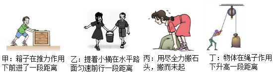

# 知识点·做功的必要因素（同步练习）

> 教材：物理·八年级全一册·沪科技版2024新教材 ｜ 来源：国家中小学智慧教育平台·在线练习 ｜ 共 6 题

## 1. 单选题（难度：简单）

下列生活实例中，人对物体施加的力做功的有（     ）. 

- A. 甲和乙
- B. 甲和丁
- C. 乙和丙
- D. 丙和丁

【答案】B

【解析】​

## 2. 单选题（难度：适中）

水平地面上有一个重为100N的物体，用10N的水平推力使其沿力的方向匀速运动了30m，则此过程中（    ）.

- A. 重力做了3000J的功
- B. 地面对物体向上的支持力为10N
- C. 推力做了300J的功
- D. 摩擦力为100N

【答案】C

【解析】​

## 3. 填空题（难度：简单）

电动平衡车是一种时尚的代步工具，当平衡车带着人沿水平路面加速前行时，平衡车对人（选填“做功”或“不做功”）. 
​​

​

【答案】做功

【解析】​

## 4. 填空题（难度：简单）

手提书包不动，则手的提力对书包（填“做功”或“没做功”），因为；此时书包的重力对书包（填“做功”或“没做功”）；手提书包上楼梯，则手的提力对书包   （填“做功”或“没做功”）；当书包不慎从手中掉下来时，书包的重力对书包 （填“做功”或“没做功”）.

【答案】没做功，没有距离，没做功，做功，做功

【解析】​

## 5. 填空题（难度：适中）

小明同学用40N的水平推力推着重120N的书箱在水平地面上前进了2m，松开手后，书箱仍向前滑行了1m，整个过程中小明做功 J，书箱的重力做功 J.

【答案】80，0

【解析】​

## 6. 填空题（难度：适中）

木块在大小为10 N的水平拉力作用下，沿水平面匀速前进2 m，拉力做功为 J，木块受到摩擦力的大小为 N；若木块重16 N，在此过程中重力做功为 J.

【答案】20，10，0

【解析】​
