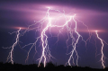
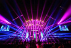
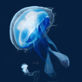
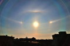

# 知识点·光源（同步练习）

> 教材：物理·八年级全一册·沪科技版2024新教材 ｜ 来源：国家中小学智慧教育平台·在线练习 ｜ 共 3 题

## 1. 多选题（难度：简单）

以下物体是光源的有（   ）．

- A. 点燃的“祥云”火炬
- B. 金灿灿的奥运金牌
- C. 正在转播奥运赛事的电视屏幕
- D. “鸟巢”上空燃放的烟花

【答案】A/C/D

【解析】​

## 2. 填空题（难度：简单）

能够的物体叫光源．下列物体：太阳、月亮、通电的电灯、萤火虫，不属于光源的有．

【答案】自身发光，月亮

【解析】​

## 3. 单选题（难度：简单）

如图的光源，属于人造光源的是（    ）．

- A. 
闪电
- B. 
灯光
- C. 
水母
- D. 
太阳

【答案】B

【解析】​
