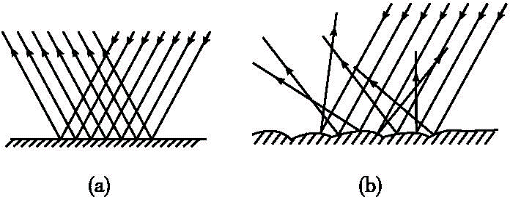
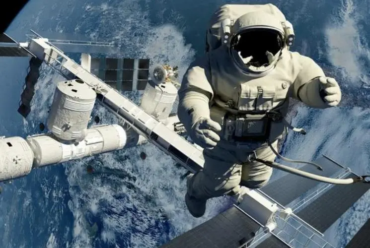

# 知识点·光的反射分类（同步练习）

> 教材：物理·八年级全一册·沪科技版2024新教材 ｜ 来源：国家中小学智慧教育平台·在线练习 ｜ 共 5 题

## 1. 单选题（难度：简单）

如图所示，下列说法正确的是（     ）．

- A. （a）图中发生的反射叫漫反射
- B. （b）图中发生的反射叫镜面反射
- C. 放电影时电影屏幕上发生的反射与（a）图所示情景相似
- D. 能从不同方向看见物体，是因为物体发生了（b）图所示的反射

【答案】D

【解析】​

## 2. 填空题（难度：简单）

中考考场中，同学们能从不同方向看到监考老师在黑板上所写的“本场考试科目：×××，考试时间：××﹣﹣××”等提示语，这是因为光发生了反射的缘故，发生这种反射时（填会或不会）遵循光的反射定律．

【答案】漫，会

【解析】​

## 3. （难度：简单）

黑板发生“反光”时，为什么看不清黑板上的粉笔字？

【答案】

光滑的黑板发生的是镜面反射，而黑板上的粉笔字发生的是漫反射，黑板反射的光要比粉笔字反射的光线强，所以看不清黑板上的粉笔字

【解析】​

## 4. 填空题（难度：简单）

如图所示，太空中宇航员不能面对面直接对话，因为声音的传播需要，看电影时，不同位置的观众都能看到幕布上的画面，是因为电影幕布发生（选填“漫反射”或“镜面反射”）．

【答案】介质，漫反射

【解析】​

## 5. （难度：简单）

通常皮鞋的表面有灰尘附着时，皮鞋就会失去光泽，为什么？涂上鞋油后，仔细地用布擦一擦，皮鞋就变得又亮又好看了，这是为什么？

【答案】

因为皮鞋的表面不光滑有灰尘，光射向鞋面后发生漫反射，这样皮鞋就失去了光泽．涂上鞋油后，用布仔细擦拭，使鞋面就变得十分光滑．光射向鞋面后会发生镜面反射，皮鞋看起来就更光亮更好看了．

【解析】​
