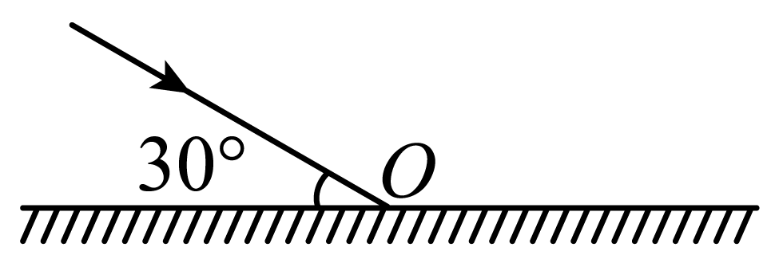
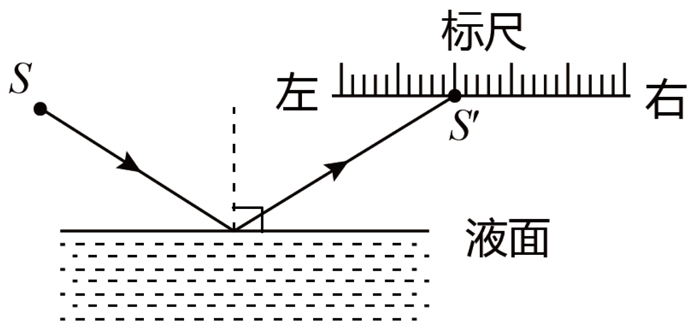
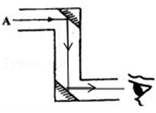
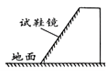

# 知识点·光的反射定律（同步练习）

> 教材：物理·八年级全一册·沪科技版2024新教材 ｜ 来源：国家中小学智慧教育平台·在线练习 ｜ 共 6 题

## 1. 单选题（难度：简单）

下列说法中正确的是（    ）．

- A. 当入射光线垂直反射面入射时，反射角为90°
- B. 当入射光线与镜面成30°角时，反射角是30°
- C. 当入射光线远离法线时，反射光线也会远离法线
- D. 镜面反射遵守光的反射定律，漫反射不遵守光的反射定律

【答案】C

【解析】​

## 2. 单选题（难度：适中）

如图，一束光与镜面成\( \text{30°}\)角入射，以垂直纸面的直线为轴，绕\( O\)点转动平面镜，使反射光线跟入射光线恰好垂直，则镜面应（    ）．

- A. 顺时针转动\( \text{30°}\)
- B. 逆时针转动\( \text{30°}\)
- C. 顺时针转动\( \text{15°}\)
- D. 逆时针转动\( \text{15°}\)

【答案】D

【解析】​

## 3. 单选题（难度：简单）

一束平行光与镜面成\( \text{30°}\)的夹角入射到平面镜上，则反射角等于（    ）．

- A. \( \text{30°}\)
- B. \( \text{60°}\)
- C. \( \text{120°}\)
- D. \( \text{90°}\)

【答案】B

【解析】​

## 4. 单选题（难度：适中）

如图所示是一种液面升降监测装置原理图．点光源\( S\)发出的一束激光与水平液面成\( \text{30}\text{°}\)角入射，下列说法正确的是（    ）．

- A. 不改变激光与水平液面夹角，反射角为 \( \text{30}\text{°}\)
- B. 当液面下降时，光点\({S}^{′}\)将向左移动
- C. 当液面上升时，光点\({S}^{′}\)的位置不变
- D. 光源\( S \)不动，增大激光与水平液面夹角，光点\({S}^{′}\)将向左移动

【答案】D

【解析】​

## 5. 多选题（难度：简单）

潜水艇下潜后，艇内人员可以用潜望镜观察水面情况，下面关于潜望镜的说法中，正确的是（    ）。

- A. 潜望镜利用了光的反射改变了光的传播方向
- B. 潜望镜利用了平面镜成像原理
- C. 光在潜望镜内传播时发生的是光的漫反射
- D. 从潜望镜看到的是物体的虚像

【答案】A/B/D

【解析】​

## 6. 填空题（难度：简单）

如图是商场里的试鞋镜，小飞站在试鞋镜前看见鞋的像是由光的形成的，鞋的像和鞋的连线与镜面（选填“垂直”或“不垂直”）。

【答案】反射，垂直

【解析】​
