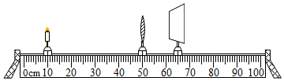
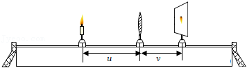
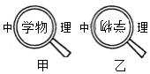
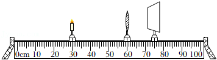

# 知识点·凸透镜成像规律及其应用（同步练习）

> 教材：物理·八年级全一册·沪科技版2024新教材 ｜ 来源：国家中小学智慧教育平台·在线练习 ｜ 共 4 题

## 1. 多选题（难度：简单）

在做“探究凸透镜成像规律”的实验中，所用凸透镜的焦距为\( \text{10cm}\)，蜡烛、凸透镜、光屏在光具座上的位置如图所示，这时烛焰在光屏上成清晰的像（像未在图中画出来），下列说法正确的是（    ）.  

- A. 实验前应调整烛焰、透镜、光屏的中心在同一水平直线上
- B. 光屏上形成的是烛焰倒立、放大的实像
- C. 图中烛焰的成像特点与照相机成像特点相同
- D. 将蜡烛移到光具座\( \text{35cm}\)刻度线处，保持凸透镜位置不动，向右移动光屏到合适位置，可以得到烛焰倒立、放大的清晰实像

【答案】C/D

【解析】​

## 2. 多选题

小明利用如图所示的装置探究凸透镜成像的规律.  将蜡烛放在凸透镜左侧适当位置，调整光屏到凸透镜的距离，使烛焰在光屏上成清晰的像，分别测出物距\( u\)和像距\( v\)，实验数据如下表.  

    
实验次数
1
2
3
4
5

物距\( u\text{/cm}\)
60
30
20
15
12

像距\( v\text{/cm}\)
12
15
20
30
60

下列说法正确的是（    ）.

- A. 该凸透镜的焦距为\( \text{20cm}\)
- B. 从第1次实验到第5次实验，成在光屏上的像越来越大
- C. 当\( u\text{＝}\text{45cm}\)时，移动光屏，可在光屏上成倒立、缩小的清晰实像
- D. 第5次实验后，在贴近凸透镜左侧再放一凸透镜，向右移动光屏，能在光屏上成清晰的像.

【答案】B/C

【解析】​

## 3. 多选题（难度：适中）

小明用同一凸透镜先后两次观察同一书本上的字，看到如图所示的两种情景.  以下说法中正确的是（    ）.  

- A. 甲、乙两图成像原理都是光的折射
- B. 甲图中成的是虚像，乙图中成的是实像
- C. 甲图中的成像规律可应用于放大镜，乙图中的成像规律可应用于照相机
- D. 甲图中书本到凸透镜的距离比乙图中书本到凸透镜的距离小

【答案】A/B/D

【解析】​

## 4. 填空题（难度：简单）

如图所示，是“探究凸透镜成像的规律”的实验装置，已知使用的凸透镜的焦距为10cm.  

    
（1）实验时，要将（选填“蜡烛”或“烛焰”）、凸透镜、光屏三者的中心调到同一.  
（2）如图所示，光屏上承接到清晰的实像，像距为 cm，（选填“照相机”、“投影仪”或“放大镜”）就是利用这个成像原理制成的.  
（3）保持透镜位置不动，将蜡烛向右移动10cm，光屏移动到 cm的刻度线处，光屏上再次得到清晰的像.  
（4）实验中，由于蜡烛变短，烛焰在光屏上的像位于光屏的（选填“上半部”或“下半部”）.

【答案】烛焰，高度，15.0，照相机，80，上半部

【解析】​
