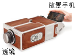
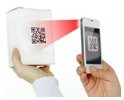
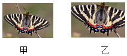
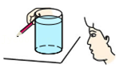

# 知识点·凸透镜成像规律的其他应用（同步练习）

> 教材：物理·八年级全一册·沪科技版2024新教材 ｜ 来源：国家中小学智慧教育平台·在线练习 ｜ 共 6 题

## 1. 单选题（难度：简单）

小明通过焦距为10cm的凸透镜看到了提示牌上“关灯”两字放大的像，如图所示.  下列说法正确的是（    ）.  

- A. “关灯”两字放大的像是实像
- B. 提示牌上“关灯”两字在凸透镜的焦点上
- C. 提示牌上“关灯”两字到凸透镜的距离小于10cm
- D. 提示牌上“关灯”两字到凸透镜的距离大于20cm

【答案】C

【解析】​

## 2. 单选题（难度：适中）

如图所示，购物支付已进入“刷脸”时代，消费者结账时站在摄像头（相当于一个凸透镜）前约1m的位置，面对镜头，经系统自动拍照、扫描等，确认信息后，即可进行后续工作.  则下列说法正确的是（    ）.  

- A. 摄像头的焦距可能是2m
- B. 人脸通过摄像头成像是光的反射现象形成的
- C. “刷脸”时，面部经摄像头成正立缩小的实像
- D. “刷脸”时，面部应位于摄像头两倍焦距之外

【答案】D

【解析】​

## 3. 单选题（难度：适中）

如图是小明用手机、透镜和纸盒自制简易“投影仪”，它能将手机上的画面放大投射到白墙上.  下列说法不正确的是（    ）.  

- A. 手机屏幕到透镜的距离应在透镜的一倍焦距和二倍焦距之间
- B. 白墙上呈现的是手机画面倒立、放大的实像
- C. 若用不透明的硬纸板遮住透镜的一部分，白墙上的画面将不再完整
- D. 从各个角度都能清楚的看到白墙上的像，是因为白墙对照射到其上面的光产生漫反射

【答案】C

【解析】​

## 4. 单选题（难度：简单）

手机扫描二维码，相当于给二维码照了一张照片，如图是手机扫描物品上的二维码，登陆网址，查看物品相关信息，下列说法中正确的是（    ）.  

- A. 二维码位于摄像头的一倍焦距和二倍焦距之间
- B. 二维码位于摄像头的二倍焦距以外
- C. 物体上的二维码是光源
- D. 当二维码超出手机上设定的方框时，物品不动，把手机靠近物品

【答案】B

【解析】​

## 5. 单选题（难度：适中）

蝴蝶研究专家章丽晖在茅山首次发现国家二级保护动物﹣中华虎凤蝶，他先用相机拍摄了蝴蝶休憩的照片甲，为了拍摄照片乙，应（    ）.  

- A. 相机适当靠近蝴蝶，镜头略向外伸
- B. 相机适当靠近蝴蝶，镜头略向内缩
- C. 相机适当远离蝴蝶，镜头略向外伸
- D. 相机适当远离蝴蝶，镜头略向内缩

【答案】A

【解析】​

## 6. 单选题

星期天，小明同学按照课后动手动脑学物理的操作要求，验证了一个有趣的实验：找一个圆柱形的玻璃瓶，里面装满水.  把一支普通铅笔放在玻璃瓶的一侧，透过玻璃瓶，可以看到那支笔，如图所示.  如果把笔由靠近玻璃瓶的位置向远处慢慢移动，会看到什么现象？小明记录了这个过程中所看到的现象，其中有错误的是（    ）.  
 

- A. 先成虚像，后成实像
- B. 笔尖一直变长变大
- C. 到某一位置时，笔尖突然改变方向
- D. 笔尖先变长变大，后变短变小

【答案】B

【解析】​
