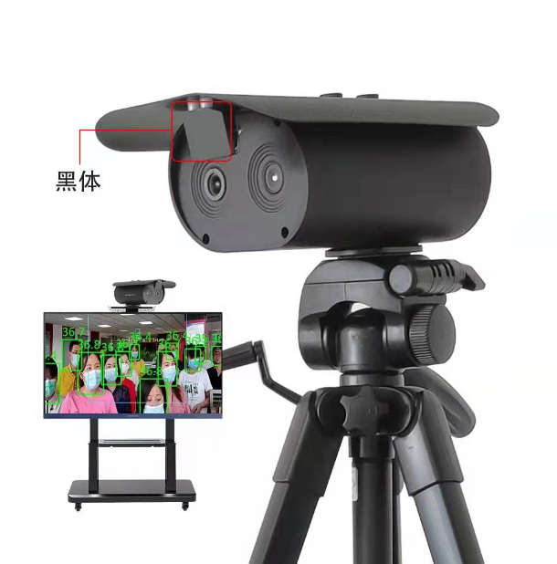
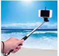
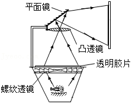
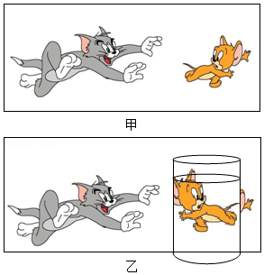

# 知识点·凸透镜成像规律的应用（同步练习）

> 教材：物理·八年级全一册·沪科技版2024新教材 ｜ 来源：国家中小学智慧教育平台·在线练习 ｜ 共 5 题

## 1. 填空题（难度：简单）

为了防控新型冠状病毒疫情，学校门口安装了测温摄像仪，如图所示，当同学们经过它时，会自动利用（选填“紫外线”或“红外线”）检测人体温度是否正常.  测温摄像仪的成像原理与我们生活中的（选填“照相机”、“投影仪”或“放大镜”）成像原理相同，当人靠近镜头时，所成像的大小将（选填“变大”、“变小”或“不变”）.  

【答案】红外线，照相机，变大

【解析】​

## 2. 填空题（难度：简单）

现代生活中人们越来越离不开手机，其中手机强大的拍照功能给人们带来很多的便利，景物通过手机镜头成倒立、缩小的（选填“实像”或“虚像”）.  如图所示，小明利用自拍杆进行自拍，与手拿手机自拍相比，利用自拍杆可以物距，从而取景范围，取得更好的拍摄效果（后两个空均选填“增大”或“减小”）.  

【答案】实， 增， 增

【解析】​

## 3. 填空题（难度：适中）

如图所示是投影仪的示意图，它是利用凸透镜能成倒立像（选填“放大”，“缩小”或“等大”）的原理制成的.  在练习调节投影仪的实践活动中，小明使屏幕上出现了清晰画面，这时，教室后排同学要求他将画面调得大一些.  为此，小明的操作应当是：适当（选填“增大”或“减小”）投影仪与屏幕的距离，并将凸透镜适当向（选填“上”或“下”）移动.  

【答案】放， 增， 下

【解析】​

## 4. 填空题（难度：适中）

无人机利用携带的焦距一定的微型摄像机进行航拍，来自地面景物的光通过摄像机镜头，会聚在感光晶片上，形成倒立、（选填“放大”或“缩小”）的实像；当无人机上升时，须（选填“增大”或“减小”）镜头与感光晶片间的距离，才能拍摄到清晰地画面.

【答案】缩小，减小

【解析】​

## 5. 填空题

一幅如图甲所示的漫画立在桌面上，小明把一个装水的玻璃杯放在漫画前，惊奇地发现：透过水杯看到漫画中的老鼠变“胖”了，还掉头奔向猫，如图乙所示.  小明观察分析：装水的圆柱形玻璃杯横切面中间厚，边缘薄，起到（填“平面镜”“凸透镜”或“凹透镜”）的作用，使图片横向放大、颠倒，透过水杯看到的是老鼠的（填“实”或“虚”）像，此时老鼠到玻璃杯的距离满足（填“\( f<u<2f\)”或“\( u>2f\)”）.  

【答案】凸透，实 ， $f&lt;u&lt;2f$ 

【解析】​
