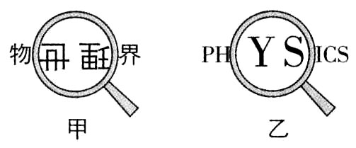
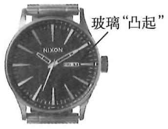
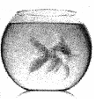

# 知识点·凸透镜的应用  放大镜（同步练习）

> 教材：物理·八年级全一册·沪科技版2024新教材 ｜ 来源：国家中小学智慧教育平台·在线练习 ｜ 共 3 题

## 1. 单选题

甲、乙两图是用同一个凸透镜观察到的现象. 下列说法正确的是（    ）

- A. 甲、乙两图的成像原理都和放大镜的工作原理相同
- B. 甲图的成像原理和投影仪的工作原理相同
- C. 乙图的成像原理和照相机的工作原理相同
- D. 甲、乙两图中成的都是虚像

【答案】B

【解析】​

## 2. 填空题（难度：适中）

如图所示，手表的表壳上靠近旋钮处有一个透明的玻璃“凸起”，透过它可以看到一个较大的日历数字，那么这个玻璃“凸起”相当于一个镜，透过它看到的实际上是日历数字的立的\( (\)填“实”或“虚”\( )\)像. 

【答案】凸透$ ($或放大$ )$，正，虚

【解析】​

## 3. 填空题（难度：简单）

在圆形鱼缸里养的鱼，看起来比真实的要大，这是因为圆形鱼缸相当于一个\( (\)选填“凹”或“凸”\( )\)透镜，所看到的“鱼”其实是鱼放大的\( (\)选填“虚”或“实”\( )\)像，而从鱼缸的斜上方观察水中鱼的深度，感觉比实际深度要\( (\)选填“深”或“浅”\( )\)一些. 

【答案】凸，虚，浅

【解析】​
