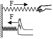
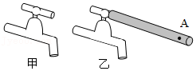
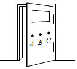
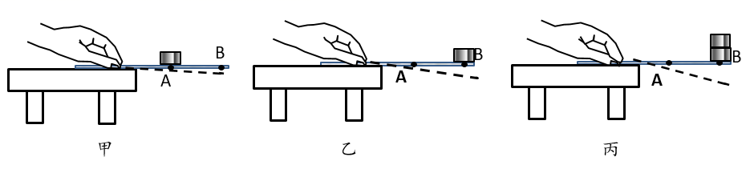

# 知识点·力的三要素（同步练习）

> 教材：物理·八年级全一册·沪科技版2024新教材 ｜ 来源：国家中小学智慧教育平台·在线练习 ｜ 共 7 题

## 1. 单选题（难度：简单）

“香蕉球”又称“弧线球”，是足球运动的技术名词。指运动员的脚踢在球的恰当的位置，球在空中向前并作弧线运行的踢球技术。从力的三要素分析这里的“恰当的位置”，是指力的（    ）。

- A. 大小
- B. 方向
- C. 作用点
- D. 以上都是

【答案】C

【解析】​

## 2. 单选题（难度：简单）

如图，分别用大小相等的力拉和压同一弹簧。该实验表明，弹簧受力产生的效果与力的（    ）。

- A. 大小有关
- B. 作用点有关
- C. 方向有关
- D. 大小、方向、作用点都有关

【答案】C

【解析】​

## 3. 单选题（难度：适中）

关于力的三要素，下面说法中正确的是（    ）。

- A. 只要两个力作用在同一个点，产生的效果就相同
- B. 只要力的三要素中两个相同，那么这两个力作用效果就相同
- C. 只要两个力的大小、方向相同，且作用在同一个物体上，则产生的效果就相同
- D. 如果两个大小相等、方向相同的力作用在物体上的同一点，产生的效果就相同

【答案】D

【解析】​

## 4. 单选题（难度：适中）

如图1甲所示，长期不用的水龙头会因生锈而很难打开，维修人员常会用一长铁管套在水龙头上，如图乙所示，用同样大小的力作用在管端\( A\)点处，则会很容易打开水管，此过程中，改变了力的作用效果的因素是（   ）。

- A. 大小
- B. 作用点
- C. 方向
- D. 以上说法都不正确

【答案】B

【解析】​

## 5. 填空题（难度：简单）

力的作用效果与力的大小、和作用点有关。如图，分别在\( A\)、\( B\)、\( C\)处用同样大小的力关门，感受手推\( A\)点最容易，此现象说明力的作用效果跟力的有关。

【答案】方向，作用点

【解析】​

## 6. 填空题（难度：适中）

如图所示，用扳手拧螺母时，按通常经验，沿顺时针方向使螺母拧紧，沿逆时针方向可使螺母拧松，这表明力的作用效果与力的有关。若用同样的力拧螺母，则图所示的位置更容易将螺母拧紧或拧松，这表明力的作用效果与力的有关。

【答案】方向，乙，作用点

【解析】​

## 7. 填空题（难度：简单）

小明在“探究影响力的作用效果的因素”实验中，他把一根钢尺的一端用手固定在桌面上。先在钢尺\( A\)点上放一个金属块，观察钢尺弯曲的程度，弯曲程度如图甲虚线所示；保持钢尺伸出的长度不变，将\( A\)点的金属块移至\( B\)点，观察钢尺弯曲的程度，弯曲程度如图乙虚线所示；最后，保持钢尺伸出的长度不变，在\( B\)点的金属块上叠加一个相同规格的金属块，观察钢尺弯曲的程度，弯曲程度如图丙虚线所示。

 
（1）根据小明甲、乙实验中的现象，得出的结论是：。
（2）根据小明乙、丙实验中的现象，得出的结论是：。

【答案】力的作用效果与力的作用点有关，力的作用效果与力的大小有关

【解析】​
