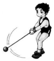
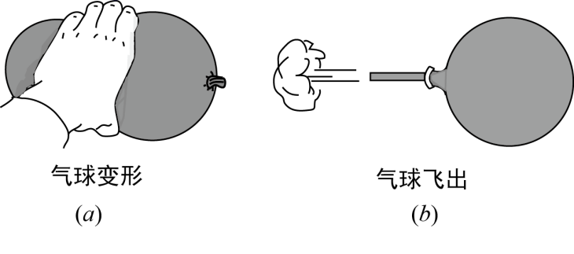
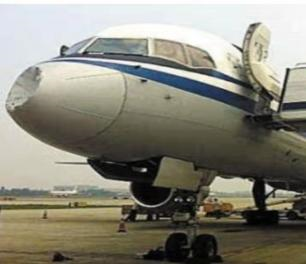

# 知识点·力的概念（同步练习）

> 教材：物理·八年级全一册·沪科技版2024新教材 ｜ 来源：国家中小学智慧教育平台·在线练习 ｜ 共 5 题

## 1. 单选题（难度：简单）

如图所示，运动员两手握着链球的把手，人和球同时旋转，最后加力使球脱手而出。运动员和球同时旋转时，手感觉受到一个很大的拉力作用，这个力的施力物体是（    ）。

- A. 运动员的手
- B. 链球的把手
- C. 链球的链子
- D. 地球

【答案】B

【解析】​

## 2. 单选题（难度：适中）

俗话说“鸡蛋碰石头——自不量力”，从物理学角度看（    ）。

- A. 石头对鸡蛋的作用力更大
- B. 石头先对鸡蛋产生作用力
- C. 鸡蛋对石头没有作用力
- D. 石头和鸡蛋间同时有等大的相互作用力

【答案】D

【解析】​

## 3. 填空题（难度：适中）

端午节赛龙舟，船员用桨整齐地向后划水，龙舟却快速地向前行驶，说明桨受到了向（“前”或“后”）的作用力，这个作用力的施力物体是。唐代诗人韩愈在《调张籍》中写到“蚍蜉撼大树，可笑不自量”。其中“蚍蜉撼大树”一句中的施力物体是。

【答案】前，水，蚍蜉

【解析】​

## 4. 填空题（难度：简单）

如图（a）、（b）所示表示力的两种作用效果，如图（a）主要说明力可以改变物体的，如图（b）主要说明力可以改变物体的。

【答案】形状，运动状态

【解析】​

## 5. 填空题（难度：简单）

如图所示，2013年6月4日，一架波音757客机的机载雷达罩在数千米高空被小鸟撞出一个大凹洞，机组人员处置得当，事件未造成人员伤亡。飞机被撞出一个洞，施力物体是。相撞时，小鸟撞飞机的力（选填“大于”、“小于”或“等于”）飞机撞小鸟的力。

【答案】小鸟，等于

【解析】​
