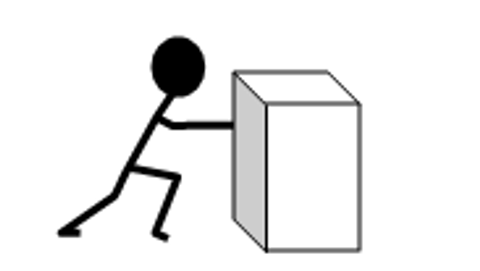
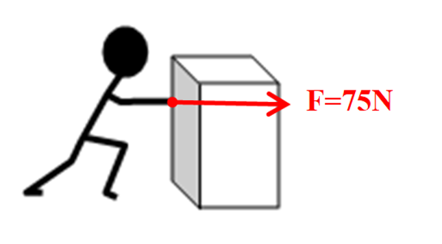
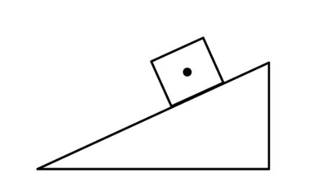
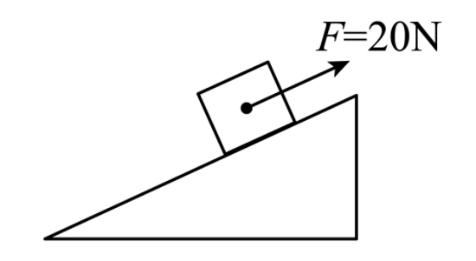
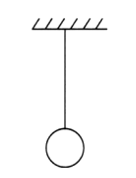
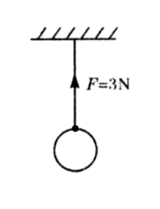

# 知识点·力的示意图（同步练习）

> 教材：物理·八年级全一册·沪科技版2024新教材 ｜ 来源：国家中小学智慧教育平台·在线练习 ｜ 共 3 题

## 1. （难度：简单）

一位同学沿水平方向用75N的力推箱子，请在图中画出这个力的示意图。

【答案】

    

## 2. （难度：简单）

20N的力沿斜面向上拉铁块（力的作用点已画出），画出拉力的示意图。

【答案】

   

【解析】​

## 3. （难度：简单）

如图所示，悬挂在绳上的小球受到的拉力是3N，画出小球所受拉力的示意图。

【答案】

  

【解析】​
