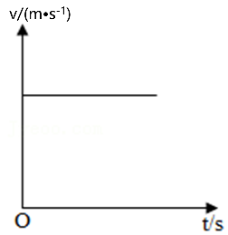
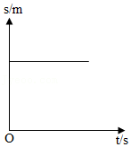
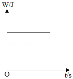
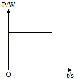

# 知识点·功率的概念与单位（同步练习）

> 教材：物理·八年级全一册·沪科技版2024新教材 ｜ 来源：国家中小学智慧教育平台·在线练习 ｜ 共 5 题

## 1. 单选题（难度：简单）

一台机器的功率是150W，它表示的含义是（    ）.

- A. 这台机器所做的功只能是150J
- B. 这台机器正常工作每分钟可做功150J
- C. 这台机器正常工作每秒钟可做功150J
- D. 这台机器正常工作每秒钟可做功150W

【答案】C

【解析】​

## 2. 单选题（难度：简单）

通过物理学习，请你指出下列数据中最接近生活实际的是（    ）.

- A. 一个标准大气压约为\( {\text{10}}^{\text{5}}\text{Pa}\)
- B. 一张物理试卷的重力约为\( \text{10N}\)
- C. 中学生缓慢上楼的功率约为\( \text{2000W}\)
- D. 人正常行走时的速度为\( \text{10m/s}\)

【答案】A

【解析】​

## 3. 单选题（难度：简单）

关于功率下列说法错误的是（    ）.

- A. 功率表示做功的大小
- B. 功率表示做功的快慢
- C. 相同时间，功率大的机器做功多
- D. 做功相同时，用时越少的机器功率越大

【答案】A

【解析】​

## 4. 多选题（难度：简单）

关于功和功率，下列说法正确的是（    ）.

- A. 功率越大的机械，做功越多
- B. 做功越多的机械，用的时间越长
- C. 做功越快的机械，功率越大
- D. 在相同的时间内，机械的功率越大，做功越多

【答案】C/D

【解析】​

## 5. 多选题（难度：简单）

如图所示，是跳伞运动员在匀速下落过程中，下落的速度\( v\)、下落的路程\( s\)、重力做的功\( W\)和重力做功的功率\( P\)随时间\( t\)变化规律的图象，其中正确的是（    ）.

- A. 
- B. 
- C. 
- D. 

【答案】A/D

【解析】​
