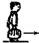

# 知识点·功的概念（同步练习）

> 教材：物理·八年级全一册·沪科技版2024新教材 ｜ 来源：国家中小学智慧教育平台·在线练习 ｜ 共 4 题

## 1. 单选题（难度：简单）

下列关于功的说法正确的是（    ）.

- A. 只要有力作用在物体上，力就对物体做功
- B. 物体只要移动了距离,就有力对物体做功
- C. 有力作用在物体上，物体又移动了距离，这个力就一定对物体做了功
- D. 有力作用在物体上，物体在力的方向上又移动了距离，这个力就一定对物体做了功

【答案】D

【解析】​

## 2. 单选题（难度：适中）

在下列的四种情境中，力对物体做功的叙述，正确的是（    ）.

- A. 小军提着水桶在水平地面上匀速前进，小军提水桶的力对水桶做了功
- B. 小红背着书包慢慢爬上五楼，小红对书包做了功
- C. 兰兰用力推汽车但没推动，兰兰的推力对汽车做了功
- D. 足球在水平地面上滚动，足球受到的重力对足球做了功

【答案】B

【解析】​

## 3. 单选题

关于体育考试中的一些场景，下列说法错误的是（    ）.

- A. 跳绳过程中，要克服体重做功
- B. 实心球抛出后最终落回地面是因为受到重力作用
- C. 跑步到达终点时人不能马上停下来是因为具有惯性
- D. 立定跳远的同学跳出后在空中受到推力的作用

【答案】D

【解析】​

## 4. 单选题（难度：简单）

如图所示的四幅图是小新提包回家的情景，小新提包的力不做功的是（    ）.

- A. 将包提起来

- B. 站在匀速行驶的车上

- C. 乘电梯上楼

- D. 步行上楼

【答案】B

【解析】​
