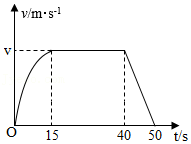

# 知识点·功的计算和公式的应用（同步练习）

> 教材：物理·八年级全一册·沪科技版2024新教材 ｜ 来源：国家中小学智慧教育平台·在线练习 ｜ 共 4 题

## 1. 

抗击新冠肺炎疫情期间，我省用负压救护车转运患者进行集中隔离治疗. 该车配置了负压装置，负压舱内气压小于外界气压，将内部空气“吸入”排风净化装置进行处理，有效避免了病毒的传播. 某次转运病人时，救护车以\( 4.5\times {10}^{4}\text{W}\)的恒定功率在平直公路上匀速行驶\( 9\times {10}^{3}\text{m}\)，用时\( \text{600s}\). 求：

（1）救护车在这段时间内的速度是多少\( \text{m/s}\)？

（2）救护车在这段时间内牵引力做的功是多少\( \text{J}\)？

（3）救护车在平直公路上匀速行驶所受的阻力是多少\( \text{N}\)？

【答案】

（1）$ \text{1}\text{5}\text{m/s}$；（2）$ 2.7\times {\text{10}}^{\text{7}}\text{J}$ ；（3）$ \text{3}\text{000N}$

解：（1）救护车在这段时间内得速度：$ v=s/t=\frac{9\times {10}^{3}\text{m}}{600\text{s}}=15\text{m/s}$

（2）牵引力做的功为：由$ P=W/t$得，$ W=Pt=4.5\times {10}^{4}\text{W}\times 600\text{s}=2.7\times {\text{10}}^{\text{7}}\text{J}$

（3）由$ W=Fs$得，救护车所受牵引力：$ F=W/s=\frac{2.7\times {\text{10}}^{\text{7}}\text{J}}{9\times {10}^{3}\text{m}}=3000\text{N}$

救护车匀速行驶，根据二力平衡条件，阻力$ f=F=3000\text{N}$

【解析】​

## 2. （难度：简单）

如图所示是2022年北京冬奥会餐厅的智能服务机器人，它具有净化室内空气、送餐服务、温馨提示等功能. 若重\( \text{600N}\)的机器人在\( \text{50N}\)的牵引力作用下以\( \text{0.5m/s}\)的速度在水平地面匀速直线行驶\( \text{60s}\). 求：

（1）此过程中牵引力所做的功. 

（2）此过程中机器人的功率. 

【答案】

（1）$ \text{1500J}$；（2）$ \text{25W}$

解：

（1）由$ v=\frac{s}{t}$ 得，$ s=vt=0.5\text{m/s}\times 60\text{s}=30\text{m}$

牵引力所做的功为：$ W=Fs=5\text{0N}\times 30\text{m}=1500\text{J}$

（2）$ \text{t}\text{=60s}$，机器人的功率：$ P=\frac{W}{t}=\frac{\text{1500J}}{\text{60s}}=25\text{W}$

【解析】​

## 3. （难度：适中）

一辆质量为\( \text{2}\)吨的汽车，在平直公路上以额定功率\( \text{80kW}\)从静止开始运动，经\( \text{15s}\)运动\( \text{200m}\)恰好达到最大速度，接着匀速运动\( \text{25s}\)关闭发动机，滑行\( \text{100m}\)停下. 整个过程中\( v-t\)图象如图所示. 已知汽车在运动过程中受到的阻力为车重的\( \text{0.2}\)倍，求：

（1）整个过程中发动机做的功. 

（2）汽车的最大速度\( v\)最大. 

【答案】

（1）$ 3.2\times {10}^{6}\text{J}$；（2）$ \text{ 20m/s}$

解：

（1）整个过程中发动机的工作时间：$ t=15\text{s}+25\text{s}=40\text{s}$ 

功率$ P=80\text{k}\text{W}=8\times {10}^{4}\text{W}$

由$ P=W/t$得，整个过程中发动机做的功：$ W=Pt=8\times {10}^{4}\text{W}\times 40\text{s}＝3.2\times {10}^{6}\text{J}$

（2）$ m=2\text{t}=2\times {10}^{3}\text{kg}$ 

$ F=f=0.2G=0.2mg=0.2\times 2\times {10}^{3}\text{kg}\times 10\text{N/kg}=4\times {10}^{3}\text{N}$ 

由$ P=W/t=Fv$得，

汽车最大速度：$ {v}_{\mathrm{最}\mathrm{大}}=P/F=8\times {10}^{4}\text{W}/4000\text{N}=20\text{m/s}$   

【解析】​

## 4. （难度：简单）

在某次引体向上的测试中，初二某班的小才同学体重为\( \text{60kg}\)，求：

（1）在引体向上测试中，若他每次上升将自身重心提高\( \text{0.5m}\)，则他每做一次引体向上做功多少\( \text{J}\)（\( g\)取\( \text{10N/kg}\)）？

（2）在引体向上测试中，小才同学一分钟完成\( \text{12}\)个标准的引体向上，请问小才同学做功的平均功率是多少\( \text{W}\)？

【答案】

（1）$ \text{3}\text{00J}$；（2）$ \text{6}\text{0W}$

解：（1）小才同学的重力：$ G=mg=60\text{kg}\times 10\text{N/kg}=600\text{N}$

完成一次引体向上做功：$ W=Fs=Gh=600\text{N}\times 0.5\text{m}＝300\text{J}$ 

（2）$ t=1\text{min}=60\text{s}$ 

$ \text{1min}$内引体向上克服重力做的功为：$ {W}_{\text{总}}=12\text{W}=12\times 300\text{J}＝3600\text{J}$ 

小才同学做功的平均功率为：$ P={W}_{\text{总}}/t=3600\text{J}/60\text{s}=60\text{W}$

【解析】​
