# 知识点·同一直线上的二力合成（同步练习）

> 教材：物理·八年级全一册·沪科技版2024新教材 ｜ 来源：国家中小学智慧教育平台·在线练习 ｜ 共 49 题

## 1. 单选题

小红练习排球垫球时，排球离开胳膊竖直上升过程中，某时刻受到的空气阻力大小为0.5N，已知排球重力2.7N，此时排球所受合力的大小和方向是（　　）

- A. 3.2N，竖直向上
- B. 2.2N，竖直向上
- C. 2.2N，竖直向下
- D. 3.2N，竖直向下

【答案】D

【解析】排球竖直上升时，受到竖直向下的重力（2.7N）和竖直向下的空气阻力（0.5N），两力方向相同，因此合力为两力之和，即\( {F}_{\mathrm{合}}=G+f=2.7\mathrm{N}+0.5\mathrm{N}=3.2\mathrm{N}\)
方向竖直向下，故ABC不符合题意，D符合题意。
故选D。

## 2. 单选题（难度：简单）

弹簧测力计下挂有重5N的物体，当用手竖直向上托住这个物体时，弹簧测力计的示数是2.6N，则手对物体向上托的力的大小是（    ）．

- A. 7.6N
- B. 5N
- C. 2.6N
- D. 2.4N

【答案】D

【解析】由题知，物体重为5N，测力计对物体向上的拉力为2.6N；物体受到竖直向下的重力，竖直向上的测力计的拉力和手对物体向上托的力，物体处于静止状态，即\( G={F}_{\mathrm{拉}}+{F}_{\mathrm{托}}\)
所以手对物体向上托的力\( {F}_{\mathrm{托}}=G-{F}_{\mathrm{拉}}=5\mathrm{N}-2.6\mathrm{N}=2.4\mathrm{N}\)，故ABC不符合题意，D符合题意。
故选 D。

## 3. 单选题（难度：简单）

重力为50N的书包放在桌面上，用30N竖直向上的力提书包，此时书包受到的合力为（    ）

- A. 20N
- B. 80N
- C. 0N
- D. 45N

【答案】C

【解析】书包静止在桌面上，处于平衡状态，虽然受三个力（重力、拉力、支持力）作用，但合力为0N，故ABD不符合题意，C符合题意。
故选C。

## 4. 填空题（难度：适中）

一个重为\( 5\text{N}\)的小球被竖直抛出，运动过程中所受阻力大小为\( 2\text{N}\)，运动过程中阻力大小不变，阻力方向始终与运动方向相反（不计浮力）。上升过程中小球所受合力为\( \text{N}\)。

【答案】7

## 5. 填空题（难度：简单）

放在水平桌面上的木块同时受到水平向左、大小为5N的拉力和水平向右、大小为8N的拉力作用而水平方向运动，这两个力合力大小为N。

【答案】3

## 6. 单选题（难度：非常简单）

一个物体受到同一直线上两个力的作用，其合力的大小是70N，已知其中一个力的大小是50N，那么另一个力的大小可能是（　　）

- A. 20N
- B. 120N
- C. 20N 或120N
- D. 30N

【答案】C

【解析】当两个力方向相同时，另一个力大小为\( {F}_{2}=F-{F}_{1}=70\mathrm{N}-50\mathrm{N}=20\mathrm{N}\)
当两个力方向相反时，另一个力大小为 \( {F}_{2}=F+{F}_{1}=70\mathrm{N}+50\mathrm{N}=120\mathrm{N}\)
故C符合题意，ABD不符合题意。
故选 C。

## 7. 单选题（难度：适中）

雨滴在竖直下落的过程中，由于受到重力和阻力作用，一般要经历加速和匀速两个阶段，最终落到地面。如果一滴雨滴所受重力为\( 6\times {10}^{-4}\text{N}\)，它在某时刻受到阻力大小为\( 2\times {10}^{-4}\text{N}\)，则此时雨滴所受的合力为（　　）

- A. \( 2\times {10}^{-4}\text{N}\)
- B. \( 8\times {10}^{-4}\text{N}\)
- C. 0N
- D. \( 4\times {10}^{-4}\text{N}\)

【答案】D

【解析】雨滴受到的重力为\( 6\times {10}^{-4}\mathrm{N}\)，方向竖直向下，雨滴受到空气的阻力为\( 2\times {10}^{-4}\mathrm{N}\)，方向竖直向上，则雨滴下落过程中所受合力为\( {F}_{\mathrm{合}}=6\times {10}^{-4}\mathrm{N}-2\times {10}^{-4}\mathrm{N}=4\times {10}^{-4}\mathrm{N}\)
故ABC不符合题意，D符合题意。
故选D。

## 8. 单选题（难度：简单）

作用在同一物体同一条直线上的两个力分别为3N和5N，则合力为  (      )

- A. 一定是8N
- B. 一定是2N
- C. 可能是3N或5N
- D. 可能是2N或8N

【答案】D

【解析】根据同一直线上两个力的合力的特点可知，如两个力方向相同，则\( F={F}_{1}+{F}_{2}=3\text{N}+5\text{N}=8\text{N}\)
如两个力方向相反，则\( F={F}_{2}-{F}_{1}=5\text{N}-3\text{N}=2\text{N}\)
因此合力可能是2N或8N，故D符合题意，ABC不符合题意。
故选D。

## 9. 单选题（难度：适中）

某同学在体育期末考试的排球测试中，排球离开胳膊后竖直上升，到达最高点后竖直下落。 已知排球重力约为2.7N，排球所受的空气阻力与速度的大小有关，方向与运动的方向相反。若排球在上升过程中的某一时刻所受的空气阻力的大小约为0.5N，则此时排球所受的合力的大小和方向是（    ）

- A. 2.2N    竖直向下
- B. 2.2N    竖直向上
- C. 3.2N    竖直向下
- D. 3.2N    竖直向上

【答案】C

【解析】排球上升过程中，重力\( G=2.7\mathrm{N}\)方向竖直向下，空气阻力\( f=0.5\mathrm{N}\)方向与运动方向相反也竖直向下，合力\( {F}_{\text{合}}=G+f=2.7\mathrm{N}+0.5\mathrm{N}=3.2\mathrm{N}\)
方向竖直向下，故ABD不符合题意，C符合题意。
故选C。

## 10. 填空题（难度：简单）

跳伞运动员连同装备共重800N，他从飞机上跳下，降落伞未打开前，受到空气的阻力为50N，这两个力的合力大小为N。

【答案】750

## 11. 单选题（难度：适中）

用250N的力竖直向上提起一个重200N的水桶时。桶受到的合力的大小和方向是（    ）

- A. 450N，竖直向上
- B. 450N，竖直向下
- C. 50N，竖直向上
- D. 50N，竖直向下

【答案】C

【解析】水桶受到两个力：竖直向上的提力F=250N，竖直向下的重力G=200N。因为这两个力方向相反，合力大小为两力之差，即\( {F}_{\mathrm{合}}=F-G=250\text{N}-200\text{N}=50\text{N}\)
合力方向与较大的提力方向一致，即竖直向上。
A．合力大小计算错误，方向正确，故A不符合题意；
B．合力大小和方向均错误，故B不符合题意；
C．合力大小和方向均正确，故C符合题意；
D．方向错误，故D不符合题意。
故选C。

## 12. 单选题（难度：适中）

一个物体在同一直线上只受到两个力的作用，它们分别为20N和50N，则这个物体受到的合力（　　）

- A. 一定是30N
- B. 一定是70N
- C. 可能是30N，也可能是70N
- D. 可能是20N，也可能是50N

【答案】C

【解析】两个力在同一直线上时，合力的计算分两种情况。当两个力方向相同时，合力大小等于两力之和，即F合1=20N+50N=70N
当两个力方向相反时，合力大小等于两力之差，即F合2=50N-20N=30N
因此这个物体受到的合力可能是30N，也可能是70N，故ABD不符合题意，C符合题意。
故选C。

## 13. 填空题（难度：适中）

质量为0.05g的雨滴在竖直下落的过程中，由于受到重力和阻力的作用，要经历加速和匀速两个阶段。若雨滴在某时刻所受的阻力为\( 3\times {10}^{-4}\mathrm{N}\)，则此时雨滴所受的合力大小是N、方向，雨滴在匀速下落的过程中所受的阻力大小是N（g取10N/kg）。

【答案】     $ 2\times {10}^{-4}$，竖直向下，    $5\times {10}^{-4}N$

【解析】[1][2]雨滴质量\( m=0.05\text{g}=0.05\times {10}^{-3}\text{kg}=5\times {10}^{-5}\text{kg}\)
重力\( G=mg=5\times {10}^{-5}\text{kg}\times 10\text{N/kg}=5\times {10}^{-4}\text{N}\)
已知某时刻阻力\( f=3\times {10}^{-4}\text{N}\)，重力方向竖直向下，阻力方向竖直向上，合力\( {F}_{\text{合}}=G-f=5\times {10}^{-4}\text{N}-3\times {10}^{-4}\text{N}=2\times {10}^{-4}\text{N}\)
因此合力方向与重力方向一致，即竖直向下。
[3]雨滴匀速下落时，受力平衡，因此阻力\( {f}^{\text{'}}=G=5\times {10}^{-4}\text{N}\)

## 14. 单选题

关于力与运动，下列说法中正确的是（　　）

- A. 杯子放在水平桌面上，杯子受到的重力与杯子对桌面的压力是一对平衡力
- B. 小明推动购物车加速向前时，小明对车的作用力大于车对小明的作用力
- C. 在匀速直线行驶的列车上立定跳远，向列车行驶的反方向跳，这样的跳远成绩最好
- D. 500N的杠铃静止在水平地面，小明用400N的力竖直向上提它，杠铃所受合力为0

【答案】D

【解析】A．杯子受到的重力与杯子对桌面的压力方向都是竖直向下，且作用在不同物体，不是一对平衡力，故A错误；
B．推动购物车时，人推车的力和车推人的力是一对相互作用力，其大小相等，而购物车能加速运动，是因为受到的推力大于车所受的阻力，故B错误；
C．起跳前，人和列车以相同速度运动，人相对车是静止的，在匀速直线行驶的列车上立定跳远时，向列车行驶方向和行驶的反方向跳远，距离是一样的，故C错误；
D．用400N的力提重力为500N的杠铃时，提不动杠铃，所以杠铃仍处于静止状态，所受的力是平衡力，合力为0。故D正确。
故选D。

## 15. 单选题（难度：简单）

如图所示，女孩用大小为F的拉力竖直向上提书包，书包恰好离开地面并且保持静止不动。若书包的重力为G，此时书包的重力G和拉力F的合力大小为（　　）

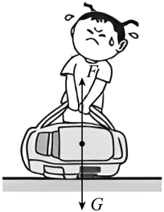

- A. 0
- B. G
- C. F
- D. G+F

【答案】A

【解析】书包恰好离开地面并且保持静止，书包处于平衡状态，受平衡力。此时书包所受的重力与拉力平衡，这两个力大小相等方向相反，一个竖直向下，另一个竖直向上，它们的合力\( {F}_{\mathrm{合}}=G-F=0\)
故A符合题意，BCD不符合题意。
故选A。

## 16. 单选题（难度：简单）

两位同学在沿东西方向移动课桌的过程中，一个力\( {F}_{1}\)的大小为5N，另一个力\( {F}_{2}\)的大小为3N，他们的合力大小和方向不可能是（   ）

- A. 向东2N
- B. 向西8N
- C. 向西5N
- D. 向东8N

【答案】C

【解析】由题可知，同方向时，合力为\( 5\text{N}+3\text{N}=8\text{N}\)
方向与两力一致，若均向东，合力为8N，向东；若均向西，合力为8N，向西；
反方向时，合力为\( 5\text{N}-3\text{N}=2\text{N}\)
方向与较大的力（5N）一致。若\( {F}_{1}\)向东、\( {F}_{2}\)向西，合力为2N向东；
若\( {F}_{1}\)向西、\( {F}_{2}\)向东，合力为2N向西，综上ABD不符合题意，C符合题意。
故选C。

## 17. 填空题

体育中考前，同学们在加强排球训练。如图所示，小明将排球竖直向上抛出，排球上升过程中依次经过A、B、C三点，到达最高点D，已知物体所受空气阻力会随着其运动速度的增大而增大，则在由A点运动到D点的过程中，排球所受合力最大的点是点。

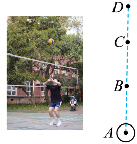

【答案】A

【解析】排球竖直向上抛出，受到两个力，重力\( G\)（大小恒定，方向竖直向下），空气阻力\( f\)（方向与运动方向相反，大小随速度增大而增大），排球在上升过程中，速度方向向上，所以空气阻力方向向下，与重力同向。因此合力
\( {F}_{\text{合}}=G+f\) 
上升阶段，速度不断减小（因为合力向下，做减速运动），所以空气阻力\( f\)从下往上逐渐变小。
在A点（刚出手时）速度最大，阻力最大，合力最大。
在D点（最高点）速度为零，阻力为零，合力最小（等于重力\( G\)）。

## 18. 单选题（难度：简单）

如图为“朱雀”机器人，当其运送物品时，受到水平方向的牵引力为200N、阻力为180N，则它在水平方向受到的合力大小及其方向是（　　）

- A. 6000N，水平向后
- B. 200N，水平向前
- C. 180N，水平向后
- D. 20N，水平向前

【答案】D

【解析】当其运送物品时，受到水平方向的牵引力为200N、阻力为180N，则合力的大小为\( F=200\text{N}-18\text{0N=20N}\)
合力的方向与较大的力的方向相同，即水平向前，故D符合题意，ABC不符合题意。
故选D。

## 19. 单选题

如图所示，小红同学在练习垫排球，排球离手后竖直上升过程中依次经过a、b、c三处，到达最高处d后，又回到a处。已知排球所受空气阻力随运动速度的增大而增大。则排球整个运动过程中，下列说法正确的是（　　）

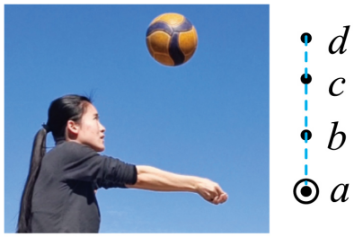

- A. 排球向上运动经过a处时，合力大小最大
- B. 排球经过d处时，合力大小最小
- C. 合力方向始终竖直向上
- D. 合力方向先向上后向下

【答案】A

【解析】ACD．排球上升过程中依次经过a、b、c三点，到达最高点d。已知物体所受空气阻力会随着其运动速度的增大而增大，则在由a点运动到d点的过程中，阻力是竖直向下的，重力是竖直向下的，合力等于二力之和，合力方向始终竖直向下，因而阻力最大的位置，合力最大，而a点的速度最大，阻力最大，故排球所受合力最大的是a，故A正确，CD错误；
B．排球经过d处时到达最高处，只受重力作用，当回到a处时，阻力最大，重力不变，此时合力最小，故B错误。
故选A。

## 20. 单选题（难度：适中）

如图所示，这是测量滑动摩擦力大小的一种方法，实验中弹簧测力计A、B的示数分别为\( \text{8N}\)和\( \text{5N}\)。下列说法正确的是（　　）

- A. 弹簧测力计A一定需要拉着木板做匀速直线运动
- B. 木块受到摩擦力的方向水平向左
- C. 木块受到摩擦力的大小是\( \text{3N}\)
- D. 木板受到水平方向的合力不一定等于零

【答案】D

【解析】A．图示实验中，测量木块所受的滑动摩擦力，弹簧测力计A拉动木板运动，木板不管是不是匀速运动，木块相对地面静止，处于平衡状态，测力计B的拉力总等于木块所受的滑动摩擦力，故A错误；
B．木块所受的测力计B的拉力水平向左，据二力平衡知，木块所受的滑动摩擦力水平向右，因为此时的拉力与滑动摩擦力是一对平衡力，两者的方向相反，故B错误；
C．测力计的示数为5N，据二力平衡知，木块所受的摩擦力大小为5N，故C错误；
D．如果木板在拉力作用下，匀速直线运动，处于平衡状态，所受合力为0；如果不是匀速直线运动，则所受的合力不为0，故D正确。
故选D。

## 21. 单选题（难度：非常简单）

如图所示，两名工人分别用\( {F}_{1}=300\mathrm{N}\)和\( {F}_{2}=200\mathrm{N}\)的力水平向右推车和拉车，则这两个力合力的大小和方向为（　　）

- A. 100N，方向水平向右
- B. 100N，方向水平向左
- C. 500N，方向水平向左
- D. 500N，方向水平向右

【答案】D

【解析】作用在一个物体上的两个力，因为两个力的方向相同，所以其合力方向跟每个力的方向相同，即方向水平向右，合力大小为\( F={F}_{1}+{F}_{2}=300\mathrm{N}+200\mathrm{N}=500\mathrm{N}\)
故ABC不符合题意，D符合题意。
故选D。

## 22. 单选题（难度：适中）

踢毽子是一项简便易行的健身活动，深受青少年和儿童的喜爱。如图所示，这是同学们在大课间活动时踢毽子的情景，毽子在运动过程中受到重力和空气阻力，且重力大于空气阻力。下列对毽子上下飞舞时分析正确的是（　　）

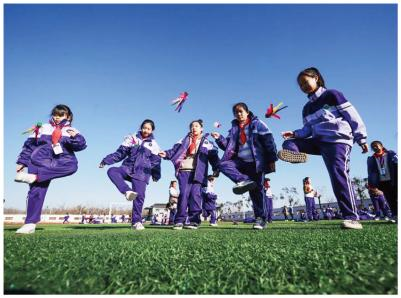

- A. 上升过程中，合力方向向上
- B. 毽子离开脚后，上升过程中，人对毽子做功
- C. 下落过程中，毽子惯性变大
- D. 下落过程中，重力做功越来越快

【答案】D

【解析】A．毽子在上升过程中受到竖直向下的重力和竖直向下的空气阻力，合力方向向下，故A错误；
B．毽子离开脚后，人对毽子不再施加力，因此人对毽子不做功,故B错误；
C．惯性是物体的固有属性，只与质量有关，下落过程中毽子质量不变，惯性不变，故C错误；
D．毽子在下落的过程中，重力不变，且重力大于空气阻力，合力方向向下，则速度越来越快，据\( P=Fv\)知，重力做功越来越快，故D正确。
故选D。

## 23. 单选题（难度：适中）

某同学练习排球垫球。若排球在竖直上升过程中所受空气阻力大小为f1，它此时所受合力大小为F1；排球在竖直下落过程中所受空气阻力大小为f2，它此时所受合力大小为F2，下列关系式正确的是（　　）

- A. 排球上升时所受合力大小F1=G-f1，方向竖直向上
- B. 排球上升时所受合力大小F1=G+f1，方向竖直向上
- C. 排球下落时所受合力大小F2=G-f2，方向竖直向下
- D. 排球下落时所受合力大小F2=G+f2，方向竖直向下

【答案】C

【解析】AB．排球上升时受到竖直向下的重力、竖直向下的空气阻力，则合力为\( {F}_{1}=G+{f}_{1}\)
方向竖直向下，故AB错误；
CD．排球下落时受到竖直向下的重力、竖直向上的阻力，且此时排球向下运动，重力大于阻力，说明合力方向竖直向下，合力大小为\( {F}_{2}=G-{f}_{2}\)，故C正确，D错误。
故选C。

## 24. 单选题（难度：简单）

如图所示，一只羽毛球所受的重力约为0.05N，正在空中竖直上升，某时刻它所受空气阻力的大小约为0.02N，则此时羽毛球所受合力的大小约为（　　）

- A. 0.05N
- B. 0.04N
- C. 0.03N
- D. 0.07N

【答案】D

【解析】重力的方向总是竖直向下的，物体运动时受到的空气阻力方向与物体的运动方向相反，因为羽毛球正在竖直上升，所以空气阻力的方向是竖直向下，根据同一直线上方向相同的两个力的合成可知，合力的大小等于这两个力的大小之和。所以，此时羽毛球所受合力的大小为\( {F}_{\mathrm{合}}=G+f=0.05\text{N}+0.02\text{N}=0.07\text{N}\)
故选D。

## 25. （难度：适中）

小聪将一根橡皮筋左端固定在墙上，用弹簧测力计拉其右端来“探究同方向两个分力与合力的关系”。
a．小聪用两个弹簧测力计一起沿相同方向作用于橡皮筋上，拉到A点，此时两个弹簧测力计的示数分别为F1=0.5N、F2=1.5N，如图甲所示；
b．小聪只用一个弹簧测力计把橡皮筋也拉到A点，弹簧测力计的示数F=2.0N，如图乙所示。
c．F的作用效果与F1、F2共同作用的效果相同，即F为F1和F2的合力。改变A点的位置多次实验，记录的数据如表所示。

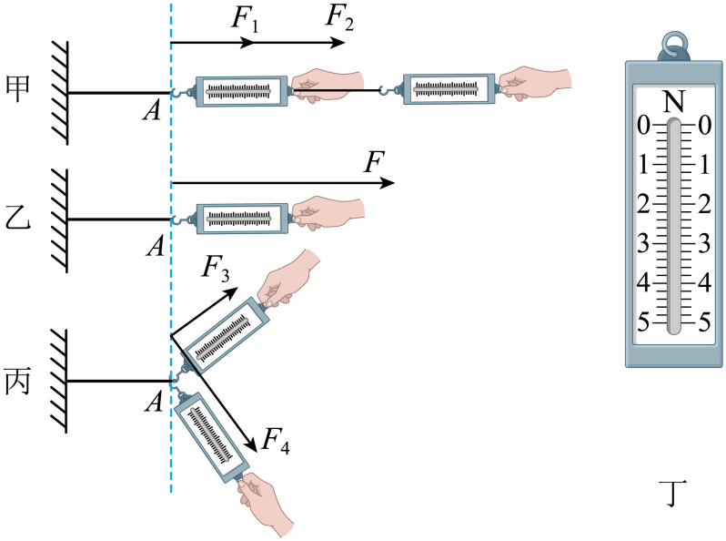
    
序号
F1/N
F2/N
F合/N

1
0.5
1.5
2.0

2
2.0
1.0
3.0

3
2.3
1.3

多次实验的目的是：                     ；

表格第三组中合力的大小没有记录，请在图丁中用横线标出此时弹簧测力计指针的位置；

小聪在实验中突发奇想，将两弹簧测力计相互垂直作用在橡皮筋上，也拉到第一次A点的位置，判断：F（选填“是”或“不是”）F3、F4的合力，理由是                     。

【答案】

避免实验结果的偶然性，得出普遍规律

，     ，     是     拉到第一次A点的位置，F$_{3}$、F$_{4}$的作用效果与力F的作用效果相同，所以F是F$_{3}$、F$_{4}$的合力。

## 26. （难度：适中）

小明同学在探究同一直线二力合成的实验中，把一根轻质弹簧的一端固定在O点，另一端用尼龙细线固定在弹簧秤的挂钩上，每次实验时，都将弹簧由A 拉伸到B位置。研究过程及实验数据如图（a）、（b）、（c）所示，请仔细观察图中的装置、操作及现象，然后归纳得出初步结论。

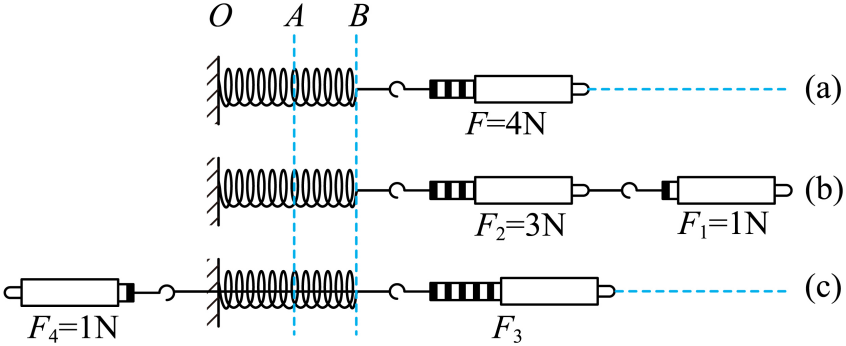

由图a、b、c中，每次都将弹簧由A拉伸到B 位置，目的是；

分析比较图a与图b中拉力的方向及弹簧测力计的示数F1、F2可得出结论：在同一直线上，方向相同的两个力的合力大小F=               （ 用 含F1、F2表达式作答）

图c验证了在同一直线上，方向相反的两个力的合力等于这两个分力的大小之差，并且方向与较大的力的方向相同的规律，则F3=

【答案】使每次实验中力产生的作用效果相同    ，

<i>F</i><i>1</i>+ <i>F</i><i>2</i><i>       </i>

，5N

## 27. （难度：适中）

(1)图甲所示的弹簧测力计的示数是       N；

图甲所示的弹簧测力计的示数是       N；

如图乙所示，汽车静止在平直的斜面上，其中OA平行于斜面，OB垂直于水平面，OC垂直于斜面。此时，汽车所受重力是沿图中（选填“OA”、“OB”或“OC”）的方向；

如图丙所示，探究同一直线上二力合成的规律。先用大小分别为\( {F}_{1}\)和\( {F}_{2}\)的拉力一同将橡皮筋的右端A拉至O点。撤去\( {F}_{1}\)和\( {F}_{2}\)，再只用一个拉力，读出此时拉力的大小 F，经多次实验发现\( F={F}_{1}+{F}_{2}\)。 
  
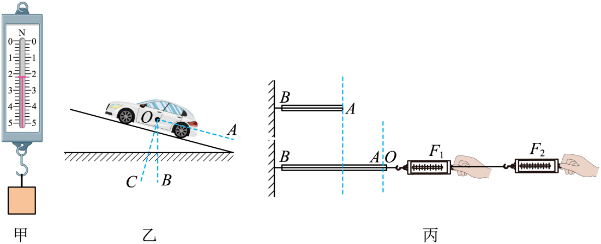

【答案】

2.2   

，<i>OB</i><i>   </i>，将橡皮筋的右端拉至相同位置

## 28. （难度：简单）

将一个重2.9N的排球竖直向上抛出。若排球在上升和下落的过程中受到的空气阻力都是0.1N，则排球在上升时，受到的合力大小为（     ）N，排球在下降时，受到的合力为（     ）N。

【答案】

3       2.8   

## 29. （难度：简单）

作用在同一直线上的两个力，若两力的方向相同，其中一个力的大小为3N，另一个力的大小为12N，合力为           N；若两力的方向相反，其中一个力的大小为15N，另一个力的大小为12N，合力为           N。

【答案】

15      3  

## 30. （难度：简单）

勤快的小敏同学一个人用60N的力沿竖直方向提起一袋质量为5kg的米，提起来的过程中，米袋受到的合力为（      ）N；米袋被提起，说明力可以改变物体的（      ）。

【答案】

10        运动状态  

## 31. （难度：适中）

一名从飞机上跳下的跳伞运动员，他和伞的总质量为60kg。打开降落伞前，运动员和伞所受的空气阻力为200N，合力的大小是（      ）N，此时运动员将（      ）（选填“加速”“匀速”或“减速”）下降（g取10N/kg）。

【答案】

  400    加速  

## 32. （难度：适中）

小华将一个重3N的小球竖直向上抛出。若小球在上升和下落过程中受到的空气阻力都是0.5N，则小球向上运动时所受的合力与向下运动时所受的合力相差（      ）N。小球向上运动到最高点时速度为0，此时小球（      ）（填“是”或“不是”）处于平衡状态。

【答案】

1     不是  

【解析】小球向上运动时所受的合力\( {F}_{\mathrm{上}}=G+f=3\mathrm{N}+0.5\mathrm{N}=3.5\mathrm{N}\)
小球向下运动时所受的合力\( {F}_{\mathrm{下}}=G-f=3\mathrm{N}-0.5\mathrm{N}=2.5\mathrm{N}\)
则小球向上运动时所受的合力与向下运动时所受的合力相差\( \Delta F={F}_{\mathrm{上}}-{F}_{\mathrm{下}}=3.5\mathrm{N}-2.5\mathrm{N}=1\mathrm{N}\)
小球向上运动到最高点时速度为0，此时小球只受到向下的重力，所以不是处于平衡状态。

## 33. （难度：适中）

把一个重为1.96牛的苹果竖直向上抛出，苹果在空中受重力和空气阻力的作用。若空气阻力大小恒为0.2牛，且方向总是与运动方向相反，则苹果的质量为（      ）千克，上升过程中所受合力的大小为（      ）N。

【答案】

  0.2    2.16  

【解析】由\( G＝mg\)可得，苹果的质量\( m=\frac{G}{g}=\frac{1.96\mathrm{N}}{9.8\mathrm{N}/\mathrm{k}\mathrm{g}}=0.2\mathrm{k}\mathrm{g}\)
由题可知，重力竖直向下，大小为1.96N，空气阻力方向与运动方向相反，苹果竖直上升，则阻力方向是竖直向下的，两个力方向相同，因此，合力为两力之和\( F=G+f=1.96\mathrm{N}+0.2\mathrm{N}=2.16\mathrm{N}\)

## 34. （难度：简单）

两个力\( {F}_{1}=40\mathrm{N}\)、\( {F}_{2}=55\mathrm{N}\)，同时作用在一个物体上。当这两个力的方向都水平向右时，这两个力的合力大小为（      ）N；当\( {F}_{1}\)水平向左，\( {F}_{2}\)水平向右时，这两个力的合力大小为（      ）N，合力方向为（      ）。

【答案】

95       15        水平向右  

## 35. （难度：适中）

空中飞行的铅球重量为90N，在空中受到的空气阻力为10N（阻力恒定）。当它向上飞行的过程中，它受到的合力为（      ）N，方向向（      ）。

## 36. （难度：适中）

如图所示，木块在水平向左的力F1和水平向右的力F2的作用下向右做匀速直线运动，其中F1为1N，F2为3N，若此时撤去F2，木块继续向右做减速运动，则木块在水平方向受到的合力为（      ）N，方向（      ）。  

【答案】

3     水平向左   

## 37. 

如图所示，一艘重为\( 5400\text{N}\)的微型气艇在空中沿竖直方向匀速下降，受到方向始终竖直向上的升力\( 5000\text{N}\)，则气艇运动中受到的空气阻力大小为（      ）N，若气艇中物体的质量减少一部分，气艇就能沿竖直方向匀速上升，则减少的物质质量为（      ）kg，设气艇在上升和下降时所受的升力和阻力大小均不变。\( \left(g=10\text{N}/\text{kg}\right)\)

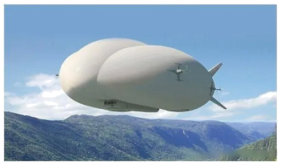

【答案】

400   80  

## 38. （难度：适中）

如图所示，一人站在平台上，竖直向上抛出一个2N的小球，空气阻力大小恒为0.8N，小球上升最大高度为H，则小球在上升过程中受到的合力大小为（      ）N，小球上升到最高点时，小球（      ）（选填“是”或“不是”）处于平衡状态。

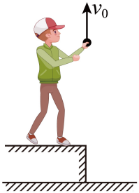

【答案】

2.8     不是   

## 39. （难度：适中）

如图所示，利用橡皮筋、定滑轮、钩码、小绳子和同学们一起探究同一直线上二力的合成，实验装置如图所示，橡皮筋原长AE，在力\( {F}_{1}\)、\( {F}_{2}\)的共同作用下伸长到\( AE\text{'}\)。

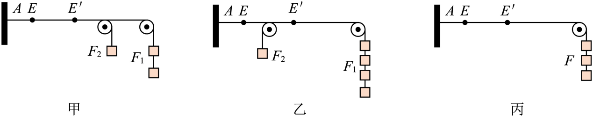

该实验应用了力能使物体发生（      ）的原理。

实验中每次均将橡皮筋右端拉至E'点，这样做的目的是使力的（      ）相同。

通过比较图（      ）和图丙两种情况，可知同一直线上方向相同的两个力F1、F2与它们的合力F的关系式为（      ），合力的方向跟这两个力的方向（      ）。

通过比较另一图和图丙两种情况，可知同一直线上方向相反的两个力的合力大小等于这两个力大小之差，方向跟（      ）（填“较大”或“较小”）的那个力的方向相同。

【答案】

形变   

，

作用效果    

，

甲  <i> F=F</i><i>1</i><i>+F</i><i>2</i><i> </i>   相同   

，

较大   

## 40. （难度：适中）

物理老师利用橡皮筋、定滑轮、钩码、细绳和同学们一起探究同一直线上的二力合成，实验装置如图所示，橡皮筋原长AE，在力\( {F}_{1}\)、\( {F}_{2}\)的共同作用下伸长到\( A{E}^{\text{'}}\)。

实验中，老师每次都将橡皮筋右端拉至\( {E}^{\text{'}}\)点，这样做的目的是（      ）。

通过比较图（      ）两种情况，可知同一直线上方向相同的两个力的合力大小等于这两个力大小之（      ），方向跟这两个力的方向相同。

通过比较图乙和图丙两种情况，可知同一直线上方向相反的两个力的合力大小等于这两个力大小之差，方向跟（      ）（选填“较大”或“较小”）的那个力的方向相同。

【答案】

控制力的作用效果相同   

，

甲丙  和   

，

较大   

## 41. （难度：适中）

如图所示，物体A在水平向右的推力<latex class="math-tex">\( {F}_{1}=6\text{N}\)</latex>、拉力<latex class="math-tex">\( {F}_{2}=8\text{N}\)</latex>作用下，做匀速直线运动。则A受到地面的摩擦力大小是（      ）N；物体A受到的合力为（      ）N。

## 42. （难度：适中）

如图所示，在F=10N的水平拉力作用下物块沿水平地面做匀速直线运动，地面对物体的摩擦力的方向水平向（      ）（选填右或左），当水平拉力增大为20N后，物块将做（      ）直线运动。（选填“加速”“匀速”或“减速”）

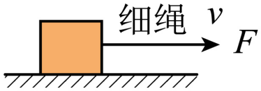

【答案】

左     加速  

## 43. （难度：适中）

如图所示，用弹簧测力计沿水平方向拉动木块做匀速直线运动，此时弹簧测力计的示数为（      ）N，当拉力增大到3N时，木块受到的合力为（      ）N。

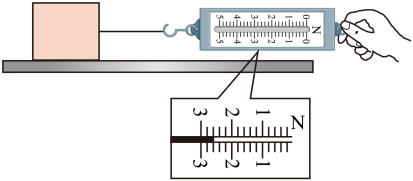

【答案】

2.6     0.4   

【解析】弹簧测力计的分度值为0.2N，图中指针指向2.6N的位置，因此示数为2.6N；木块做匀速直线运动时，拉力与滑动摩擦力平衡，故滑动摩擦力为2.6N。
当拉力增大到3N时，滑动摩擦力的大小只与压力和接触面粗糙程度有关（此二者未变），故摩擦力仍为2.6N；合力为拉力与摩擦力的差值，即\( 3\text{N}-2.6\text{N}=0.4\text{N}\)

## 44. 

如图甲所示，将一个物体竖直悬挂在弹簧测力计的挂钩上，物体静止时弹簧测力计的示数为（      ）N；如图乙所示，把弹簧测力计倒过来，将此物体竖直挂在弹簧测力计的拉环上，物体静止时弹簧测力计的示数将（      ）（选填“变大”“变小”或“不变”）。

【答案】

2.2     变大   

【解析】图甲中弹簧测力计的分度值为\( 0.2\mathrm{N}\)，指针指在\( 2\mathrm{N}\)下方第1个小格处，因此示数为\( 2.2\mathrm{N}\)，此时物体受到的重力与弹簧测力计的拉力平衡，所以物体的重力为\( 2.2\mathrm{N}\)；当弹簧测力计倒过来使用时，除了要测量物体的重力，还需额外承担弹簧测力计自身外壳的重力，因此，此时弹簧测力计的示数会大于物体实际的重力，即示数变大。

## 45. （难度：简单）

如图-1，两个小孩能拎起一桶水，一个大人也能拎起同一桶水。由此可知，一个大人的作用力产生的效果跟两个小孩共同作用产生的效果（      ）（选填“相同”或“不同”），大人的作用力相当于两个小孩的力的（      ）（填“合力”或“分力”），如图-2，用弹簧测力计和相同的弹簧分别进行多次实验，其中力F可以作为\( {F}_{1}\)、\( {F}_{2}\)合力的有（      ）（填序号）。

【答案】

  相同     合力    3  

## 46. （难度：适中）

物理老师利用橡皮筋、定滑轮、钩码、小绳子和同学们一起探究同一直线上二力的合成，实验装置如图所示，橡皮筋原长AE，在力F或F1、F2的共同作用下伸长到AE′。

图甲中的EE′表示橡皮筋（      ）的长度；

实验中，老师每次均将橡皮筋右端拉至E′点，这样做的目的是（      ）；

通过比较图（      ）两种情况，可知同一直线上方向相同的两个力的合力大小等于这两个力大小之（      ），方向跟这两个力的方向相同；

通过比较图乙和图丙两种情况，可知同一直线上方向相反的两个力的合力大小等于这两个力大小之差，方向跟（      ）（选填“较大”或“较小”）的那个力的方向相同。

【答案】

伸长   

，

控制力的作用效果相同   

，

甲丙    和    

，

较大   

## 47. （难度：适中）

如图1为研究力的作用效果的实验装置，橡皮筋上端固定在铁架台A点，其下端同一点系有两根细绳，铁架台竖直固定一直尺用于记录位置，实验中使用的钩码均相同。

如图1，在其中一根细绳上系一个钩码，另一根上系两个钩码，记录橡皮筋下端到达的位置O。然后撤去所有钩码，只在其中一根细线上挂钩码，使橡皮筋下端仍到达位置O，如图2所示，此时钩码的个数为三只。图1中两根细绳的拉力与图2中一根细绳的拉力对橡皮筋的（      ）相同。此实验说明：作用在同一物体且在同一直线上的两个力，当它们方向相同时，图2中力的大小等于图1中两个力之（      ）。

如图3所示，在橡皮筋一根细线上挂3个钩码，另一根细线竖直向上跨过定滑轮后挂1个钩码，记录橡皮筋下端到达的位置O′，则AO′（      ）AO。若要使橡皮筋下端重新回到O点，可行的操作为（      ）。

【答案】

作用效果    和    

，

&lt;      在三个钩码下方加挂一只钩码   

## 48. （难度：适中）

小华利用支架、滑轮、橡皮筋、重均为0.5N的钩码、细线等组成图所示的实验装置，探究同一直线上两个力的合成。

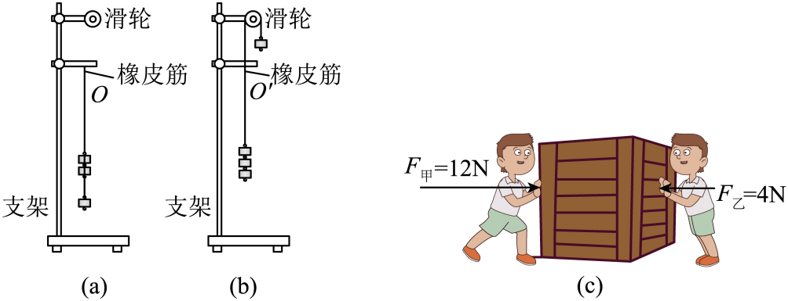

如图（a）所示，橡皮筋下端系有两根细线，在其中一根细线上挂一个钩码，在另一根细线上挂两个钩码，记录橡皮筋下端到达的位置O。
①撤去所有钩码，只在其中一根细线上挂钩码，使橡皮筋的下端（      ），记录钩码的个数。
②小华选用长短不同的两段细线，可避免钩码并排放置造成（      ）的问题。

如图（b）所示，橡皮筋下端系有两根细线，在其中一根细线上挂三个钩码，另一根细线向上跨过滑轮后挂一个钩码，记录此时橡皮筋下端到达的位置O′。撤去所有钩码，仅在橡皮筋下端的细线上挂钩码，使橡皮筋下端仍到达位置O′，需挂（      ）个钩码。

如图（c）所示，一只箱子置于水平地面上。两个小孩在游戏时，分别用相反方向的恒定大小的水平力F甲、F乙推箱子，其中F甲=12N、F乙=4N，箱子未被推动。忽然，左侧小孩松手，则箱子所受的合力为（      ）N。

【答案】

     仍到达位置<i>O</i>     两个力不在同一直线   

，

2     

，

0    

【解析】[1]撤去所有钩码后，需要在单根细线上挂钩码使橡皮筋下端仍到达位置O，这样可以通过一个力的作用效果来等效替代之前两个力的共同作用效果。
[2]选用长短不同的细线可以确保两个钩码的拉力方向在同一条直线上，避免并排放置时两个拉力方向产生夹角，导致合力测量不准确。

在图（b）中，三个钩码向下的拉力为1.5N，通过滑轮的一个钩码产生向上的拉力为0.5N，所以橡皮筋受到的合力为1.0N。要使橡皮筋下端仍到达位置\( {O}^{\text{'}}\)，需要在细线上挂2个1.0N钩码，这样才能产生相同的效果。

当两个小孩同时推箱子时，箱子处于平衡状态，说明地面对箱子的静摩擦力f=12N-4N=8N，也说明地面给箱子的最大静摩擦力至少能达到8N，左侧小孩松手后，只剩下F乙=4N的推力，此时静摩擦力会自动调整大小与之平衡，因此箱子仍保持静止状态，所受合力为0，只有当推力超过最大静摩擦力时，箱子才会开始运动。

## 49. （难度：适中）

小明将一根橡皮筋左端固定在墙上，用弹簧测力计拉其右端来“探究两个分力与合力的关系”。

如图所示，当使用弹簧测力计进行拉动橡皮筋之前，应该在（      ）（选填“水平”、“竖直”）方向对弹簧测力计进行调零；

如图甲中，小明用两个弹簧测力计一起沿水平相同方向作用于橡皮筋上拉到A点，此时两个弹簧测力计的示数分别为\( {F}_{\text{1}}\text{=3.0N}\)、\( {F}_{\text{2}}\text{=4.0N}\)；如图乙所示，小明只用一个弹簧测力计把该橡皮筋也水平拉到A点，弹簧测力计的示数F=7.0N。F的作用效果与F1、F2共同作用的效果（      ）（选填“相同”、“不同”）；

小明继续进行实验，如图甲所示，他将两弹簧测力计相互垂直作用在橡皮筋上拉到B点，记下两弹簧测力计的示数分别为\( {F}_{\text{3}}\text{=3.0N}\)、\( {F}_{\text{4}}\text{=4.0N}\)；然后如图乙所示，只用一个弹簧测力计把该橡皮筋也拉到B点，读出弹簧测力计的示数\( {F}^{\text{'}}=\)（      ）N。根据你对合力与分力的理解，判断\( {F}^{\text{'}}\)（      ）（选填“是”“不是”）F3和F4的合力。

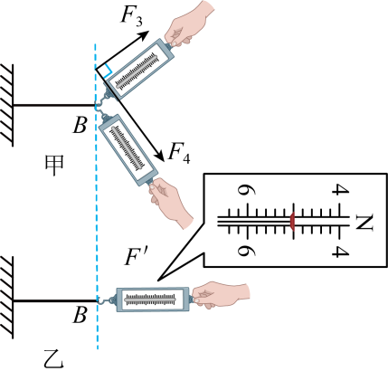

【答案】

水平   

，

相同    

，

5    是   

【解析】实验中所测力是水平方向的，所以当使用弹簧测力计进行拉动橡皮筋之前，应该在水平方向对弹簧测力计进行调零。

如图甲中，小明用两个弹簧测力计一起沿水平相同方向作用于橡皮筋上拉到A点，如图乙所示，小明只用一个弹簧测力计把该橡皮筋也水平拉到A点，橡皮筋的形变量相同，则F的作用效果与F1、F2共同作用的效果相同。

[1]由图乙得，测力计的分度值为0.2N，则此时弹簧测力计的示数\( {F}^{\text{'}}=5\text{N}\)。
[2]如图甲所示，将两弹簧测力计相互垂直作用在橡皮筋上拉到B点，记下两弹簧测力计的示数分别为\( {F}_{\text{3}}\text{=3.0N}\)、\( {F}_{\text{4}}\text{=4.0N}\)；然后如图乙所示，只用一个弹簧测力计把该橡皮筋也拉到B点，读出弹簧测力计的示数\( {F}^{\text{'}}=5\text{N}\)。\( {F}^{\text{'}}\)的作用效果与F3、F4共同作用的效果相同，所以\( {F}^{\text{'}}\)是F3和F4的合力。
