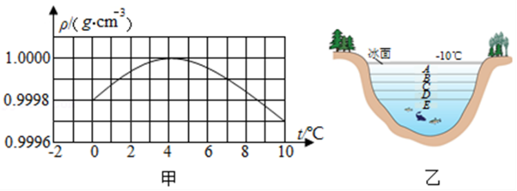
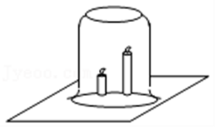
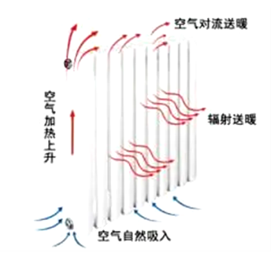

# 知识点·密度与温度关系（同步练习）

> 教材：物理·八年级全一册·沪科技版2024新教材 ｜ 来源：国家中小学智慧教育平台·在线练习 ｜ 共 7 题

## 1. 单选题（难度：简单）

古代劳动人民巧妙地利用水来开山采石. 冬季，在白天给石头打一个洞，再往洞里灌满水并封实，待晚上降温，水结冰后石头就裂开了（冰的密度比水的密度小）. 下列有关说法正确的是（    ）

- A. 石头裂开后密度减小
- B. 石头裂开后密度增大
- C. 水结冰后体积增大从而使石头裂开
- D. 水结冰后质量增大从而使石头裂开

【答案】C

【解析】​

## 2. 单选题（难度：简单）

如图甲所示为水的密度在0～10℃内随温度变化的图像，图乙为北方冬天湖水温度分布示意图. 根据图像及水的其他性质，下列分析判断正确的是（    ）

- A. 温度等于4℃时，水的密度最小
- B. 在0～4℃，水具有热胀冷缩的性质
- C. 乙图中从上至下\( A\)、\( B\)、\( C\)、\( D\)、\( E\)处的温度分别为4℃、3℃、2℃、1℃、0℃
- D. 如果没有水的反常膨胀，湖底和表面的水可能全部结冰，水中生物将很难越冬

【答案】D

【解析】​

## 3. 多选题（难度：适中）

常温常压下，质量分布均匀的固体甲密度为\( 5\text{g/c}{\text{m}}^{\text{3}}\)，质量分布均匀的固体乙密度为\( \text{2}\text{g/}{\text{cm}}^{\text{3}}\)，下列说法正确的是（    ）

- A. 随着温度的升高，固体甲的密度不会改变
- B. 在体积相同时，甲的质量大于乙的质量
- C. 将乙固体切掉一半，剩余的固体乙密度是\( \text{2}\text{g/}{\text{cm}}^{\text{3}}\)
- D. 常温常压下，甲乙按等质量混合后的平均密度是\( \text{3.5}\text{g/}{\text{cm}}^{\text{3}}\)

【答案】B/C

【解析】​

## 4. 填空题（难度：简单）

一瓶氧气用去一半后，剩下的氧气的密度（填“变大”、“变小”或“不变”）；通常情况下，空气受热体积膨胀，因而暖气片应安装在窗户的  （选填“下方”或“上方”）.

【答案】变小，下方

【解析】​

## 5. 填空题（难度：简单）

点燃两支长度不同的蜡烛，将其固定在桌面上，如图所示. 如果用玻璃杯将两支蜡烛罩在里面，发现较长的一支蜡烛先熄灭，这是由于燃烧产生的高温的二氧化碳气体的密度（选填“大于”、“等于”或“小于”）空气密度，二氧化碳气体（选填“上升”或“下降”）的缘故. 根据这个实验结果，在房间发生火灾时，人应该尽量（选填“往高处走”或“贴近地面”）离开房间. 

【答案】小于，上升，贴近地面

【解析】​

## 6. 填空题（难度：简单）

把纸风车放在点燃的酒精灯上方，风车能转动起来，如图所示，这是因为一定质量的气体受热膨胀后，密度（选填“变小”“变大”“不变”）而上升，热空气上升后，冷空气就从四面八方流过来，从而形成风. 根据气体这个特点，安装暖气片时应该靠近 （选填“地面”或“天花板”）. 

【答案】变小，地面

【解析】​

## 7. 填空题（难度：简单）

暖气片常安置在房间靠近地面的墙上，由于低处热空气密度比冷空气密度（填“大”或“小”）而（选填“上升”或“下降”），周围空气就补充过来，形成冷、热空气的交互循环，更有利于整个房间变得温暖. 

【答案】小，上升，冷

【解析】​
