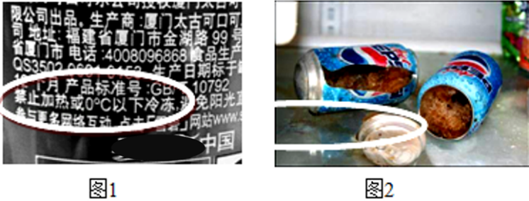

# 知识点·密度与生活联系（同步练习）

> 教材：物理·八年级全一册·沪科技版2024新教材 ｜ 来源：国家中小学智慧教育平台·在线练习 ｜ 共 8 题

## 1. 单选题（难度：简单）

\( \text{C919}\)大型喷气客机的机身和机翼均采用了极轻的碳纤维材料，以减小飞机质量，这种材料的优点是（    ）

- A. 熔点低
- B. 密度小
- C. 体积小
- D. 硬度小

【答案】B

【解析】​

## 2. 单选题（难度：简单）

建筑物内遭遇火灾时，受困人员应采取弯腰甚至匍匐的姿势撤离火场，如图所示，这样能有效避免吸入有害气体或被灼伤. 这是因为与房间内其他空气相比较，含有毒有害物质的气体（    ）

- A. 温度较低，大量聚集在房间的下方
- B. 密度较大，大量聚集在房间的上方
- C. 温度较高，大量聚集在房间的下方
- D. 密度较小，大量聚集在房间的上方

【答案】D

【解析】​

## 3. 单选题（难度：简单）

平时常说“油比水轻”，这实际上是指（    ）

​​

​

- A. 油的质量比水小
- B. 油的密度比水小
- C. 油的体积比水小
- D. 油的粘性比水小

【答案】B

【解析】​

## 4. 单选题（难度：简单）

密度与社会生活联系紧密，下列关于密度知识的说法中正确的是（    ）

- A. 氢气球升空后随着海拔升高，球内的氢气密度将会变小
- B. 建造机床设备的底座时应该选择密度较小的材料，轻便且容易移动
- C. 能装下1kg水的瓶子也一定能装的下1kg的煤油（已知煤油的密度比水小）
- D. 由于铁的密度大于水，因此铁制的物体在水中一定会下沉

【答案】A

【解析】​

## 5. 单选题（难度：简单）

冬天，常看到室外的自来水管包了一层保温材料，是为了防止水管冻裂，水管被冻裂的主要原因是（    ）

​​

​

- A. 水管里的水结成冰后，密度变大
- B. 水管里的水结成冰后，质量变大
- C. 水管里的水结成冰后，体积变大
- D. 水管本身耐寒冷程度不够而破裂

【答案】C

【解析】​

## 6. 单选题（难度：简单）

密度与生活有紧密的联系，下列说法错误的是（    ）

- A. 鉴别一个实心的金属球到底是不是铁做的，只需测出它的密度即可作出准确判断
- B. 飞船尽可能采用强度高，密度小，性能优良的新材料制造
- C. 农民常用一定密度的盐水进行选种
- D. 冬季与夏季煤气的价格不同的原因之一是煤气在两季的密度不同

【答案】A

【解析】​

## 7. 填空题（难度：简单）

如图所示，是一杯分层的鸡尾酒，这几种酒之所以能够分层，主要是因为这几种酒的 不同，用吸管将最下层的酒喝掉，这杯鸡尾酒的密度将（填“变大”、“变小”或“不变”）. 

【答案】密度，变小

【解析】​

## 8. （难度：简单）

如图1所示，易拉罐装的饮料都有禁止冷冻的说明. 图2为易拉罐冷冻后炸开的图片. 请你结合所学知识简要说明原因. （\( {\rho }_{\text{水}}=\text{1g/}{\text{cm}}^{\text{3}}\)，\( {\rho }_{\mathrm{冰}}=\text{0.9g/}{\text{cm}}^{\text{3}}\)）

【答案】

饮料主要成分是水，水凝固质量不变. 由于冰的密度小于水，根据$ \rho =m/V$可知，水结冰后体积变大，所以会凝固.

【解析】​
