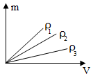
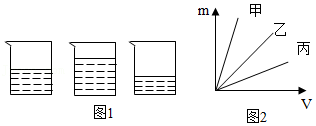
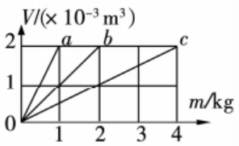
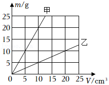
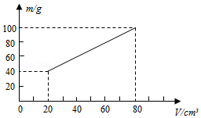

# 知识点·密度的图像（同步练习）

> 教材：物理·八年级全一册·沪科技版2024新教材 ｜ 来源：国家中小学智慧教育平台·在线练习 ｜ 共 5 题

## 1. 单选题（难度：简单）

如图是三种不同物质的质量和体积关系的图像，则由图像可知（    ）

- A. \( {\rho }_{1}>{\rho }_{2}>{\rho }_{3}\)
- B. \( {\rho }_{1}<{\rho }_{2}<{\rho }_{3}\)
- C. \( {\rho }_{1}={\rho }_{2}={\rho }_{3}\)
- D. 无法判断

【答案】A

【解析】​

## 2. 单选题（难度：适中）

如图1所示，桌面上放有三个相同的玻璃杯，分别装有质量相同的三种液体甲、乙、丙，它们的质量与体积的关系如图2所示，三个杯子从左至右依次装的液体种类是（    ）

- A. 乙，丙，甲
- B. 甲，丙，乙
- C. 甲，乙，丙
- D. 丙，乙，甲

【答案】A

【解析】​

## 3. 多选题（难度：简单）

分别由不同物质\( a\)、\( b\)、\( c\)组成的三个实心体，它们的体积和质量的关系如图所示，由图可知下列说法正确的是（    ）

- A. \( a\)物质的密度最大
- B. \( b\)物质的密度是\( \text{1.0}\text{×}{\text{10}}^{\text{3}}\text{kg/}{\text{m}}^{\text{3}}\)
- C. \( c\)物质的密度是\( a\)的4倍
- D. \( c\)的密度与它的质量、体积有关

【答案】B/C

【解析】​

## 4. 单选题（难度：适中）

如图所示为甲和乙两种物质的质量与体积关系图像，分析图像可知（    ）

- A. 甲物质的密度与质量成正比
- B. 若甲、乙的体积相等，则甲的质量较小
- C. 甲、乙两种物质的密度之比为4：1
- D. 若甲、乙的质量相等，则甲的体积较大

【答案】C

【解析】​

## 5. 多选题（难度：适中）

为测量某种液体的密度，小明利用天平和量杯测量了液体和量杯的总质量\( m\)及液体的体积\( V\)，得到了几组数据并绘出了\( m-V\)图象，如图所示. 下列说法正确的是（    ）

- A. 该液体密度为\( 1\text{g/}{\text{cm}}^{\text{3}}\)
- B. 该液体密度为\( 1.25\text{g/}{\text{cm}}^{\text{3}}\)
- C. 量杯质量为\( \text{40g}\)
- D. \( 60{\text{cm}}^{\text{3}}\)的该液体质量为\( \text{60g}\)

【答案】A/D

【解析】​
