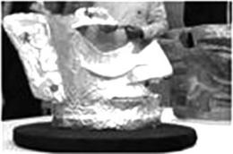

# 知识点·密度的理解（同步练习）

> 教材：物理·八年级全一册·沪科技版2024新教材 ｜ 来源：国家中小学智慧教育平台·在线练习 ｜ 共 5 题

## 1. 单选题（难度：简单）

如图是2021年三星堆遗址考古中发掘的黄金面具残片,其质量大约是280 g,根据残片体积推测完整面具的质量会超过500 g. 能这样推测是依据完整面具和残片有相同的（    ） 

- A. 面积
- B. 体积
- C. 质量
- D. 密度

【答案】D

【解析】​

## 2. 单选题（难度：简单）

一杯食盐水，倒\( \frac{1}{2}\)，剩下的半杯食盐水（    ）

- A. 密度不变、质量减半、咸度不变
- B. 质量减半、密度减半、且变淡
- C. 体积减半、密度减半、且变咸
- D. 质量、体积、密度均减半

【答案】A

【解析】​

## 3. 多选题（难度：简单）

下面列举的语句都蕴含着深刻的哲理，如果从物理学角度来解读，也别有生趣，其中分析正确的是（    ）

- A. “只要功夫深，铁棒磨成针”，此过程中铁棒的质量减小
- B. “蜡炬成灰泪始干”，蜡烛燃烧时的体积减小
- C. “锲而不舍，金石可镂”，镂后金石的密度不变
- D. “人往高处走，水往低处流”，水流的过程中密度减小

【答案】A/B/C

【解析】​

## 4. 多选题（难度：适中）

下列例子中，密度不变的是（    ）

- A. 水结成冰
- B. 粉笔用了一半
- C. 铁杵磨成针
- D. 氧气瓶中的氧气被用去一半

【答案】B/C

【解析】​

## 5. 多选题（难度：适中）

下列有关密度的说法不正确的是（    ）

- A. 一支粉笔分成体积相等的两半后，其中一半粉笔的密度变为原来的一半
- B. 一钢瓶中充满氧气，当用掉一半后，钢瓶中氧气的体积不变，密度变小
- C. 铁的密度比铝的密度大，表示铁的质量大于铝的质量
- D. 密度是物质的一种基本属性，其不随物体温度、形状、状态的改变而改变

【答案】A/C/D

【解析】​
