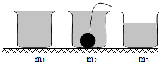

# 知识点·密度的计算（同步练习）

> 教材：物理·八年级全一册·沪科技版2024新教材 ｜ 来源：国家中小学智慧教育平台·在线练习 ｜ 共 9 题

## 1. 单选题（难度：简单）

下表中是四个金属块质量和体积的数据，其中三个是由同种材料制成，另一个是由不同种材料制成，分析数据可知，材料与众不同的金属块是（    ）

 
 
 
 金属块

 
 
 质量\( m\text{/g}\)

 
 
 体积\( V/{\text{cm}}^{\text{3}}\) 

 
 

 
 
 甲

 
 
 27

 
 
 10

 
 

 
 
 乙

 
 
 54

 
 
 20

 
 

 
 
 丙

 
 
 79

 
 
 10

 
 

 
 
 丁

 
 
 81

 
 
 30

- A. 甲
- B. 乙
- C. 丙
- D. 丁

【答案】C

【解析】​

## 2. 填空题（难度：简单）

一物体的质量是\( \text{2.7}\text{×}{10}^{4}\text{kg}\)，体积为\( 10{m}^{3}\)，则其密度为 \( \text{kg/}{\text{m}}^{\text{3}}\)，合 \( \text{g/}{\text{cm}}^{\text{3}}\)，若把该物体切去一半，则剩下部分的密度将（选填“变大”、“变小”或“不变”）.

【答案】$ 2.7\times {10}^{3}$，2.7，不变

【解析】​

## 3. 填空题（难度：适中）

一杯牛奶有250ml，其质量为300g，则牛奶的密度是  \( \text{kg/}{\text{m}}^{\text{3}}\)；小李喜欢喝加糖的牛奶，加糖溶解后，牛奶的密度会（选填“变大”、“不变”“变小”）.

【答案】$ 1.2\times {10}^{3}$ ，变大 

【解析】​

## 4. 填空题（难度：简单）

小明暑假去西藏旅游，为了旅途安全，他租赁了一瓶容积为\( \text{960mL}\)的氧气瓶（如图所示）. 若瓶中氧气的密度为\( \text{5kg/}{\text{m}}^{\text{3}}\)，则该氧气瓶内氧气的质量为  \( \text{g}\)，当氧气瓶内的氧气用去一半后，瓶内剩余氧气的密度（变大/变小/不变）. 

【答案】4.8，变小

【解析】​

## 5. 填空题（难度：适中）

同学们想知道一张质量是\( \text{14.8kg}\)的课桌的体积. 于是找来和课桌相同材质的木料作样本，测得其质量是\( \text{7.4g}\)，体积是\( 10{\text{cm}}^{\text{3}}\)则样本的密度为  \( \text{g/}{\text{cm}}^{\text{3}}\)，课桌材料的体积为 \( {\text{m}}^{\text{3}}\).

【答案】0.74  ，0.02.

【解析】​

## 6. 填空题（难度：适中）

一个空瓶子的质量是\( \text{150g}\)，当装满水时，瓶和水的总质量是\( \text{400g}\)；当装满另一种液体时，瓶和液体的总质量是\( \text{350g}\). 则这个瓶子的容积是 \( {\text{cm}}^{\text{3}}\)，液体的密度是 \( \text{kg/}{\text{m}}^{\text{3}}\).

【答案】250，<latex class="math-tex">\(0.8\times 1{0}^{3}\)</latex>

【解析】​

## 7. 

某空瓶的质量为0.1千克，在瓶内装满水，测得瓶和水的总质量0.7千克，将质量为0.5千克的金属块浸没在瓶内水中，等停止溢水后再次测得瓶、金属块和剩余水的总质量1.1千克. 求：

（1）瓶的容积\( {V}_{\mathrm{容}}\). 

（2）溢出水的质量\( {m}_{\mathrm{溢}}\). 

（3）金属块的密度\( {\rho }_{\mathrm{金}\mathrm{属}}\).

【答案】

（1）$ \text{600}{\text{cm}}^{\text{3}}$；（2）$ \text{100g}$；（3）$ 5\text{g/}{\text{cm}}^{\text{3}}$   

【解析】​

## 8. （难度：适中）

有一块质量为\( \text{9kg}\)的冰块，密度为\( 0.9\times {10}^{3}\text{kg/}{\text{m}}^{\text{3}}\). 

（1）求冰块的体积. 

（2）若冰块吸热后，有\( 3{\text{dm}}^{\text{3}}\)的冰熔化成水，水的质量为多少\( \text{kg}\)？

【答案】

（1）$ \text{0.01}{\text{m}}^{\text{3}}$；（2）$ \text{2.7kg}$   

【解析】​

## 9. （难度：适中）

如图所示，一只烧杯盛满水时，称得烧杯、杯内水的总质量\( {m}_{1}\)为\( \text{2.4kg}\)；往烧杯内放入一金属球、溢出一部分水后，称得烧杯、杯内水、金属球的总质量\( {m}_{2}\)为\( \text{5.4kg}\)；取出金属球后，称得烧杯、杯内水的总质量\( {m}_{3}\)为\( \text{1.2kg}\). 已知\( {\rho }_{\text{水}}=1\times {10}^{3}\text{kg/}{\text{m}}^{\text{3}}\)，求：

（1）金属球的质量

（2）金属球的体积

（3）金属球的密度

【答案】

（1）$ \text{4.2kg}$  ；

​（2）$ 1.2\times {\text{10}}^{\text{-3}}{\text{m}}^{\text{3}}$ ；

​（3）$ 3.5\times {10}^{3}\text{kg/}{\text{m}}^{\text{3}}$   .

【解析】​
