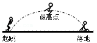
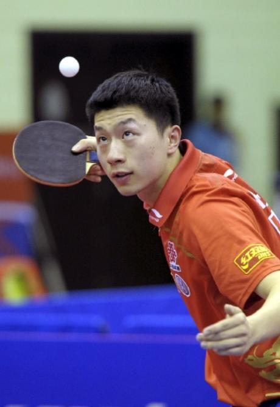

# 知识点·平衡状态的判断（同步练习）

> 教材：物理·八年级全一册·沪科技版2024新教材 ｜ 来源：国家中小学智慧教育平台·在线练习 ｜ 共 4 题

## 1. 单选题（难度：简单）

下列给出的现象中，物体处于平衡状态的是（   ）

- A. 熟透的苹果从树上落下来
- B. 正在减速进站的火车
- C. 小孩沿直滑梯匀速下滑
- D. 人造卫星绕地球匀速转动

【答案】C

【解析】​

## 2. 填空题（难度：简单）

一个物体受到平衡力作用，物体会处于平衡状态。平衡状态指物体处于状态或状态。

【答案】静止，匀速直线运动

【解析】​

## 3. 填空题

如图为小明在中考体育测试中，参加立定跳远项目，则小明在跳跃到最高点时处于（选填“平衡”或“非平衡”）状态，若他在最高点受到的所有力消失，则他将保持（选填“静止”或“匀速直线运动”）状态（整个运动过程不考虑空气阻力）。

【答案】非平衡，匀速直线运动

【解析】​

## 4. 填空题（难度：适中）

如图所示，乒乓球运动员发球时要将乒乓球竖直向上抛出，乒乓球被抛出后能继续上升，是因为乒乓球具有，到达最高点时，乒乓球处于（选填“平衡”或“非平衡”）状态，你判断的依据是。

【答案】惯性，非平衡，乒乓球在最高点只受到重力作用

【解析】​
