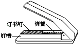

# 知识点·弹力概念（同步练习）

> 教材：物理·八年级全一册·沪科技版2024新教材 ｜ 来源：国家中小学智慧教育平台·在线练习 ｜ 共 3 题

## 1. 单选题（难度：简单）

下列有关弹力的说法，正确的是（     ）.

- A. 互相接触的两物体，一定产生弹力作用
- B. 茶杯放在水平桌面上，茶杯对桌面的压力是由于桌面发生弹性形变而产生的
- C. 从力的性质来看，压力、支持力都属于弹力，拉力不属于弹力
- D. 在弹性限度内，使物体发生弹性形变的外力越大，物体的形变就越大

【答案】D

【解析】​

## 2. 多选题（难度：适中）

关于弹力，下列叙述正确的是（   ）.

- A. 两物体相互接触，不一定会产生相互作用的弹力
- B. 两物体不接触，就一定没有相互作用的弹力
- C. 两物体有弹力作用，物体不一定发生了弹性形变
- D. 只有弹簧才能产生弹力

【答案】A/B

【解析】​

## 3. 填空题（难度：适中）

如图是一种常见的订书机，钉槽内的订书钉之所以不会松脱，是因为固定在槽内后部的弹簧给钉子一个向（选填“左”或“右”）的弹力.在使用过程中，随着钉子数目的减少，弹簧给钉子的这个力将（选填“增大”、“不变”或“减小”）.

【答案】左，减小

【解析】​
