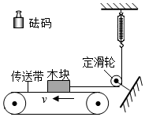
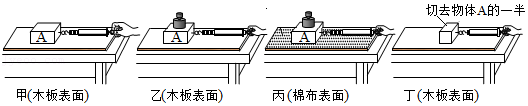
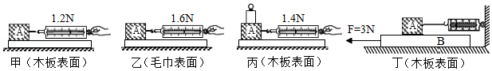
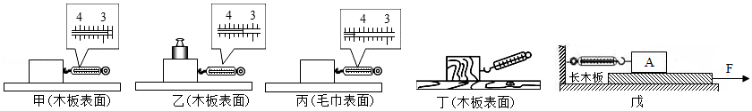

# 知识点·影响摩擦力大小的因素（同步练习）

> 教材：物理·八年级全一册·沪科技版2024新教材 ｜ 来源：国家中小学智慧教育平台·在线练习 ｜ 共 4 题

## 1. 多选题（难度：适中）

如图是小明“探究影响滑动摩擦力大小的因素”的实验器材和装置图，水平传送带的速度\( v\)可以调节（绳重、滑轮轴的摩擦忽略不计）。下列说法正确的是（    ）

- A. 木块受到滑动摩擦力的方向是水平向右
- B. 测量滑动摩擦力大小依据了二力平衡的知识
- C. 在木块上加砝码，弹簧测力计的示数稳定后，其示数比未加砝码时小
- D. 弹簧测力计的示数稳定后，加快传送带的速度，弹簧测力计的示数不变

【答案】B/D

【解析】​

## 2. 填空题（难度：简单）

为了探究“滑动摩擦力大小与什么因素有关”，小明设计了如图所示的实验。

（1）实验中，弹簧测力计必须沿水平方向拉着物块做运动，根据二力平衡的条件得出拉力摩擦力，从而测出木块所受摩擦力的大小。
（2）在如图所示的四次实验中，滑动摩擦力最小的是（选填“甲”、“乙”“丙”或“丁”）。
（3）比较甲、乙实验，是为了研究滑动摩擦力大小与大小的关系；比较乙、丙实验，是为了研究滑动摩擦力大小与接触面的的关系。
（4）比较甲、丁实验，发现甲实验弹簧测力计的示数大于丁实验弹簧测力计的示数，小明得出结论：滑动摩擦力大小与接触面积的大小有关，你认为他的结论是（选填“正确”或“错误”）的。
（5）此实验所采用的研究方法是法。

【答案】匀速直线  ，等于，丁，压力，粗糙程度，错误，控制变量

【解析】​

## 3. 填空题（难度：适中）

在探究影响滑动摩擦力大小因素的实验中，小明用完全相同的木块分别做了如图所示的甲、乙、丙三个实验。

（1）实验时，弹簧测力计必须沿方向拉动木块做匀速直线运动；
（2）甲、丙两个实验说明滑动摩擦力的大小与有关；两个实验说明滑动摩擦力的大小与接触面的粗糙程度有关。
（3）为了验证“滑动摩擦力的大小是否跟接触面的面积有关”，小明在上述甲实验的基础上，将木块沿竖直方向切去一半继续进行实验。这种做法（选填“正确”或“错误”），理由是。
（4）实验时，小明发现很难控制木块做匀速直线运动，于是，他对实验装置进行了如图丁所示的改进：水平向左拉动木板，木板相对于地面向左运动，木块\( A\)相对于地面保持静止，此时弹簧测力计的示数为\( \text{0.8}\text{N}\)，则木块\( A\)受到的滑动摩擦力是 \( \text{N}\)，方向（选填“水平向左”或“水平向右”），此过程中木板（选填“需要”或“不需要”）做匀速直线运动。

【答案】水平，压力，甲、乙，错误，没有控制压力大小相同    ，0.8，水平向左，不需要

【解析】​

## 4. 填空题

在“探究影响滑动摩擦力大小的因素”实验中：

（1）测量滑动摩擦力的大小时应在水平桌面上用弹簧测力计沿方向拉动木块做运动，此时弹簧测力计对木块的拉力等于木块受到的摩擦力，理由是。
（2）小明用弹簧测力计拉着同一木块进行了三次正确操作，如图甲、乙、丙所示。
\( \text{①}\)三次操作中木块受到的摩擦力最大为 \( \text{N}\)。
\( \text{②}\)若要探究滑动摩擦力与压力大小的关系，应比较两图的实验。
\( \text{③}\)比较甲、丙两图的实验可得出的结论是。
（3）弹簧测力计不沿水平方向拉动时，也可以使木块在木板上沿水平方向做匀速直线运动，如图丁所示，此过程中，木块处于（选填“平衡”或“非平衡”）状态，弹簧测力计对木块的拉力和木块受到的滑动摩擦力（选填“是”或“不是”）一对平衡力。
（4）小红对实验装置进行改进，如图戊所示。她用水平拉力\( F=4.0\text{N}\)拉动长木板，待弹簧测力计示数稳定后，弹簧测力计的示数为\( \text{2.5}\text{N}\)，此时木块\( A\)受到的滑动摩擦力大小为 \( \text{N}\)；若增大拉力\( F\)，弹簧测力计的示数将（选填“变大”、“变小”或“不变”）。

【答案】水平，匀速直线，弹簧测力计对木块的拉力与木块受到的摩擦力是一对平衡力，4.4，甲、乙，在压力一定时，接触面越粗糙，滑动摩擦力越大，平衡，不是，2.5，不变

【解析】​
