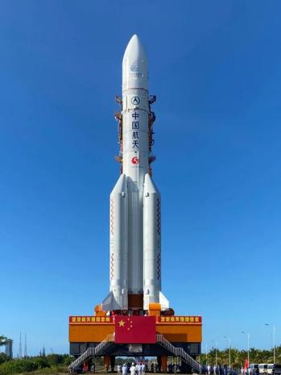
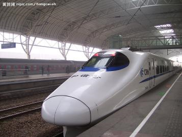
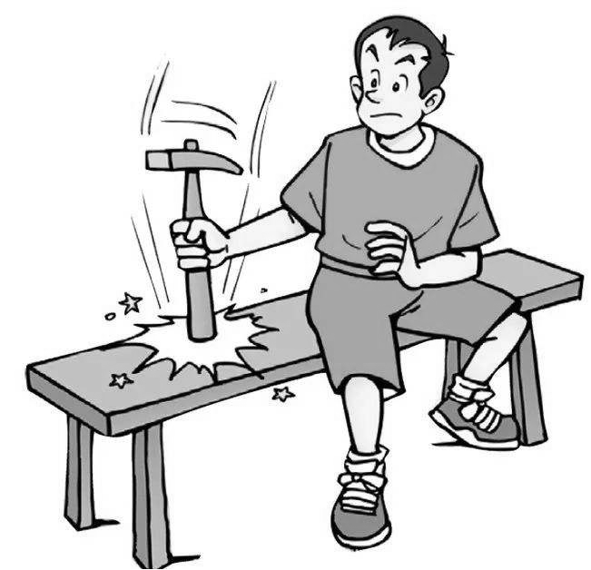
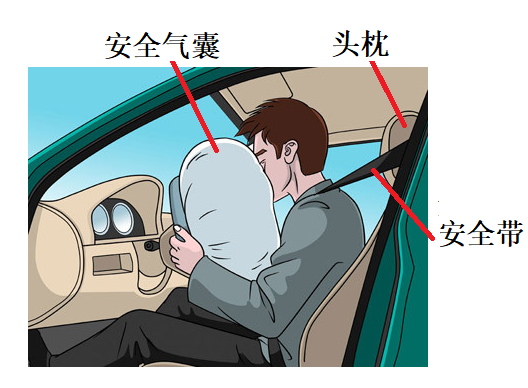

# 知识点·惯性的应用（同步练习）

> 教材：物理·八年级全一册·沪科技版2024新教材 ｜ 来源：国家中小学智慧教育平台·在线练习 ｜ 共 7 题

## 1. 单选题（难度：简单）

物理知识渗透在我们的生活中.以下警示语中，与惯性知识无关的是（   ）.

- A. 商场过道标有“禁止攀爬”
- B. 公路旁立有“雨天路滑，减速慢行”
- C. 汽车后窗贴有“保持车距”
- D. 交通规则中写有“行车时系好安全带”

【答案】A

【解析】​

## 2. 单选题（难度：适中）

地球在不停地自西向东转动，对跳远运动员来说（   ）.

- A. 面向西跳最有利
- B. 面向东跳最有利
- C. 面向南或北跳最有利
- D. 地球自转不影响运动员的成绩

【答案】D

【解析】​

## 3. 多选题（难度：简单）

关于惯性，下列说法中正确的是（     ）.

- A. 物体在静止时不容易推动，所以物体在静止时比在运动时惯性大
- B. 物体在高速运动时不容易停下来，所以物体速度越大惯性越大
- C. 物体没有受到力作用时，也能保持匀速直线运动是由于物体具有惯性
- D. 惯性是物体的固有属性，任何物体在任何情况下都有惯性

【答案】C/D

【解析】​

## 4. 单选题（难度：适中）

2020年7月23日，我国国家航天局在海南文昌航天发射场用“长征五号”遥四运载火箭成功发射火星探测器“天问一号”.当火箭助推器的燃料燃烧后自动脱离火箭，如图所示，当助推器脱离火箭后，助推器（     ）.

- A. 静止
- B. 立即下落
- C. 匀速直线运动
- D. 先上升一段距离后下落

【答案】D

【解析】​

## 5. 单选题（难度：适中）

下列现象符合实际的是（    ）.

- A. 
如图行驶的汽车突然刹车时，乘客会向后倾倒
- B. 
如图动车即将进站时关闭电源，能继续向前运行缓慢进站
- C. 
如图“嫦娥五号”探测器，脱离地球引力范围，关闭发动机后就会静止
- D. 
如图滑雪运动员加速下滑过程中，惯性会越来越大

【答案】B

【解析】​

## 6. 填空题（难度：简单）

当汽车突然启动时，坐在公共汽车里的乘客由于具有，他会向（选填“前”或“后”）倾.

【答案】惯性，后

【解析】​

## 7. 填空题（难度：简单）

如果锤头的手柄松了，常用撞击锤柄下端的方法使锤头紧套，这利用了（选填“锤头”或“锤柄”）的惯性；低速行驶的汽车，一旦被追尾，这时对人体起到保护作用（选填“安全带”或“头枕”或“安全气囊”）.

  

【答案】锤头，头枕

【解析】​
