# 知识点·托盘天平的使用（同步练习）

> 教材：物理·八年级全一册·沪科技版2024新教材 ｜ 来源：国家中小学智慧教育平台·在线练习 ｜ 共 18 题

## 1. 单选题（难度：简单）

在“用托盘天平称物体的质量”的实验中，下列哪项操作不是必要的（    ）

- A. 判断天平横梁是否水平平衡，一定要等指针完全静止下来
- B. 使用天平时，应将天平放在水平工作台面上
- C. 调节横梁平衡时，应先将游码移至横梁标尺左端零刻度线上
- D. 称量时左盘应放置待称量的物体，右盘放置砝码

【答案】A

【解析】​

## 2. 单选题（难度：适中）

在“用天平测量物体的质量”实验中，小雨用调好的天平测量烧杯和液体的总质量. 将烧杯轻轻放入左盘，往右盘加了一个20g的砝码、一个10g的砝码、一个5g的最小砝码，发现指针偏向分度盘中线右边一点，这时小雨应该（    ）

- A. 把平衡螺母向右调节一些
- B. 需要取下5g的砝码，并再向右拨动游码
- C. 把平衡螺母向左调节一些
- D. 不需取下5g的砝码，直接向右拨动游码

【答案】B

【解析】​

## 3. 单选题（难度：适中）

用天平测量一只医用外科口罩的质量，下列做法最合理的是（    ）

- A. 把一只口罩反复折叠后，放在托盘上测量
- B. 把一只口罩放在托盘上，测量3次求平均值
- C. 把20只口罩放在托盘上，测出总质量，再除以20
- D. 把一只口罩和一个10g砝码放在托盘上，测出总质量，再减去砝码质量

【答案】C

【解析】​

## 4. 单选题（难度：简单）

如图所示，托盘天平放到水平桌面上，发现摆动停止时，指针位于分度盘中央刻度线的左侧，接下来调节横梁平衡的操作是（    ）

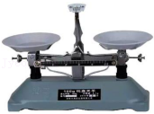

- A. 向右移动平衡螺母
- B. 向左移动平衡螺母
- C. 天平左右托盘对调
- D. 向右移动标尺游码

【答案】A

【解析】​

## 5. 单选题（难度：简单）

将一架托盘天平放在水平台上，调平后在天平的左盘内放入被测物体，右盘内放入10g砝码. 此时，指针所指位置如图所示，要测出物体的质量，接下来应该进行的操作是（    ）

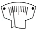

- A. 将平衡螺母向右移
- B. 将10g砝码换成更小的砝码
- C. 此时天平平衡可以直接读数
- D. 继续向右盘添加砝码或移动游码

【答案】D

【解析】​

## 6. 单选题（难度：适中）

小君取了100枚相同的大头针放在调好的天平左盘，横梁重新平衡后如图所示，则这些大头针的总质量为（    ）

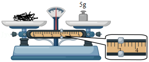

- A. 8g
- B. 8.3g
- C. 3g
- D. 80mg

【答案】A

【解析】​

## 7. 单选题（难度：适中）

小明想用托盘天平测量一枚曲别针的质量，下列做法中，简单而又比较准确的是（    ）

- A. 先测出100枚相同的曲别针的总质量\( m\)，再通过\( \frac{m}{100}\)计算求得
- B. 把一枚曲别针放在一只杯子中测出其总质量，再减去杯子的质量
- C. 把一枚曲别针放到天平左盘，用游码仔细测量
- D. 把一枚曲别针放在天平左盘里反复测量，再求出平均值

【答案】A

【解析】​

## 8. 单选题（难度：适中）

用托盘天平称量物体质量时，将被称量的物体和砝码放错了位置. 若天平平衡时，左盘放有100g和10g的砝码各一个，游码所对的刻度值是2g，则物体的质量为（    ）

- A. 104g
- B. 112g
- C. 108g
- D. 110g

【答案】C

【解析】​

## 9. 单选题

用托盘天平测量物体质量时，细心的小红发现天平的砝码缺了一角，用该砝码测得物体的质量与物体质量的真实值相比（    ）

- A. 偏大
- B. 相等
- C. 偏小
- D. 无法判断

【答案】A

【解析】​

## 10. 单选题

使用托盘天平测量物体质量时，一定会造成测量结果偏小的是（    ）

- A. 使用沾有油污的砝码进行测量
- B. 测量时，指针偏向分度盘的右侧就进行读数
- C. 调节平衡时候，游码没有归零
- D. 称量过程中，调节了平衡螺母

【答案】A

【解析】​

## 11. 填空题（难度：适中）

小明同学调节托盘天平平衡时，发现指针停在分度盘如图甲位置. 这时他应将平衡螺母向（选填“左”或“右”）调；天平调节平衡后，小明按图乙所示的方法来称物体的质量，小华立即对小明说：“你操作时犯了一个错误”. 小华所说的错误是： ；小明改正错误后，用天平测量某物体的质量，当所加砝码和游码位置如图丙所示时，天平横梁恰好水平平衡，则该物体的质量为 g. 

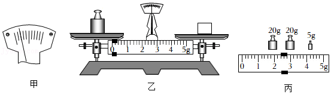

【答案】右，物体和砝码放反了，47.4

【解析】​

## 12. 填空题（难度：适中）

如图甲将天平放在水平桌面上，要调节横梁平衡接下来的调节过程为：，调节横梁平衡螺母，直至指针指在分度盘中央. 调节完成后测物体质量，天平平衡时如图乙所示，则物体质量为 g. 

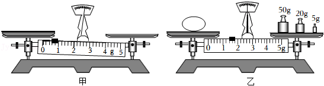

【答案】将游码移至标尺左端的零刻度线处，76.4

【解析】​

## 13. （难度：简单）

在使用托盘天平测物体质量的实验中：

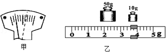

将天平放在水平桌面上，游码移至称量标尺左端的“0”刻度线上后，若发现天平指针在分度标尺中央两侧摆动，摆动幅度如图甲所示，则可判定下一步应该进行的操作是：.

实验中，当天平右盘内所加砝码的位置如图乙所示时，天平恰好平衡，则被测物体的质量是 g.

【答案】向右调节平衡螺母，63.6.

【解析】​

## 14. （难度：适中）

测量物体的质量时常常用到托盘天平，请完成下列问题：

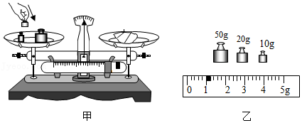

请指出图甲所示操作中的错误（写出两处即可）、.

小明同学要称量10.2g的食盐，1g以下用游码. 操作如下：
\( \text{①}\)取10g砝码放入右盘；
\( \text{②}\)将托盘天平放在水平台面上，正确调节平衡螺母使其平衡；
\( \text{③}\)向左盘内添加食盐直到指针位于分度盘中央刻度线；
\( \text{④}\)移动游码到0.2g处；
以上操作的合理顺序是（填序号）.

小红同学用已调节好的托盘天平称量某物体的质量时，盘内的砝码及游码的位置如图乙所示，则该物体的质量为g，此时小明发现小红误将砝码放在了左盘，若其它操作都正确，则物体的质量应为g.

【答案】物体和砝码放反了/用手拿砝码了，②①④③，81/79

【解析】​

## 15. 

在“使用天平测量质量”的实验中，小奇选取的天平配备的砝码规格为100g、50g、20g、10g、5g. 

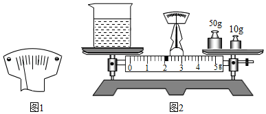

将天平放置于水平台面上，刻度盘指针如图1所示，则应将平衡螺母往调节.

正确调节后，测量空烧杯的质量. 估计空烧杯的质量约30g，则依次往右托盘放入20g和10g砝码后，指针偏向右侧，则应取下10g砝码，加上 g砝码，同时调节游码，直到天平平衡. 最后，测得空烧杯质量为28.0g.

如图2所示，为测得烧杯和液体的总质量，则杯中液体的质量为 g.

以下操作中，天平的两次平衡，指针均在刻度盘的中央刻线处，则对天平测量物体质量的结果没有影响的是（   ）

- A. 放置天平的台面不水平
- B. 砝码集中在托盘的一侧
- C. 两个托盘的质量有差异
- D. 称量中水平台面被推动

【答案】右，5，34，B/C

【解析】​

## 16. （难度：适中）

小明是集邮爱好者，在网上购买了100枚世博会首发纪念邮票. 他想利用天平测量出一枚邮票的质量大约是多少.

在调节天平横梁平衡时，他先将移至标尺左端的“0”刻度线处，若发现天平指针在分度标尺中央两侧左右摆动，摆动幅度如图甲所示，则可判断下一步应该进行的操作是：.

调节天平横梁平衡后，他将100枚世博会首发纪念邮票放在天平的左盘中，在右盘加减砝码和移动游码使天平重新平衡. 当天平右盘内所加砝码和游码的位置如图乙所示时，天平恰好重新平衡，则一枚邮票的质量约是 mg. 

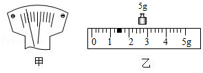

【答案】游码/向右调平衡螺母至天平平衡，64

【解析】​

## 17. （难度：适中）

在“用天平测量固体的质量”实验中，某同学用天平测量石块的质量，步骤如下：

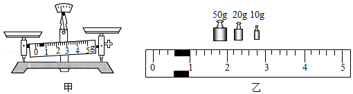

将天平取出，放置在上，如甲图所示，此时应该先调节（选填“平衡螺母”或“游码”）；

天平调平衡后，将待测的石块放在天平的（选填“左”或“右”）盘上，用向另一托盘中加减砝码. 根据石块的估计质量，向天平上加砝码时，应该先加（选填“大”或“小”）砝码；

在测量的时候，如果添加最小的砝码嫌多，而取出最小的砝码又嫌少. 这种情况下应该取出最小的砝码，并调节（选填“平衡螺母”或“游码”）使得天平平衡；

本次测量中，天平平衡时，游码位置和盘中砝码的情况如图乙所示，则该石块的质量是 g，如果本次测量中的砝码有生锈（砝码质量变大），那么石块的真实质量（选填“大于”、“小于”或“等于”）测量结果.

【答案】水平桌面/游码，左/镊子/大，游码，80.6/大于

【解析】​

## 18. （难度：适中）

小明所在学习小组在实验室练习用天平测质量，砝码盒中有5g、10g、20g、20g、50g、100g的砝码各一个. 

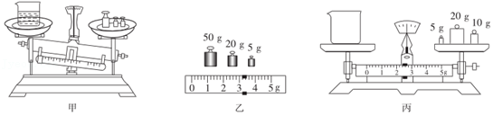

将天平放在水平台上，将游码移至标尺左端的处，再调整天平平衡.

将盛有液体的烧杯放在天平的左盘，在右盘中放入50g、20g、10g的三个砝码后，天平横梁静止在如图甲所示位置，此时天平的横梁处于（选填“平衡”或“不平衡”）状态. 接下来的操作是.

继续实验，当天平再次平衡时，右盘的砝码和游码在标尺上的位置如图乙所示，则烧杯和液体的总质量是g.

接着他们将烧杯中的液体全部倒出，测出了烧杯的质量如图丙所示，则烧杯内液体的质量为g，他们用该方法测得的液体质量与真实值相比偏，原因是.

【答案】&ldquo;0&rdquo;刻度线，平衡/取下10g砝码，添加5g的砝码，直至天平横梁平衡，78.2g，40.8g/小/将烧杯内液体全部倒出时，烧杯内壁残留着一部分液体

【解析】​
