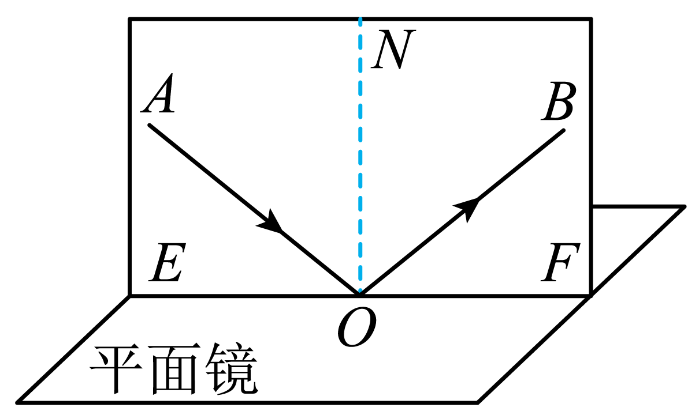
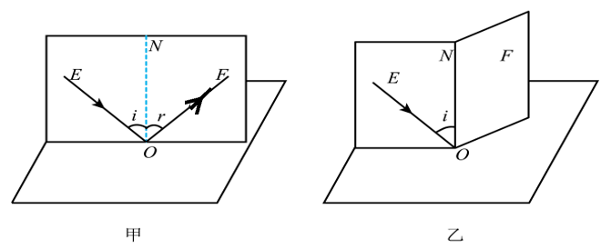
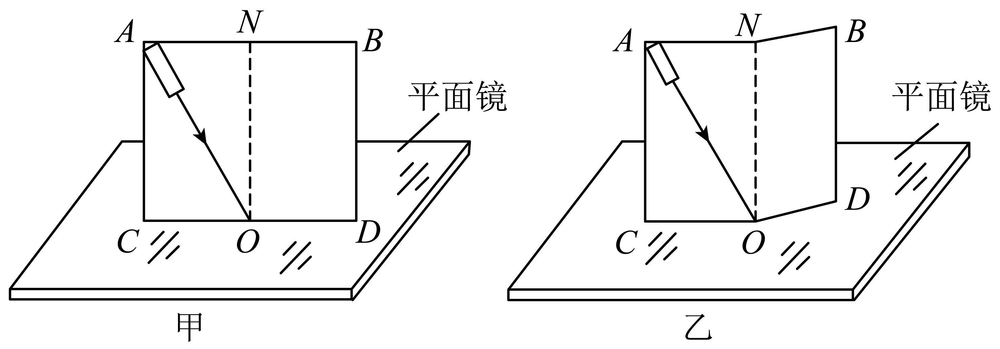

# 知识点·探究光的反射定律（同步练习）

> 教材：物理·八年级全一册·沪科技版2024新教材 ｜ 来源：国家中小学智慧教育平台·在线练习 ｜ 共 3 题

## 1. 单选题（难度：简单）

利用如图装置探究光的反射定律，下列判断正确的是（    ）．

- A. 入射光线与法线重合时，反射角为\( \text{90°}\)
- B. 反射光线\( OB\)是入射光线\( AO\)发生镜面反射形成的
- C. 入射光线\( AO\)靠近法线时，反射光线\( OB\)远离法线
- D. 纸板\( F\)向后折时看不到反射光线，原因是这时没有反射光线

【答案】B

【解析】​

## 2. 填空题（难度：简单）

在探究光的反射规律的实验中，将平面镜放在水平桌面上，硬纸板竖直地立在平面镜上，硬纸板上的直线\( ON\)垂直于镜面，右侧纸板可绕\( ON\)转动．
    

​
（1）如图甲所示，一束光贴着纸板沿某一方向射到\( O\)点，经平面镜反射，沿另一个方向射出．当入射光\( EO\)向\( ON\)靠近的过程中，发现反射光\( OF\)  \( ON\)（选填“远离”或“靠近”）．为了精确探究光的反射规律，除了图中的器材和刻度尺，还需要的测量工具是；
（2）如图乙所示，保持左侧纸板和入射光的位置不变，将右侧纸板绕\( ON\)向后转动，此时在右侧纸板上（选填“能”或“不能”）看到反射光，这是因为：．

【答案】靠近，量角器，不能，反射光线、入射光线和法线在同一平面内

【解析】​

## 3. 填空题（难度：简单）

在“探究光的反射规律”的实验装置如图甲所示，平面镜放在水平桌面上，标有刻度（图中未画出）的白色纸板\( ABCD\)能绕垂直于\( CD\)的\( ON\)轴翻转，在纸板上安装一支可在纸板平面内自由移动的激光笔．

    
（1）实验前，应将纸板\( ABCD\) 放置于平面镜上．移动激光笔，使入射光线绕入射点\( O\)沿逆时针方向转动，可观察到反射光线沿（选填“顺”或“逆”）时针方向转动．
（2）移动激光笔，使入射角为60°，此时测得反射角的度数也为60°，由此可以得到结论“反射角等于入射角”，你认为得出这个结论的不妥之处是：．
（3）如图乙所示，如果将硬纸板的右半部分向后折任意角度，此时在硬纸板上（选填“能”或“不能”）看到反射光线．此现象说明．
（4）在实验中硬纸板的作用是，这是因为光线在硬纸板上发生了（选填“镜面反射”或“漫反射”）．

【答案】垂直，顺，实验次数太少，实验结论具有偶然性，不能，反射光线、入射光线和法线在同一平面内，显示光路，漫反射

【解析】​
