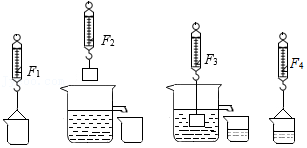
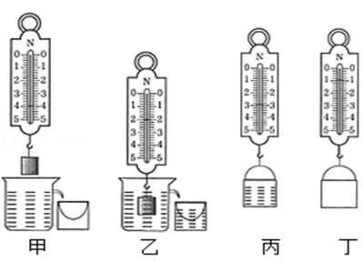
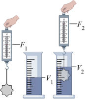
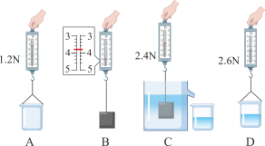

# 知识点·探究浮力的大小与排开液体所受重力的关系（同步练习）

> 教材：物理·八年级全一册·沪科技版2024新教材 ｜ 来源：国家中小学智慧教育平台·在线练习 ｜ 共 4 题

## 1. 单选题（难度：适中）

某实验小组在探究“浮力大小跟排开液体所受重力的关系”时，做了如图所示的四次测量，弹簧测力计的示数分别为\( {F}_{1}\)、\( {F}_{2}\)、\( {F}_{3}\)和\( {F}_{4}\)，则下列说法正确的是（   ）. 

- A. \( {F}_{1}+{F}_{2}={F}_{3}-{F}_{4}\)
- B. \( {F}_{1}-{F}_{2}={F}_{3}+{F}_{4}\)
- C. \( {F}_{1}+{F}_{2}={F}_{3}+{F}_{4}\)
- D. \( {F}_{1}-{F}_{2}={F}_{3}-{F}_{4}\)

【答案】C

## 2. 单选题（难度：简单）

在探究物体所受浮力的大小跟它排开液体所受的重力的关系实验时，具体设计的实验操作步骤如图甲、乙、丙和丁所示. 为方便操作和减小测量误差，最合理操作顺序应该是（    ）. 

- A. 甲、丁、乙、丙
- B. 乙、甲、丙、丁
- C. 乙、甲、丁、丙
- D. 丁、甲、乙、丙

【答案】D

## 3. 填空题（难度：适中）

在“验证阿基米德原理”的实验中，需要验证和的大小关系. 根据图中所示的实验信息，上述两个物理量的大小可用字母表示为、. （量筒内液体为水，水的密度为\( {\rho }_{\text{水}}\)，重力常数为\( g\)，以上两空请用相关字母表示）

【答案】物体浸入液体中受到的浮力， 物体排开液体的重力，$ {F}_{1}-{F}_{2}$，$ {\rho }_{\text{水}}g\left({V}_{2}-{V}_{1}\right)$

## 4. 填空题（难度：简单）

某实验小组按照如图所示的步骤，探究“浮力的大小与排开液体所受重力的关系”. 

 
（1）把石块浸没在盛满水的溢水杯中，石块受到的浮力大小为 \( \text{N}\)；
（2）由以上步骤可初步得出结论：浸在水中的物体所受浮力的大小等于它排开液体所受的重力；若溢杯的水没有装满，则会导致本实验测量的\( {F}_{\text{浮}}\)\( {G}_{\mathrm{排}}\)；
（3）另一组实验小组在步骤\( C\)的操作中，只将石块的一部浸没在水中，其他步骤正确，则（选填“仍能”或“不能”）与（2）相同的结论.

【答案】1.4，大于，仍能
