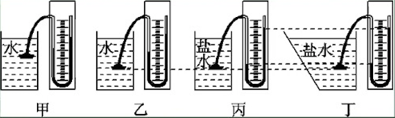
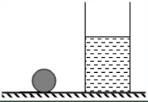
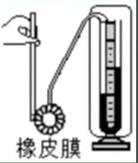

# 知识点·探究液体压强实验（同步练习）

> 教材：物理·八年级全一册·沪科技版2024新教材 ｜ 来源：国家中小学智慧教育平台·在线练习 ｜ 共 3 题

## 1. 填空题（难度：简单）

如图所示，某实验小组探究液体的压强规律. 
（1）探究装置叫，是用来测量的，液体压强大小通过来显示. 
（2）实验前，要注意检查装置的性，使左右两侧玻璃管中的液面. 
（3）甲、乙两图是探究液体压强与关系的. 
（4）要探究液体压强与盛液体的容器形状是否有关，应选择两图进行对比，结论是：液体压强与盛液体的容器形状. 
（5）在图丙中，固定该装置金属盒的橡皮膜在盐水中的深度，使橡皮膜分别处于向上、向下、向左、向右等方位，这是为了探究同一深度处，液体向的压强的大小关系. 
 

【答案】液体压强计，液体内部压强，$ U$型管两侧液面高度差，气密，相平，深度，丙、丁，无关，各个方向

【解析】​

## 2. 

如图所示，在水平桌面上，在水平桌面上，有一质量为\( \text{2kg}\)的实心小球和一薄壁圆柱形容器，容器中装有水. 现将小球轻轻放入容器后，小球浸没在水中并静止在容器底部，水未溢出. 分别测出小球放入前后水对容器底部的压强p水，小球放入前后容器对水平桌面的压强p来，如表所示. （\( {\rho }_{\text{水}}=1.0\times {\text{10}}^{\text{3}}\text{kg/}{\text{m}}^{\text{3}}\)，\( g\)取\( 10\text{N/kg}\)）. 求：

（1）小球的重力；

（2）小球放入前，容器中水的深度；

（3）小球的密度. 

 
 
 
  

 
 
 浸入前

 
 
 浸没后

 
 

 
 
 \( {p}_{\text{水}}\)/\( \text{Pa}\)

 
 
 2000

 
 
 2400

 
 

 
 
 \( {p}_{\text{桌}}\)/\( \text{Pa}\)

 
 
 2500

 
 
 3500

 
 

 

【答案】

（1）$ \text{20}\text{N}$；（2）$ \text{0.2m}$；（3）$ 2.5\times {\text{10}}^{\text{3}}\text{kg/}{\text{m}}^{\text{3}}$  

【解析】​

## 3. 填空题（难度：适中）

小明在探究“液体压强的大小与液体深度和液体密度的关系”实验中，所用的器材有：\( U\)形管
压强许、烧杯、刻度尺，足量的酒精、水和盐水，已知\( {\rho }_{\text{酒精}}<{\rho }_{\text{水}}<{\rho }_{\text{盐水}}\). 
（1）如图，\( U\)形管压强计上的\( U\)形管（选填“属于”或“不属于”）连通器. 
 

 
（2）实验前，该同学通过实验採作检查了探头与U形管之间是否漏气，请简要说明该同学是如何通过实验操作检查装置是否漏气
（3）实验时得到的几组数据如下表：
序号
液体
液体深度\( h\text{/cm}\)
高度差\( h\text{/cm}\)

1
水
3
2.7

2
水
6
5.8

3
水
9
8.9

4
酒精
9
6.4

5
盐水
9
10.1

根据表中的数据，请回答下列问题：
\( \text{①}\)比较序号为的三组数据，可得出的结论是：液体压强与密度有关. 
\( \text{②}\)比较序号1、2、了的三组数据，小明得出：“当液体密度一定时，液体的深度越大，液体压强
越大”的结论，在此基础上，小明想让结论更具普遍性，他该怎样做？ 
\( \text{③}\)实验中序号3的数据的作用是

【答案】不属于，用手轻轻按压橡皮膜，观察U型管两侧液面高度差是否能灵活升降. 如果能，则装置不漏气；如果U型管两侧液面高度差变化不大，则装置漏气；，3、4、5，换用不同的液体多次测量，两次探究的共同数据，减少实验次数

【解析】​
