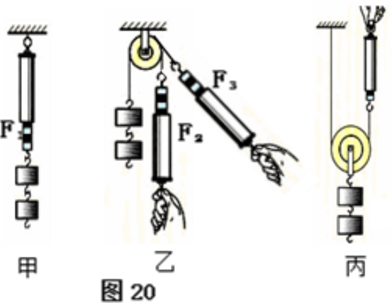
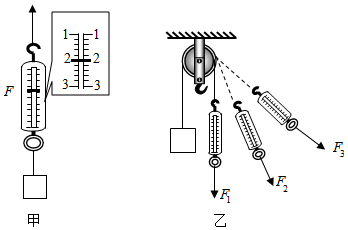

# 知识点·探究滑轮的特点（同步练习）

> 教材：物理·八年级全一册·沪科技版2024新教材 ｜ 来源：国家中小学智慧教育平台·在线练习 ｜ 共 3 题

## 1. 填空题（难度：适中）

如图是小明同学“研究定滑轮和动滑轮特点”的实验装置．他按图示提起钩码时注意保持测力计匀速移动，分别测得一组数据如下表所示，请你分析：

（1）比较测力计示数的大小，可知：使用动滑轮的好处是；
（2）比较测力计拉力的方向，可知：使用定滑轮的好处是；
（3）把钩码升高相同的高度，比较乙和丙实验测力计移动的距离，可知：使用动滑轮；
（4）在提升重物的过程中，如果要同时兼顾定滑轮和动滑轮的特点，则应选择；
 
钩码重
\( G\text{/N}\) 
钩码升高
高度\( h\text{/m}\)
测力计
示数\( F\text{/N}\)
测力计
移动距离\( s\text{/m}\)

甲
0.98
0.2
0.98
0.2

乙
0.98
0.2
1.02
0.2

丙
0.98
0.2
0.55
0.4

【答案】省力，可以改变力的方向，费距离，滑轮组

【解析】​

## 2. 填空题（难度：适中）

同学们共同研究滑轮和滑轮组的特点：

     ​

       ​

    
（1）他们研究定滑轮特点时，做的实验如甲图所示，据此可证明：使用定滑轮可以，但不可以；
（2）他们研究动滑轮特点时，用动滑轮匀速竖直提升重物，如乙图所示. 据此可知，使用动滑轮可以，但不可以；
（3）他们组装滑轮组时，他们想：利用滑轮组提升重物能否省力呢？为此，他们进行的实验如丙图所示，物体的重力为\( \text{2N}\)，测力计的示数为 \( \text{N}\)，由图可知，利用滑轮组提升重物能，如果物体被提升的速度是\( \text{0.2m/s}\)，绳子自由端移动的速度是 \( \text{m/s}\).

【答案】改变力的方向，省力，省力，改变力的方向，0.8，省力，0.6

【解析】​

## 3. 填空题（难度：适中）

在“探究定滑轮特点”的实验中，过程如下：（不计绳重和摩擦）

（1）弹簧测力计校零后，其下方悬挂物体. 如图甲所示，匀速向上提升物体时测力计示数\( F=\)  \( \text{N}\)；
（2）如图乙所示，细线的一端系上物体，另一端绕过滑轮与弹簧测力计相连，沿\( F\)方向匀速拉动测力计可使物体向运动，这一过程中该滑轮是一个滑轮，它使用时的优点是；
（3）如图乙所示，分别用拉力\( {F}_{1}\)、\( {F}_{2}\)、\( {F}_{3}\)匀速提升重物，则三个力的大小关系是.

【答案】2，上，定，改变力的方向，$ {F}_{1}={F}_{2}={F}_{3}$

【解析】​
