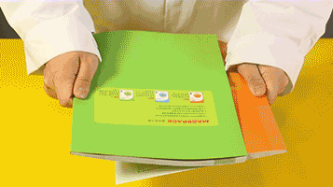
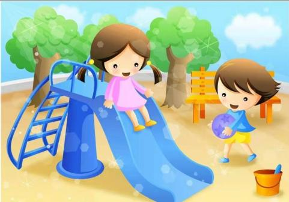
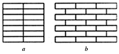

# 知识点·摩擦力的产生条件（同步练习）

> 教材：物理·八年级全一册·沪科技版2024新教材 ｜ 来源：国家中小学智慧教育平台·在线练习 ｜ 共 4 题

## 1. 单选题（难度：简单）

如图所示，将两本书的书页交叉叠放在一起后很难沿水平方向被拉开，这是因为拉书时书页间会产生较大的（    ）. 

- A. 弹力
- B. 压力
- C. 摩擦力
- D. 重力

【答案】C

【解析】​

## 2. 单选题（难度：简单）

小红学习了摩擦力后写了一首打油诗，“表面粗糙不光滑，紧密相亲还挤压. 滚动滑行非想静，相邻面上产摩擦”. 分析打油诗中内容，下列不是摩擦力产生条件的是（    ）.

- A. 两个物体相互接触
- B. 两个接触面都粗糙
- C. 两个物体间有压力
- D. 两个物体一定运动

【答案】D

【解析】​

## 3. 单选题（难度：适中）

小孩从滑梯上滑下的过程，受到的力有（    ）. 

- A. 下滑力、摩擦力
- B. 重力、下滑力、摩擦力
- C. 下滑力、摩擦力、重力、支持力
- D. 重力、支持力、摩擦力

【答案】D

【解析】​

## 4. 填空题（难度：简单）

砌墙时墙的砖块应采用如图（选填“\( a\)”或“\( b\)”）所示的形式砌叠而成，因为这样当砖墙分裂时，每层砖块之间会产生力以抵抗分裂. 

【答案】b，摩擦

【解析】​
