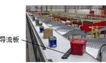
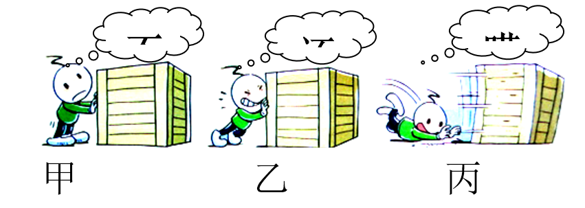
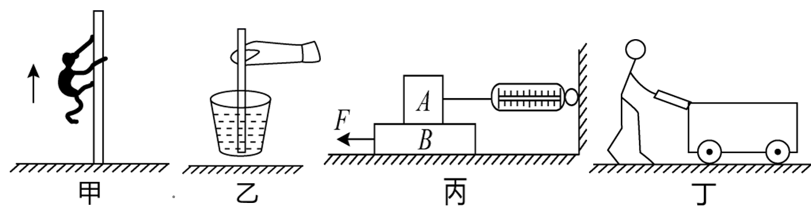
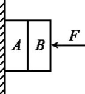
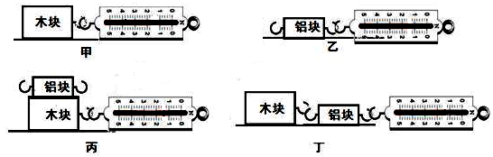
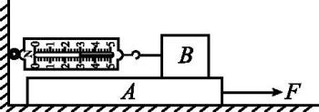
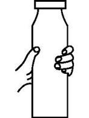
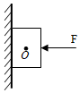

# 知识点·摩擦力的大小和方向（同步练习）

> 教材：物理·八年级全一册·沪科技版2024新教材 ｜ 来源：国家中小学智慧教育平台·在线练习 ｜ 共 11 题

## 1. 单选题

如图甲所示，完全相同的木块\( A\)和\( B\)叠放在水平桌面上，在\( \text{10N}\)水平拉力\( {F}_{1}\)的作用下，\( A\)、\( B\)一起做匀速直线运动；如图乙所示，将\( A\)、\( B\)紧靠着放在同一水平桌面上，用水平力\( {F}_{2}\)推\( A\)使它们一起做匀速直线运动，甲、乙两种情况中，\( A\)受到的摩擦力分别是（　　）. 

- A. \( \text{10N}\)、\( \text{0N}\)
- B. \( \text{10N}\)、\( \text{5N}\)
- C. \( \text{10N}\)、\( 1\text{0N}\)
- D. \( \text{0N}\)、\( \text{5N }\)

【答案】B

【解析】​

## 2. 单选题（难度：适中）

快递自动分拣系统展示了“中国制造”的实力. 如图是水平分拣线传动面上分拣快件时的情形，下列对快件的分析正确的是（   ）. 

- A. 同一个物体运动速度增大时，受到摩擦力也增大
- B. 物体刚放到传动面上时受到摩擦力的方向与传送带运动方向相反
- C. 物体匀速直线运动时质量大的物体受到的摩擦力大
- D. 物体匀速直线运动时不受到分拣线传动面的摩擦力

【答案】D

【解析】​

## 3. 单选题（难度：简单）

为了探究滑动摩擦力，小红同学利用牙刷做实验. 当用力匀速拖动牙刷时，刷毛发生了如图所示的弯曲，对这一实验的分析错误的是（      ）. 

- A. 刷毛弯曲越厉害说明牙刷受到的力越大
- B. 从刷毛弯曲的方向可以判断牙刷受到摩擦力的方向向左
- C. 手对牙刷的拉力和牙刷受到的摩擦力不平衡
- D. 牙刷受到的摩擦力作用在刷毛上

【答案】C

【解析】​

## 4. 多选题（难度：适中）

小红观察如下漫画，总结了四个观点，正确的是（    ）. 

- A. 甲图此刻人对箱子的推力等于箱子受到的摩擦力
- B. 乙图漫画中小孩用比甲图中更大的力去推箱子，但是箱子仍没有移动. 此刻箱子受到的摩擦力大于甲图此刻箱子受到的摩擦力
- C. 乙图此刻人对箱子推力和箱子对人的力是平衡力
- D. 丙图箱子在同一水平面上滑动时受到的摩擦力大小不变

【答案】A/B/D

【解析】​

## 5. 多选题（难度：适中）

如图所示四幅图对应的说法不正确的是（   ）. 

- A. 图甲中某同学沿杆匀速向上爬升时，该同学受到的摩擦力方向向下
- B. 图乙中筷子提米在空中静止时，米给筷子提供的摩擦力方向向下
- C. 图丙中力\( F\)拉动木板\( B\)使其速度逐渐变大的过程中，弹簧测力计的示数也变大
- D. 图丁中重\( \text{200N}\)的小车一定要\( \text{200N}\)的水平方向的力才能推着它做匀速直线运动

【答案】A/C/D

【解析】​

## 6. 多选题

如图所示，用水平压力\( F\)重力大小均为\( G\)的木块\( A\)、\( B\)压在竖直墙面上保持静止，下列说法中正确的是（   ）. 

- A. 木块\( B\)受到的摩擦力大小一定等于\( F\)
- B. 木块\( B\)受到的摩擦力方向为竖直向上
- C. 木块\( A\)受到墙面的摩擦力大小等于\( 2G\)
- D. 若增大力\( F\)，则木块\( B\)受到的摩擦力变大

【答案】B/C

【解析】​

## 7. 多选题（难度：适中）

某同学用下列器材研究影响滑动摩檫力大小的因素：粗糙程度均匀的长木板一块，质量相等的木块和铝块各一块，弹簧测力计一只. 如图所示，四次实验中他都用弹簧测力计沿水平方向缓慢拉动物块，使其在水平长木板上做匀速直线运动，下列说法正确的是（    ）. 

- A. 甲、丙两图所示的实验说明：接触面的粗糙程度相同时，滑动摩擦力的大小与重力大小有关.
- B. 对比甲、乙两图所示的实验可比较木块和铝块的粗糙程度
- C. 丙图中，铝块受到的摩擦力大小为0N
- D. 丁图中铝块受到的摩擦力大小等于乙图中铝块受到的摩擦力大小

【答案】B/C/D

【解析】​

## 8. 填空题（难度：适中）

如图所示，在\( \text{15N}\)的水平拉力\( F\)作用下，木板\( A\)在水平地面上向右做匀速直线运动的过程中，物体\( B\)相对于地面静止，此时弹簧测力计的示数为\( \text{3N}\)，则\( B\)所受滑动摩擦力的方向为水平向 （选填“左”或“右”），\( A\)受到地面的摩擦力大小为\( \text{N}\). 

【答案】右，12

【解析】​

## 9. 填空题（难度：适中）

如图所示，瓶子和水的总质量为\( \text{400g}\)，用手握住瓶子，瓶子静止不动时，手对瓶子的摩擦力大小为\( \text{N}\)，方向（\( g\)取\( \text{10N/kg}\)）. 若手握瓶子的力逐渐增大，则手与玻璃瓶之间摩擦力的大小将. 若再向瓶内加水，瓶子仍然静止不动，则手与玻璃瓶之间摩擦力的大小将. （均选填 “变大”“变小”“不变”）. 

【答案】4，竖直向上，不变，变大

【解析】​

## 10. 填空题（难度：适中）

如图所示，小红把一根筷子插在玻璃杯中间，装满糙米压紧并加少许水后，居然可以用筷子把装糙米的玻璃杯提起来，此时米给筷子摩擦力的方向是若吸水糙米重力为2N，玻璃杯重1N，当筷子提着糙米、杯子在空中静止时，筷子对糙米的摩擦力为N. 

【答案】竖直向下，3

【解析】​

## 11. （难度：简单）

木块所受重力是50N，如图对它施加一个水平向左的30N的压力将它压在竖直墙面上处于静止，画出此时木块受到的摩擦力的示意图（作用点画在重心上）. 

【答案】

  

【解析】​
