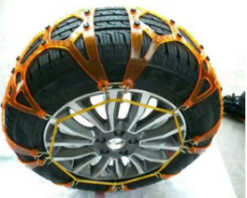
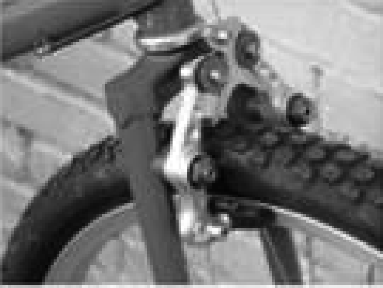
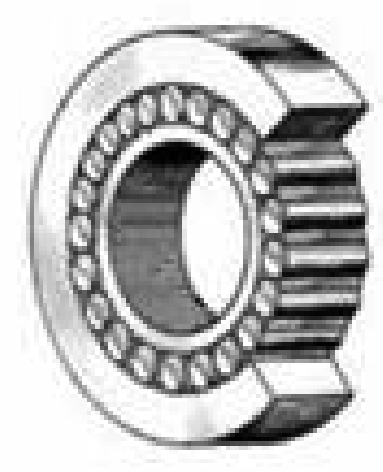
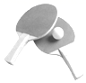

# 知识点·摩擦的利用和防止（同步练习）

> 教材：物理·八年级全一册·沪科技版2024新教材 ｜ 来源：国家中小学智慧教育平台·在线练习 ｜ 共 3 题

## 1. 单选题（难度：简单）

如图所示的措施中，为了减小摩擦的是（    ）.

- A. 汽车轮胎上加装防滑链

​

- B. 用力捏自行车的车闸

​

- C. 滚动轴承

​

- D. 乒乓球拍上贴有橡胶

​

【答案】C

【解析】​

## 2. 填空题（难度：简单）

观看体操比赛，常见体操运动员总要到镁粉盒内向手上涂些镁粉，其作用是（增大，减小）摩擦力. 手术医生在戴乳胶手套前总要在手上涂些滑石粉，其作用是（增大，减小）摩擦力.

【答案】增大，减小

【解析】​

## 3. 填空题（难度：简单）

下列各种摩擦中，属于有害摩擦的是，属于有益摩擦的是. 
\( \text{①}\)机器运转时，各部件之间的摩擦；
\( \text{②}\)拔河比赛时，手与绳之间的摩擦；
\( \text{③}\)汽车行驶时与空气之间的摩擦；
\( \text{④}\)吃饭时，筷子与食物之间的摩擦

【答案】$ \text{①③}$  ，$ \text{②④}$ 

【解析】​
