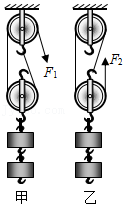

# 知识点·机械效率的概念（同步练习）

> 教材：物理·八年级全一册·沪科技版2024新教材 ｜ 来源：国家中小学智慧教育平台·在线练习 ｜ 共 5 题

## 1. 单选题（难度：简单）

关于机械效率，下列说法正确的是（     ）

- A. 有用功越大，机械的机械效率就越高
- B. 额外功越大，机械的机械效率就越低
- C. 总功越大，机械的机械效率就越低
- D. 有用功与总功的比值越大，机械的机械效率就越高

【答案】D

【解析】​

## 2. 单选题（难度：简单）

下列关于功、功率、机械效率的说法正确的是（     ）

- A. 额外功与总功之比越小，机械效率一定越大
- B. 机器的功率越大，机械效率一定越大
- C. 功率不同的机器，做的功一定不相等
- D. 物体做功越多，机械效率一定越大

【答案】A

【解析】​

## 3. 单选题（难度：适中）

某实验小组分别用如图所示的甲、乙两个滑轮组（动滑轮的重不相同）匀速提起相同的重物到相同的高度，所用拉力\( {F}_{1}\)和\( {F}_{2}\)相等. 不计绳重及摩擦，下列说法正确的是（     ）

- A. 乙图更省力，机械效率甲图大
- B. 甲图更省力，机械效率乙图大
- C. 甲、乙两图省力程度相同，所用的拉力\( {F}_{1}\)、\( {F}_{2}\)做功相等
- D. 甲、乙两图省力程度相同，机械效率甲图大

【答案】D

【解析】​

## 4. 单选题（难度：简单）

生产生活中常常会用到各种机械设备，下列说法正确的是（     ）

- A. 有用功越多，机械效率就越大
- B. 减小摩擦可以提高机械效率
- C. 机械做功越快，其效率就越高
- D. 精密机械的效率能达到\(100\% \)

【答案】B

【解析】​

## 5. 填空题（难度：简单）

某机械的效率为\(50\% \)，表示该机械做功时，功在总功中的比例为\(50\% \)，使用任何机械时，机械效率总是小于.

【答案】有用，100%

【解析】​
