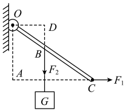
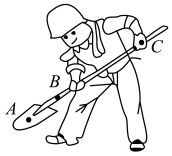
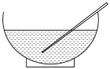

# 知识点·杠杆五要素（同步练习）

> 教材：物理·八年级全一册·沪科技版2024新教材 ｜ 来源：国家中小学智慧教育平台·在线练习 ｜ 共 4 题

## 1. 单选题（难度：简单）

下列关于杠杆的一些说法中，正确的是（    ）.

- A. 杠杆只可以是直的
- B. 动力臂就是支点到动力作用点的距离
- C. 杠杆支点一定在杠杆上
- D. 杠杆的长度等于动力臂与阻力臂之和

【答案】C

【解析】​

## 2. 单选题（难度：适中）

如图所示，杠杆可以绕\( O\)点转动，在\( B\)点挂一重物\( G\). \( C\)点施加一个水平拉力\( {F}_{1}\)，则\( {F}_{1}\)、\( {F}_{2}\)的力臂分别是（    ）. 

- A. \( OC\)和\( BC\)
- B. \( OA\)和\( OD\)
- C. \( OC\)和\( OB\)
- D. \( AC\)和\( BD\)

【答案】B

【解析】​

## 3. 填空题（难度：简单）

如果把铁锹看作费力杠杆，在图所示的\( A\)、\( B\)、\( C\)三点中，支点是点，动力作用点是点，阻力作用点是点. 

【答案】C，B  ，A

【解析】​

## 4. （难度：简单）

如图所示，一根粗细均匀的筷子放在盛有半碗水的碗中，此时的筷子可以等效为一根绕\( O\)点转的杠杆，画出这时的杠杆五要素. 

【答案】

​  

【解析】​
