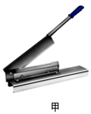
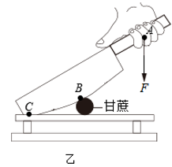
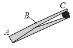
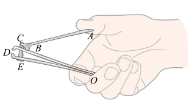

# 知识点·杠杆五要素及分类（同步练习）

> 教材：物理·八年级全一册·沪科技版2024新教材 ｜ 来源：国家中小学智慧教育平台·在线练习 ｜ 共 4 题

## 1. 单选题（难度：适中）

下图是生活中常用的简单机械，其中属于费力杠杆的是（    ）.

- A. 
打开瓶盖的起子
- B. 
取盘子的夹子
- C. 
修剪树枝的剪刀
- D. 
夹核桃的夹子

【答案】B

【解析】​

## 2. 单选题（难度：简单）

如图甲为用铡刀切甘蔗时的情景，若把铡刀视为一根能够绕固定点转动的杠杆，用图乙表示. 关于切甘蔗的过程，下列有关叙述中正确的是（    ）. 

  

- A. 铡刀属于省力杠杆，\( B\)是支点
- B. 铡刀属于费力杠杆，\( B\)是支点
- C. 铡刀属于省力杠杆，\( C\)是支点
- D. 铡刀属于费力杠杆，\( C\)是支点

【答案】C

【解析】​

## 3. 填空题（难度：简单）

人们常用的镊子是一种杠杆. 如图所示，用镊子夹取物体时，手压在\( B\)点处，则支点在点处，阻力作用点在\( C\)点处，是杠杆（填“省力”、“费力”或“等臂”）. 

【答案】A，费力

【解析】​

## 4. 填空题（难度：适中）

如下图为指甲剪的示意图，它由\( ABC\)、\( OBD\)和\( OED\)三个杠杆组成. 如果把\( B\)看作支点，则\( ABC\)是杠杆（填省力或费力），则动力臂是，\( OED\)杠杆中，\( O\)是支点，阻力臂是. 

【答案】省力，$ AB$  ，$ OD$ 

【解析】​
