# 知识点·杠杆五要素及平衡条件（同步练习）

> 教材：物理·八年级全一册·沪科技版2024新教材 ｜ 来源：国家中小学智慧教育平台·在线练习 ｜ 共 14 题

## 1. 单选题（难度：简单）

如图所示，轻质杠杆\( AB\)可以绕\( O\)点转动，在\( A\)点用细线悬挂一重物，在\( B\)点施加一竖直向下的动力，使杠杆在水平位置保持平衡. 若将动力的方向改为沿虚线方向，仍使杠杆在水平位置保持平衡，则（    ）. 

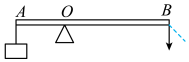

- A. 动力臂增大
- B. 动力臂减小
- C. 动力臂不变
- D. 条件不足，无法判断

【答案】B

【解析】​

## 2. 单选题（难度：适中）

如图是开瓶盖的起子开启瓶盖的示意图，可以看成是一个杠杆. 下列能正确表示出杠杆的支点、动力和阻力的图是（    ）. 

- A. 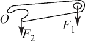
- B. 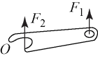
- C. 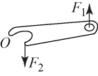
- D. 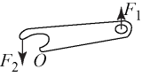

【答案】C

【解析】​

## 3. 单选题（难度：适中）

如图所示，是自卸车的示意图，车厢部分可视为杠杆，则下列分析正确的是（    ）. 

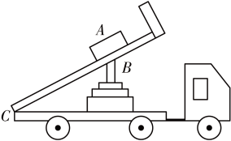

- A. \( C\)点是支点，液压杆施的力是动力，货物重力是阻力
- B. \( B\)点是支点，物体\( A\)放在车厢前部可省力
- C. \( C\)点是支点，物体\( A\)放在车厢后部可省力
- D. \( B\)点是支点，物体\( A\)放在车厢前部要费力

【答案】A

【解析】​

## 4. 单选题（难度：简单）

“节约用水，人人有责”，我们应养成随手关闭水龙头的好习惯. 水龙头手柄可视为如图所示杠杆，\( O\)为支点，\( F\)为阻力，分别沿图示的三个方向用力关闭水龙头，下列说法正确的是（    ）. 

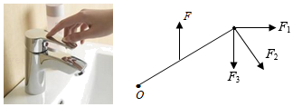

- A. 沿\( {F}_{1}\)方向最省力
- B. 沿\( {F}_{2}\)方向最省力
- C. 沿\( {F}_{3}\)方向最省力
- D. 三个方向同样省力

【答案】B

【解析】​

## 5. 多选题（难度：简单）

如图所示，在探究杠杆平衡条件的实验中，轻质杠杆上每个小格长度均为 \( \text{1.5cm}\). 在 \( B\)点竖直悬挂\( \text{4}\)个重均为\( \text{0.5N}\) 的钩码. 当在\( A\)点用与水平方向成\( \text{30}\text{°}\)角的动力\( {F}_{1}\)拉杠杆，使杠杆在水平位置平衡. 下列说法中错误的是（    ）. 

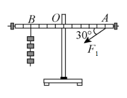

- A. 此时该杠杆为省力杠杆
- B. 该杠杆的阻力大小为\( {F}_{2}=2\text{N}\)
- C. 杠杆平衡时，动力臂\( l=7.5\text{cm}\)
- D. 杠杆平衡时，动力\( {F}_{1}=3.2\text{N}\)

【答案】A/C

【解析】​

## 6. 多选题

如图甲所示的杠杆是水平平衡的，在支点两侧的钩码下方分别加挂一个等重的物体，如图乙所示，则杠杆（    ）. 

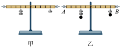

- A. 仍然水平平衡
- B. 不再水平平衡，\( B\)端下沉，\( A\)端上升
- C. 使杠杆重新水平平衡，将\( A\)端悬挂的重物一起向右移动
- D. 使杠杆重新水平平衡，将\( B\)端悬挂的重物一起向左移动

【答案】B/D

【解析】​

## 7. 填空题（难度：适中）

如图所示，轻质杠杆\( OA\)中点悬挂重为\( \text{80N}\)物体，在\( A\)端施加一竖直向上的力\( F\)，杠杆在水平位置平衡，则力\( F\)的大小是 \( \text{N}\)，保持\( F\)的方向不变，将杠杆从\( A\)位置匀速提升到\( B\)位置的过程中，力\( F\)将（选填“变大”、“变小”、或“不变”）. 

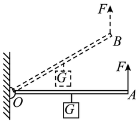

【答案】40，不变

【解析】​

## 8. 填空题（难度：简单）

如图所示，\( OA=AB=10\text{cm}\)，重物\( G=20\text{N}\)，要使轻质杠杆平衡，\( {F}_{B}=\)  \( \text{N}\)，此杠杆属于杠杆（选填“省力”、“费力”或“等臂”）. 

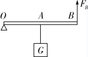

【答案】10，省力

【解析】​

## 9. 填空题（难度：适中）

如图是一辆装满同种货物的手推车，当前轮遇到障碍物\( A\)时，售货员向下压扶手，这时手推车可看作杠杆，支点是点（填字母）；当后轮遇到障碍物时，售货员向上提扶手，与前轮遇到障碍物时相比，此时较力（选填“省”或“费”）. 

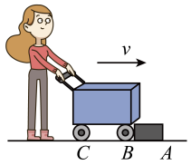

【答案】C，省

【解析】​

## 10. （难度：简单）

如图所示，轻质杠杆的支点为\( O\)，力臂\( OA=1\text{m}\)，\( OB=4\text{m}\)，在A端挂一体积为\( \text{1}{\text{m}}^{\text{3}}\)的物体\( G\)，\( B\)端施加一竖直向下、大小为\( 100N\)的拉力，杠杆恰能在水平位置平衡；求物体\( G\)所受重力. 

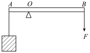

【答案】

400N  

【解析】​

## 11. （难度：适中）

如图所示，探究小组利用铁架台、带有刻度的杠杆、细线、若干相同钩码、弹簧测力计（单位：\( \text{N}\)）等实验器材探究杠杆的平衡条件，在探究实验中：

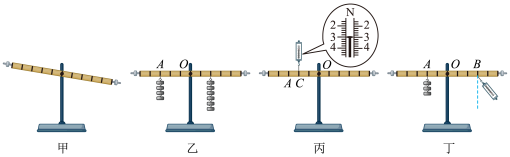

在挂钩码前，杠杆在如图甲所示的位置静止，此时杠杆（选填“达到”或“没达到”）平衡状态，接下来应将杠杆两端的平衡螺母向调节（选填“左”或“右”），使杠杆在水平位置平衡，这样做的目的是为了方便读出；

接着小组在杠杆的两侧挂上不同数量的钩码，移动钩码的位置，使杠杆重新在水平位置平衡（如图乙）. 若在 \( A\)、\( B\)下方分别去掉一个相同的钩码，则杠杆端将下沉（选填“左”或“右”）；

如图丙是已经调节平衡的杠杆，用弹簧测力计在杠杆\( C\)处竖直向上拉，在\( A\)处挂上适当的钩码，使杠杆在水平位置平衡，则弹簧测力计读数为 \( \text{N}\)，钩码的重力为 \( \text{N}\)；

如图丁所示，小明用弹簧测力计替代钩码，在\( B\)点竖直向下拉，然后将弹簧测力计逐渐向右倾斜，要使杠杆仍然在水平位置平衡，则弹簧测力计的示数将逐渐（选填“变大”或“变小”），原因是.

【答案】达到  /左  /力臂，右  ，3  /2，变大/拉力力臂变小

【解析】​

## 12. （难度：简单）

小明和同学们一起以小组为单位，探究杠杆的平衡条件；

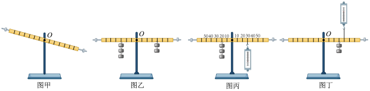

实验前，小明将杠杆的中点置于支架上，调节平衡螺母，使杠杆水平平衡，这样做的目的是为了消除. 当杠杆静止时，发现杠杆停在如图甲所示位置，小明将左端的平衡螺母向（选填“左”或“右”）调，晓华认为也可以将右端的平衡螺母向（选填“左”或“右”）调；

下面展示出了三个实验小组的实验方案和实验数据：
\( \text{①}\)如图乙，第一小组的同学分别在杠杆两侧挂上钩码，移动钩码，使杠杆重新在水平位置平衡. 做完两次实验，将实验数据记录在的表格中；
\( \text{②}\)如图丙，第二组同学在杠杆左侧挂钩码，右侧用弹簧测力计竖直向下拉杠杆，使杠杆重新在水平位置平衡. 做完两次实验，将实验数据记录在下面的表格中；
\( \text{③}\)如图丁，第三组同学在杠杆右侧挂钩码，用弹簧测力计在另一位置竖直向上拉杠杆，使杠杆重新在水平位置平衡. 每小组同学做完两次实验后，将数据分别记录在下面的实验表格中；
组别
次数
动力
\( {F}_{1}\text{/N}\) 
动力臂
\( {l}_{1}\text{/cm}\) 
阻力
\( {F}_{2}\text{/N}\) 
阻力臂
\( {l}_{2}\text{/cm}\) 

第一组
第一次
1
8
1
8

第二次
0.5
14
1
7

第二组
第一次
0.75
15
1.5
10

第二次
1.75
10
1
20

第三组
第一次
1.5
10
1
15

第二次
2
6
0.5
24

第一、三组同学归纳分析数据后得到相同的结论：\( {F}_{1}{l}_{1}={F}_{2}{l}_{2}\)，第二组同学的数据有一点差异，分析其中的原因是；

找出原因后，第二组同学也得到了同样的结论，通过不同方法得到同样结论，这种做法的优点是；

第一组的数据中有一次动力臂与阻力臂相等，这类杠杆是，此类杠杆的应用有（请举一例）.

【答案】杠杆自身重力对实验的影响  /左  /左，弹簧测力计倒着使用时，弹簧测力计的自重对杠杆平衡有影响  ，可以避免偶然性，使结论更有普遍的规律  ，等臂杠杆/天平

【解析】​

## 13. （难度：适中）

如图所示，如图所示的轻质杠杆\( OB\)，\( O\)为支点，\( OB\)长\( 40\)厘米，\( AB\)长\( \text{10}\)厘米，\( B\)端所挂物体重为\( \text{60}\)牛，求：

（1）在\( A\)点使杠杆水平平衡的最小拉力的大小和方向. 

（2）若改用\( \text{18}\)牛的力仍在\( A\)点竖直提起原重物，求重物的悬挂点离\( O\)点的距离. 

【答案】

（1）80N，方向竖直向上；

（2）9cm  

【解析】​

## 14. （难度：适中）

在“探究杠杆平衡条件”的实验中，所用的器材有：每格长度等距的杠杆、支架、弹簧测力计、刻度尺、细线，重力均为0.5N的钩码若干个. 
​​

​​​　　​​

杠杆安装好后处于如图甲所示的静止状态，此时的杠杆是否平衡？（选填“是”或“否”）；为使杠杆在水平位置平衡，应将杠杆左端螺母向边移动（选填“左”或“右”）；

如图乙所示，杠杆处于水平平衡状态．若将杠杆的两侧钩码都向支点移动一格，那么杠杆的（选填“左”或“右”）端下沉；

若将右侧的钩码换成弹簧测力计进行实验，依次将弹簧测力计挂在从1到5的位置竖直向下施加拉力，始终保持杠杆在水平位置平衡，如图丙所示. 按1到5的顺序，弹簧测力计的示数会逐渐（选填“变小”、“不变”或“变大”）；下列图像能正确表示整个过程中弹簧测力计对杠杆的拉力\( F\)与其力臂\( l\)大小变化关系的是；

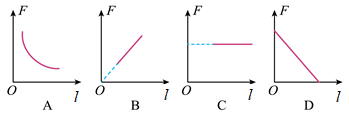

如图丁所示，弹簧测力计竖直向上拉杠杆，当钩码悬挂在杠杆上（选填“\( A\)”、“\( B\)”、“\( C\)”或“\( D\)”）点时，杠杆在图示的位置处于平衡状态，且弹簧测力计的示数最小.

【答案】是  /左，右  ，变小/A，B

【解析】​
