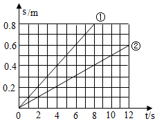
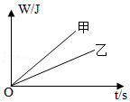

# 知识点·比较功率的大小（同步练习）

> 教材：物理·八年级全一册·沪科技版2024新教材 ｜ 来源：国家中小学智慧教育平台·在线练习 ｜ 共 3 题

## 1. 单选题（难度：适中）

两次水平拉动同一物体在同一水平面上做匀速直线运动，两次物体运动的\( s-t\)图象如图，根据图象，下列判断正确的是（    ）. 

- A. 两次物体运动的速度：\( {v}_{1}<{v}_{2}\)
- B. 两次物体所受的拉力：\( {F}_{1}>{F}_{2}\)
- C. \( \text{0}\text{-}\text{8s}\)两次拉力对物体做功的功率：\( {P}_{1}>{P}_{2}\)
- D. \( \text{0}\text{-}\text{8s}\)两次拉力对物体所做的功：\( {W}_{1}={W}_{2}\)

【答案】C

【解析】​

## 2. 单选题（难度：简单）

如图，两条直线是表示甲、乙两个物体做功与所需时间的关系图象，由图象可知，甲、乙两物体的功率关系是（    ）. 

- A. \( {P}_{\text{甲}}>{P}_{\text{乙}}\)
- B. \( {P}_{\text{甲}}<{P}_{\text{乙}}\)
- C. \( {P}_{\text{甲}}={P}_{\text{乙}}\)
- D. 无法比较大小

【答案】A

【解析】​

## 3. 多选题

某汽车公司对自主研发的无人驾驶汽车性能进行测试，甲、乙两辆完全相同的汽车在同一水平路面上做匀速直线运动，且\( {v}_{\text{甲}}<{v}_{\text{乙}}\)，若不计空气阻力，则汽车受到的牵引力为\( {F}_{\text{甲}}\)和\( {F}_{\text{乙}}\)，牵引力在相同时间内所做的功\( {W}_{\text{甲}}\)和\( {W}_{\text{乙}}\)，以及所做的功率\( {P}_{\text{甲}}\)和\( {P}_{\text{乙}}\)之间的关系正确的是（    ）.

- A. \( {F}_{\text{甲}}={F}_{\mathrm{乙}}\)
- B. \( {F}_{\text{甲}}<{F}_{\mathrm{乙}}\)
- C. \( {W}_{\text{甲}}<{W}_{\mathrm{乙}}\)
- D. \( {P}_{\text{甲}}>{P}_{\mathrm{乙}}\)

【答案】A/C

【解析】​
