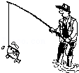
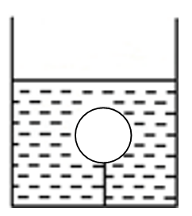
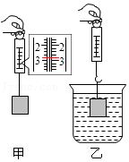
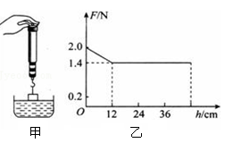
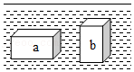

# 知识点·测量浮力大小（同步练习）

> 教材：物理·八年级全一册·沪科技版2024新教材 ｜ 来源：国家中小学智慧教育平台·在线练习 ｜ 共 8 题

## 1. 单选题（难度：简单）

有一个铜块挂在弹簧测力计上，当铜块全部浸没水中时，弹簧测力计的读数是（ ）.

- A. 铜块所受的重力
- B. 铜块所受浮力
- C. 铜块所受重力与浮力之差
- D. 以上所述均不正确

【答案】C

## 2. 单选题（难度：简单）

一个金属块吊在弹簧测力计下端，在空气中弹簧测力计读数是27.5N，现将金属块浸没水中后，弹簧测力计读数是21.5N，则金属块受到的浮力是（   ）.

- A. 6N
- B. 27.5N
- C. 21.5N
- D. 49N

【答案】A

## 3. 单选题（难度：适中）

一只水桶装满水，总重为60 N，其中空桶重20 N，用这个水桶从井里匀速提水，当水桶尚未露出水面之前，人所用的拉力为（   ）.

- A. 40N
- B. 小于20 N
- C. 0 N
- D. 等于20 N

【答案】B

## 4. 单选题

用钓鱼竿钓鱼的时候，鱼钩已经钩住了鱼，鱼还在水中时，感觉鱼很轻，刚把鱼从水中拉离水面就感觉鱼变“重”了. 对钓鱼过程的下列几种解释，正确的是（   ）. 

- A. 鱼离开水后，失去了水的浮力，使人感觉鱼变重
- B. 鱼离开水后，鱼的重力增大，使人感觉鱼变重了
- C. 鱼离开水后，钓鱼线对钓鱼竿的拉力会不变
- D. 钓鱼竿太重

【答案】A

## 5. 填空题（难度：适中）

如图所示，一个重为0.2N的小球被拉线拉住而浸没在液体中，如果它受的浮力是1.8N，则拉线对球的拉力是N. 
  

【答案】1.6

## 6. 填空题（难度：简单）

弹簧测力计通过细线吊着一个金属块，静止时弹簧测力计的示数如图甲所示，则金属块的重力是N．如图乙所示，将金属块浸没在水中，静止时弹簧测力计的示数是1.6N．则金属块在水中受到的浮力是N. 

【答案】2.8，1.2

## 7. 填空题（难度：适中）

用弹簧测力计挂着一个实心圆柱体，圆柱体的底面刚好与水面接触（未浸入水中），如图甲所示，然后将其逐渐浸入水中，图乙所示是弹簧测力计示数随圆柱体逐渐浸入水中深度的变化情况，则圆柱体受到的最大浮力是 \( \text{N}\)；圆柱体刚浸没时下表面受到的液体压强是 \( \text{pa}\). （\( g\)取\( \text{10N/kg}\)）

【答案】0.6，1200

## 8. 填空题

如图所示，完全相同的\( a\)、\( b\)两个长方体，长度为\( h\)，悬浮在密度为\( \rho \)的液体中. 若两长方体\( a\)、\( b\)下表面所受液体的压力分别为\( {F}_{a}\)、\( {F}_{b}\)，则\( {F}_{a}\)  \( {F}_{b}\)（选填“＞”、“＜”、或“＝”）. 

【答案】＞
