# 知识点·液体压强（同步练习）

> 教材：物理·八年级全一册·沪科技版2024新教材 ｜ 来源：国家中小学智慧教育平台·在线练习 ｜ 共 17 题

## 1. 单选题（难度：适中）

匀速地向某容器内注满水，容器底所受水的压强与注水时间的关系如图所示，这个容器可能是（   ）

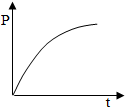

- A. 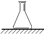
  锥形瓶
- B. 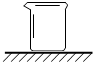
 烧杯
- C. 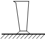
 量杯
- D. 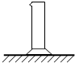
 量筒

【答案】C

【解析】​

## 2. 单选题（难度：简单）

如图所示，放在水平桌面上的密封圆台形容器内装有一定质量的水\( (\)未装满\( )\)，此时容器底部受到水的压强为\( {p}_{1}\)。现将容器倒过来放在桌面上，容器底部受到水的压强为\( {p}_{2}\)。则\( {p}_{1}\)、\( {p}_{2}\)的大小关系为（   ）

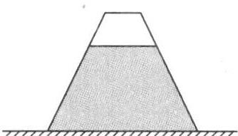

- A. \( {p}_{1}<{p}_{2}\)
- B. \( {p}_{1}>{p}_{2}\)
- C. \( {p}_{1}={p}_{2}\)
- D. 无法比较

【答案】A

【解析】​

## 3. 单选题（难度：适中）

甲、乙两个相同的量筒盛有不同的液体放在同一水平面上，液面位置如图所示。两个量筒内底部所受液体的压强相等，同一高度上\( A\)、\( B\)两点的液体压强为\( {p}_{A}\)和\( {p}_{B}\)，则（   ）

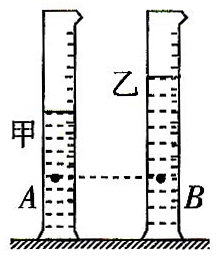

- A. \( {p}_{A}>{p}_{B}\)
- B. \( {p}_{A}={p}_{B}\)
- C. \( {p}_{A}<{p}_{B}\)
- D. 无法判断

【答案】C

【解析】​

## 4. 单选题（难度：适中）

如图所示玻璃管两端开口处蒙的橡皮膜绷紧程度相同，将此装置置于水中，下列哪幅图能反应橡皮膜受到水的压强后的凹凸情况（   ）

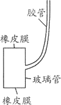

- A. 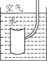
- B. 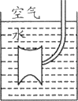
- C. 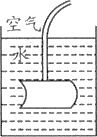
- D. 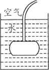

【答案】B

【解析】​

## 5. 填空题（难度：适中）

在“探究液体压强特点”的实验中，王超将压强计做了如图所示的改进，当两金属盒在空气中时，\( U\)形管两边液面相平；现把两金属盒分别放在密度为\( {\rho }_{1}\)、\( {\rho }_{2}\)的两种液体中，且两金属盒所处深度相同，则由图可知\( {\rho }_{1}\)  （选填“\( >\)”“\( <\)”或“\( =\)”） \( {\rho }_{2}\)；要使\( U\)形管两边液面相平，可进行的操作是。
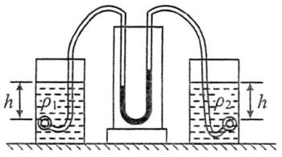

【答案】$ &gt;$ ，增大右侧容器中的探头在液体中的深度

【解析】​

## 6. 填空题（难度：简单）

甲、乙、丙三个容器中液体的液面相平，如图所示，已知图中\( A\)、\( B\)、\( C\)三点液体的压强相等，则三种液体的密度关系是\( {\rho }_{\text{甲}}\)  \( {\rho }_{\text{乙}}\)  \( {\rho }_{\text{丙}}\) 填（ “\( >\)”“\( =\)”或“\( <\)” ）

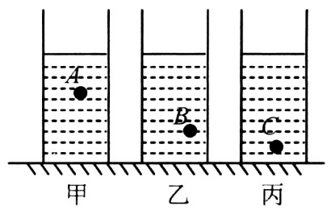

【答案】$ &gt;$  ，$ &gt;$ 

【解析】​

## 7. 单选题（难度：简单）

如图所示，三个底面积相同，形状不同的甲、乙、丙容器，放在水平桌面上，分别装入\( a\)、\( b\)、\( c\)三种液体，它们的液面在同一水平面上，已知三个容器中的液体对容器底面的压强相等，则液体密度最大的是（   ）

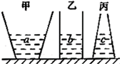

- A. \( a\)
- B. \( b\)
- C. \( c\)
- D. 一样大

【答案】D

【解析】​

## 8. 单选题（难度：简单）

下列关于液体内部的压强的说法中，错误的是（  ）.

- A. 由于液体受到重力的作用，所以上层液体对下层液体有压强
- B. 由于液体有流动性，所以液体不仅对容器底部有压强，对容器侧壁也有压强
- C. 液体内部压强是液体重力产生的，重力方向坚直向下，所以液体不可能有向上的压强
- D. 由于液体具有流动性，所以液体内部不仅有向下压强而且向各个方向都有压强

【答案】C

【解析】​

## 9. 单选题（难度：适中）

在研究液体压强的实验中，将压强计的金属盒放在水中，下列做法能够使图中压强计的\( U\)形管两边的液面高度差减小的是（   ）. 

 ​​
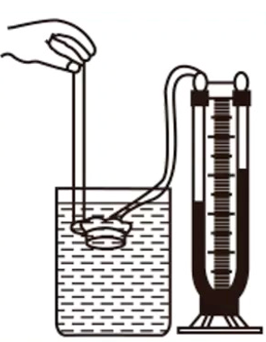
​

- A. 将压强计的金属盒向下移动一段距离
- B. 将压强计的金属盒改放在同样深度的酒精中
- C. 将压强计的金属盒在原处转动\( \text{180}\text{°}\)
- D. 将压强计的金属盒换成面积大一些的，但仍放在原深处

【答案】B

【解析】​

## 10. 单选题

研究液体压强的实验分步进行，如图所示是实验中的某一步，从实验中的这一步可得出的结论是（   ）. 

​​
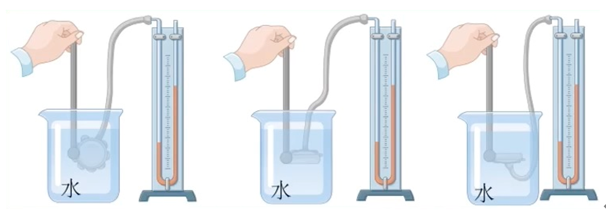
​

- A. 液体的压强随深度的增加而增大
- B. 在同一深度，液体向各个方向的压强相等
- C. 液体对容器底和侧壁都有压强
- D. 液体的压强跟深度无关

【答案】B

【解析】​

## 11. 单选题（难度：适中）

装有一定量水的细玻璃管斜放在水平桌面上，如图所示，则此时水对玻璃管底部的压强为（    ）. （\( g\)取\( \text{10N/kg}\)）. 
 
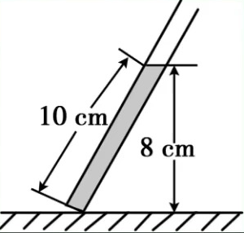

- A. \( \text{1× }{10}^{\text{2}}\text{Pa}\)
- B. \( \text{8×}{10}^{\text{4}}\text{Pa}\)
- C. \( \text{8×}{10}^{2}\text{Pa}\)
- D. \( \text{1×}{10}^{5}\text{Pa}\)

【答案】C

【解析】​

## 12. 单选题（难度：适中）

如图是甲、乙两种液体内部的压强与深度关系的图像. 甲液体的密度为\( {\rho }_{\text{甲}}\)，乙液体的密度为\( {\rho }_{\text{乙}}\)，则\( {\rho }_{\text{甲}}\)和\( {\rho }_{\text{乙}}\)关系是（    ）. 
 
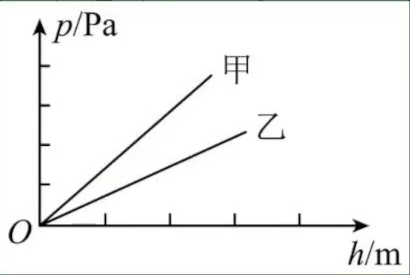

- A. \( {\rho }_{\text{甲}}<{\rho }_{\text{乙}}\)
- B. \( {\rho }_{\text{甲}}={\rho }_{\text{乙}}\)
- C. \({\rho }_{\text{甲}}>{\rho }_{\text{乙}}\)
- D. 无法判断

【答案】C

【解析】​

## 13. 单选题

如图所示，水平桌面上放着底面积相等的甲、乙两容器，分别装有同种液体且深度相同，两容器底部所受液体的压力、压强分别用\( {F}_{\text{甲}}\)、\( {F}_{\text{乙}}\)、\( {p}_{\text{甲}}\)、\( {p}_{\text{乙}}\)表示，则（   ）. 
 
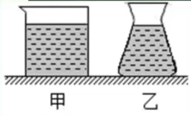

- A. \( {F}_{\text{甲}}={F}_{\text{乙}}\)，\( {p}_{\text{甲}}={p}_{\text{乙}}\)
- B. \( {F}_{\text{甲}}={F}_{\text{乙}}\)，\( {p}_{\text{甲}}>{p}_{\text{乙}}\)
- C. \( {F}_{\text{甲}}>{F}_{\text{乙}}\)，\( {p}_{\text{甲}}={p}_{\text{乙}}\)
- D. \( {F}_{\text{甲}}>{F}_{\text{乙}}\)，\( {p}_{\text{甲}}>{p}_{\text{乙}}\)

【答案】A

【解析】​

## 14. 单选题（难度：简单）

一未装满液体的密闭杯子，先正立放在水平桌面上，如图甲所示，液体对底部的压强和压力分别是\( {p}_{A}\)和\( {F}_{A}\)；然后反过来倒立在水平桌面上，如图乙所示，液体对底部的压强和压力分別是\( {p}_{B}\)和\( {F}_{B}\)，在先后两次不同的放置方法中，下列关系式正确的是（   ）. 
 
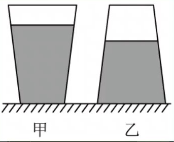

- A. \( {p}_{A}>{p}_{B}\)，\( {F}_{A}>{F}_{B}\)
- B. \( {p}_{A}>{p}_{B}\)，\( {F}_{A}={F}_{B}\)
- C. \( {p}_{A}>{p}_{B}\)，\( {F}_{A}<{F}_{B}\)
- D. \( {p}_{A}<{p}_{B}\)，\( {F}_{A}>{F}_{B}\)

【答案】C

【解析】​

## 15. 单选题（难度：适中）

如图所示，底面积不同的甲、乙圆柱形容器 内分别装有不同的液体，两种液体对容器底部的压强相等. 若从甲、乙中分别抽取出相同体积的液体，则剩余液体对甲、、乙两种容器底部的压强、大小关系为（    ）. 

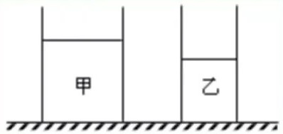

- A. \( {p}_{\text{甲}}={p}_{\text{乙}}\)
- B. \( {p}_{\text{甲}}>{p}_{\text{乙}}\)
- C. \( {p}_{\text{甲}}<{p}_{\text{乙}}\)
- D. 无法确定

【答案】B

【解析】​

## 16. 多选题（难度：简单）

如图所示，两个底面积不同的薄壁轻质圆柱形容器甲和己放在水平地面上容器内分别盛有体积相同的不同液体\( A\)、\( B\)，此时液体对容器底部的压强相等. 现将完全相同的两个金属球分別浸没在\( A\)、\( B\)液体中（液体不溢出）. 则下列判断一定正确的是（    ）. 
 
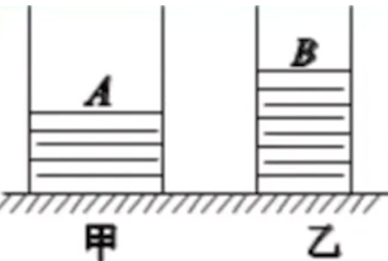

- A. 放入小球后，液体对容器底部的压强变化量\( {∆P}_{A}={∆P}_{B}\)
- B. 放入小球后，容器对水平地面的压强\( {P}_{A}>{∆P}_{B}\)
- C. 放入小球前，液体对容器底部的压力\( {F}_{A}>{F}_{B}\)
- D. 放入小球后，容器对水平地面的压力\( {F}_{A}^{\text{'}}>{F}_{B}^{\text{'}}\)

【答案】A/C/D

## 17. 填空题

某水池内水深\( \text{2}\text{m}\)，谁对池底不产生的压强为 \( \text{Pa}\)，在水中某处深度为\( \text{5000}\text{Pa}\)，则该处到水池底部的距离是\( \text{m}\). （\( g=10\text{N/kg}\)）.

【答案】$ 2\times {10}^{4}$   ，$ \text{1.5}$ 

【解析】​
