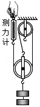
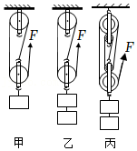
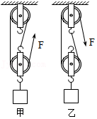

# 知识点·滑轮组机械效率的测量（同步练习）

> 教材：物理·八年级全一册·沪科技版2024新教材 ｜ 来源：国家中小学智慧教育平台·在线练习 ｜ 共 3 题

## 1. 多选题（难度：适中）

用如图所示的装置探究滑轮组机械效率，下列说法正确的是（     ）

- A. 实验时弹簧测力计可以在静止时读数
- B. 测量机械效率的原理：\( \eta =\frac{{W}_{\text{有用}}}{{W}_{\text{总}}}\times 100\%\)
- C. 此装置可以探究滑轮组机械效率与绳子股数的关系
- D. 实验测量工具可以不用刻度尺

【答案】B/C/D

【解析】​

## 2. （难度：适中）

同学们进行了“影响滑轮组机械效率因素”的实验探究，用到的装置如图，实验数据记录如表所示：

​​​ 
实验
次数
钩码
重\( G\text{/N}\)
钩码上升
高度\( h\text{/m}\)
拉力的大小
\( \text{/N}\) 
绳端移动
距离\( s\text{/m}\)
机械
效率\( \eta \)

1
2
0.1
1.2
0.3
55.6%

2
2
0.2
1.2
0.6
55.6%

3
4
0.1
1.9
0.3
70.2%

4
4
0.1
1.3
0.5
61.5%

实验中应沿竖直方向拉动弹簧测力计.

分析表中数据可知：第4次实验是用图所示装置来完成的.

通过比较1、2两次实验数据可得出：使用同一滑轮组提升相同重物，滑轮组的机械效率与重物上升高度（选填“无关”或“有关”）.

通过比较两次实验数据可得出：同一滑轮组提升的物体越重，滑轮组机械效率越高.

通过比较3、4两次实验数据可得出：不同滑轮组提升相同重物，动滑轮越重机械效率（选填“越大”或“越小”）.

【答案】匀速，丙，无关，1、3，越小

【解析】​

## 3. （难度：适中）

学习了滑轮组的机械效率之后，小明同学用同样的滑轮组装成两个滑轮组，完成了两次不同的实验，分别如图甲、乙所示，实验数据如表格所示.  

次数
物体
重\( \text{/N}\)
物体上升
高度\( \text{/cm}\)
弹簧测力
计示数\( \text{/N}\)
弹簧测力计
移动距离\( \text{/cm}\)
机械效率

1
2
10
1.0
 
 

2
2
10
1.5
20

第一次实验，如甲图所示，则弹簧测力计移动的距离是 \( \text{cm}\).

第二次实验的机械效率是，分析比较两次机械效率，发现第二次实验测得滑轮组的机械效率（选填“大于”、“小于”或“等于”）第一次实验测得滑轮组的机械效率.

【答案】30；，66.7%/等于

【解析】​
