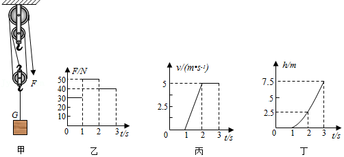
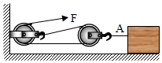
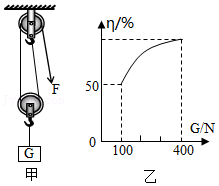
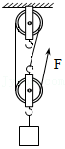
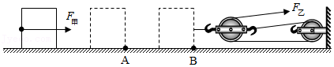
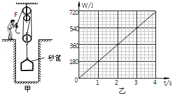
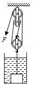

# 知识点·滑轮组的机械效率（同步练习）

> 教材：物理·八年级全一册·沪科技版2024新教材 ｜ 来源：国家中小学智慧教育平台·在线练习 ｜ 共 7 题

## 1. 单选题（难度：适中）

为了将放置在水平地面上重为\( \text{100N}\)的物体提升一定高度，设置了图甲所示的滑轮组装置. 当用图乙所示随时间变化的竖直向下的拉力\( F\)拉绳时，物体上升的速度\( v\)和物体上升的高度\( h\)随时间变化的关系分别如图丙和丁所示. 不计绳重和绳与轮之间的摩擦. 下列说法正确的是（     ）

- A. \( \text{0s}\text{～}\text{1s}\)内，物体做匀速直线运动
- B. \( \text{2s}\text{～}\text{3s}\)内，拉力\( F\)的功率是\( \text{200W}\)
- C. \( \text{1s}\text{～}\text{2s}\)内，拉力\( F\)做的功是\( \text{375J}\)
- D. \( \text{2s}\text{～}\text{3s}\)内，滑轮组的机械效率是\(62.5\% \)

【答案】C

【解析】​

## 2. 单选题（难度：适中）

用如图所示的滑轮组，在\( \text{4s}\)内将重为\( \text{1500N}\)的物体沿水平方向匀速移动\( \text{2m}\)的过程中，所用的拉力大小为\( \text{375N}\)，滑轮组的机械效率为\( 80\%\). 在此过程中，下列说法正确的是（     ）

- A. 绳子自由端沿水平方向移动了 \( \text{6m}\)
- B. 物体受到的拉力为 \( \text{750N}\)
- C. 如果只增加物体的重力，滑轮组的机械效率不变
- D. 拉力做的额外功为 \( \text{300J}\)

【答案】D

【解析】​

## 3. 填空题（难度：适中）

用图甲所示的滑轮组运送货物上楼，每件货物重为\( \text{100N}\)，每次运送的量不定，图乙记录了在整个过程中滑轮组的机械效率随货物重力增加而变化的图像，则动滑轮重为 \( \text{N}\)；当某次运送4件货物时，滑轮组的机械效率为 %（不考虑绳重和摩擦）. 

【答案】100，80

【解析】​

## 4. （难度：适中）

建筑工地上，某施工人员利用如图所示的滑轮组匀速提升重物. 若不计摩擦和绳重，利用这个滑轮组匀速提升重为\( \text{1200N}\)的物体时，所用的拉力是\( \text{500N}\)．求：

（1）动滑轮的重力；

（2）此时滑轮组的机械效率；

（3）当用这个滑轮组匀速提升重为\( \text{1800N}\)的物体时的拉力. 

【答案】

解：

（1）由图知，$ n=3$，绳重及摩擦不计，拉力$ F=\frac{1}{n}\left(G+{G}_{\text{动}}\right)$，

则动滑轮的重力：$ {G}_{\text{动}}＝nF-G=3\times 500\text{N}-1200\text{N}=300\text{N}$；

（2）滑轮组的机械效率：$ \eta =\frac{{W}_{\text{有}}}{{W}_{\text{总}}}=\frac{{F}_{\text{有}}{S}_{有}}{FS}=\frac{Gh}{FS}=\frac{G}{nF}=\frac{\text{1200N}}{\text{3}\text{×}\text{500N}}=80\%$

（3）不计摩擦和绳重，当匀速提升重为$ \text{1800N}$的物体时，

此时的拉力：$ {F}^{\text{'}}=\frac{1}{n}\left(G\text{'}+{G}_{\text{动}}\right)=\frac{1}{3}\times \left(\text{1800N+300N}\right)=\text{700N}$. 

答：（1）动滑轮的重力为$ \text{300N}$；（2）此时滑轮组的机械效率为$80\% $；（3）当用这个滑轮组匀速提升重为$ \text{1800N}$的物体时的拉力为$ \text{700N}$.

【解析】​

## 5. 

如图所示，甲工人用水平推力\( {F}_{\text{甲}}\)推动重为\( \text{750N}\)的货物，在水平路面上匀速移动\( \text{2m}\)至仓库门口\( A\)处，用时\( \text{10s}\)，此过程中甲工人做功的功率\( {P}_{\text{甲}}=\text{30W}\)；乙工人接着使用滑轮组拉动该货物在同样的路面上匀速移动\( \text{3m}\)到达指定位置\( B\)，拉力\( {F}_{\text{乙}}\)为\( \text{80N}\). 求：

（1）甲工人做的功；

（2）该滑轮组的机械效率.

【答案】

解：（1）由$ P=\frac{W}{t}$可得甲工人做的功：

$ {W}_{\text{甲}}={P}_{\text{甲}}t=\text{30W}\text{×}\text{10s}\text{＝}\text{300J}$；

（2）由$ W=Fs$可得甲工人的推力：

$ {F}_{\text{甲}}=\frac{{W}_{\text{甲}}}{{s}_{1}}=\frac{\text{300J}}{\text{2}\text{m}}=150\text{N}$，

因为货物在水平路面上被匀速推动，所以货物受到的推力、摩擦力是一对平衡力，

货物受到的摩擦力：

$ f={F}_{\text{甲}}=150\text{N}$；

乙工人使用滑轮组将货物在同样的路面上匀速移动$ \text{3m}$，

由图知，$ n=3$，拉力端移动距离$ {s}_{\text{乙}}=3{s}_{2}$，

滑轮组的机械效率：

$\eta =\frac {{W}_{\text{有用}}} {{W}_{\mathrm{总}}}=\frac {f{s}_{2}} {{F}_{\text{乙}}{s}_{\text{乙}}}=\frac {f{s}_{2}} {{F}_{\text{乙}}\times 3{s}_{2}}=\frac {f} {{3F}_{\text{乙}}}=\frac {\text{150N}} {\text{3×80N}}\times 100\% =62.5\% $. 

答：（1）甲工人做的功为$ \text{300J}$；（2）该滑轮组的机械效率为$62.5\% $.

【解析】​

## 6. （难度：适中）

如图甲所示是工人利用滑轮组从竖直深井中提取泥土的情形，所用动滑轮和筐受到的总重力为\( \text{30N}\)．某次操作中，将重\( \text{405N}\)的泥土以\( \text{0.4m/s}\)的速度匀速提起，在此过程中工人的拉力\( F\)所做的功随时间变化的图象如图乙所示. 细绳的质量忽略不计，\( g\)取\( \text{10N/kg}\)．求：

（1）拉力\( F\)做功的功率

（2）利用该装置提升泥土的机械效率；

（3）在提起泥土上升3m的过程中，拉力F克服摩擦力做的功. 

【答案】

解：

（1）由图乙可知拉力$ \text{4s}$做功$ \text{720J}$，拉力做功功率：

$ {P}_{F}＝\frac{W}{t}=\frac{\text{720J}}{\text{4}\text{s}}\text{＝}\text{180W}$；

（2）$ \text{4s}$内提升泥土上升的高度：

$ h={v}_{\text{物}}t=\text{0.4m/s}\text{×}\text{4s}\text{＝}\text{1.6m}$，

$ {W}_{\text{有用}}=Gh\text{＝}\text{405N}\text{×}\text{1.6m}\text{＝}\text{648J}$，

提升泥土的机械效率：

$\eta =\frac {{W}_{\text{有用}}} {{W}_{\mathrm{总}}}\times 100\% =\frac {\text{648J}} {\text{720J}}\times 100\% =90\% $；

（3）由图可知，$ n=3$，拉力端移动速度：

$ {v}_{F}=3\times {v}_{\text{物}}=\text{3}\text{×}\text{0.4m/s}\text{＝}\text{1.2m/s}$，

根据拉力$ F$做功的功率$ {P}_{F}=F{v}_{F}$可得，拉力：

$ F=\frac{{P}_{F}}{{v}_{F}}=\frac{\text{180W}}{\text{1.2}\text{m}/\text{s}}\text{＝}\text{150N}$，

在提起泥土上升$ \text{3m}$的过程中，$ s\text{'}=nh\text{'}=\text{3}\text{×}\text{3m=9m}$

$ {W}_{\text{总}}^{\text{'}}=F s\text{'}\text{＝}\text{150N}\text{×}\text{9m}\text{＝}\text{1350J}$，

$ {W}_{\text{有}}^{\text{'}}=Gh\text{'}\text{＝}\text{405N}\text{×}\text{3m}\text{＝}\text{1215J}$，

克服动滑轮及筐总重做功：

$ {W}_{G}={G}_{\text{轮筐}}h\text{'}\text{＝}\text{30N}\text{×}\text{3m}\text{＝}\text{90J}$ 

细绳的质量忽略不计，则$ {W}_{\text{总}}^{\text{'}}={W}_{\text{有}}^{\text{'}}+{W}_{\text{额}}={W}_{\text{有}}^{\text{'}}+{W}_{G}+{W}_{f}$，

所以，克服摩擦力做功：

$ {W}_{f}={W}_{\text{总}}^{\text{'}}-{W}_{\text{有}}^{\text{'}}-{W}_{G}=\text{1350J}\text{﹣}\text{1215J}\text{﹣}\text{90J}\text{＝}\text{45J}$. 

答：（1）拉力$ F$做功的功率为$ \text{180W}$；

（2）利用该装置提升泥土的机械效率为$90\% $；

（3）在提起泥土上升$ \text{3m}$的过程中，拉力$ F$克服摩擦力做的功为$ \text{45J}$.

【解析】​

## 7. 

如图所示，用滑轮组提升浸没在水中的棱长为\( \text{1m}\)的正方体重物，重为\( \text{2.6}\text{×}{10}^{\text{4}}\text{N}\)，以\( \text{0.1m/s}\)匀速上升，重物在露出水面后，拉力\( F\)为\( \text{1}\text{×}{10}^{4}\text{N}\)，不计绳重及摩擦，求：（\( g\)取\( \text{10N/kg}\)）

（1）重物在露出水面前受到的浮力；

（2）动滑轮的重；

（3）当重物完全露出水面前，滑轮组的机械效率；

（4）当重物完全露出水面后，滑轮组的机械效率. 

【答案】

解：

（1）重物在露出水面前，全部浸没在水中，$ {V}_{\text{排}}=V={\text{（}\text{1m}\text{）}}^{3}=\text{1}{\text{m}}^{\text{3}}$

受到的浮力：$ {F}_{\text{浮}}={G}_{\text{排}}={\rho }_{\text{水}}g{V}_{\text{排}}=\text{1.0}\text{×}{\text{10}}^{\text{3}}\text{kg/}{\text{m}}^{\text{3}}\text{×}\text{10N/kg}\text{×}\text{1}{\text{m}}^{\text{3}}\text{＝}\text{1}\text{×}{\text{10}}^{\text{4}}\text{N}$；

（2）由图知，$ n=3$，重物在露出水面后，拉力$ F=\frac{1}{3}\left(G+{G}_{\text{动}}\right)$，则动滑轮重力：

$ {G}_{\text{动}}=3F﹣G=\text{3}\text{×}\text{1}\text{×}{\text{10}}^{\text{4}}\text{N}\text{﹣}\text{2.6}\text{×}{\text{10}}^{\text{4}}\text{N}\text{＝}\text{4}\text{×}{\text{10}}^{\text{3}}\text{N}$；

（3）不计绳重及摩擦，当重物完全露出水面前，滑轮组的机械效率：

$ \eta =\frac{{W}_{\text{有用}}}{{W}_{\mathrm{总}}}=\frac{G-{F}_{\text{浮}}}{G-{F}_{\text{浮}}+{G}_{\text{动}}}=\frac{\text{2.6×}{\text{10}}^{\text{4}}\text{N-1×}{\text{10}}^{\text{4}}\text{N}}{\text{2.6×}{\text{10}}^{\text{4}}\text{N-1×}{\text{10}}^{\text{4}}\text{N+4×}{\text{10}}^{\text{3}}\text{N}}=80\%$；

（4）不计绳重及摩擦，当重物完全露出水面后，滑轮组的机械效率：

$ {\eta }^{\text{'}}==\frac{{{W}_{\text{有用}}}^{\text{'}}}{{{W}_{\mathrm{总}}}^{\text{'}}}=\frac{Gh}{Gh+{G}_{\text{动}}h}=\frac{G}{G+{G}_{\text{动}}}=\frac{\text{2.6×}{\text{10}}^{\text{4}}\text{N}}{\text{2.6×}{\text{10}}^{\text{4}}\text{N+4×}{\text{10}}^{\text{3}}\text{N}}\times 100\%\approx 86.7\%$. 

答：（1）重物在露出水面前受到的浮力为$ \text{1}\text{×}{\text{10}}^{\text{4}}\text{N}$；

（2）动滑轮的重$ \text{4}\text{×}{\text{10}}^{\text{3}}\text{N}$；

（3）当重物完全露出水面前，滑轮组的机械效率为$80\% $；

（4）当重物完全露出水面后，滑轮组的机械效率约为$86.7\% $.   

【解析】​
