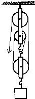
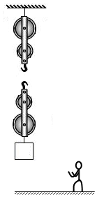
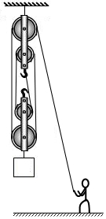
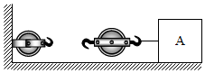
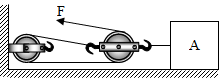

# 知识点·滑轮组绳子的绕法（同步练习）

> 教材：物理·八年级全一册·沪科技版2024新教材 ｜ 来源：国家中小学智慧教育平台·在线练习 ｜ 共 3 题

## 1. （难度：适中）

小明同学站在地面上，要利用如图所示的滑轮组提升重物，已知物重\( \text{1000N}\)，每个滑轮重均为\( \text{200N}\)，而绳子最多只能承受\( \text{500N}\)的拉力 ，请你通过计算帮他在图中画出符合要求的绳子绕法. 
 

【答案】

  

【解析】​

## 2. （难度：适中）

请画出滑轮组的绕线图. 

【答案】

   

【解析】​

## 3. （难度：适中）

利用如图所示的滑轮组拉着物体A沿水平方向做匀速直线运动. 请画出：滑轮组最省力的绕线情况. 

【答案】

  

【解析】​
