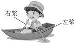
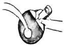
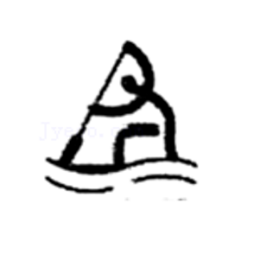
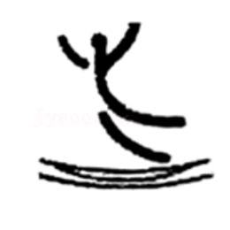
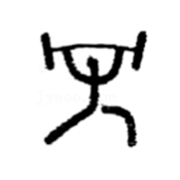
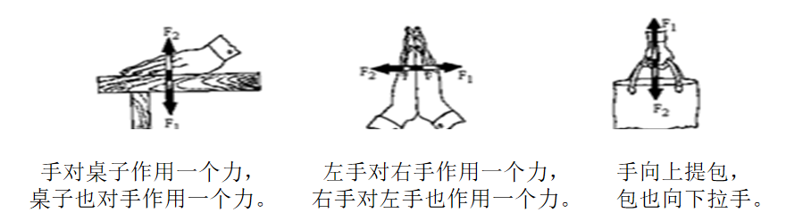
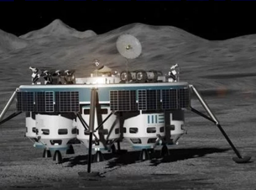

# 知识点·物体间力的作用是相互的（同步练习）

> 教材：物理·八年级全一册·沪科技版2024新教材 ｜ 来源：国家中小学智慧教育平台·在线练习 ｜ 共 7 题

## 1. 单选题（难度：简单）

下列事例中，不能够说明“物体间力的作用是相互的”是（    ）。

- A. 游泳时手和脚向后划水，人就能前进
- B. 将铅球从手中抛出，铅球由静止变为运动
- C. 跳高时用力向下蹬地，人能够向上跳起
- D. 火箭升空时需向下喷出燃气

【答案】B

【解析】​

## 2. 单选题

如图所示，小强用双桨在水中划动游船，为了使船头向左转，他应采用下面什么方式划水（    ）。

- A. 左右桨同时向后划水
- B. 左桨向前划水，右桨向后划水
- C. 左右桨同时向前划水
- D. 左桨向后划水，右桨向前划水

【答案】B

【解析】​

## 3. 多选题（难度：简单）

下列实例中能够说明“力的作用是相互的”是（   ）。

- A. 用力扣杀排球时手感到疼痛
- B. 青蛙向后蹬腿而在水中前进
- C. 抛出去的粉笔头，最终会落回地面
- D. 重物压在海绵上，海绵形状发生改变

【答案】A/B

【解析】​

## 4. 填空题（难度：简单）

如图所示，用球拍击打乒乓球时，是球拍与球之间发生了相互作用。若以乒乓球为研究对象，施力物体是，受力物体是。

【答案】球拍，乒乓球

【解析】​

## 5. 多选题（难度：适中）

如图所示为某届奥运会运动项目图标，其中利用“力的作用是相互的”这一原理的是（   ）。

- A. 游泳

​

- B. 皮划艇

​

- C. 蹦床

​

- D. 举重

​

【答案】A/B/C

【解析】​

## 6. 填空题（难度：简单）

观察下面的三幅图，可得出的结论是。

【答案】物体间力的作用是相互的

【解析】​

## 7. 填空题

2021年5月15日，历时近十个月，祝融号成功登陆火星。探测器降落到火星表面附近时需喷射高温高压气体完成多次“刹车制动”，这说明。（写出一项物理知识的运用）火星车（如图）着陆火星表面时，为避免撞击，其携带的发动机喷射“火焰”的方向与下落方向选填“相同”或“相反”）使其减速，称之为“软着陆”。 

【答案】物体间力的作用是相互的（或力可以改变物体的运动状态），相同

【解析】​
