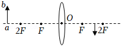
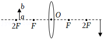
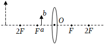
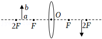
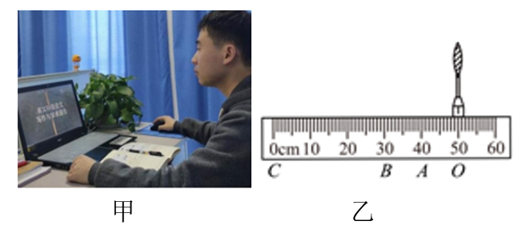
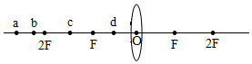

# 知识点·物距像距焦距与成像性质的关系（同步练习）

> 教材：物理·八年级全一册·沪科技版2024新教材 ｜ 来源：国家中小学智慧教育平台·在线练习 ｜ 共 6 题

## 1. 单选题（难度：简单）

将一凸透镜正对太阳，可在距透镜20cm处得到一个最小、最亮的光斑.  若将一个物体放在此透镜前50cm处，则可在透镜另一侧得到（    ）.

- A. 倒立、缩小的实像
- B. 倒立、放大的实像
- C. 正立、缩小的实像
- D. 正立、放大的虚像

【答案】A

【解析】​

## 2. 单选题（难度：适中）

小明做“探究凸透镜成像的规律”实验时，在光屏上得到烛焰清晰的缩小的像，然后他把燃烧的蜡烛和光屏互换位置，这时光屏上能看到（    ）.

- A. 倒立、放大的像
- B. 倒立、缩小的像
- C. 正立、放大的像
- D. 正立、缩小的像

【答案】A

【解析】​

## 3. 单选题（难度：适中）

下列关于凸透镜成像特点的说法中，错误的是（    ）.

- A. 实像都是倒立的，虚像都是正立的
- B. 缩小的都是实像，放大的都是虚像
- C. 缩小的像都是倒立的、放大的像可能是正立的，也可能是倒立的
- D. 实像和物体分别在凸透镜的两侧，虚像和物体在凸透镜的同一侧

【答案】B

【解析】​

## 4. 单选题（难度：简单）

如图所示是一种常见的投射灯，它的成像镜头可简化为一个凸透镜，能把投影片ab投射到地面，下图中能正确反映其成像原理的示意图是（    ）.  

- A. 
- B. 
- C. 
- D. 

【答案】B

【解析】​

## 5. 填空题（难度：简单）

如图甲所示是疫情期间“停课不停学”直播上课的场景，老师的电脑上的摄像头相当于一个凸透镜，若该透镜的焦距为10cm，如图乙所示，有区间“\( AO\)”“\( BA\)”或“\( CB\)”，直播老师应坐在区间上，经凸透镜就能成清晰的（选填“倒立”或“正立”）的影像.  

【答案】$ CB$   ，倒立

【解析】​

## 6. 填空题（难度：适中）

在观察凸透镜成像的实验中，首先调节烛焰、凸透镜和光屏三者的中心在同一高度，若凸透镜位置不变，先后把烛焰放在\( a\)、\( b\)、\( c\)、\( d\)各点，分别调节光屏的位置.  
  

    
（1）烛焰放在点时，屏上出现的像最大；
（2）烛焰放在点时，屏上出现的像最小；
（3）烛焰放在点时，无论怎样移动光屏在屏上都得不到烛焰的像，可以观察到放大的像；
（4）烛焰从\( a\)移到\( b\)的过程中，像的大小变，像与凸透镜的距离变.

【答案】$ c$  ，<latex class="math-tex">\(a\)</latex>，$ d$  ，大  ，大

【解析】​
