# 知识点·眼睛和眼镜（同步练习）

> 教材：物理·八年级全一册·沪科技版2024新教材 ｜ 来源：国家中小学智慧教育平台·在线练习 ｜ 共 17 题

## 1. 单选题（难度：简单）

如图是一位同学眼球成像的示意图，他所患的眼疾及矫正视力应配戴的透镜类型是（    ）

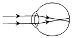

- A. 远视眼，凸透镜
- B. 远视眼，凹透镜
- C. 近视眼，凸透镜
- D. 近视眼，凹透镜

【答案】D

【解析】​

## 2. 单选题（难度：简单）

小明只能看清近处的物体，而看不清远处的物体，来自远处某点的光会聚在他的视网膜前. 那么（    ）

- A. 他可能患上近视眼，需用凸透镜矫正
- B. 他可能患上近视眼，需用凹透镜矫正
- C. 他可能患上远视眼，需用凸透镜矫正
- D. 他可能患上远视眼，需用凹透镜矫正

【答案】B

【解析】​

## 3. 单选题（难度：简单）

如图所示是我们看远处物体的示意图，来自远处物体的光经过眼睛晶状体后在视网膜上形成（    ）

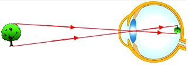

- A. 正立、缩小的实像
- B. 正立、缩小的虚像
- C. 倒立、缩小的实像
- D. 倒立、缩小的虚像

【答案】C

【解析】​

## 4. 单选题（难度：简单）

下列关于眼睛的说法正确的是（    ）

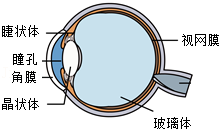

- A. 晶状体和角膜相当于光屏
- B. 物体在视网膜上成正立的像
- C. 看清远处物体时，晶状体较薄
- D. 患近视眼，应使用凸透镜矫正

【答案】C

【解析】​

## 5. 单选题（难度：简单）

关于近视眼和远视眼的成因如图所示，下列说法正确的是（    ）

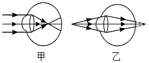

- A. 甲为近视眼，应配戴凹透镜矫正
- B. 乙为近视眼，应配戴凸透镜矫正
- C. 甲为远视眼，应配戴凸透镜矫正
- D. 乙为远视眼，应配戴凹透镜矫正

【答案】A

【解析】​

## 6. 单选题（难度：简单）

如图所示是几种光学部件的示意图，其中可以用于制作近视眼镜的是（    ）

- A. 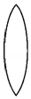
- B. 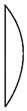
- C. 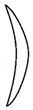
- D. 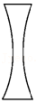

【答案】D

【解析】​

## 7. 单选题（难度：适中）

如图是患有近视眼的小明检查视力时的情景，小明通过观察视力表在平面镜中所成的像来完成检查. 下列描述正确的是（    ）

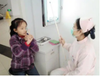

- A. 视力表与它在平面镜中所成像到平面镜的距离相等
- B. 视力表在平面镜中所成的像比实际视力表小
- C. 近视眼形成的原因是晶状体太厚，对光的折射能力太弱
- D. 近视眼应该用度数合适的凸透镜来矫正

【答案】A

【解析】​

## 8. 单选题（难度：简单）

某人只能看清远处的物体，看不清近处的物体，关于该人的视力情况，下列说法正确的是（    ）

- A. 远视眼，用凸透镜矫正
- B. 远视眼，用凹透镜矫正
- C. 近视眼，用凸透镜矫正
- D. 近视眼，用凹透镜矫正

【答案】A

【解析】​

## 9. 单选题

小花用水凸透镜模拟人眼的晶状体，光屏相当于视网膜（如图）. 当用注射器向胶膜内注水，水凸透镜的凸起程度增加，光屏上原来清晰的像变模糊了；将蜡烛靠近水凸透镜，光屏上再次得到清晰的像，此过程模拟的眼睛及该眼睛的矫正方法是（    ）

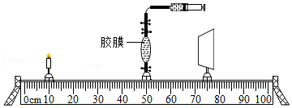

- A. 近视眼  用凸透镜矫正
- B. 远视眼  用凸透镜矫正
- C. 近视眼  用凹透镜矫正
- D. 远视眼  用凹透镜矫正

【答案】C

【解析】​

## 10. 多选题（难度：简单）

如图所示，人的眼球好像一架照相机，关于眼球，下列说法中正确的是（    ）

- A. 晶状体和角膜的共同作用相当于一个凸透镜
- B. 晶状体和角膜的共同作用相当于一个凹透镜
- C. 外界物体在视网膜上所成的像是倒立的实像
- D. 外界物体在视网膜上所成的像是正立的实像

【答案】A/C

【解析】​

## 11. 填空题（难度：简单）

在疫情防控期间，进入公共场所需要出示“健康码”，扫描“健康码”的摄像头相当于透镜，此透镜用于矫正（近视眼/远视眼）

【答案】凸，远视眼.

【解析】​

## 12. 填空题（难度：简单）

如图一所示，不正确的用眼姿势容易导致视力下降. 人眼的成像原理与（选填“照相机”、“投影仪”或“放大镜”）相同；图二（选填“甲”或“乙”）是近视眼的光路示意图，需配戴（选填“凸”或“凹”）透镜矫正. 

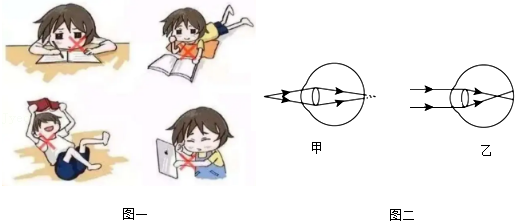

【答案】照相机，乙，凹

【解析】​

## 13. 填空题（难度：简单）

小明是近视眼，爷爷是老花眼，在甲、乙示意图中，图是小明眼睛的成像示意图，矫正需配戴眼镜的镜片应选用（选填“丙”或“丁”）. 爷爷想看书，小明应拿眼镜给他（选填“\( A\)”或“\( B\)”）. 

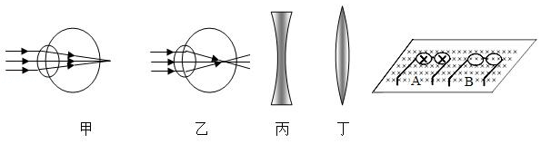

【答案】乙，丙，A

【解析】​

## 14. 填空题（难度：适中）

人眼是世界上最精密的照相机，来自物体的光经晶状体在视网膜上成立、缩小的像，为满足特殊人群的需求，有一种眼镜的镜片可以改变如图甲，它是通过在透明的薄膜中注入或抽出光学液体来实现，图乙是某人看远处物体时的成像情况，该人的眼睛属于，矫正时应选择（选填“镜片Ⅰ”或“镜片Ⅱ”）. 

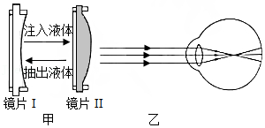

【答案】倒，近视眼，镜片Ⅰ

【解析】​

## 15. 填空题（难度：适中）

某同学制作的眼球模型如图所示，其中凸透镜相当于晶状体，烧瓶（内有透明液体）相当于玻璃体，其后壁相当于视网膜. 该图模拟的是（选填“近视眼”或“远视眼”），需要戴用（选填“凸透镜”或“凹透镜”）制作的眼镜来矫正视力. 

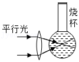

【答案】近视眼，凹透镜.

【解析】​

## 16. 多选题（难度：简单）

现在中学生近视眼患者越来越多，保护眼睛刻不容缓，学校开展了上、下午各一次眼保健操活动来预防近视，如图中关于近视眼成因及其矫正的原理图正确的是（    ）

- A. 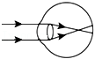
- B. 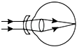
- C. 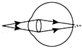
- D. 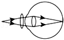

【答案】A/B

【解析】​

## 17. 填空题（难度：适中）

如图是人眼与鱼眼的结构示意图，我们观察发现：鱼眼晶状体的形状比人眼更加凸一些，如果人眼的晶状体像鱼这样，观察远处物体的像将成在视网膜的（填“前”或“后”）面，若要看清远处的物体，应该配戴（填“凹”或“凸”）透镜. 

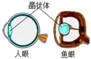

【答案】前，凹

【解析】​
