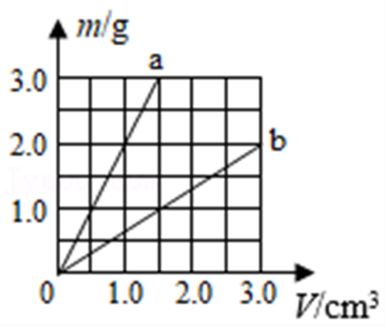
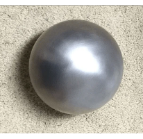

# 知识点·空心密度计算（同步练习）

> 教材：物理·八年级全一册·沪科技版2024新教材 ｜ 来源：国家中小学智慧教育平台·在线练习 ｜ 共 10 题

## 1. 单选题（难度：适中）

用同种材料制成体积相等的甲、乙两个小球，其中一个是实心的，另一个是空心的. 甲、乙两球的质量之比为5：3，则下列说法错误的是（    ）

- A. 甲球是实心的
- B. 乙球是实心的
- C. 空心金属球的空心部分与实心部分的体积之比为2：3
- D. 空心金属球的空心部分与整个球的体积之比为2：5

【答案】B

【解析】​

## 2. 单选题（难度：简单）

用相同质量的铝和铜制成体积相等的球（\( {\rho }_{\text{铝}}=\text{2.7}\text{×}{\text{10}}^{\text{3}}\text{kg/}{\text{m}}^{\text{3}}\)，\( {\rho }_{\mathrm{铜}}=\text{8.9}\text{×}{\text{10}}^{\text{3}}\text{kg/}{\text{m}}^{\text{3}}\)），下列说法正确的是（    ）

- A. 铜球一定是空心的
- B. 铝球和铜球都是实心的
- C. 铜球是实心的，铝球一定是空心的
- D. 铝球是实心的，铜球可能是实心的

【答案】A

【解析】​

## 3. 多选题（难度：简单）

在室温下，用绷紧的橡皮膜把一个空玻璃瓶的瓶口封上，然后把瓶子放入热水中，橡皮膜会凸起来. 下列说法正确的是（    ）

- A. 瓶子放入热水中，瓶内空气的质量变大
- B. 瓶子放入热水中，瓶内空气的密度变小
- C. 如果把瓶子放入冰水中，橡皮膜会凹下去一些
- D. 不管把瓶子放入热水中还是放入冰水中瓶内空气的密度都不会发生改变

【答案】B/C

【解析】​

## 4. 多选题（难度：适中）

如图所示，\( a\)、\( b\)是两种物质质量与体积的关系图象，分别用\( a\)、\( b\)两种物质制成质量均为\( \text{50g}\)，体积均为\( \text{100}{\text{cm}}^{\text{3}}\)的甲、乙两空心球体，\( {\rho }_{\text{水}}=\text{2}\text{.0}\text{g/}{\text{cm}}^{\text{3}}\). 则下列说法中不正确的是（    ）

- A. \( a\)物质的密度小于水的密度
- B. 甲球的实心部分体积大于空心部分体积
- C. 乙球的实心部分体积为\( \text{75}{\text{cm}}^{\text{3}}\)
- D. 甲球和乙球的空心部分体积之比为1：3

【答案】A/B/D

【解析】​

## 5. 填空题（难度：简单）

现有\( a\)、\( b\)两个小球，分别由\( {\rho }_{a}=3\text{g/}{\text{cm}}^{\text{3}}\)、\( {\rho }_{b}=4\text{g/}{\text{cm}}^{\text{3}}\)的两种材料组成，两小球的质量之比\( {m}_{a}:{m}_{b}=5:6\)，体积之比\( {V}_{a}:{V}_{b}=3:2\)，若这两个球一个为实心球一个为空心球，则空心球的是 . （\( a\)或\( b\)）

【答案】a

【解析】​

## 6. 填空题（难度：简单）

有一个铝球，质量是\( \text{108g}\)，体积是\( \text{60}{\text{cm}}^{\text{3}}\)（\( {\rho }_{\text{铝}}=\text{2.7g/}{\text{cm}}^{\text{3}}\)），则铝球空心部分的体积是 \( {\text{m}}^{\text{3}}\). 

【答案】$ 2\times {10}^{-5}$     

【解析】​

## 7. 填空题（难度：适中）

现有由同种材料制成的\( A\)、\( B\)两个球，其中有一个是实心的一个是空心的，它们的质量分别是\( \text{280g}\)、\( \text{64g}\)，体积分别是\( 42{\text{cm}}^{\text{3}}\)、\( 8{\text{cm}}^{\text{3}}\)，则实心球的密度为  \( \text{g/}{\text{cm}}^{\text{3}}\)，空心球的空心部分体积是 \( {\text{m}}^{\text{3}}\).

【答案】8，$ 7\times {10}^{-6}$

【解析】​

## 8. 填空题（难度：适中）

质量、外形和体积完全相同的铁球、木球、铅球和铝球（\( {\rho }_{\text{木}}<{\rho }_{\text{铝}}<{\rho }_{\text{铁}}<{\rho }_{\text{铅}}\)），如果其中只有一个球是实心的，那么这个球一定是球，同时空心部分最小的球是球.

【答案】木，铝

【解析】​

## 9. 填空题（难度：适中）

若甲、乙两实心球质量比是1：2，密度比是2：3，则体积比是 . 现有一个体积为\( 30{\text{cm}}^{\text{3}}\)，质量为\( \text{158g}\)的空心球，其空心部分注满水后测得质量为\( \text{168g}\)，则其空心部分的体积是\( {\text{cm}}^{\text{3}}\)，若把无水空心球压成实心球，其密度是 \( \text{kg/}{\text{m}}^{\text{3}}\). （\( {\rho }_{\text{水}}=\text{1.0g/}{\text{cm}}^{\text{3}}\)）

【答案】3:4   ，10，$ 7.9\times {10}^{3}$

【解析】​

## 10. 填空题（难度：适中）

现有甲、乙两种液体，\( {\rho }_{\text{甲}}=1\text{g/}{\text{cm}}^{\text{3}}\)，\( {\rho }_{\text{乙}}=2\text{g/}{\text{cm}}^{\text{3}}\). 要在两试管中分别装入质量相等的甲、乙两种液体，加入液体的体积之比为. 若两试管分别装有甲、乙液体\( \text{30g}\)、\( \text{20g}\)，要使两试管中液体质量相等，需分别再加入相同体积的液体 \( {\text{cm}}^{\text{3}}\).

【答案】2:1，10   

【解析】​
