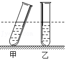

# 知识点·质量与体积的关系（同步练习）

> 教材：物理·八年级全一册·沪科技版2024新教材 ｜ 来源：国家中小学智慧教育平台·在线练习 ｜ 共 6 题

## 1. 单选题（难度：简单）

质量相等的水、盐水、酒精（\( {\rho }_{\mathrm{酒}\mathrm{精}}<{\rho }_{\mathrm{水}}<{\rho }_{\mathrm{盐}\mathrm{水}}\)）分别倒入三只规格相同的杯子里，液面最高的是（    ）

- A. 盛有酒精的杯子
- B. 盛有水的杯子
- C. 盛有盐水的杯子
- D. 三只杯子内液面一样高

【答案】A

【解析】​

## 2. 单选题（难度：适中）

最多能装载\(5\text{t}\)​水的水箱，能装得下\(5\text{t}\)下列哪种液体（已知\( {\rho }_{\mathrm{酱}\mathrm{油}}>{\rho }_{\mathrm{植}\mathrm{物}\mathrm{油}}>{\rho }_{\mathrm{酒}\mathrm{精}}>{\rho }_{\mathrm{汽}\mathrm{油}}\)）（    ）

​

- A. 酱油
- B. 汽油
- C. 酒精
- D. 植物油

【答案】A

【解析】​

## 3. 单选题（难度：适中）

两个完全相同的空烧杯中分别放入质量相等的实心铜块和实心铝块后（\( {\rho }_{\mathrm{铜}}>{\rho }_{\mathrm{铝}}\)），（铜块和铝块高度均小于烧杯高度），缓慢向两烧杯中倒满水，且水没有溢出，下列判断中正确的是（    ）

- A. 放铝块的烧杯倒入水较多
- B. 放铜块的烧杯倒入水较多
- C. 两烧杯倒入水一样多
- D. 无法判断

【答案】B

【解析】​

## 4. 单选题（难度：适中）

两支相同的试管装入质量相等的两种不同液体，如图所示，它们液面齐平，甲、乙两液体的密度相比（    ）

- A. 甲大
- B. 乙大
- C. 一样大
- D. 无法比较

【答案】B

【解析】​

## 5. 多选题（难度：适中）

下列说法正确的是（    ）

- A. 质量大的物体，体积一定大
- B. 体积大的物体，密度一定小
- C. 同种材料制成的实心物体，体积大的质量也一定大
- D. 不同材料制成的实心物体，体积相同时，质量大的密度一定大

【答案】C/D

【解析】​

## 6. 填空题（难度：简单）

冰的密度为\( 0.9\times {10}^{3}\text{kg/}{\text{m}}^{\text{3}}\)，若\( \text{1kg}\)的冰熔化成水，其不变，变小. （均选填“质量”、“体积”或“密度”）

【答案】质量，体积

【解析】​
