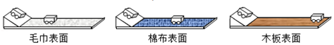
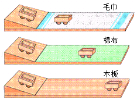
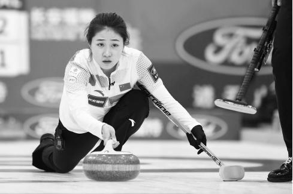
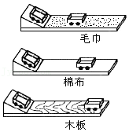
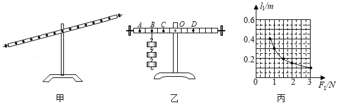

# 知识点·阻力对物体运动的影响（同步练习）

> 教材：物理·八年级全一册·沪科技版2024新教材 ｜ 来源：国家中小学智慧教育平台·在线练习 ｜ 共 5 题

## 1. 单选题（难度：简单）

在“探究阻力对物体运动的影响”的实验中，记录数据如下表，关于该实验和记录数据，下列说法不正确的是（   ）. 
  

接触面
毛巾
棉布
木板

小车移动的距离\( s \text{/ cm}\)
18.3
26.8
98.2

- A. 每次要让小车从斜面的同一高度由静止滑下
- B. 该实验运用了控制变量的方法
- C. 阻力越小，小车的速度减小得越快
- D. 该实验不能直接说明运动物体不受力时的运动情况

【答案】C

【解析】​

## 2. 单选题（难度：简单）

如图所示，小明同学拿出三个相同的三角形积木与平整的木板构成了三个完全一样的斜面，并在前两个木板上依次铺上毛巾和棉布（毛巾对小车的阻力大于棉布的阻力）.他让玩具小车从斜面上同一高度由静止滑下，他得到了以下的实验现象和判断：

  
\( \text{①}\)在铺有毛巾的水平面上，小车运动的路程最短；
\( \text{②}\)如果在没有摩擦的水平面上，小车将做匀速直线运动；
\( \text{③}\)如果在更平滑的水平面上，小车运动的路程更长；
\( \text{④}\)在铺有棉布的水平面上，小车运动的路程较短；
\( \text{⑤}\)在水平木板表面上，小车运动的路程较长；
下面的判断和排列次序正确的是（     ）.

- A. 事实①④⑤，先推论②，再推论③
- B. 事实①④⑤，先推论③，再推论②
- C. 事实①②③，先推论④，再推论⑤
- D. 事实①③②，先推论⑤，再推论④

【答案】B

【解析】​

## 3. 单选题（难度：简单）

冬奥会即将在我国举行，关于冰壶比赛，下列说法正确的是（   ）.

- A. 冰壶在冰面上滑行时不受阻力的作用
- B. 冰壶绕过前方障碍壶前进时运动状态保持不变
- C. 冰壶最终停下来是由于受到阻力的作用
- D. 用力推着冰壶使它前进，说明力是维持物体运动的原因

【答案】C

【解析】​

## 4. （难度：简单）

在探究“阻力对物体运动的影响”实验时，所用的器材有斜面、木板、毛巾、棉布和小车，如图所示.
 

让小车从斜面同一高度由静止滑下的目的是使小车到达水平面时的大小相同.

实验中通过改变接触面的材料，目的是为了改变小车在水平面上滑行时所受的大小；实验中利用小车在水平面滑行的来反映阻力对物体运动的影响程度.

牛顿在实验研究的基础上总结出牛顿第一定律，下列现象中，属于利用惯性的是（   ）.

- A. 坐汽车时要系好安全带
- B. 跳远运动员快速助跑
- C. 行车时要注意保持车距
- D. 学校路段减速慢行

【答案】速度，阻力/距离，B

【解析】​

## 5. 填空题（难度：适中）

利用如图所示的装置来探究“杠杆的平衡条件”.

（1）实验前，杠杆静止如图甲所示，此时杠杆处于平衡状态吗？（“是”或“不是”），可将杠杆两端的平衡螺母向（选填“左”或“右”）调节，使杠杆在水平位置平衡，这样做的好处是可以直接从杠杆上读出.
（2）杠杆平衡后，如图乙所示，在杠杆\( B\)点挂3个相同的钩码，可在杠杆的\( D\)点挂个相同的钩码，就可使杠杆重新在水平位置平衡. 若在\( C\)点挂4个钩码. 在\( A\)点用调好的弹簧测力计竖直向上拉杠杆，杠杆在水平位置平衡时，弹簧测力计的示数为\( {F}_{1}\)，将弹簧测力计斜向左拉，杠杆在水平位置平衡时，其示数\( {F}_{2}\)  \( {F}_{1}\)（选填“＞”、“＝”或“＜”）.
（3）得到实验结论后，利用图乙所示的装置，重物悬挂左侧\( C\)点，弹簧测力计悬挂左侧\( B\)点，若弹簧测力计的量程是\( \text{0}\text{～}\text{8N}\)，仍要使杠杆在水平位置平衡，通过计算可知，悬挂的重物最重可达 \( \text{N}\).
（4）保持\( B\)点钩码数量和力臂不变，杠杆在水平位置平衡时，测出多组动力臂\( {l}_{1}\)和动力\( {F}_{1}\)的数据，绘制了\( {l}_{1}﹣{F}_{1}\)的关系图象，如图丙所示. 请根据图象推算，当\( {l}_{1}\)为\( \text{0.6m}\)时，\( {F}_{1}\)为 \( \text{N}\).

【答案】是，右，力臂，4，＞，16，0.5

【解析】​
