# 零散题目汇编（每知识点 ≤2 题）

> 教材：物理·八年级全一册·沪科技版2024新教材 ｜ 由 134 个小知识点文件合并，便于检索。

## 知识点·二力平衡

## 1. 填空题（难度：简单）

小明沿水平方向用力推静止在水平地面上的桌子，但没有推动，此时他对桌子的推力桌子所受到的阻力（填“大于”、“小于”或“等于”），此过程中小明（填“有”或“没有”）做功.

【答案】等于，没有

【解析】​

## 2. 填空题

如图所示的铁块重力\( G=4\text{N}\)，被吸附在竖直放置且足够长的磁性平板上，当他在竖直方向上拉力\( F=6\text{N}\)的作用下向上运动， 则铁块受到的摩擦力为 \( \text{N}\). 铁块此时速度\( v\)与时间\( t\)的关系图像如图乙所示，\( \text{4s}\)内拉力\( F\)做的功是 \( \text{J}\).   
 
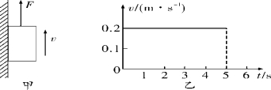

【答案】2，4.8

【解析】​

## 知识点·二力平衡、滑动摩擦力的大小

## 1. 填空题（难度：适中）

质量为\( \text{5}\text{kg}\)的物体放在水平地面上，地面对物体的支持力是 N，支持力的方向。某同学用\( \text{20}\text{N}\)的水平推力推这个物体但没有推动，此时受到的摩擦力为 \( \text{N}\)。若用\( \text{45}\text{N}\)的水平推力刚好能使其做匀速直线运动，则此时受到的摩擦力为 \( \text{N}\)。若撤销外力，此时受到的摩擦力为 \( \text{N}\)。（\( g\)取\( \text{10N/kg}\)）

【答案】50，竖直向上，20，45，45

【解析】​

## 2. （难度：适中）

如图是工人利用滑轮组提升重为\( \text{600N}\)物体的示意图，某段过程中物体匀速上升的速度为\( \text{0.1m/s}\)，工人拉力\( F\)的功率为\( \text{75W}\)，物体上升\( \text{10s}\)拉力\( F\)克服滑轮组的摩擦做的功是\( \text{60J}\)，不计绳重. 求：

（1）拉力所做的有用功.

（2）滑轮组的机械效率.

（3）滑轮组中的动滑轮的重力.

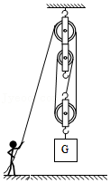

【答案】

解：

（1）由$ v=\frac{s}{t}$可得，物体上升的高度：

$ h=vt=\text{0.1m/s}\text{×}\text{10s}\text{＝}\text{1m}$，

拉力所做的有用功：

$ {W}_{\text{有}}=Gh=600\text{N}\text{×}\text{1m}\text{＝}\text{600J}$；

（2）由$ P=\frac{W}{t}$可得，工人拉力所做的总功：

$ {W}_{\text{总}}=Pt\text{＝}\text{75W}\text{×}\text{10s}\text{＝}\text{750J}$，

则滑轮组的机械效率：

$ \eta =\frac{{W}_{\text{有}}}{{W}_{\text{总}}}\times 100\%=\frac{\text{600J}}{\text{750J}}\times 100\%=80\%$；

（3）不计绳重，克服动滑轮重力所做的功：

$ {W}_{\text{动}}={W}_{\text{总}}-{W}_{\text{有}}-{W}_{\text{摩擦}}=\text{750J}\text{﹣}\text{600J}\text{﹣}\text{60J}\text{＝}\text{90J}$，

则滑轮组中的动滑轮的重力：

$ {G}_{\text{动}}=\frac{{W}_{\text{动}}}{h}=\frac{\text{90J}}{\text{1m}}=\text{90N}$.

答：（1）拉力所做的有用功为$ \text{600J}$；（2）滑轮组的机械效率为$ \text{80\%}$；（3）滑轮组中的动滑轮的重力为$ \text{90N}$.

【解析】​

## 知识点·二力平衡的条件

## 1. 填空题（难度：简单）

一个物体受到\( \text{10N}\)的一对平衡力的作用而做匀速直线运动，如果这时这对平衡力同时增大到\( \text{40N}\)，则物体做运动。

【答案】匀速直线

【解析】​

## 2. 填空题（难度：适中）

网传“2月11日这天地球引力最小，可以将扫把静立于地面”，如图所示，或许你也“成功”尝试过。其实只要细心操作，在任何时候你都能成功，扫把能静立于水平地面主要是利用
了原理，之所以细心操作是为了满足原理中的这一条件，这与地球引力大小并无关系。

【答案】二力平衡，作用在同一条直线上

【解析】​

## 知识点·作光的折射光路图

## 1. 单选题（难度：简单）

下列四幅光路图中，正确表示光从空气进入水中的光路是（    ）

- A. 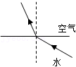
- B. 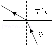
- C. 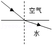
- D. 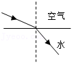

【答案】D

【解析】​

## 2. 单选题（难度：简单）

有经验的渔民都知道：只有瞄准看到的鱼的下方才能叉到鱼．对此做法解释正确的光路图是（    ）

- A. 
​
- B. 
​
- C. 
​
- D. 
​

【答案】B

【解析】​

## 知识点·使用机械是否省功

## 1. 多选题（难度：适中）

小明和小红要用实验探究“使用动滑轮是否省功”. 如图甲，用弹簧测力计将钩码缓慢地匀速提升一定的高度；如图乙，用弹簧测力计通过动滑轮将同样的钩码缓慢地竖直匀速提升相同的高度. 他们的实验数据如表格所示. 下列分析判断正确的是（     ）
 
所用实验
装置
弹簧测力计
的拉力\( F\text{/N}\)
钩码上升的
高度\( h\text{/m}\)
弹簧测力计绳端
移动的距离\( s\text{/m}\)

小明
甲
1.6
0.1
0.1

乙
0.9
0.1
0.2

小红
甲
2.4
0.2
0.2

乙
1.4
0.2
0.4

 

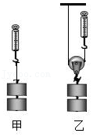

- A. 小明用装置甲实验，拉力所做的功为\( \text{0.16J}\)
- B. 小明两次实验中，乙比甲拉力所做的功多\( \text{0.02J}\)
- C. 小红两次实验中，乙比甲拉力所做的功多\( \text{0.4J}\)
- D. 两次实验中，乙比甲拉力所做的功都多，即“使用动滑轮不省功”

【答案】A/B/D

【解析】​

## 知识点·做功判断

## 1. 单选题（难度：适中）

如图所示，一名运动员投掷铅球的过程示意图，铅球在\( b\)点离手，\( c\)点是铅球运动的最高点，不计空气阻力. 在\( a\)到\( d\)的整个过程中，下列说法正确的是（    ）. 

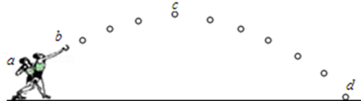

- A. 在\( b\)到\( c\)的过程中，运动员推力对铅球做了功
- B. 在\( b\)到\( d\)的过程中，铅球的机械能先增加后减少
- C. 在\( c\)到\( d\)的过程中，铅球的动能减少
- D. 在\( a\)到\( d\)的过程中，铅球的运动状态在不断的变化

【答案】D

【解析】​

## 知识点·光年

## 1. 单选题（难度：适中）

关于1光年、1万年、1万公里之间的叙述与比较，下列说法正确的是（    ）．

- A. 光年为时间单位，且1光年比1万年长
- B. 光年为时间单位，且1光年比1万年短
- C. 光年为距离单位，且1光年比1万公里长
- D. 光年为距离单位，且1光年比1万公里短

【答案】C

【解析】​

## 知识点·光折射的可逆性

## 1. 单选题（难度：适中）

渔民用激光枪射鱼，应该使激光对准（    ）

- A. 看到的鱼
- B. 看到的鱼的上方
- C. 看到的鱼的下方
- D. 看到的鱼的左上方

【答案】A

【解析】​

## 知识点·光的反射

## 1. 单选题（难度：简单）

如图所示，阳光下一本物理教材掉到地上，小明和小红从不同的位置都能看到它，是因为 （     ）．

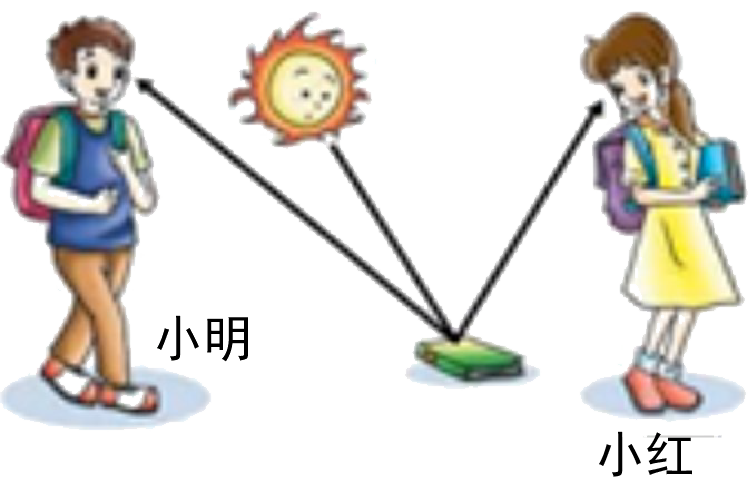

- A. 物理教材是光源，它发出的光射入小明和小红的眼睛
- B. 阳光在教材上发生反射，入射角等于反射角
- C. 小明和小红眼睛发出的光都射在书本上
- D. 阳光在教材上发生漫反射，反射光线向各个不同方向射出

【答案】D

【解析】​

## 2. 单选题（难度：简单）

房间里有两盏灯，其中一盏灯点亮，另一盏灯没有点亮．如下四个图中，能正确反映出人看见没有点亮的灯的光路图的是（    ）．

- A. 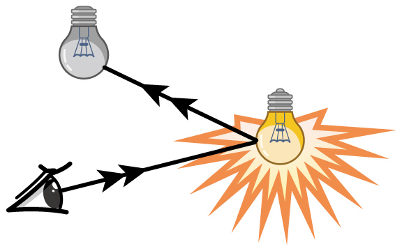
- B. 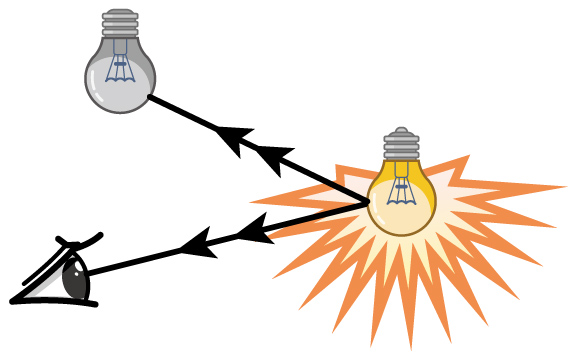
- C. 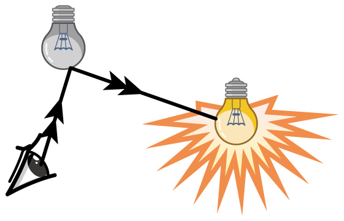
- D. 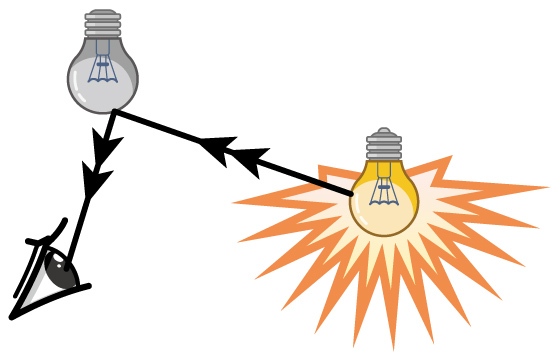

【答案】D

【解析】​

## 知识点·光的反射应用

## 1. 单选题（难度：适中）

晚上，在桌面上铺一张白纸，把一块小平面镜平放在白纸上，让手电筒的光正对着平面镜和白纸照射，如图所示，从侧面看去（    ）．

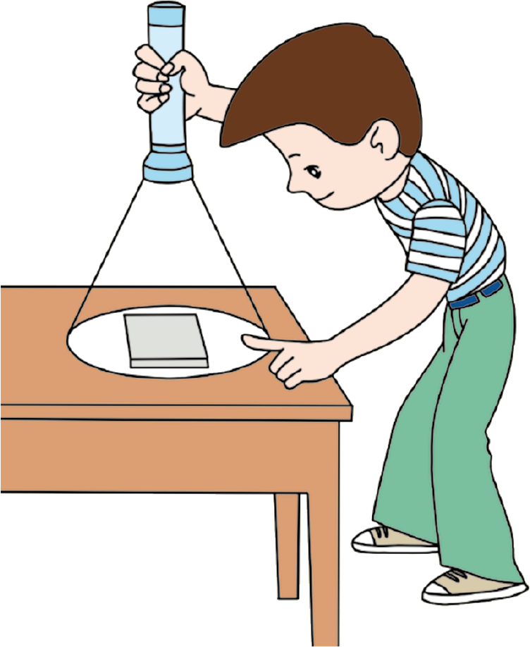

- A. 镜子比较亮，因为它发生了镜面反射
- B. 镜子比较亮，因为它发生了漫反射
- C. 白纸比较亮，因为它发生了镜面反射
- D. 白纸比较亮，因为它发生了漫反射

【答案】D

【解析】​

## 知识点·光的反射现象

## 1. 填空题（难度：简单）

在太阳的照耀下，岸边的树在地面上形成了阴影，同时也在水中形成了倒影．其中，“阴影”是光的现象，“倒影”是光的现象．

【答案】直线传播，反射

【解析】​

## 知识点·光的反射现象应用

## 1. 单选题（难度：简单）

如图的四种表述中，属于反射现象的是（    ）．

- A. 
漂亮的“日环食”
- B. 
水中的倒影
- C. 
凿壁偷光
- D. 
变幻的手影

【答案】B

【解析】​

## 知识点·光的反射现象的应用

## 1. 单选题（难度：简单）

一个雨后的晚上天放晴后，路上有小水潭，人在月光下行走，为避免踩到水潭里，要对路面作出判断，下列说法中正确的是（    ）．

- A. 迎着月光走时地上发亮处是水潭
- B. 迎着月光走时地上暗处是水潭
- C. 背着月光走时地面上发亮处是水潭
- D. 不论迎着月光还是背着月光走总是发亮处是水潭

【答案】A

【解析】​

## 知识点·光的折射

## 1. 单选题（难度：适中）

光从一种透明介质射入另一种透明介质时，下列说法正确的是（    ）

- A. 光的传播方向不一定发生改变
- B. 光的传播方向一定不发生改变
- C. 光的传播方向一定发生改变
- D. 在分界面处不发生反射

【答案】A

【解析】​

## 2. 填空题（难度：简单）

网上有新闻说“江西武宁出现海市蜃楼，时长近半小时”，“海市蜃楼”之所以会形成是因为光发生了．

【答案】折射

【解析】​

## 知识点·光的折射与反射_实像与虚像

## 1. 多选题（难度：适中）

在\( \text{①}\)小孔成像\( \text{②}\)平面镜成像\( \text{③}\)放大镜成像\( \text{④}\)照相机成像\( \text{⑤}\)幻灯机成像中（    ）

- A. 成实像的是\( \text{①④⑤}\)
- B. 成虚像的是\( \text{②③④}\)
- C. 属于反射成像的是\( \text{①⑤}\)
- D. 属于折射成像的是\( \text{③④⑤}\)

【答案】A/D

【解析】​

## 知识点·光的折射现象

## 1. 单选题（难度：适中）

如图所示，下列现象中属于光的折射现象的是（    ）

- A. 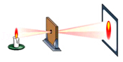
小孔成像
- B. 
手影游戏
- C. 
塔在水中的倒影
- D. 
铅笔“折断”了

【答案】D

【解析】​

## 2. 填空题（难度：适中）

如图所示，渔夫在叉水中的鱼时，看到的是鱼的（选填“实像”“虚像”），鱼叉应瞄准（选填“看到的鱼的方向”、“看到的鱼的上方”或“看到的鱼的下方”）才能叉到鱼．

【答案】虚像，看到的鱼的下方

【解析】​

## 知识点·光的折射规律

## 1. 填空题（难度：简单）

光的折射规律：当光从空气斜射入水或其他透明介质中时，折射光线、入射光线、法线在内；折射光线和入射光线分居的两侧；折射角入射角；折射角随着入射角的增大而 ；当光线垂直射到介质表面时，传播方向．

【答案】同一平面，法线，小于，增大，不变

【解析】​

## 知识点·光的直线传播_光的反射_光的折射

## 1. 单选题（难度：适中）

“影”是生活中常见的光现象，它们与物理知识对应关系错误的是（    ）

- A. 手影\( --\)光的直线传播\( --\)成倒立缩小实像
- B. 倒影\( --\)光的反射\( --\)成正立等大虚像
- C. 摄影\( --\)光的折射\( --\)成倒立缩小实像
- D. 投影\( --\)光的折射\( --\)成倒立放大的实像

【答案】A

【解析】​

## 2. 多选题

“影”是我们日常生活中常见的光现象，如夏天乘凉的“树影”；海市蜃楼中的“幻影”；岸边景色在水中形成的“倒影”；春游时的“摄影”等. 下列说法中不正确的是（    ）

- A. 树影是由光的直线传播形成的
- B. 幻影利用了平面镜成像的原理
- C. 倒影是由光的折射形成
- D. 摄影时用的照相机是根据凹透镜成像原理制成

【答案】B/C/D

【解析】​

## 知识点·光的直线传播_日食

## 1. 单选题（难度：适中）

\( 2020\)年\( 6\)月\( 21\)日，我国多地可以看到罕见的日环食，天文爱好者用墨水成像、小孔成像、相机拍照等方式观看或记录了这一天象奇观，下列说法正确的是（    ）

- A. 日食形成的原因是光沿直线传播
- B. 太阳在墨水中形成倒影是光的折射现象
- C. 太阳通过小孔成像是光的反射现象
- D. 太阳通过照相机镜头成的是虚像

【答案】A

【解析】​

## 知识点·光的直线传播、光源

## 1. 填空题（难度：简单）

舞蹈“千手观音”是我国佛教文艺形式的精品，给人以美的熏陶，善的启迪．
\( \text{（}\text{1}\text{）}\)观众看不见领舞者身后站着的其她舞蹈者，这是因为光的的缘故；
\( \text{（}\text{2}\text{）}\)佛光普照，梵音如丝．佛光是舞蹈者手上的饰品发出的，饰品（填“是”或“不是”）光源．

【答案】直线传播，不是

【解析】​

## 知识点·光路可逆

## 1. 单选题（难度：适中）

甲从一面镜子中能看见乙的眼睛，此时乙从这面镜子中（    ）．

- A. 一定能看见甲的眼睛
- B. 一定看不见甲的眼睛
- C. 可能看见，也可能看不见甲的眼睛
- D. 只有将镜子放到特定的位置时才能看见甲的眼睛

【答案】A

【解析】​

## 知识点·光速

## 1. 单选题（难度：简单）

下列关于光的传播速度的说法中正确的是（    ）．

- A. 光在真空中的传播速度最大
- B. 光和声音一样，不能在真空中传播
- C. 光的传播速度为\(3×1{0}^{8}{\text{m}/\text{s}}\)​
- D. 光在玻璃中的传播速度比在真空中大

【答案】A

【解析】​

## 知识点·其他简单机械_轮轴

## 1. 填空题（难度：简单）

生活中的许多现象都与我们所学的物理知识有关，小明发现，如图甲所示的水龙头很难徒手拧开，但将乙所示的钥匙，如丙所示安装并旋转后，水龙头就能正常出水，则此钥匙相当于一个（选填“斜面”、“滑轮”或“轮轴”），属于（选填“省力”或“费力”）机械. 

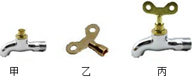

【答案】轮轴，省力

【解析】​

## 2. 填空题（难度：简单）

在生产和生活中，人们常用的简单机械除了杠杆、滑轮，还有斜面和轮轴. 如图所示，是用螺丝刀拧螺丝的情景. 手柄越（选填“粗”或“细”）的螺丝刀用起来越省力，这是运用了（填“斜面”或“轮轴”）的原理；螺丝钉是一种简单机械，螺丝钉上螺纹的展开长度相当于（填“斜面”或“轮轴”），螺纹越（选填“疏”或“密”）  的螺丝钉拧起来越省力. 

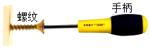

【答案】粗， 轮， 斜， 密

【解析】​

## 知识点·减弱噪声的途径

## 1. 单选题（难度：适中）

噪声严重污染环境，影响人们的生活和工作，已成为社会公害，下列措施中不能有效控制噪声的是（    ）.

- A. 在公路与住宅区之间设置屏障
- B. 植树种草，绿化城市
- C. 清除城市垃圾，保持环境整洁
- D. 在繁华路段禁止汽车鸣笛

【答案】C

【解析】​

## 知识点·凸透镜三条特殊光线

## 1. （难度：适中）

图中\( {S}^{\text{'}}\)为烛焰\( S\)的像，请通过作图画出透镜、标出一个焦点\( F\)的位置并完成光路图.  

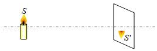

【答案】

     

【解析】​

## 知识点·凸透镜成像的规律

## 1. 填空题（难度：适中）

在“天宫课堂”的水球实验中，小明看到王亚平老师的倒立、缩小的像，如图甲所示.  于是他利用实验室的光学器材探究凸透镜成像的规律.  

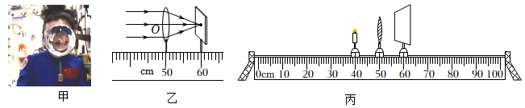
   
（1）小明找到了一个焦距未知的凸透镜，用一束平行光正对凸透镜照射，移动光屏，直到光屏上出现最小最亮的光斑，如图乙所示.  则凸透镜的焦距是 cm.  
（2）如图丙所示，将蜡烛、凸透镜、光屏依次安装在光具座上.  点燃蜡烛，调整它们的高度到合适的位置.  
（3）将凸透镜固定在50cm刻度线处，蜡烛移动到20cm刻度线处，向（填“靠近”或“远离”）凸透镜的方向移动光屏，直到出现烛焰倒立、的实像.  
（4）在实验过程中，原来光屏中央的像“跑”到上方，为了使像回到中央，接下来的操作是（填“\( \text{①}\)”“\( \text{②}\)”或“\( \text{③}\)”）.  
\( \text{①}\)向下调光屏
\( \text{②}\)向上调凸透镜
\( \text{③}\)向上调蜡烛

【答案】10.0，远离，缩小，$ \text{③}$ 

【解析】​

## 2. 

在“探究凸透镜成像规律”的实验中：

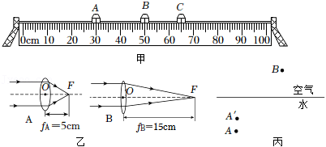

为了探究蜡烛的烛焰能否在光屏上成实像，应该把凸透镜放在如图甲所示的（选填“\( A\)”、“\( B\)”或“\( C\)”）处.  为了使像成在光屏中央，应调整烛焰、凸透镜和光屏，使它们的中心在；

下表是小明设计的实验表格，请你在表格中横线处补全缺少的项目，小明用焦距为10cm的凸透镜做实验，蜡烛放到较远处，调整光屏到凸透镜的距离，直到烛焰在光屏上成清晰的实像，观察像的性质，同时测出此时物距和像距，把蜡烛向凸透镜移近一些，重复以上操作.  把实验测出的数据和成像的性质填入表中；   
物距
\( u\)/cm
像的性质
像距
\( v\)/cm

虚实
大小
 

30
实
缩小
 
15

20
实
等大
 
20

15
实
放大
 
30

通过分析表中数据，可以得到规律：凸透镜成实像时，物距变小，像距（选填“变大”、“变小”或“不变”）；

小明换用如图乙所示焦距不同的\( A\)、\( B\)两个凸透镜中的一个再进行实验，当物距为15cm时，移动光屏在光屏上得到清晰的像，测出像距为7.5cm，结合上表的实验数据，可以判断出小明这次实验用的是（选填“\( A\)”或“\( B\)”）透镜；

凸透镜成像利用了光的折射，生活中存在由于光的折射而产生“错觉”的现象，如泳池水看起来变浅了，所以不能贸然下水，以免发生危险.  如图丙所示，人眼在\(B\)​点看到水中\(A\)​点的像在\({A}^{′}\)​点处，请完成人眼在\(B\)​点看到\(A\)点的像的光路图.

【答案】B/同一高度，正倒，变大，A   ，

如图所示

 

【解析】​

## 知识点·凸透镜成像规律与图象结合

## 1. 单选题（难度：适中）

某班同学在“探究凸透镜成像规律”的实验中，记录并绘制了像到凸透镜的距离\( v\)跟物体到凸透镜的距离\( u\)之间关系的图像，如图所示，下列判断正确的是（    ）.  
 
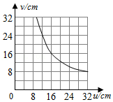

- A. 该凸透镜的焦距是\( \text{16cm}\)
- B. 当\( u\text{＝}\text{12cm}\)时，在光屏上能得到一个放大的像，投影仪就是根据这一原理制成的
- C. 当\( u\text{＝}\text{24cm}\)时成放大的像，放大镜就是根据这一原理制成的
- D. 把物体从距凸透镜\( \text{12cm}\)处移动到\( \text{24cm}\)处的过程中，像先变大后变小

【答案】B

【解析】​

## 知识点·凸透镜的定义

## 1. 单选题（难度：简单）

在办公桌的玻璃板上滴一滴水，通过这滴水可以看到玻璃板下压着的字变大了，这是由于水滴相当于（    ）

- A. 凸透镜
- B. 凹面镜
- C. 凸面镜
- D. 凹透镜

【答案】A

【解析】​

## 知识点·凸透镜的应用_幻灯机

## 1. 填空题（难度：适中）

如图所示是幻灯机的工作原理图. 幻灯机的镜头相当于一个镜. 为了使观众看到正立的像，幻灯片要\( (\)填“顺着“或“倒着“\( )\)插入架上. 用强光照射幻灯片，幻灯片上的画面在屏幕上形成像\( (\)填“实”或“虚”\( )\). 

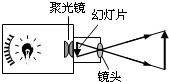

【答案】凸透，倒着，实

【解析】​

## 知识点·凸透镜的应用_摄像机

## 1. 单选题（难度：适中）

当汽车经过十字路口时，监控摄像头就会拍下照片，摄像头相当于一个透镜，影像传感器相当于光屏，下列说法正确的是（    ）

- A. 监控摄像头和近视眼镜的镜片都对光有会聚作用
- B. 拍照时，汽车位于摄像头二倍焦距以外
- C. 当汽车远离摄像头时，影像传感器上的像变大
- D. 影像传感器上成的是正立的虚像

【答案】B

【解析】​

## 2. 单选题（难度：适中）

如图是学校测温棚里的红外线测温仪，它既能测温，也能摄像，其镜头相当于凸透镜，它正常工作时所成像的性质是（    ）

- A. 正立放大的虚像
- B. 倒立缩小的实像
- C. 倒立放大的实像
- D. 正立缩小的实像

【答案】B

【解析】​

## 知识点·凸面镜和凹面镜的作用

## 1. 填空题（难度：简单）

第二届全国青年运动会中，中国艺术体操运动员张豆豆手中拿着采火棒对着凹面镜进行采火，这是利用凹面镜对太阳光的（填“会聚”或“发散”）作用。四周的人都能看见采火棒，是因为光照射到采火棒上时发生了（填“镜面”或“漫”）反射。

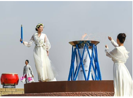

【答案】会聚，漫

【解析】​

## 知识点·凸面镜和凹面镜的应用

## 1. 单选题（难度：简单）

下列对生活中的光现象及其应用的认识，合理的是（    ）。

- A. 汽车的后视镜多为凹面镜，它起到了扩大视野的作用
- B. 眼睛能看见物体是因为眼睛发出的光到达了该物体
- C. 通过平面镜、凸面镜、凹面镜反射的光线都遵守光的反射定律
- D. 我们可以从不同方向看到投影仪投到幕布上的图像是因为光在幕布上发生了镜面反射

【答案】C

【解析】​

## 知识点·力与运动的关系

## 1. 多选题（难度：适中）

某次演练中，直升机悬停于高空，一伞兵（含伞）跳伞后竖直降落，其速度\( v\)与时间\( t\)的关系如图所示。下列判断正确的是（   ）

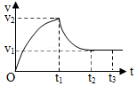

- A. 在\(0\sim {t}_{1}\)内，伞兵受到的重力小于阻力
- B. 在\(0\sim {t}_{2}\)内，伞兵受到的重力等于阻力
- C. 在\({t}_{2}\sim {t}_{3}\)内，伞兵受到的重力等于阻力
- D. 在\({t}_{2}\sim {t}_{3}\)内，伞兵受到的阻力保持不变

【答案】C/D

【解析】​

## 知识点·力的_三要素

三要素（同步练习）

## 1. （难度：适中）

如图所示，在水平桌面上用手指压铅笔尖，铅笔在竖直位置处于静止状态.在图中画出铅笔所受弹力的示意图.

【答案】

  

【解析】​

## 2. （难度：适中）

如图，小球向右运动将弹簧拉伸，请画出小球在水平方向上所受弹力的示意图.

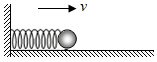

【答案】

  

【解析】​

## 知识点·力的作用效果;力的作用是相互的

## 1. 单选题（难度：简单）

如图为运动员撑竿跳高时的情景，下列说法正确的是（　　）

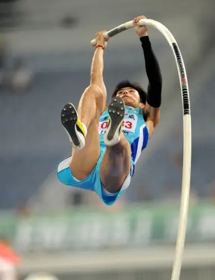

- A. 运动员能跃起，说明力能改变物体的运动状态
- B. 使整个撑竿发生形变的力的施力物体是地球
- C. 运动员撑竿时手通常握在竿的上部，这是利用力的作用效果与力的方向有关
- D. 起跳时，撑竿对人的作用力大于人对撑竿的作用力

【答案】A

【解析】AB．运动员撑竿跳高的起跳过程需要使撑竿底部顶住地面，人对撑竿的顶端施加力的作用，使撑竿发生弹性形变，撑竿在恢复原状的过程中产生弹力，从而对运动员施加力的作用，改变了运动员的运动状态，故A正确，B错误；
C．运动员撑竿时手通常握在竿的上部，便于对撑竿施力时可使撑竿发生最大程度的弹性形变，这是利用了力的作用效果与力的作用点有关，故C错误；
D．起跳时，撑竿对人的作用力，与人对撑竿的作用力是大小相等、方向相反，但作用在两个不同的物体上的相互作用力，故D错误。
故选A。

## 知识点·力的性质

## 1. 单选题（难度：适中）

如图所示，甲、乙两同学各用2N的拉力在水平方向上同时向相反的方向拉一弹簧测力计，则弹簧测力计的示数为（    ）.

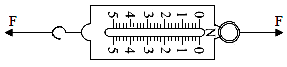

- A. 2N
- B. 4N
- C. 0N
- D. 无法判断

【答案】A

【解析】​

## 2. 单选题

某实验小组的同学对\( A\)、\( B\)两根橡皮筋进行探究，将橡皮筋的一端固定，另一端悬挂钩码图甲所示，记录橡皮筋受到的拉力大小\( F\)和橡皮筋伸长量，根据多组测量数据做出的图线如图乙所示.下列说法正确的是（    ）.

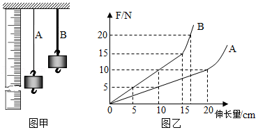

- A. 分别用这两根橡皮筋制成的测力计，橡皮筋\( B\)制成的测力计测量的精确度高
- B. 将本实验中两根橡皮筋并列起来一起用，能够测的力最大值为\( \text{25N}\)
- C. 将本实验中两根橡皮筋串接起来一起用，能够测的力最大值为\( \text{10}\text{N}\)
- D. 当在两根橡皮筋上都悬挂重力为\( \text{8}\text{N}\)的物体时，橡皮筋\( A\)的伸长量为\( \text{8cm}\)

【答案】C

【解析】​

## 知识点·力的测量;弹力

## 1. 单选题（难度：非常简单）

关于弹簧测力计下列说法正确的是（　　）

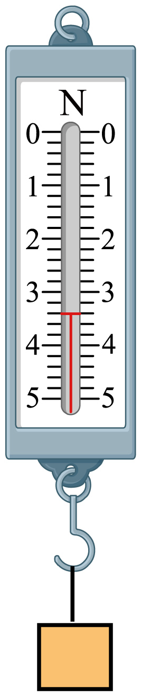

- A. 弹簧测力计只能测竖直方向上的拉力而无法测出水平方向的拉力
- B. 图中的弹簧测力计分度值及测量范围分别是0.2N和0~5N，读数为3.2N
- C. 在弹性限度内，弹簧测力计受到的拉力越大，弹簧伸长量就越长
- D. 测量范围大的弹簧测力计弹簧长度一定比测量范围小的弹簧测力计弹簧长度长

【答案】C

【解析】A．使用弹簧测力计既能测出重力又能测出水平方向上的拉力，只要拉力沿弹簧的轴线方向即可，故A错误；
B．由图示弹簧测力计可以看出，其量程为0~5N，分度值为0.2N，读数为3.4N，故B错误；
C．弹簧所受的拉力与弹簧的伸长量成正比，在弹性限度内，弹簧测力计受到的拉力越大，弹簧伸长量就越长，故C正确；
D．弹簧测力计的测量范围（量程）取决于弹簧的弹性限度等因素，和弹簧本身的长度没有必然联系。测量范围大的弹簧测力计，其弹簧不一定比测量范围小的弹簧长度长。故D错误。
故选C。

## 知识点·力的示意图；二力平衡条件的应用

## 1. （难度：简单）

如图所示，把汤匙放在手指上，仔细调节支撑汤匙的支撑点，使其在手指上平衡。请画出汤匙此时受到手指的作用力F。

【答案】

   

## 知识点·力的示意图；杠杆；探究水沸腾前后温度变化的特点；

## 1. 单选题（难度：适中）

下面是学考复习时，同学们整理的几种物理情景下的图像，以下与图像相关的说法中正确的是（  ）

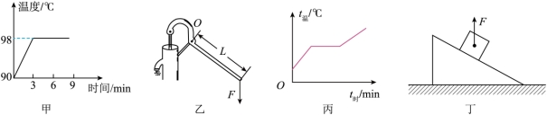

- A. 甲图：水沸腾时的温度保持不变
- B. 乙图：施加在把手上的力F对应的力臂为L
- C. 丙图：某晶体熔化前后曲线倾斜程度不同是因为该物质液态时的比热容较大
- D. 丁图：放在斜面上的物体受到的支持力F的示意图

【答案】A

【解析】A．水在标准大气压下沸点是100℃，气压降低，沸点降低，图甲中水在98℃时沸腾，可能是当时气压低于标准大气压，且水沸腾时继续吸热、温度不变，故A‌正确‌；
B．力臂是支点到力的作用线的垂直距离，图乙中L与力F的作用线不垂直，故施加在把手上的力F对应的力臂不是L，故B‌错误；
C．晶体熔化前处于固态，熔化后处于液态，熔化前后质量不变，相同时间吸收热量相同，如图丙所示，熔化前后吸热相同时，熔化后升高的温度较小，根据Q=cmΔt可知，液态比热容大，故C‌正确‌；
D．放在斜面上的物体受到的支持力垂直于斜面向上，图丁中支持力方向错误，故D错误‌。
故选A。

## 知识点·力的示意图；浮力

## 1. （难度：非常简单）

请在图中画出潜水艇静止在海面时所受浮力的示意图（O点为重心）。

【答案】

## 2. （难度：简单）

强我海军，护我领海。如图所示，请作出我国某潜水艇在海水中加速上浮时所受重力和浮力的示意图（O为潜水艇的重心）。

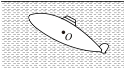

【答案】

   

【解析】F浮大于G。

## 知识点·力的示意图；浮力大小的相关因素;液体压强

## 1. 填空题（难度：适中）

一只苹果漂浮在容器中的水面上，如图（a）所示。

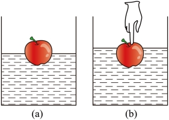
   
(1).在图（a）中用力的示意图画出苹果受到的浮力F浮。
(2).用手指将苹果向下按压至如图（b）所示的位置并保持静止，则苹果受到的浮力大小将（选填“变大”、“变小”或“不变”），若此时水深0.2m，则水对容器底部的压强为Pa。

【答案】         ，变大      2000

## 知识点·力的示意图；理解牛顿第一定律

## 1. 单选题（难度：适中）

利用无人机搬运货物可大幅提升效率，如图无人机正带着货物匀速上升。（忽略空气阻力） 

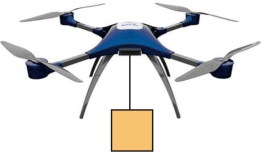
   
(1)相对于无人机，货物是_____的。
(2)在图中，若货物的重力为10N，用力的示意图画出此时货物所受的力。 
 

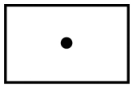
   
(3)无人机带着货物竖直匀速上升时，若连接无人机与货物的绳子突然断了，绳子断开瞬间：①无人机受到的升力_____无人机的重力（选填“小于”、“大于”或“等于”）；
②货物将会如何运动_____，请说明理由_____。

- A. 静止
- B. 竖直向下运动
- C. 竖直向上运动

【答案】C

【解析】（1）无人机带着货物匀速上升，相对于无人机，货物的位置没有发生变化，是静止的。
（2）货物匀速直线运动，处于平衡状态，竖直方向上受到的力大小相等。受到竖直向下的重力20N，则受到竖直向上的拉力也为20N，两个力的作用点均可以近似在物体的重心位置，货物所受的力如下图所示：

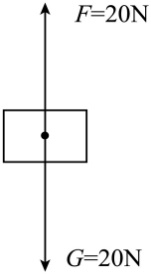
   
（3）（1）无人机匀速上升时，处于平衡状态，竖直方向上受到的力大小相等。受到竖直向上的升力，竖直向下的重力，和货物竖直向下的拉力，三个力平衡，即F升=G无+G货。此时无人机受到的升力大于无人机的重力，若连接无人机与货物的绳子突然断了，绳子断开瞬间无人机的升力不变，即无人机受到的升力仍大于无人机的重力。故大于。
（2）（3）连接无人机与货物的绳子突然断了， 货物原来在竖直向上运动，由于货物具有惯性，故断开的瞬间货物将保持原运动状态，即竖直向上运动。

## 知识点·功率在实际生活中的应用

## 1. 单选题（难度：简单）

等高线存在于生活中，比如美丽的梯田，比如弯曲的盘山公路. 车子在盘山公路上爬坡时，司机会换低挡. 这样做是为了使车辆向上行驶时可以（    ）. 

- A. 获得更大的功率来爬坡
- B. 提高行驶速度
- C. 省油
- D. 获得更大的牵引力

【答案】D

【解析】​

## 2. （难度：简单）

汽车在爬坡时一般车速都较慢，根据你所学的知识，解释一下其原因.

【答案】

汽车在爬坡时，车速一般都较慢，根据功率的推导公式$ P=\frac{W}{t}=Fv$可知，在功率一定时，速度$ v$越小，牵引力$ F$越大，汽车上坡时，需要的牵引力大，所以要慢速行驶.

【解析】​

## 知识点·功率测量的实验

## 1. 单选题（难度：简单）

攀岩运动是从登山运动中派生来的新项目，它集健身、娱乐、竞技于一体，以其独有的登临高处的征服感吸引了众多爱好者（如图所示）. 要测量两名运动员在攀岩时克服重力做功的功率大小，不需要测量的物理量是（    ）. 

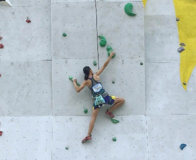

- A. 运动员的质量
- B. 攀岩的高度
- C. 运动员的身高
- D. 攀岩所用的时间

【答案】C

【解析】​

## 2. 填空题（难度：简单）

学校买了一箱物理器材，小军同学将它从一楼搬运到三楼，小丽同学想测量小军同学搬运器材过程中对箱子做功的功率. 
（1）测量所需要的器材有：磅秤、卷尺和. 
（2）小丽同学设计的测量步骤如下，其中多余的是. 
\( \text{①}\)测出箱子的质量为\( {m}_{1}\)
\( \text{②}\)测出一楼到三楼楼梯的总长度\( l\)
\( \text{③}\)测出一楼到三楼的竖直高度\( h\)
\( \text{④}\)测出小军上楼梯所用的时间\( t\)
\( \text{⑤}\)测出小军的质量为\( {m}_{2}\)
（3）小军同学搬运器材过程中对箱子做功的功率表达式为\( P=\).

【答案】停表，②⑤，$  \frac{W}{t}=\frac{{m}_{1}gh}{t}$

【解析】​

## 知识点·功率的概念

## 1. 单选题（难度：简单）

甲机械比乙机械的功率大，表示两机械在做功时（    ）.

- A. 甲做功快
- B. 甲更省力
- C. 甲做功多
- D. 甲用时少

【答案】A

【解析】​

## 知识点·功率的概念和单位

## 1. 填空题（难度：简单）

功率是表示物体做功的物理量. 坚持锻炼，增强体魄！小明每天跑步的功率为400W，表示的物理意义是 .

【答案】快慢，1秒时间内小明做的功为400J

【解析】​

## 2. 填空题（难度：简单）

如图所示，健身教练要增大学员的运动量，会加快音乐的节奏，以（选填“增大”或“降低”）运动的（选填“功”、“时间”或“功率”）. 

【答案】增大，功率

【解析】​

## 知识点·功率的计算_滑轮组机械效率

## 1. 填空题（难度：适中）

如图所示，滑轮规格相同、重均为\( \text{60N}\)．工人用\( \text{150N}\)的水平拉力匀速向右拉动绳端，在\( \text{20s}\)内矿井里的物体提升\( \text{8m}\). 不计绳重及轮轴间摩擦，物体重为 \( \text{N}\)，工人拉动绳子做功的功率为 \( \text{W}\)．此过程中，滑轮组的机械效率为 %. 

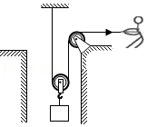

【答案】240，120，80

【解析】​

## 知识点·功的大小比较

## 1. 多选题

物体在同一水平地面上做直线运动，通过相等的路程s，当物体运动的路程和时间图像如图甲时，受到的水平推力为\( {F}_{1}\)；当物体运动的速度和时间图像如图乙时，受到的水平推力为\( {F}_{2}\)；两次推力做功分别为\( {W}_{1}\)、\( {W}_{2}\)；两次推力的功率分别为\( {P}_{1}\)、\( {P}_{2}\). 则下列关系正确的是（    ）. 

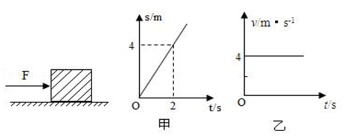

- A. \( {W}_{1}={W}_{2}\)，\( {P}_{1}<{P}_{2}\)
- B. \( {W}_{1}<{W}_{2}\)，\( {P}_{1}={P}_{2}\)
- C. \( {F}_{1}<{F}_{2}\)，\( {P}_{1}={P}_{2}\)
- D. \( {F}_{1}={F}_{2}\)，\( {P}_{1}<{P}_{2}\)

【答案】A/D

【解析】​

## 知识点·功的计算公式及变形

## 1. （难度：简单）

马拉着质量是\( \text{2000}\text{kg}\)的车在水平路上前进\( \text{400}\text{m}\)，马的水平拉力做了\( {3\times 10}^{5}\text{J}\)的功，马的水平拉力是多大?

【答案】

解：由$ W=Fs$

可知$ F=\frac{W}{S}=\frac{3\times {10}^{5}\text{J}}{400\text{m}}=750\text{N}$

答：马的水平拉力是$ \text{7}\text{50N}$.

【解析】​

## 知识点·动能与势能转化

## 1. 填空题（难度：简单）

如图是卫星轨道示意图. 人造卫星沿椭圆轨道绕地球运行时，离地球最近的一点叫近地点，最远的一点叫远地点. 卫星在运行过程中机械能守恒. 当卫星从远地点向近地点运动时，它的重力势能（增大/减小），速度越来越（快/慢），动、势能的转化是. 

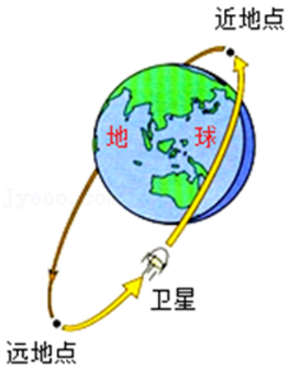

【答案】减小，快，势能转化为动能

【解析】​

## 知识点·压强、摩擦力

## 1. 填空题（难度：适中）

如图甲所示，将一块质地均匀的长木板平放在水平桌面上，用水平力\( F\)向右缓慢推动木板，使其右端渐渐露出桌面，如图乙所示。在推动木板使其右端逐渐伸出桌面边缘未掉落之前，长木板对桌面的压力，压强，摩擦力。（选填“变大”“变小”或“不变”）

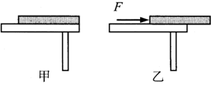

【答案】不变，变大），不变

【解析】​

## 知识点·压强、摩擦力、惯性

## 1. 填空题（难度：简单）

“自平衡电动踏板车”如图所示，当人站上踏板车后，踏板车对地面的压强 （选填“变小”、“不变”或“变大”）；轮胎表面的凹凸花纹是为了增大轮胎与地面的；停止对踏板车供电后，由于惯性它将继续运动一段距离，在速度逐渐变小直到静止的过程中，踏板车的惯性（选填“逐渐变小”、“保持不变”或者“逐渐变大”）。

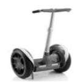

【答案】变大，摩擦（或摩擦力），保持不变

【解析】​

## 知识点·压强和液体压强

## 1. 填空题（难度：适中）

如图甲所示，密闭的容器中装有一定量的水，静止在水平桌面上，容器内水面到容器底的距离为\( 6\text{cm}\)，则水对容器底的压强为 \( \text{Pa}\)；若把该容器倒放在该桌面上，如图乙所示，那么水对容器底的压强将，容器对水平桌面的压强将（后面两空填“变大”、“变小”或“不变”）。

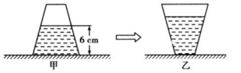

【答案】588，变大，变大

【解析】​

## 知识点·压强综合

## 1. 单选题（难度：简单）

以下关于压强的说法，错误的是（   ）

- A. 菜刀的刀口做得很薄是为了增大压强
- B. “蛟龙号”深潜器在海水中下潜的过程中，受到的海水压强增大
- C. 氢气球升到高空后会炸裂，是因为大气压随高度的增大而增大
- D. 动车运行时，车厢附近的气流速度较大，压强较小

【答案】C

【解析】​

## 知识点·受力分析

## 1. （难度：简单）

一同学在河边游泳后从水的较深处走向越来越浅的岸边，由于岸边都是尖硬的鹅卵石，该同学感觉河底越来越“扎脚”，请利用你学过的物理知识解释这个现象.

【答案】

当该同学游泳回来，逐渐走上岸的过程中，排开水的体积变小，根据阿基米德原理可知受到的浮力变小，而人的重力不变，所以，受的支持力变大，脚底受到的压强逐渐变大，使他感觉踩在鹅卵石上的脚掌越来越疼，感觉河底越来越&ldquo;扎脚&rdquo;．

## 知识点·固体的密度测量实验

## 1. 单选题（难度：适中）

某同学用托盘天平和量筒测量一小石块的密度，如图甲是调节天平时的情形，图乙和图丙分别是测量石块质量和体积时的情形，下列说法正确的是（    ）. 

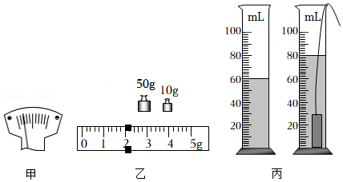

- A. 甲图中，应将游码向左调，使天平横梁平衡
- B. 乙图中测得石块质量为\( \text{62.2g}\)
- C. 丙图中测得石块的体积为\( \text{80}{\text{cm}}^{\text{3}}\)
- D. 该石块的密度为\( \text{3.1}\text{×}\text{10}\text{³}\text{kg/m}\text{³}\)

【答案】D

【解析】​

## 知识点·图像分析

## 1. 多选题

如图甲所示，某人在水平地面上用力推木箱，推力随时间变化的图像如图乙所示，木箱速度随时间变化的图像如图丙所示，以下对于这一过程的分析中正确的是（    ）. 

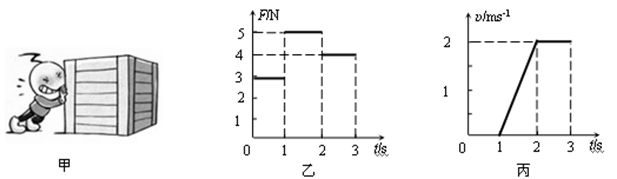

- A. 0—1s内木箱没有动是因为人对木箱的推力小于地面给木箱的摩擦力
- B. 1s—2s内木箱受到的摩擦力大小为4N
- C. 2s—3s内人对木箱的推力做功为8J
- D. 如果3s后人停止用力，木箱将做匀速直线运动

【答案】B/C

【解析】​

## 知识点·图像数据处理

## 1. （难度：适中）

在学习了弹力及弹簧测力计的相关知识后，小红同学发现，弹簧测力计的刻度是均匀的，由此她想探究“弹簧的伸长与所受拉力的关系”，于是她采用了图一的装置进行了探究.

要完成实验，除了需要如图一所示的铁架台，一根两头带钩的弹簧，若干相同的钩码（已知每个钩码重\( \text{0.5N}\)）以外，还需要的测量仪器是.

通过实验，小红同学收集了弹簧受到大小不同的拉力\( F\)以及所对应的弹簧长度\( L\)，并在坐标纸上绘制了图二的图象.分析图象可知：
（1）该弹簧的原长\( {L}_{0}\)为 \( \text{cm}\)，当弹簧受到\( \text{2N}\)的拉力时，弹簧伸长量\( △L\)为 \( \text{cm}\)；
（2）可以得到的实验结论是；
（3）若用该弹簧制作一只弹簧测力计，其量程是 \( \text{N}\).

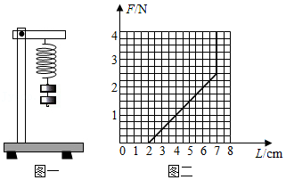

【答案】刻度尺，2/4/在弹性限度内，弹簧的伸长量$ △L$与它所受到的拉力$ F$成正比/0～2.5

【解析】​

## 知识点·增大减小压强方法浮力影响因素_超声波传递信息

## 1. 多选题（难度：适中）

妙趣横生的动物世界蕴涵着丰富的物理知识，下列说法中正确的是（   ）

- A. 鸭子的脚掌又扁又平，可以增大压强，从而在松软的烂泥地上行走自如
- B. 鱼要下沉时就吐出鱼鳔内的空气，减小自身排开的水的体积而使浮力变小
- C. 蝙蝠能在夜间活动，是利用了次声波传递信息
- D. 鸟的翅膀的形状使其上下表面受到的空气压强不同，为其向上飞翔提供了升力

【答案】B/D

## 知识点·增大减小压强的方法

## 1. 单选题（难度：简单）

在如图所示的工具中，为了减小压强的是（   ）

- A. 
 逃生锤
- B. 
 削皮器
- C. 
 锥子
- D. 
 防勒提手

【答案】D

【解析】​

## 知识点·增大减小摩擦力的方法

## 1. 填空题（难度：简单）

劣质橡皮较硬，擦字时易打滑，导致字擦不干净，这是因为物体间接触面越光滑，摩擦力越，小明用橡皮轻轻擦字没擦干净，稍加用力就擦干净了，这是通过增大压力来（选填“增大”或“减小”）橡皮与纸间的摩擦的。

【答案】小，增大

【解析】​

## 知识点·增大或减小机械效率的方法

## 1. 单选题（难度：适中）

小明用动滑轮竖直向上提升重物，下列措施能提高动滑轮机械效率的是（     ）

- A. 减小动滑轮的重力
- B. 增大重物上升的高度
- C. 减小物体的重力
- D. 增大重物上升的速度

【答案】A

【解析】​

## 2. 多选题（难度：适中）

用如图所示的滑轮组提升重物时（忽略绳重及摩擦），下列做法能提高滑轮组机械效率的有（     ）

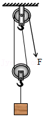

- A. 增加物体被提升的高度
- B. 减轻动滑轮的重力
- C. 改变绕法，增加承担重物的绳子的段数
- D. 增加物体的重力

【答案】B/D

【解析】​

## 知识点·声与信息

## 1. 单选题（难度：适中）

超声波已广泛应用于人们生活的各个领域. 下列关于超声波的利用，说法正确的是（    ）.

- A. 用超声波查看零件内部结构，说明超声波具有能量
- B. 用“倒车雷达”发现车后障碍物，说明超声波能传递信息
- C. 用超声波除去人体内的结石，说明超声波能传递信息
- D. 用超声波清洗眼镜片，说明超声波能传递信息

【答案】B

【解析】​

## 知识点·声的利用

## 1. 多选题（难度：适中）

关于声的利用和噪声的防治，下列说法正确的是（    ）.

- A. 医生利用超声波洗牙﹣﹣声音能传递信息
- B. 打雷时房屋在震动﹣﹣声音能传递能量
- C. 安装双层玻璃窗﹣﹣传播中减弱噪音
- D. 摩托车的消声器﹣﹣人耳处减弱噪音

【答案】B/C

【解析】​

## 知识点·声音的特性

## 1. 多选题

关于声现象的说法中，正确的是（    ）.

- A. “请小声说话”指的是声音的音调
- B. “不见其人，便闻其声”根据的是声音的音色
- C. 物体振动的频率越高，声音的响度越大
- D. 离声源越远，声音的响度越小

【答案】B/D

【解析】​

## 知识点·天平的使用

## 1. 单选题（难度：适中）

托盘天平测物体的质量，下列情况中会出现测量结果比真实值偏小的是（    ）.

- A. 按游码右端所对的刻度读数
- B. 使用已被磨损的砝码
- C. 游码未移至零刻度线处，就调节横梁平衡测量物体的质量
- D. 横梁没有平衡，指针偏向分度盘的右侧，就进行测量

【答案】D

【解析】​

## 知识点·定滑轮的工作特点

## 1. 单选题（难度：适中）

一名体重\( 600\mathrm{N}\)的举重运动员，可举起\( 1300\mathrm{N}\)的物体，这个人站在地面上，用如图装置提升物体，滑轮重绳重和摩擦均忽略不计，在下列四个不同重力的物体中，他能提起的最重的物重是（     ）.

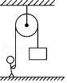

- A. 600\( \mathrm{N}\)
- B. 1300\( \mathrm{N}\)
- C. 1900\( \mathrm{N}\)
- D. 700\( \mathrm{N}\)

【答案】A

【解析】​

## 知识点·定滑轮的特点

## 1. 单选题（难度：简单）

如图所示，使用定滑轮提升重物，当分别在\( A\)方向、\( B\)方向和\( C\)方向拉重物时（     ）. 

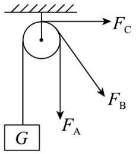

- A. \( A\)方向拉力最小
- B. \( B\)方向拉力最小
- C. \( C\)方向拉力最小
- D. 三个方向拉力都一样

【答案】D

【解析】​

## 知识点·密度的应用

## 1. 多选题（难度：简单）

密度知识与生活联系非常紧密，下列关于密度的一些说法中正确的是（    ）

- A. 1kg冰与1kg水的密度相等
- B. 粗铜丝拉伸后变成了细铜丝，密度变大
- C. 为减轻质量，比赛用自行车采用强度高、密度小的材料制造
- D. 节日放飞的气球可以飘在空中，是因为气球内部气体的密度比空气密度小

【答案】C/D

【解析】​

## 2. 单选题（难度：简单）

有一个金属块，从外观上很难认出是哪种金属. 现测得它的体积和质量分别是\( 5.40{\text{cm}}^{\text{3}}\)、\( \text{48g}\). 请你通过下表信息鉴别它是什么金属（    ）

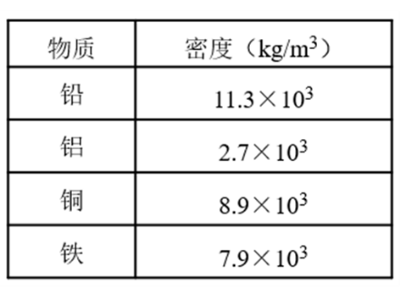

- A. 铝
- B. 铜
- C. 铅
- D. 铁

【答案】B

【解析】​

## 知识点·密度的比值

## 1. 填空题（难度：适中）

体积相同的甲、乙两物体的质量之比为3：2．则甲、乙两物体的密度之比为，把甲、乙两物体都截去一半，两物体剩余部分的密度之比为.

【答案】3：2，3：2

【解析】​

## 2. 填空题

甲、乙两个金属块，甲的密度是乙的\( \frac{1}{3}\)，乙的质量是甲的2倍，那么甲的体积是乙的倍.

【答案】$ \frac{3}{2}$ 

【解析】​

## 知识点·平衡力与相互作用力的区分

## 1. 单选题（难度：适中）

如图所示，是无人驾驶汽车在平直公路上匀速行驶的情景，下列说法正确的是（   ）

- A. 汽车向前运动的过程中牵引力大于阻力
- B. 汽车对地面的压力和汽车的重力是一对平衡力
- C. 汽车的重力和地面对汽车的支持力是一对相互作用力
- D. 汽车对地面的压力和地面对汽车的支持力是一对相互作用力

【答案】D

【解析】​

## 2. 填空题（难度：简单）

建国70周年，在北京天安门广场隆重举行了盛大的阅兵仪式。检阅车在水平地面上匀速行驶，它受到的牵引力（选填“大于”“小于”或“等于”）它受到的阻力，且地面对前轮的力和前轮对地面的力是一对（选填“平衡力”或“相互作用力”）。

【答案】等于，相互作用力

【解析】​

## 知识点·平衡力的辨别

（同步练习）

## 1. 填空题（难度：适中）

如图所示，木块竖立在表面粗糙的小车上，随小车一起在地面上向右做匀速直线运动，不考虑空气阻力。地面对小车的支持力与小车所受重力（选填“是”或“不是”）一对平衡力。

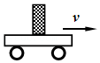

【答案】不是

【解析】​

## 知识点·平面镜的应用

## 1. 多选题（难度：简单）

正面拍摄演员照镜子时，为了防止镜中出现摄像机的像，导演找来两个演员和一个空镜框模拟照镜子的情景（如图所示）。在模拟过程中下列说法正确的是（    ）。

- A. 应选择两个身高与外形相近的演员进行模拟
- B. 两个演员到镜框的距离应相等
- C. 两个演员所在位置的连线应与镜框所在平面垂直
- D. 镜框前的演员用右手刷牙时，镜框后的演员也应用右手刷牙

【答案】A/B/C

【解析】​

## 知识点·弹力产生原因

## 1. 单选题（难度：适中）

书放在水平桌面上，书会受到弹力的作用，产生这个弹力的直接原因是（   ）.

- A. 书的形变
- B. 桌面的形变
- C. 书和桌面的形变
- D. 桌面受到的支持力

【答案】B

【解析】​

## 知识点·弹力产生条件

## 1. 单选题（难度：简单）

如图所示的四个力中，不属于弹力的是（    ）.

- A. 妈妈对婴儿车的推力

 

- B. 花瓶对桌面的压力

​

- C. 磁铁对小球的吸引力

 

- D. 绳子对小车的拉力

​

【答案】C

【解析】​

## 知识点·弹力大小

## 1. （难度：适中）

小明用弹簧拉力器锻炼身体，刚拉开时没感到太费力，可随着俩手拉开的距离越大，就感到越费力. 这是什么原因？

【答案】

因为弹簧的伸长量跟受到的拉力成正比，俩手拉开的距离越大，弹簧伸长的就越长，受到的拉力越大，弹簧对手的拉力也就越大，所以会感到越费力.

【解析】​

## 知识点·弹簧测力计使用

## 1. 单选题（难度：简单）

关于弹簧测力计的使用，下列说法中正确的是（    ）.

- A. 弹簧测力计使用前应来回轻拉挂钩，防止弹簧被外壳卡住
- B. 弹簧测力计只能测量拉力的大小
- C. 弹簧测力计可以用来测量超过它测量范围的力
- D. 弹簧测力计的原理：在弹性限度内，弹簧受到的拉力越大，弹簧的伸长量就越短

【答案】A

【解析】​

## 知识点·弹簧测力计原理

## 1. 单选题（难度：适中）

几位同学使用弹簧拉力器锻炼身体，每位同学都可以将弹簧拉力器拉开至两臂伸直，两臂伸直时对弹簧拉力器拉力最大的是（    ）.

- A. 几个同学都一样大
- B. 手臂长的同学
- C. 体重大的同学
- D. 力气大的同学

【答案】B

【解析】​

## 知识点·形变

## 1. 填空题（难度：适中）

如图所示是中国甲骨文中的“射”字，宛如搭弓射箭，人们射箭时，弓弦发生了形变，产生了力，图中这个力的方向是（选填“水平”或“竖直”）的，受力物体是.

【答案】弹性，弹，水平，箭

【解析】​

## 知识点·影响浮力大小因素

## 1. 填空题（难度：简单）

潜水艇对保卫我国的南海起着重要的作用. 如图所示，潜水艇在水中处于悬浮状态，此时其所受浮力与重力的大小关系为：\( {F}_{\text{浮}\mathrm{ }}\)  \( G\)（选填“>”“<”或“=”），当压缩空气将水舱中的水排出一部分时，潜水艇将（填“上浮”“下沉”或“悬浮”）. 

【答案】$ =$，上浮

## 知识点·惯性

## 1. （难度：适中）

小明先后在水平桌面铺上粗糙程度不同的物体（毛巾、棉布、木板），做了三次实验，然后将实验数据填入下列表格.请回答以下问题：
​​

从上述实验数据中，可以得出结论是：小车受到的阻力越小，速度减小得越慢.由此联想到在雨雪天驾驶汽车应适当（选填“增大”或“减小”）汽车之间的距离.

如果分别让小车从不同的高度滑下，请你推理：当小车以不同的速度在阻力为零的平面上运动，最终的速度（选填“相同”或“不同”）.

在水平木板上滑行的小车受到的重力和小车对木板的压力（“是”或“不是”）相互作用力.

【答案】增大，不同，不是

【解析】​

## 知识点·惯性现象解释

## 1. （难度：简单）

如图所示，小梦学习小组利用铁架台、带有刻度的杠杆、细线、弹簧测力计、若干钩码（每个钩码重均为\( \text{0.5N}\)）等实验器材，探究“杠杆的平衡条件”.

   
实验前，小梦观察到杠杆如图甲所示，为了使杠杆在水平位置平衡，应将杠杆右侧的平衡螺母向_____（选填“左”或“右”）调节.

将天平调整好后，如图乙所示，在\( A\)点挂3个钩码，应在\( B\)点挂个钩码，才能使杠杆在水平位置平衡. 使杠杆在水平位置平衡的目的是. 在上述实验中，若将水平位置平衡的杠杆，两端同时去掉一个钩码，杠杆（选填“仍然平衡”“沿顺时针旋转”或“沿逆时针旋转”）.

如图乙所示，小梦用弹簧测力计替代钩码，在\( B\)点竖直向下拉，然后将弹簧测力计逐渐向右倾斜，要使杠杆仍然在水平位置平衡，则弹簧测力计的示数将逐渐（选填“变大”或“变小”），原因是.

在实验中，改变力和力臂的大小得到多组数据的目的是（    ）.

- A. 多次测量取平均值减小误差；
- B. 避免偶然性，使实验结论具有普遍性

【答案】2/便于测量力臂大小/沿逆时针旋转，变大/力臂变小，B

【解析】​

## 知识点·折射与反射_实像与虚像

## 1. 单选题（难度：适中）

小希对下列光学成像实例进行了分析，判断正确的是（    ）
实例：\( ①\)针孔照相机内所成的像；\( ②\)潜望镜中看到的景物的像；\( ③\)放大镜看到的物体的像；\( ④\)幻灯机屏幕上所成的像；\( ⑤\)照相机中所成的像.

- A. 反射成像的有\( ②③⑤\)
- B. 折射成像的有\( ①④⑤\)
- C. 属于实像的是\( ①④⑤\)
- D. 属于虚像的是\( ②③④\)

【答案】C

【解析】​

## 知识点·折射成像

## 1. 单选题（难度：简单）

关于光现象的描述，其原理与其它三个不同的是（    ）

- A. 叉鱼时向更深处投掷鱼叉
- B. 商场内监控探头的应用
- C. 缸中金鱼“变大”
- D. 日食现象

【答案】D

【解析】​

## 知识点·折射现象

## 1. 多选题（难度：适中）

下列现象为光的折射现象的是（    ）

- A. 筷子插入水中，在水中的部分看起来发生了弯折
- B. 太阳未出地平线，人已经看见太阳了
- C. 清澈的水底看起来比实际浅一些
- D. 在平面镜中看到了自己的像

【答案】A/B/C

【解析】​

## 知识点·探究二力平衡条件

## 1. （难度：适中）

小明在探究“二力平衡”条件的实验中，设计了如图所示的两种实验方案。

通过实验比较，小明发现采用方案乙，实验效果更好，原因是。

在两侧托盘中放入砝码，使作用在小车上的两个拉力方向（选填“相同”或者“相反”），并通过调整砝码的质量来改变两端拉力的。

保持两盘中砝码质量相等，把小车在水平桌面上扭转一个角度，放手后观察到小车转动，最后恢复到静止状态。这个实验现象说明：作用在同一物体上的两个力，大小相等，方向相反，并且，这两个力才能彼此平衡。

【答案】减小了摩擦力对实验的影响，相反/大小，作用在同一条直线上

【解析】​

## 知识点·探究光折射的特点

## 1. 填空题（难度：适中）

某同学在做探究光折射时的特点实验，如图是光从空气射入水中时的光路．
\( \text{（}\text{1}\text{）}\)实验中发现，折射光线、入射光线和法线在，折射光线和入射光线分别位于，通过实验还得到如表数据：
入射角α
0°
15°
30°
45°
60°

反射角β
0°
15°
30°
45°
60°

折射角γ
0°
11°
22.1°
35.4°
40.9°

\( \text{（}\text{2}\text{）}\)分析表中数据，可得出结论：
\( \text{①}\)光从空气斜射到水面时，将同时发生和现象．
\( \text{②}\)光从空气斜射到水面时，折射角随入射角的增大而，且折射角（选填“大于”“等于”或“小于”）入射角．当光从空气垂直射到水面时，折射角大小等于，即传播方向．

【答案】同一平面内，法线两侧，反射，折射，增大，小于，0&deg;，不改变

【解析】​

## 知识点·探究光的折射定律

## 1. 填空题（难度：适中）

小明分别探究了光从空气射入水中和从水射入空气中的折射规律，并记录了表一，表二两组数据．
表一
序号
1
2
3
4

入射角（°）
60
40
20
0

折射角（°）
40
29
15
？

表二
序号
1
2
3

入射角（°）
15
29
40

折射角（°）
20
？
60

\( \text{（}\text{1}\text{）}\)表一中“？”处的数据是．
\( \text{（}\text{2}\text{）}\)表二中“？”处的数据模糊不清，请综合分析两个表格中的数据，判断出这个数据应该是．你判断的依据是．

【答案】0，40，在折射现象中，光路可逆

【解析】​

## 知识点·探究浮力大小的影响因素

## 1. 填空题（难度：简单）

探究影响浮力大小的因素时，小红做了如图所示的实验，请你根据她的实验探究回答下列问题：

\( \text{①}\)比较图\( B\)和\( C\)可知，物体受到的浮力大小与排开液体的有关；
\( \text{②}\)比较图\( C\)和\( E\)可知，物体受到的浮力大小与液体的有关；
\( \text{③}\)比较图\( C\)和可知，浮力的大小与物体浸没在液体中的深度无关；
\( \text{④}\)图\( E\)中物体受到浮力大小为 \( \text{N}\)；
\( \text{⑤}\)比较图\( C\)和E可知，水对杯底部的压强酒精对杯底部的压强（选填“大于”、“小于”或“等于”）.

【答案】体积，密度，D，0.8，大于

## 知识点·摩擦力

## 1. 单选题（难度：适中）

物体\( A\)和\( B\)叠放在不光滑的水平面上，\( A\)的质量为\( \text{1}\text{kg}\)，\( B\)的质量为\( \text{2}\text{kg}\)，在\( B\)上作用一个水平向右的\( \text{3}\text{N}\)的拉力，使\( AB\)一起匀速前进了\( \text{4}\text{m}\)，在这个过程中\( B\)对\( A\)做功（    ）. 

- A. \( \text{4J}\)
- B. \( \text{12J}\)
- C. \( \text{0J}\)
- D. \( \text{6J}\)

【答案】C

【解析】​

## 知识点·摩擦力的产生、摩擦力的方向判断

## 1. 填空题（难度：适中）

如图所示，不计空气阻力，货物随水平传送带一起向右做匀速直线运动时，货物（选填“受到向左的”“不受”或“受到向右的”）摩擦力；货物被传送到水平桌面上滑动时，货物（选填“受到向左的”“不受”或“受到向右的”）摩擦力。  
 

【答案】不受，受到向左的

【解析】​

## 知识点·摩擦力种类的辨别

## 1. 填空题（难度：简单）

书法是中华民族文化的瑰宝. 如图手执毛笔竖直悬空静止，手与笔之间的是摩擦；用钢笔写字时，笔尖与纸面之间的摩擦是摩擦；用圆珠笔写字时，笔尖的圆珠与纸面之间的摩擦是摩擦（选填“静”、“滑动”或“滚动”）. 

【答案】静，滑动，滚动

【解析】​

## 知识点·斜面机械效率的测量

## 1. （难度：适中）

小明在“探究斜面的机械效率与哪些因素有关”的活动中，提出了以下猜想：
\( A.\)对于同一个斜面，是不是所推的物体越重，机械效率越高呢？
\( B.\)斜面的机械效率可能与斜面的倾斜程度有关；
为了验证自己的猜想，小明用木板搭成了如图所示的装置进行探究，记录数据如表：
​

​​
 
实验
次序
斜面
倾角
物重
\( G\text{/N}\) 
拉力
\( F\text{/N}\) 
斜面高度
\( h\text{/m}\) 
斜面长度
\( s\text{/m}\) 
有用功
\( {W}_{\text{有}}\text{/J}\) 
总功
\( {W}_{\text{总}}\text{/J}\) 
斜面
机械效率\( \eta \)

1
30°
3
2.5
0.6
1.2
1.8
3
60%

2
30°
5
4.2
0.6
1.2
3
5.04
 

3
42°
3
2.8
0.8
1.2
2.4
3.36
71%

在实验过程中，应沿斜面向上拉动物体，此时的绳子对物体的拉力和斜面对物体的摩擦力（选填“是”或“不是”）平衡力.

第2次实验中斜面的机械效率\( \eta =\) .

对比实验1、2的数据可以用来验证猜想.

对比1、3两次实验数据，可初步得出的结论是.

【答案】匀速直线/不是，60%，A；物体对斜面的压力，当物体的重力相同时，斜面的倾斜程度越大，斜面的机械效率越大

【解析】​

## 知识点·斜面的机械效率

## 1. 单选题（难度：适中）

如图所示，用\( \text{300N}\)的力沿斜面把\( \text{600N}\)的重物匀速拉到顶端，物体在斜面上移动的距离为\( \text{3m}\)，上升的高度为\( \text{1m}\). 下列说法正确的是（     ）

- A. 木块所受到支持力做功\( \text{600J}\)
- B. 斜面的机械效率是\( 50\%\)
- C. 木块受到的摩擦力是\( \text{100N}\)
- D. 运动过程中，木块所受拉力和摩擦力是一对平衡力

【答案】C

【解析】​

## 2. （难度：适中）

在美丽乡村建设中，政府为某村购置一批健身器材. 工人在往车上搬运装有健身器材的箱子时，先用长木板搭了一个\( \text{3m}\)长的斜面，再用推力\( F=\text{500N}\)把\( \text{120kg}\)的箱子沿斜面匀速推到\( \text{1m}\)高的车厢上，用时\( \text{10s}\)，如图. 求：

（1）工人推箱子做的有用功；

（2）工人所做的总功的功率；

（3）斜面的机械效率；

（4）箱子受到的摩擦力. 

【答案】

解：

（1）此过程所做有用功为：$ {W}_{\text{有}}=Gh=mgh=\text{120kg}\text{×}\text{10N/kg}\text{×}\text{1m}=\text{1200J}$；

（2）所做总功为：$ {W}_{\mathrm{总}}=Fs=500\text{N}\times 3\text{m}=1500\text{J}$；

所做总功的功率为：$ P=\frac{{W}_{\text{总}}}{t}=\frac{\text{1500J}}{\text{10}\text{s}}=\text{150W}$；

（3）机械效率为：$ \eta =\frac{{W}_{\text{有}}}{{W}_{\mathrm{总}}}=\frac{\text{1200J}}{\text{1500J}}=80\%$；

（4）此过程所做额外功为：$ {W}_{\mathrm{额}}={W}_{\mathrm{总}}﹣{W}_{\text{有}}=\text{1500J}\text{﹣}\text{1200J}\text{＝}\text{300J}$；

由$ {W}_{\mathrm{额}}=fs$变形得：

摩擦力为：$ f=\frac{{W}_{\mathrm{额}}}{s}=\frac{\text{300J}}{\text{3}\text{m}}\text{=}\text{100N}$. 

答：（1）工人推箱子做的有用功为$ \text{1200J}$；

（2）工人所做的总功的功率为$ \text{150W}$；

（3）斜面的机械效率为$80\% $；

（4）箱子受到的摩擦力为$ \text{100N}$.

【解析】​

## 知识点·日食的成因

## 1. 单选题（难度：适中）

\( 2022\)年\( 6\)月\( 10\)日，本年全球唯一的日环食登场，天文爱好者用相机拍摄了这一天象奇观，如图所示，下列说法正确的是（    ）

- A. 日环食是由于光沿直线传播所形成的虚像
- B. 日环食在水中成的倒影是光的折射形成的
- C. 日环食在照相机中成的像是光的折射形成的
- D. 日环食在照相机中成的是正立、缩小的实像

【答案】C

【解析】​

## 知识点·有用功

## 1. 单选题（难度：简单）

分别用杠杆、动滑轮和滑轮组将同一物体举到相同高度，做的有用功（     ）

- A. 杠杆最多
- B. 动滑轮最多
- C. 滑轮组最多
- D. 一样多

【答案】D

【解析】​

## 知识点·有用功_功率

## 1. 填空题（难度：简单）

如图所示，物体重\( \text{90N}\)，小明用\( \text{50N}\)的拉力将物体匀速提升\( \text{1m}\)，用了\( \text{10s}\)，则此过程中有用功是 \( \text{J}\)，拉力的功率是 \( \text{W}\). 

【答案】90，10

【解析】​

## 知识点·有用功、额外功和总功

## 1. 单选题（难度：简单）

清晨，河畔聚集了很多钓鱼爱好者，若某位师傅不小心把水桶弄进水里，捞上桶时发现桶里带些水. 在打捞水桶的过程中，下列关于做功的说法中正确的是（     ）

- A. 对水所做的功是有用功
- B. 对桶所做的功是总功
- C. 对水所做的功是总功
- D. 对桶所做的功是有用功

【答案】D

【解析】​

## 2. 单选题（难度：简单）

利用如图所示的滑轮，在粗糙水平面上匀速拉动物体，下列叙述正确的是（     ）

- A. 重力做的功是有用功
- B. 拉力\( {F}_{1}\)做的功是额外功
- C. 绳子自由端的拉力\( F\)做的功是总功
- D. 克服物体与地面间的摩擦力做的功是额外功

【答案】C

【解析】​

## 知识点·有用功、额外功和总功_滑轮组的机械效率

## 1. 单选题（难度：适中）

工地上，工人用滑轮组吊起一堆质量为\( \text{500kg}\)的砖块（如图所示），若将砖块匀速拉升\( \text{20m}\)，拉力\( F\)的功率为\( \text{2500W}\)，滑轮组的机械效率为\(80\% \)，不计绳重和摩擦，则（     ）（\( g=\text{10N/kg}\)）

- A. 拉力所做的有用功为\( {10}^{3}\text{J}\)
- B. 拉力所做的功为\( {10}^{6}\text{J}\)
- C. 物体上升的速度为\( \text{0.4m/s}\)
- D. 若重新吊起\( \text{300kg}\)的物体，其机械效率变大

【答案】C

【解析】​

## 2. 多选题

甲装置中，空吊篮\( A\)重\( \text{25N}\)，\( B\)处绳子承受的拉力足够大，\( C\)处绳子承受的最大拉力为\( \text{100N}\). 小明将\( A\)提升到高处，施加拉力\( F\)随时间变化关系如图乙，\( A\)上升速度随时间变化关系如图丙. 忽略绳重、摩擦、空气阻力. 下列说法正确的是（     ）

- A. 动滑轮所受的重力为\( \text{15N}\)
- B. 第\( \text{2}\)秒内克服滑轮重做的额外功为\( \text{30J}\)
- C. 此装置最多能匀速运载\( \text{160N}\)重的货物
- D. 此装置运载货物最高机械效率为\(92.5\% \)

【答案】A/B/C

【解析】​

## 知识点·有用功和额外功

（同步练习）

## 1. 填空题（难度：简单）

当你用桶从井中提水时，你对桶做的功是；如果桶掉进井里，从井中捞桶时，桶里带着一些水，这时你对桶做的功是，对水做的功是（均选填“总功”、“额外功”或“有用功”）.

【答案】额外功，有用功，额外功

【解析】​

## 知识点·机械效率的大小比较

## 1. 多选题（难度：适中）

如图，小明用两个相同的滑轮组（不计绳重和绳与滑轮之间的摩擦），分别将相同的两个物体匀速提高到相同高度，则所用的拉力分别为\( {F}_{1}\)和\( {F}_{2}\)，其机械效率分别为\( {\eta }_{1}\)和\( {\eta }_{2}\). （     ）

- A. \( {F}_{1}>{F}_{2}\)
- B. \( {F}_{1}<{F}_{2}\)
- C. \( {\eta }_{1}={\eta }_{2}\)
- D. \( {\eta }_{1}<{\eta }_{2}\)

【答案】A/C

【解析】​

## 知识点·机械能概念

## 1. 单选题（难度：适中）

如图所示是蹦极运动的简化示意图. 弹性绳一端固定在\( O\)点，另一端系住运动员，运动员从\( O\)点自由下落，到\( A\)点处弹性绳自然伸直. \( B\)点是运动员受到的重力与弹性绳对运动员拉力相等的点，\( C\)点是蹦极运动员到达的最低点（忽略空气阻力），下列说法正确的是（    ）. 

- A. 从\( O\)点到\( A\)点运动员的机械能不变
- B. 从\( O\)点到\( C\)点运动员的机械能一直在增大
- C. 从\( O\)点到\( C\)点运动员的机械能一直在减小
- D. 从\( O\)点到\( C\)点运动员速度一直减小

【答案】A

【解析】​

## 知识点·机械运动

## 1. 多选题（难度：适中）

下面是同学们上体育课时的一些场景，其中解释正确的是（    ）.

- A. 百米赛跑时，裁判员是通过相同路程比较时间的方法来判定运动员运动快慢的
- B. 同学们在进行篮球绕杆练习时，认为杆静止是选择了自己为参照物
- C. 抛出去的铅球最终落回地面，是因为铅球受重力的作用
- D. 男同学举着杠铃不动时，他对杠铃做了功

【答案】A/C

【解析】​

## 知识点·杠杆定义

## 1. 单选题（难度：简单）

下列物体中能作为杠杆的是（    ）.

- A. 一把剪刀
- B. 一段橡胶软管
- C. 一根弹簧
- D. 一段棉线

【答案】A

【解析】​

## 知识点·杠杆的分类_杠杆机械效率的测量

## 1. （难度：适中）

如图所示，在测定杠杆机械效率的实验中，始终保持竖直向上缓慢拉动弹簧测力计，使挂在杠杆\( OB\)下面的物块缓慢上升：
​

请在图中画出杠杆在如图位置时，杠杆所受测力计拉力（为杠杆的动力）的力臂\( {L}_{1}\)，（2）此杠杆是杠杆（选填“省力”、“费力”、“等臂”）.

图中测力计的示数\( F\)始终为\( \text{2.5N}\)，测力计上升的高度\( s\)为\( \text{0.2m}\). 物块重力\( G\)为\( \text{1.5N}\)物块上升高度\( h\)为\( \text{0.3m}\)，则拉力做的总功为，机械效率为. ​

【答案】/费力，0.5J/90%

【解析】​

## 知识点·案秤的使用

## 1. 单选题

有些商店还在使用一种案秤，如图所示，它的工作原理与天平相同，不过两臂长度不等. 把被测物体放在秤盘，向砝码盘里加减槽码并调节游码在秤杆上的位置，直至横梁恢复平衡，即可测出物体的质量. 下列说法正确的是（    ）

- A. 使用案秤时，可以把案秤放在任意台面上
- B. 称量物体质量前，要调节游码使横梁平衡
- C. 称量物体质量时，向右移动游码相当于向秤盘内增加小槽码
- D. 若砝码盘上的槽码沾有油污，会使测得的质量比真实值小

【答案】D

【解析】​

## 2. 填空题（难度：适中）

如图甲所示为商店里使用的案秤，其工作原理与实验室中的天平相似. 使用前调平时，先将游码移至秤杆左端的零刻度线处，若发现秤杆右侧偏低，应将调零螺丝向（选填“左”或“右”）调，称量一物体质量时，将物体放在秤盘上. 接着在砝码盘上放槽码，并移动游码后，如图乙所示，秤杆恰好在水平位置平衡，那么测得该物体的质量为 . 

【答案】左，1.7kg.

【解析】​

## 知识点·比较做功的快慢

## 1. 填空题（难度：简单）

我们可以用两种方法来比较物体做功的快慢. 如图是挖掘机和人同时开始工作到某时刻的情形，你认为方式做功较快，理由是相同时间内甲做的功多；另一种方法是做相同的，比较做功时间的长短. 

【答案】甲，功

【解析】​

## 知识点·浮力产生_原因

## 1. （难度：适中）

如图所示，把一个底面积为\( S\)，体积为\( V\)的长方体浸没在密度为\( \rho \)的液体中，上、下表面距液面高度分别为\( {h}_{1}\)和\( {h}_{2}\)，浸入液体中的物体的上下表面在液体中的深度不同，所受的压力不同，下表面受到向上压力\( {F}_{2}\)，上表面受到向下压力\( {F}_{1}\)，请从浮力产生原因的角度推导出\( {F}_{\text{浮}}=\rho gV\). 

【答案】

由题目图可知：上表面所处的深度为$ {h}_{1}$，则上表面受到的压强为$ {p}_{1}=\rho g{h}_{1}$，

根据$ p=\frac{F}{S}$可得，受到的压力为$ {F}_{1}={p}_{1}S=\rho g{h}_{1}S$；

下表面所处的深度$ {h}_{2}$，则下表面受到的液体压强为$ {p}_{2}=\rho g{h}_{2}$，

受到的压力为$ {F}_{2}={p}_{2}S=\rho g{h}_{2}S$；

因此，液体对长方体物块产生一个向上的压力和向下的压力不相等，

浮力产生的原因是液体对物体上下表面产生的压力差，

即$ {F}_{\text{浮}}={F}_{2}﹣{F}_{1}=\rho g{h}_{2}S﹣\rho g{h}_{1}S=\rho gS\left({h}_{2}﹣{h}_{1}\right)=\rho gV$.

## 知识点·浮力影响因素

## 1. 单选题

如图所示，一铅块用细线挂在一个充气的小气球的下面，把它放入水中某处恰好处于静止状态，如果往池中缓慢注入一些水，则铅块及气球（   ）

- A. 仍能静止
- B. 向下运动
- C. 向上运动
- D. 静止、向上或向下运动都有可能

【答案】B

## 知识点·浮力方向

## 1. 填空题（难度：简单）

如图所示，一个小球静止在水中，它所受浮力的方向是；如果剪断绳子后，小球漂浮在水面上，它所受浮力的大小与原来相比将. 

【答案】竖直向上，变小

## 知识点·浮力的应用

## 1. 填空题（难度：适中）

一艘远洋轮船装上货物后，发现船身下沉了一些，则它受到的浮力 （填“变大”“变小”或“不变”）当船由内河驶入大海后，船受的浮力（填“变大”“变小”或“不变”），船相对于水面将（填“上浮”“下沉”或“不变”）.

【答案】变大，不变，上浮

## 知识点·浮力示意图

## 1. （难度：简单）

如图，重为4N的小球漂浮在水面上，请画出小球所受力的示意图. 

【答案】

## 知识点·浮力计算

## 1. 填空题

一个质量是\( \text{3}\text{kg}\)，体积是1\( {\text{dm}}^{3}\)的物体，若将其在水中匀速向上提2m的距离(物体始终浸没在水中)，拉力做的功是 \( \text{J}\). （\( g\)取\( \text{10}\text{N/kg}\)）

【答案】40

【解析】​

## 知识点·滑动摩擦力的大小

## 1. 单选题（难度：适中）

用\( 5\text{N}\)的水平拉力使木块在水平桌面上做匀速直线运动，现改用\( 10\text{N}\)的水平拉力使木块仍在这一水平桌面上运动，此时木块受到的滑动摩擦力大小是（    ）

- A. 大于\( 5\text{N}\)，小于\( 10\text{N}\)
- B. \( 10\text{N}\)
- C. \( 5\text{N}\)
- D. 无法判断

【答案】C

【解析】​

## 知识点·滑动摩擦力的大小比较

## 1. 单选题（难度：适中）

如图所示，在一水平地面上，木箱重\( \text{400N}\)，受到的摩擦力为\( \text{200N}\)，用力\( F\)拉动木箱使它在\( \text{5s}\)内匀速直线运动了\( \text{3m}\)（不计滑轮重力及绳与滑轮间的摩擦），下列说法正确的是（   ）

- A. 拉力\( F\)的大小为\( \text{200N}\)
- B. 绳子自由端移动的速度为\( \text{0.6m/s}\)
- C. 绳自由端移动了\( \text{6m}\)
- D. 拉力\( F\)的功率为\( \text{60W}\)

【答案】C

【解析】​

## 知识点·滑轮组的工作特点

## 1. 单选题（难度：适中）

如图所示，装置处于静止状态，不计滑轮重和绳重及摩擦，如果物体的重分别为\({G}_{1}\)和\({G}_{2}\)，那么\({G}_{1}\)和\({G}_{2}\)的关系是  （     ）. 

- A. \( {G}_{1}={G}_{2}\)
- B. \( {G}_{1}=2{G}_{2}\)
- C. \( {G}_{1}=\frac{{G}_{2}}{2}\)
- D. 无法判断

【答案】C

【解析】​

## 2. 单选题（难度：适中）

把质量相等的\( A\)、\( B\)两物体挂在如图所示的滑轮组下面，不计绳子、滑轮的重力和摩擦，放手后（     ）. 

- A. \( A\)上升，\( B\)上升
- B. \( A\)下降，\( B\)上升
- C. \( A\)、\( B\)均静止
- D. \( A\)上升，\( B\)下降

【答案】B

【解析】​

## 知识点·照相机原理

## 1. 单选题

为了规范交通行为，城市公安部门在很多路口安装了监控摄像头，如图所示，它可以拍下违章行驶或发生交通事故时的现场照片. 拍照时，摄像头的镜头相当于一个（    ）

- A. 凸透镜，成放大的实像
- B. 凸透镜，成缩小的实像
- C. 凹透镜，成放大的虚像
- D. 凹透镜，成缩小的虚像

【答案】B

【解析】​

## 知识点·牛顿第一定律、惯性、增大减小摩擦力的方法

## 1. 填空题（难度：简单）

2021年2月4日晚，北京冬奥会倒计时一周年活动在国家游泳中心“冰立方”举行，下图是中国女子冰壶队积极备战训练的情景。掷球员将冰壶沿水平冰面推出后，冰壶由于继续向前运动；刷冰员不停地刷冰面可以（选填“增大”或“减小”）冰壶受到的摩擦力；如果摩擦力为零，运动的冰壶将（选填“静止”“逐渐停下来”或“做匀速直线运动”）。

【答案】惯性，减小，做匀速直线运动

【解析】​

## 知识点·物体运动状态变化判断

## 1. 单选题（难度：简单）

“后羿射日”是大家熟悉的我国上古时期的神话故事.后羿射出去的箭离地而起后，假设突然不受任何力的作用，射出去的箭会（     ）.

- A. 落回地面
- B. 飞向太阳
- C. 停在空中
- D. 绕地球转动

【答案】B

【解析】​

## 2. 单选题（难度：简单）

在汶川抗震救灾时，用飞机空投物品，物品下落过程中，如果它所受的力全部消失，那么它将做（   ）.

- A. 匀速运动
- B. 减速运动
- C. 加速运动
- D. 曲线运动

【答案】A

【解析】​

## 知识点·物理量的单位

## 1. 单选题（难度：简单）

下面哪一个是属于力的单位（    ）。

- A. 秒
- B. 千克
- C. 米
- D. 牛顿

【答案】D

【解析】​

## 知识点·理想实验法（科学推理法）

## 1. 单选题（难度：适中）

伽利略认为：一个金属小球从光滑斜面的某一高度处由静止滚下，由于不受阻力，没有能量损耗，那么它必定到达另一光滑斜面的同一高度，若把斜面放平缓一些，也会出现同样的情况，模拟实验如图，则下列说法中正确的是（   ）.

- A. 小球从斜面滚下过程中速度大小不发生改变
- B. 此实验可以说明力是维持物体运动状态的原因
- C. 减小右侧斜面与水平面的夹角后，小球在右侧斜面上运动的距离不变
- D. 根据这一实验，可以科学推理出运动物体不受力时将做匀速直线运动

【答案】D

【解析】​

## 知识点·电阻的测量

## 1. 单选题（难度：简单）

小明探究杠杆的平衡条件时，通过增减钩码并移动钩码获得3组数据，小华在测量未知电阻时，通过调节滑动变阻器获得了3组数据，这两个实验采用多次实验的目的，下列说法正确的是（　　）

- A. 都是为了找出普遍规律
- B. 都不是为了找出普遍规律
- C. 小华的操作是为了多次测量减小误差
- D. 小明的操作是为了多次测量减小误差

【答案】C

【解析】​

## 知识点·称重法测浮力

## 1. 填空题（难度：适中）

如图所示，是物体浸入水中前后弹簧测力计的示数，由此可知水对物体的浮力是 N，物体的质量是kg，物体的体积是\( {\text{m}}^{\text{3}}\)，物体的密度是 \( \text{kg/}{\text{m}}^{\text{3}}\)．（\( g\)取\( \text{10N/kg}\)）

【答案】$ 1$，$ 0.4$，$ 1\times {10}^{-4}$，$ 4\times {10}^{3}$

## 知识点·质量的估测_质量的性质

质量的性质（同步练习）

## 1. 填空题（难度：简单）

“玉兔”月球车的质量为140kg，合t. 从地球到月球上，月球车的质量（选填“变大”、“变小”或“不变”）.

【答案】0.14，不变

【解析】​

## 知识点·质量的属性

## 1. 单选题（难度：简单）

下列情境中，物体的质量发生了变化的是（    ）

- A. 一块橡皮被用掉了一半
- B. “冰墩墩”被航天员带入太空
- C. 一根直铁丝被弯成弧形
- D. 试管中固态的冰熔化成为液态的水

【答案】A

【解析】​

## 2. 单选题（难度：简单）

一个铝合金块的质量为8.6kg，下列情况中，它的质量将发生改变的是（    ）

- A. 将其熔化后，全部铸成一个零件
- B. 将铝合金块压成铝合金板
- C. 把铝合金块从赤道拿到南极
- D. 把铝合金块挫成一个规则的零件

【答案】D

【解析】​

## 知识点·质量的测量

## 1. 单选题（难度：简单）

小明同学用托盘天平测一圆柱体铁块的质量，天平平衡时，他用了50g、20g、5g砝码各一个，游码位置如图所示. 测量完毕后才发现错误地将物体放在了右盘，而将砝码放在了左盘，则该圆柱体铁块的质量为（    ）. 

- A. 73.0g
- B. 77.0g
- C. 77.5g
- D. 72.5g

【答案】A

【解析】​

## 知识点·超声波与次声波

## 1. 填空题

2020年3月16一群大象从西双版纳一路向北迁徙了几百公里. 一路上大象的很多活动似乎在“悄无声息”中进行，实际上它们可以用低于\( \text{20Hz}\)的声波交流. 站在路边的小明向着远处的山崖大喊一声，约\( \text{3s}\)后听到回声，则小明距山崖大约 \( \text{m}\). （在空气中声速为\( \text{340m/s}\)）.

【答案】次，510

【解析】​

## 知识点·连通器

## 1. 填空题（难度：适中）

如图是一款名为“旋转杯”的网红杯，杯子由粗细两部分组成，从结构上来看杯子粗细两部分构成一个. 当用左侧管吸了些饮料后，杯子内液面静止后，粗杯内饮料对杯底的压强会（选填变“变大”“变小”或“不变”）. 
  

【答案】连通器，变小

【解析】​

## 知识点·透镜及其应用

## 1. 多选题（难度：简单）

在探究凸透镜成像规律的实验中，将点燃的蜡烛放在距凸透镜15cm处时，在透镜另一侧距透镜30cm处的光屏上得到烛焰清晰的像. 则（    ）.

- A. 光屏上成倒立、放大的实像
- B. 光屏上成倒立、缩小的实像
- C. 照相机应用了该次实验的成像规律
- D. 投影仪应用了该次实验的成像规律

【答案】A/D

【解析】​

## 知识点·速度计算

## 1. 填空题（难度：适中）

甲、乙两人在相同的水平路面上，分别以 1m/s 和 0.5m/s 的速度将两个完全相同的木箱沿直线匀速推动了 10s．推力沿水平方向. 在此过程中，地面对木箱的力对木箱不做功，（选填“甲”或“乙”）人做的功更多.

【答案】支持，甲

【解析】​

## 2. 

一辆汽车以恒定的功率在平直的公路上做直线运动，其\( v-t\)图象如图所示，在第\( \text{10}\text{s}\)时速度达到\( \text{20}\text{m/s}\)，通过的路程为\( \text{120}\text{m}\).求：

（1）在\( \text{0}\text{～}\text{10}\text{s}\)内汽车的平均速度；

（2）设汽车在行驶过程中所受阻力不变，大小为\( f=4000\text{N}\)，那么在\( \text{10}\text{～}\text{20}\text{s}\)内汽车发动机产生的牵引力所做的功是多少焦耳？

【答案】

解：（1）根据题意知，汽车在$ \text{10}\text{s}$内通过的路程是$ \text{120}\text{m}$，

所以，由$ v=\frac{s}{t}$ 知，在$ \text{0}\text{～}\text{10}\text{s}$内汽车的平均速度： $ v=\frac{s}{t}=\frac{\text{120m}}{\text{10s}}=12\mathrm{m}/\mathrm{s}$；

（2）由图象知，$ \text{10}\text{～}\text{20}\text{s}$内汽车做匀速直线运动，速度是$ {v}^{\text{'}}=20\text{m/s}$，

所以，在$ \text{10}\text{～}\text{20}\text{s}$内汽车通过的路程：$ {s}^{\text{'}}={v}^{\text{'}}{t}^{\text{'}}=20\text{m/s}\times \left(\text{20}\text{s}\text{﹣}\text{10}\text{s}\right)=200\text{m}$，

由平衡力条件知，此时汽车受到的牵引力等于阻力，

即$ F=f=4000\text{N}$，所以，在$ \text{10}\text{～}\text{20}\text{s}$内牵引力所做的功：

$ W=F{s}^{\text{'}}=4000\text{N}\times 200\text{m}=8\times {10}^{5}\text{J}$. 

答：（1）在$ \text{0}\text{～}\text{10}\text{s}$内汽车的平均速度为$ \text{12}\text{m/s}$（2）；在$ \text{10}\text{～}\text{20}\text{s}$内汽车发动机产生的牵引力所做的功是$ 8\times {10}^{5}\text{J}$.

【解析】​

## 知识点·重力计算

## 1. （难度：适中）

若质量是\( \text{60}\text{kg}\)的人骑重\( \text{40}\text{kg}\)电动自行车在水平路面上以\( \text{6}\text{m/s}\)的速度匀速行驶时，受到的阻力是人与车总重的\( \text{0.02}\)倍，取\( g=10\text{N/kg}\)，求行驶\( \text{10}\)分钟，电动机对自行车做的功.

【答案】

解：人与车总重力$ G=mg=\left(60\text{kg}+40\text{kg}\right)\times 10\text{ }\text{N/kg}=1\times {10}^{3}\text{N}$

骑车行驶时所受的阻力大小：$ f=0.02G=0.02\times 1\times {10}^{3}\text{N}=20\text{N}$；

因为匀速行驶，所以牵引力与阻力是一对平衡力，

即 $ F=f=20\text{N}$

由$ v=\frac{s}{t}$可知，$ \text{10min}$内货车行驶的路程： $ s=vt=6\text{m/s}\times 10\times 60\text{s}=3600\text{m}$，

故 $ \text{10min}$ 内电动机对自行车做的功：

$ W=Fs=20\text{N}\times 3600\text{m}=7.2\times {10}^{4}\text{J}$.

【解析】​

## 2. （难度：适中）

一辆在水平路面上沿直线匀速行驶的货车，行驶时所受的阻力为车总重的 \( 0.1\) 倍，货车（含驾驶员）空载时重为 \( 2.5\times {10}^{4}\text{N}\). 

（1）求货车空载行驶时所受的阻力大小；

（2）求货车以\( \text{ 36}\text{km/h}\) 的速度空载匀速行驶时，\( \text{10}\text{s}\) 内货车牵引力做的功

【答案】

解：（1）货车空载行驶时所受的阻力大小：

$ f=0.1G=0.1\times 2.5\times {10}^{4}\text{N}=2.5\times {\text{10}}^{\text{3}}\text{N}$；

（2）$ v=36\text{km/h}=10\text{m/s}$ 

由 $ v=\frac{s}{t}$可知，$ \text{10}\text{s}$ 内货车行驶的路程：$ s=vt=10\text{m/s}\times 10\text{s}=100\text{m}$，

因为货车匀速行驶，所以牵引力与阻力是一对平衡力，

即 $ F=f=2.5\times {10}^{3}\text{N}$，故 $ \text{10}\text{s}$ 内货车牵引力做的功：

$ W=Fs=2.5\times {10}^{3}$N$ \times 100$m$ =2.5\times {10}^{5}\text{J}$.  

答：（1）货车空载行驶时所受的阻力大小为 $ {2.5\times 10}^{3}\text{N}$；（2）$ \text{10s}$ 内货车牵引力做的功为$ {2.5\times 10}^{5}\text{J}.$

【解析】​

## 知识点·静摩擦力的大小

## 1. 填空题（难度：适中）

冰冰用手握着一个重为\( \text{10}\text{N}\)的水杯静止在空中，杯口竖直向上，手的握力为\( \text{20}\text{N}\)，则水杯受到的摩擦力为 \( \text{N}\)；若使手的握力增大到\( \text{30}\text{N}\)，则水杯受到的摩擦力为 \( \text{N}\)。 
  

【答案】10，10

【解析】​

## 知识点·面镜的应用

## 1. 填空题（难度：简单）

如图所示，是一条盘山公路，当汽车在\( AB\)路段行驶时，由于光的（从光学角度）司机看不到\( BC\)路段的情况；为了尽可能地看到\( BC\)路段的情况，人们利用光的规律在公路急拐弯\( B\)处装上（选填“平面镜”、“凸面镜”或“凹面镜”），以减少事故的发生。

【答案】直线传播，反射，凸面镜

【解析】​

## 知识点·音调响度与音色的区分

## 1. 单选题（难度：适中）

现在智能家居已进入千家万户. 有一种智能音箱能通过网络让用户以语言对话的交互方式，实现影音娱乐、生活服务、信息查询等多项功能的操作. 以下说法中错误的是（    ）.

- A. 智能音箱能根据语言指令来完成指定操作，说明声音可以传递信息
- B. 智能音箱接收到传递来的信息后依靠扬声器的振动才能发出声音
- C. 用户对智能音箱发布指令“大点儿声”，目的是改变声音的音调
- D. 人们能够分辨出智能音箱播放的二胡和笛子的声音，根据的是声音的音色

【答案】C

【解析】​
