# 第三节 二力平衡（同步练习）

> 教材：物理·八年级全一册·沪科技版2024新教材 ｜ 来源：国家中小学智慧教育平台·在线练习 ｜ 共 94 题

## 1. 单选题（难度：适中）

在足球比赛中，运动员用脚踢足球，足球离开脚后在空中飞行的过程中，下列说法正确的是（　　）

- A. 足球受到脚的踢力和重力的作用
- B. 足球只受到重力的作用
- C. 足球受到的重力和空气阻力是一对平衡力
- D. 足球的运动状态保持不变

【答案】B

【解析】A．足球离开脚后，脚与足球不再接触，脚对足球的踢力消失，不计空气阻力，足球只受到重力的作用，故A错误；
B．不考虑空气阻力，足球离开脚后在空中飞行，此时足球只受到重力的作用，故B正确；
C．足球受到的重力方向竖直向下，空气阻力方向与足球运动方向相反，这两个力不在同一直线上，不是一对平衡力，故C错误；
D．足球在空中飞行时，速度大小和运动方向都会发生变化，其运动状态是改变的，故D错误。
故选B。

## 2. 单选题（难度：简单）

体育课上，足球在空中划过一道弧线飞向球门。此过程中对足球分析正确的是（　　）

- A. 受平衡力作用
- B. 运动状态改变
- C. 惯性逐渐消失
- D. 重力方向不断改变

【答案】B

【解析】AB．足球在空中划过一道弧线飞向球门，运动方向改变，因而运动状态是改变的，受力不平衡，此时的重力改变了足球的运动状态，故B正确，A错误；
C．惯性是物体的性质，任何物体任何时候都有惯性，不可能消失，故C错误。
D．重力的方向总是竖直向下的，不管物体怎样运动，重力方向不会改变，故D错误。
故选B。

## 3. 单选题（难度：适中）

生活中蕴含着许多物理知识，下列事例分析正确的是（　　）

- A. 跳远运动员助跑后起跳是为了增大惯性
- B. 踢出去的足球继续运动，是由于受到惯性的作用
- C. 汽车关闭发动机后还能继续前进，是因为汽车的惯性大于它受到的阻力
- D. 小明没有推动静止的汽车是由于推力等于摩擦力

【答案】D

【解析】A．跳远运动员助跑后起跳是为了利用惯性，但惯性的大小只与物体的质量有关，助跑不会增大惯性，故A错误；
B．踢出去的足球继续运动，是由于足球具有惯性，但不能说受到惯性的作用，故B错误；
C．汽车关闭发动机后还能继续前进，是因为汽车具有惯性，惯性不是力，不能与阻力比较大小，故C错误；
D．小明没有推动静止的汽车，汽车处于平衡状态，所以受力平衡，此时推力等于摩擦力，故D正确。
故选D。

## 4. 单选题（难度：简单）

一个重为10N的物体，在水平桌面上受到一个水平向右的拉力F＝5N作用下，沿水平面向右做匀速直线运动。当拉力增大到8N时，物体受到的摩擦力为（　　）

- A. 10N
- B. 8N
- C. 5N
- D. 3N

【答案】C

【解析】根据物体向右做匀速直线运动可知，此时物体处于平衡状态，所受滑动摩擦力大小等于拉力大小，故物块所受摩擦力是5N。当水平拉力增加到8N时，影响滑动摩擦力大小的压力和接触面的粗糙程度均不变，则滑动摩擦力大小仍不变，为5N。故ABD不符合题意，C符合题意。
故选C。

## 5. 单选题（难度：简单）

在“探究滑动摩擦力的大小与哪些因素有关”的实验中，小明用弹簧测力计水平向右拉动木块，使它沿水平长木板匀速直线滑动，如图所示。下列说法正确的是（　　）

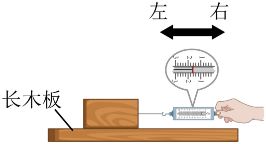

- A. 木块运动过程中受到的滑动摩擦力方向向右
- B. 木块运动过程中所受滑动摩擦力的大小为2.4N
- C. 在木块上加砝码重新实验，发现测力计示数变大，说明滑动摩擦力大小与物重有关
- D. 在长木板表面铺毛巾重新进行实验，可探究滑动摩擦力大小与接触面粗糙程度的关系

【答案】D

【解析】A．木块相对长木板向右滑动，根据滑动摩擦力的方向与物体相对运动方向相反，木块受到的滑动摩擦力方向向左，故A错误；
B．观察，弹簧测力计的分度值为0.2N，示数为1.6N。因为木块做匀速直线运动，拉力与滑动摩擦力平衡，所以滑动摩擦力大小为1.6N，故B错误；
C．在木块上加砝码，增大了木块对长木板的压力。重新实验时测力计示数变大，说明在接触面粗糙程度相同时，压力越大，滑动摩擦力越大，即滑动摩擦力大小与压力大小有关，而不是物重，故C错误；
D．在长木板表面铺毛巾，改变了接触面的粗糙程度。控制压力不变，重新进行实验，可探究滑动摩擦力大小与接触面粗糙程度的关系，故D正确。
故选D。

## 6. 单选题（难度：简单）

下列关于生活中力的现象描述，其中正确的是（    ）

- A. 只有相互接触的两个物体才会产生力的作用
- B. 足球被踢出去后，在空中会受到惯性力的作用继续向前运动
- C. 游泳时使人的前进的力是水施加给人的
- D. 茶杯静止在水平桌面上，茶杯的重力和茶杯对桌面的压力是一对平衡力

【答案】C

【解析】A．磁铁之间的吸引力不需要两个磁铁相互接触，故A错误；
B．惯性不是力，足球被踢出去后，在空中会继续向前运动，是因为足球具有惯性，故B错误；
C．游泳时，人给水向后的力，由于物体间力的作用是相互的，水给人向前的力，因此使人的前进的力是水施加给人的，故C正确；
D．茶杯的重力方向竖直向下，茶杯对桌面的压力方向也是向下，两个力不满足方向相反，不是一对平衡力，故D错误。
故选C。

## 7. 单选题（难度：适中）

如图所示，四旋翼无人机下方用细线悬挂一个重物，通过四个螺旋桨的高速转动改变运动状态。不考虑空气阻力，则无人机在空中（　　） 

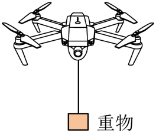

- A. 水平匀速飞行时，悬挂重物的细线会偏离竖直方向
- B. 匀速下降时，重物所受的重力大于细线对重物的拉力
- C. 螺旋桨对空气的力与空气对螺旋桨的力大小相等
- D. 加速上升时，细线对重物的拉力等于重物所受的重力

【答案】C

【解析】A．水平匀速飞行时，重物处于平衡状态，竖直方向合力为0，即拉力和重力在竖直方向上，所以悬挂重物的细线不会偏离竖直方向，故A不符合题意；
B．匀速下降时，重物处于平衡状态，竖直方向合力为0，即重物所受的重力等于细线对重物的拉力，故B不符合题意；
C．四个螺旋桨的高速转动对空气施加向下的力，使空气向下运动，由于物体间力的作用是相互的，空气也会给飞机一个向上的力，大小相等，故C符合题意；
D．加速上升时，合力的方向是向上的，即细线对重物的拉力大于重物所受的重力，故D不符合题意。
故选C。

## 8. 单选题（难度：适中）

如图，用水平力 F 将木块压在粗糙竖直墙壁上静止。下列力属于平衡力的是（　　）

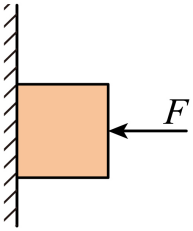

- A. 木块重力与墙壁对它的支持力
- B. 水平力 F 与木块对墙壁的压力
- C. 水平力 F 与墙壁对木块的支持力
- D. 木块对墙壁的压力与墙壁对木块的摩擦力

【答案】C

【解析】A．木块重力方向竖直向下，墙壁对木块的支持力方向水平向左，这两个力方向不在同一直线上，不是平衡力，故A不符合题意；
B．水平力F作用在木块上，木块对墙壁的压力作用在墙壁上，这两个力作用在不同物体上，不是平衡力，故B不符合题意；
C．水平力F与墙壁对木块的支持力，都作用在木块上，大小相等、方向相反、作用在同一直线上，是一对平衡力，故C符合题意；
D．木块对墙壁的压力方向水平向右，墙壁对木块的摩擦力方向竖直向上，这两个力方向不在同一直线上，不是平衡力，故D不符合题意。
故选C。

## 9. 单选题（难度：非常简单）

周末，小伟带着弟弟去海洋馆观看海狮表演，看到海狮将足球顶在头上静止不动，如图所示。下列与足球所受的重力是一对平衡力的是（　　）

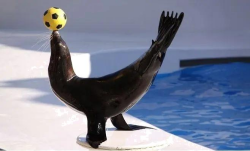

- A. 海狮受到的重力
- B. 地面对海狮的支持力
- C. 海狮对足球的支持力
- D. 海狮与足球受到的总重力

【答案】C

【解析】A．该力作用在海狮上，与足球重力没有作用在同一物体上，不是一对平衡力。故A不符合题意；
B．该力作用在海狮上，与足球重力没有作用在同一物体上，不是一对平衡力。故B不符合题意；
C．足球只受重力与海狮对足球的支持力，在此二力作用下，足球处于静止状态，故二力是一对平衡力。故C符合题意；
D．该力作用在海狮与足球这个整体的重心上，没有作用在足球上，故与足球重力不是一对平衡力。故D不符合题意。
故选C。

## 10. 单选题（难度：简单）

如图所示，小丽用力F把一木块压在竖直墙面上静止，现有以下受力分析，下述受力分析正确的是（　　）

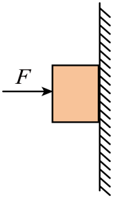

- A. 小丽对木块的压力F和木块对墙的弹力是一对平衡力
- B. 小丽对木块的压力F和墙对木块的支持力是一对相互作用力
- C. 木块受到的摩擦力和木块的重力是一对平衡力
- D. 小丽对木块的压力F和木块对小丽的弹力是一对平衡力

【答案】C

【解析】A．小丽对木块的压力F作用在木块上，木块对墙的弹力作用在墙上，两个力作用在不同物体上，不符合平衡力作用在同一物体上的条件，故A错误；
B．小丽对木块的压力F和墙对木块的支持力，都作用在木块上，且大小相等、方向相反、作用在同一直线上，是一对平衡力，而相互作用力需要作用在两个物体上，故B错误；
C．木块静止在竖直墙面上，处于平衡状态，在竖直方向上，木块受到的摩擦力向上，重力向下，这两个力大小相等、方向相反、作用在同一物体上、作用在同一直线上，符合平衡力的条件，故C正确。
D．小丽对木块的压力F作用在木块上，木块对小丽的弹力作用在小丽上，两个力作用在不同物体上，是一对相互作用力，而不是平衡力，故D错误。
故选C。

## 11. 单选题（难度：简单）

如图，课桌上有一个静止的课本，下列分析正确的是（　　）

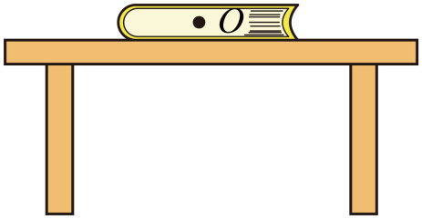

- A. 课本受到的重力和它对桌面的压力是一对平衡力
- B. 课本受到的重力和桌面对课本的支持力是一对相互作用力
- C. 课本受到的重力和地面对课桌的支持力是一对平衡力
- D. 课本对桌面的压力和桌面对课本的支持力是一对相互作用力

【答案】D

【解析】A．课本受到的重力和它对桌面的压力方向相同，不满足平衡力的条件，不是一对平衡力，故A错误；
B．课本静止，受到的重力和桌面对课本的支持力大小相等、方向相反、作用在同一直线和同一物体上，是一对平衡力，故B错误；
C．课本受到的重力和地面对课桌的支持力大小不相等，不是一对平衡力，故C错误；
D．课本对桌面的压力和桌面对课本的支持力，大小相等，方向相反，作用在同一直线上，作用在两个物体上，是一对相互作用力，故D正确。
故选D。

## 12. 单选题（难度：适中）

如图所示，一辆公交汽车在平直的公路上匀速行驶，下列说法正确的是（　　）

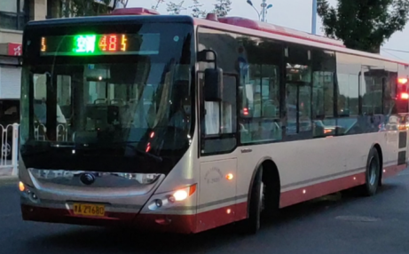

- A. 汽车轮胎上有花纹是为了减小摩擦
- B. 汽车对地面的压力和汽车受到的重力是一对平衡力
- C. 汽车受到的牵引力和汽车受到的阻力是一对相互作用力
- D. 汽车急刹车时，由于惯性，车内乘客身体会前倾

【答案】D

【解析】A．汽车轮胎上有花纹，是通过增大接触面的粗糙程度来增大摩擦的，故A错误；
B．汽车对地面的压力作用在地面上，汽车受到的重力作用在汽车上，这两个力不是作用在同一物体上，不是一对平衡力，故B错误；
C．汽车受到的牵引力和汽车受到的阻力都作用在汽车上，且汽车匀速行驶，这两个力大小相等、方向相反、作用在同一直线上，是一对平衡力，不是相互作用力，故C错误；
D．汽车急刹车时，车内乘客的下半身随着汽车一起减速，而上半身由于惯性要保持原来的运动状态继续向前运动，所以身体会前倾，故D正确。
故选D。

## 13. 单选题（难度：简单）

如图所示，电灯吊在天花板上，下列各力中属于一对平衡力的是（　　）

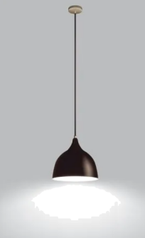

- A. 电线对灯的拉力与灯受到的重力
- B. 灯对电线的拉力与灯受到的重力
- C. 电线对灯的拉力与灯对电线的拉力
- D. 天花板对绳子的拉力与灯的重力

【答案】A

【解析】A．电线对灯的拉力方向竖直向上，灯受到的重力方向竖直向下，这两个力都作用在灯上，且大小相等、方向相反、作用在同一直线上，满足平衡力的条件，故A正确；
B．灯对电线的拉力作用在电线上，灯受到的重力作用在灯上，这两个力作用在不同的物体上，不满足平衡力作用在同一物体上的条件，故B错误；
C．电线对灯的拉力作用在灯上，灯对电线的拉力作用在电线上，这两个力是一对相互作用力，而不是平衡力，故C错误；
D．天花板对绳子的拉力作用在绳子上，灯的重力作用在灯上，这两个力作用在不同的物体上，不满足平衡力的条件，故D错误。
故选A。

## 14. 单选题（难度：简单）

如图所示是乒乓球运动员孙颖莎在“WTT重庆冠军赛”的比赛场景，下列分析正确的是（    ）

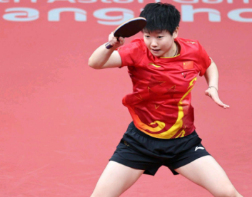

- A. 乒乓球静止在球桌上时，所受的合力不为零
- B. 球离开球拍后继续向前运动过程中，球拍对它做了功
- C. 球在空中的运动轨迹发生弯曲，说明力改变了物体的运动状态
- D. 接球时，球对球拍的作用力与球拍对球的作用力是一对平衡力

【答案】C

【解析】A．静止或匀速直线运动的物体合力为零，乒乓球静止在球桌上时，受平衡力作用，所受的合力为零，故A错误；
B．球离开球拍后继续向前运动过程中，球拍对球没有力的作用，所以球拍对球不做功，故B错误；
C．球在空中的运动过程中忽略空气阻力，只受重力作用，在重力作用下球做轨迹发生弯曲，即运动方向发生改变，说明力改变了物体的运动状态，故C正确；
D．接球时，球对球拍的作用力与球拍对球的作用力是两个物体之间的相互作用力，不是平衡力，故D错误。
故选C。

## 15. 单选题（难度：简单）

2019年春晚精彩纷呈，如图所示是武术《少林魂》的画面，演员甲站在一个由多位演员乙托起的大鼓上，下面说法正确的是（　　）

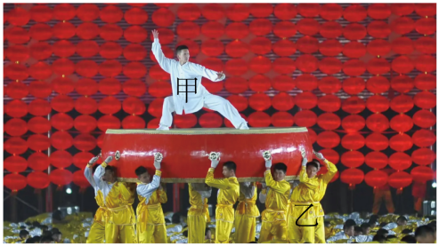

- A. 演员甲对鼓的压力和鼓对他的支持力是一对平衡力
- B. 演员甲对鼓的压力和演员乙对鼓的托力是一对平衡力
- C. 演员乙对鼓的支持力和鼓对演员乙的压力是一对平衡力
- D. 鼓对演员甲的支持力和演员甲对鼓的压力是一对相互作用力

【答案】D

【解析】A．演员甲对鼓的压力和鼓对他的支持力作用在不同物体上，不是一对平衡力，故A错误；
B．演员甲对鼓的压力和演员乙对鼓的托力大小并不相等，因此不是一对平衡力，故B错误；
C．演员乙对鼓的支持力和鼓对演员乙的压力大小相等、方向相反、作用在同一直线上、作用在不同物体上，是一对相互作用力，故C错误；
D．鼓对演员甲的支持力和演员甲对鼓的压力大小相等、方向相反、作用在同一直线上、作用在不同物体上，是一对相互作用力，故D正确。

## 16. 单选题（难度：简单）

如图所示，在做“研究滑动摩擦力大小”的实验时，将木块A放置在水平木板B上，并在木块A上加上一个砝码，把一个弹簧测力计系在木块A上。当向左拉动木板B时，弹簧测力计指针稳定在图示位置。下列说法错误的是（   ）

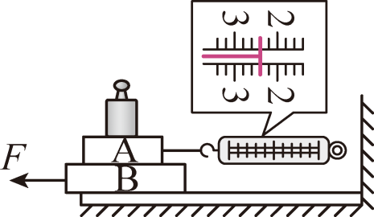

- A. 此装置可研究滑动摩擦力大小与压力的关系
- B. 木块A在水平方向受到的是一对平衡力
- C. 木块A受到木板B的摩擦力的大小为2.4N，方向向左
- D. 若增大拉动木板B的速度，则弹簧测力计的示数会变大

【答案】D

【解析】A．两物体间接触面的粗糙程度不变，在A上加减砝码可以改变物体间压力的大小，该实验装置可以探究滑动摩擦力大小与压力的关系，故A正确，不符合题意；
B．A受B的摩擦力与测力计对A的拉力是作用在同一物体上的两个力，弹簧测力计指针稳定，说明木块A处于平衡状态，所以A受到B的摩擦力与弹簧测力计对它的拉力是一对平衡力，故B正确，不符合题意；
C．由图示弹簧测力计可知，其分度值为0.2N，示数为2.4N，A处于平衡状态，由二力平衡条件可知，A受到B的滑动摩擦力f=F示=2.4N
A相对于B向右滑动，则A受到向左的滑动摩擦力，故C正确，不符合题意；
D．A、B间的摩擦力是滑动摩擦力，滑动摩擦力与物体间接触面的粗糙程度和物体间的压力有关，与物体的运动速度无关；如果增大拉动B的速度，接触面的粗糙程度、物体间的压力保持不变，物体间的滑动摩擦力不变，由力的平衡条件可知，测力计的示数不变，故D错误，符合题意。
故选D。

## 17. 单选题（难度：适中）

如图所示为潮州镇海楼上的府楼猴，下列关于府楼猴说法正确的是（　　）

【答案】A

## 18. 单选题（难度：适中）

下列各种动作，若无其他辅助，在水平地面上无法保持平衡的是（　　）

- A. 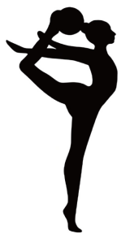
- B. 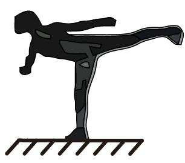
- C. 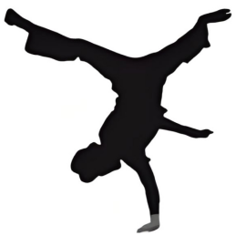

【答案】D

【解析】二力平衡的条件是：两个力的大小相等，方向相反，作用在同一直线上，作用在同一物体上。
ABC．由图可知，三种情况下，人受重力和支持力的作用，当二者共线时即可平衡，故ABC不符合题意；
D．健身者受到的重力和地面对脚的支持力作用，由图可知支持力和重力的作用线不可能在同一直线上，所以健身者在这两个力的作用下不可能平衡，故D符合题意。
故选D。

## 19. 单选题（难度：简单）

如图所示，水平桌面上的甲、乙两个物体分别在水平拉力的作用下做匀速直线运动，已知\( {G}_{\mathrm{甲}}＞{G}_{\mathrm{乙}}\)。下列说法正确的是（　　）

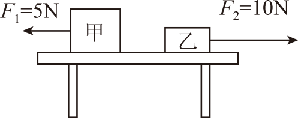

- A. 甲物体的表面更粗糙
- B. 乙物体的表面更光滑
- C. 甲物体受到的摩擦力小于乙物体受到的摩擦力
- D. 甲物体的运动速度一定小于乙物体的运动速度

【答案】C

【解析】ABC．甲、乙两物体都沿水平方向做匀速直线运动，因此所受摩擦力等于各自的拉力，故\( {f}_{\mathrm{甲}}＝5\mathrm{N}\)，\( {f}_{\mathrm{乙}}＝10\mathrm{N}\)，即\( {f}_{\mathrm{甲}}<{f}_{\mathrm{乙}}\)
滑动摩擦力大小跟压力大小和接触面粗糙程度有关，因为\( {G}_{\mathrm{甲}}>{G}_{\mathrm{乙}}\)，故甲的表面更光滑，乙物体的表面更粗糙，故AB错误，C正确；
D．滑动摩擦力的大小只与压力大小和接触面的粗糙程度有关，与物体运动的速度无关，所以仅根据题目所给信息不能判断甲、乙两物体运动速度的大小，故D错误。
故选C。

## 20. 单选题（难度：适中）

3月20日北半球进入春分节气，“春分竖蛋”已成为世界性游戏。如图所示在水平桌面上竖起的鸡蛋保持静止，下列说法正确的是（　　） 

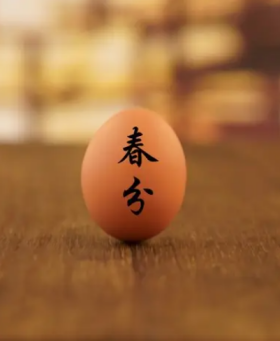

- A. 鸡蛋对桌面的压力就是鸡蛋的重力
- B. 鸡蛋所受重力和桌面对鸡蛋的支持力是相互作用力
- C. 桌面对鸡蛋的支持力和鸡蛋对桌面的压力是平衡力
- D. 鸡蛋所受重力与桌面对鸡蛋的支持力是平衡力

【答案】D

【解析】A．鸡蛋对桌面的压力是鸡蛋对桌面施加的力，其施力物体是鸡蛋，受力物体是桌面；而鸡蛋的重力是地球对鸡蛋施加的力，其施力物体是地球，受力物体是鸡蛋，这两个力是不同性质的力，故A错误；
BD．鸡蛋所受重力是竖直向下的，作用在鸡蛋上；桌面对鸡蛋的支持力是竖直向上的，也作用在鸡蛋上。这两个力在同一直线上，且大小相等、方向相反，是一对平衡力，故B错误，D正确；
C．桌面对鸡蛋的支持力和鸡蛋对桌面的压力，这两个力分别作用在鸡蛋和桌面上，是相互作用力，不是平衡力，故C错误。
故选D。

## 21. 填空题（难度：适中）

如图所示，\( {F}_{1}\)和\( {F}_{2}\)是物体所受的方向相反的两个力，图（选填“甲”“乙”或“丙”）中的两个力是平衡的。

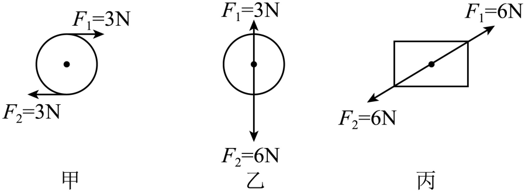

【答案】丙

## 22. （难度：适中）

如图甲所示，在郑州博物馆展台上有一静止的青铜鼎重3000N，请在图乙中画出其受力示意图。

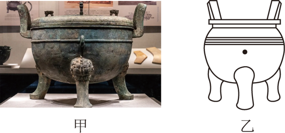

【答案】

   

## 23. 单选题（难度：简单）

如图所示，物体随着皮带轮在水平向右匀速移动。此时，物体在水平方向（　　）

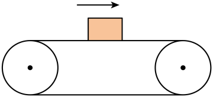

- A. 受到向右的摩擦力
- B. 不受任何力
- C. 受到向左的摩擦力
- D. 受到的是平衡力

【答案】B

【解析】物体随着传送带一起匀速向右运动，由于物体与传送带之间不存在相对运动及相对运动趋势，所以物体不会受到摩擦力。又因为处于平衡状态，在水平方向上物体不受其他力，所以水平方向物体不受任何力，故ACD不符合题意，B符合题意。
故选B。

## 24. 单选题（难度：适中）

如图所示，两个力彼此平衡的是（　　）

- A. 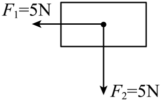
- B. 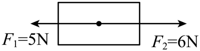
- C. 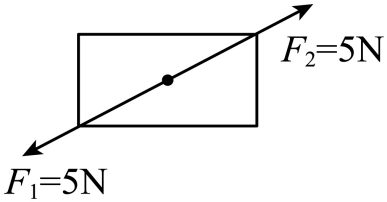
- D. 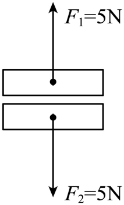

【答案】C

【解析】二力平衡的条件是：大小相等、方向相反、作用在同一直线上、作用在同一物体上。
A．图中两个力不是作用在同一直线上，不满足二力平衡条件，故A不符合题意；
B．图中两个力的大小不相等，不满足二力平衡条件，故B不符合题意；
C．图中两个力大小相等、方向相反、作用在同一直线上、作用在同一物体上，满足二力平衡条件，故C符合题意；
D．图中两个力不是作用在同一物体上，不满足二力平衡条件，故D不符合题意。
故选C。

## 25. 单选题（难度：适中）

如图所示，小红在擦黑板时，用力将黑板擦压在黑板表面竖直向上滑动，从而擦去粉笔印迹。对于这一过程的分析，下列说法正确的是（　　）

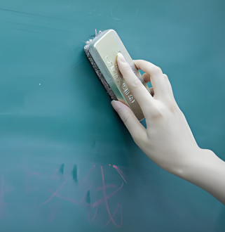

- A. 小红对黑板擦的力和黑板擦对黑板的力是一对相互作用力
- B. 黑板擦对黑板的摩擦力和黑板对黑板擦的摩擦力是一对平衡力
- C. 黑板擦对黑板的摩擦力方向竖直向上
- D. 黑板擦对黑板的压力等于黑板擦所受的重力

【答案】C

【解析】A．相互作用力是作用在两个物体之间的力，大小相等、方向相反、作用在同一直线上。小红对黑板擦的力作用在黑板擦上，黑板擦对黑板的力作用在黑板上，这两个力不是两个物体之间的力，故这两个力不是相互作用力，故A错误；
B．黑板擦对黑板的摩擦力和黑板对黑板擦的摩擦力，这两个力分别作用在黑板和黑板擦这两个不同的物体上，是一对相互作用力，而不是平衡力，故B错误；
C．黑板擦竖直向上滑动，它受到黑板给它的摩擦力方向竖直向下，根据力的作用是相互的，那么黑板擦对黑板的摩擦力方向竖直向上，故C正确；
D．小红用力将黑板擦压在黑板上，此时黑板擦对黑板的压力是由小红施加的力产生的，与黑板擦所受的重力无关，二者大小不相等，故D错误。
故选C。

## 26. （难度：适中）

如图，小明将雨伞挂在挂钩上，图中已画出挂钩对伞的支持力\( F\)的示意图，请大致画出伞所受重力的示意图。

【答案】

       

## 27. （难度：适中）

如图伊伊用10N的力沿水平面向右推一个木箱，木箱恰好以0.5m/s的速度做匀速直线运动，则木箱受到的摩擦力大小为           N，方向为            ；如果仍然在同一水平面上，让此木箱以2m/s的速度做匀速直线运动，则推力           （填“大于”“小于”或“等于”）10N。

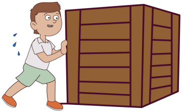

【答案】

     10     水平向左     等于

## 28. 单选题（难度：适中）

如图所示，哪个物体受到的两个力是平衡力（　　）

- A. 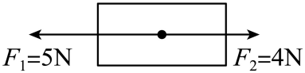
- B. 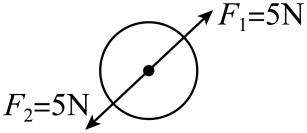
- C. 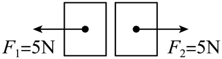
- D. 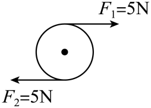

【答案】B

【解析】二力平衡的条件是：两个力作用在同一物体上，大小相等，方向相反，且作用在同一直线上。A选项中两个力大小不相等，不是一对平衡力；C选项中两个力作用在不同物体上，不是一对平衡力；D选项两个力不在同一直线上，不是一对平衡力；B选项两个力作用在同一物体上，大小相等，方向相反，且作用在同一直线上，符合二力平衡的条件，是一对平衡力。故B符合题意，ACD不符合题意。
故选B。

## 29. （难度：适中）

为探究“二力平衡的条件”，小宇和小光两位同学分别设计了如图甲和乙两种实验方案。 

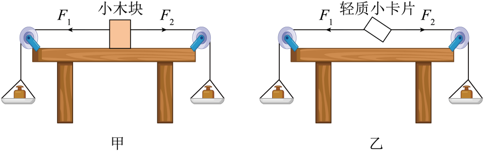

当物体处于静止状态或  状态时，它受到的力是相互平衡的。

从实验效果的角度分析，你认为选择 （选填“甲”或“乙”）实验器材更加合理，理由是：可以减小 对实验带来的影响。

在探究力的大小对二力平衡的影响时，通过调整              来改变F1和F2的大小。当两端的托盘里的砝码质量不相等时，小木块运动；当两端的托盘里的砝码质量相等时，小木块静止。这说明二力平衡时，两个力的大小          .

如图乙所示，小光把小卡片转过一个角度，然后松手，观察到小卡片转动，最后恢复到静止状态，说明两个力必须作用在              才能平衡。

【答案】匀速直线运动， 乙/  摩擦力，
     砝码总质量        相等
，

同一直线上

## 30. （难度：适中）

安徽省砀山县因酥梨而闻名，砀山酥梨酥脆爽口，入口即化，营养价值与养生价值也极高，被形象地称为“果中甘露子，药中圣醍醐”。请在图右边的点上画出酥梨的受力示意图。

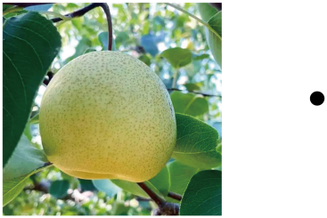

【答案】

           

## 31. 单选题（难度：简单）

下列四幅图，属于平衡力的是（　　）

- A. 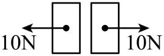
- B. 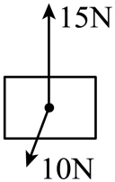
- C. 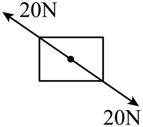
- D. 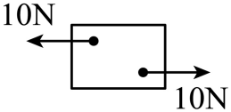

【答案】C

【解析】平衡力是大小相等、方向相反、作用在同一个物体上、作用在同一条直线上的两个力。
A．图中两个力没有作用在同一个物体上，不是平衡力，故A不符合题意；
B．图中两个力没有作用在同一条直线上，不是平衡力，故B不符合题意；
C．图中两个力符合平衡力的四个条件，是平衡力，故C符合题意；
D．图中两个力大小不相等，但不在同一条直线上，不是平衡力，故D不符合题意。
故选C。

## 32. 单选题（难度：简单）

下列情形中，松手后轻质（忽略质量）硬纸片还能保持平衡的是（　　）

- A. 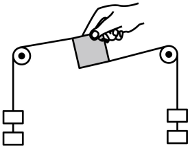
- B. 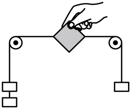
- C. 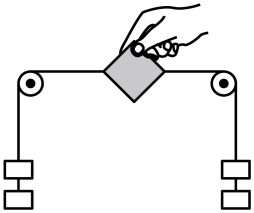
- D. 

【答案】C

【解析】A．松手后，纸片受2个力不作用在一条直线上，所以纸片会发生旋转，不能保持平衡状态，故A不符合题意；
B．松手后，纸片受2个力大小不等，所以纸片会向左移动，不能保持平衡状态，故B不符合题意；
C．松手后，纸片受2个力作用在一条直线上、大小相等、方向相反，是一对平衡力，所以纸片保持平衡状态，故C符合题意；
D．松手后，纸片受2个力不作用在一条直线上，不是一对平衡力，纸片不能保持平衡状态，故D不符合题意。
故选C。

## 33. （难度：适中）

如图所示甲是一种执拿毛笔的方法——五指执笔法，其中的毛笔竖直悬空且静止。若在图乙中以O点表示该毛笔的重心，请在图乙中画出毛笔竖直方向上所受力的示意图。

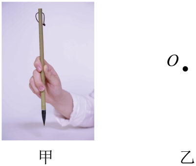
       
错误提示：操作超时

【答案】

 

     

## 34. （难度：适中）

请画出静止在水平地面上的足球的受力示意图。

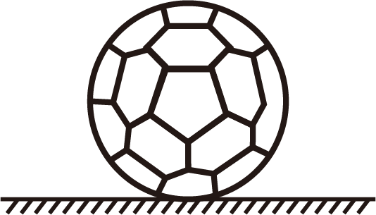

【答案】

     

## 35. 填空题（难度：适中）

在探究“二力平衡条件”的实验时：

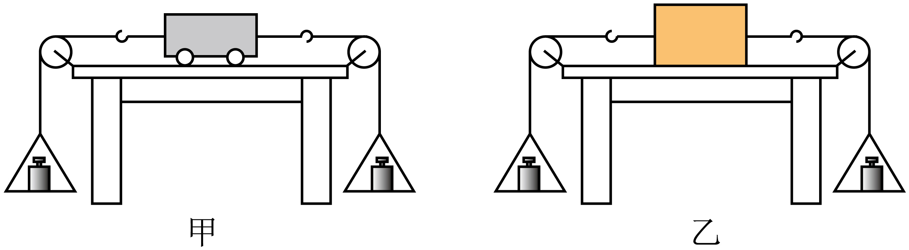

(1)小明和小亮分别采用图甲和图乙实验装置进行实验，你认为（选填“甲”或“乙”）实验装置较好些，这样做的好处是为了减小对实验的影响；
(2)左、右细线同时悬挂一个质量相等的钩码时，小车处于静止状态；改变其中一端的钩码数量，小车无法保持静止状态，由此说明一对平衡力必须。

【答案】甲，摩擦力，大小相等

## 36. 单选题（难度：简单）

如图所示，物体只受到F1和F2两个方向相反的力（F1=F2），不能使物体处于平衡状态的是（　　）

- A. 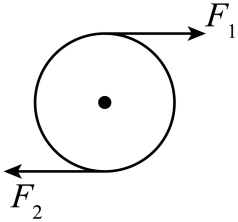
- B. 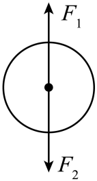
- C. 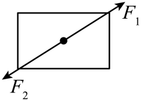
- D. 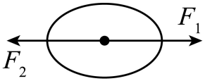

【答案】A

【解析】若物体只受到两个力的作用，且大小相等、方向相反、作用在同一直线上，则二力平衡，物体受平衡力的作用，处于平衡状态。A选项中的两个力不在同一直线上，二力不是一对平衡力，不能使物体处于平衡状态；BCD选项中的两个力均符合二力平衡条件，能使物体处于平衡状态。故A符合题意，BCD不符合题意。
故选A。

## 37. （难度：适中）

在“探究二力平衡条件”的实验中：

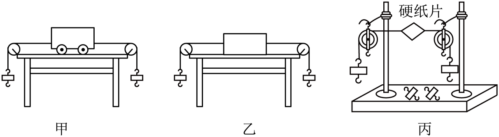

如果物体在两个力的共同作用下，处于（     ）或匀速直线运动状态，这两个力就是一对平衡力；

小明和小李分别采用如图甲、乙所示的实验装置进行实验，你认为图 （     ）（选填“甲”或“乙”）所示的实验装置较好些。这样做的好处是减小了（     ）对实验的影响；

为避免更多因素对实验的影响，两位同学最终采用了如图丙所示的实验装置。他们将细线分别系在硬纸片的两端，并跨过左右支架的滑轮，在细线的两端挂上钩码，使硬纸片两边拉力的方向（     ），通过调整 （     ）来改变拉力的大小；

当硬纸片平衡时，将硬纸片转过一定角度，松手后，硬纸片（     ）（选填“能”或“不能”）平衡。此步骤是为了验证只有作用在同一直线上的两个力才能平衡；

当小明用剪刀将处于平衡状态的硬纸片从中间剪开时，发现硬纸片分开后向相反的方向运动。这说明两个力必须作用在（     ）物体上才能平衡。

【答案】

静止状态

，

     甲     摩擦力

，

     相反     钩码个数

，

不能

，

同一

## 38. （难度：适中）

在探究“二力平衡的条件”的实验中，小帅同学采用的实验装置如图甲所示，小梅同学采用的实验装置如图乙所示，通过实验探究将下列问题填补完整： 

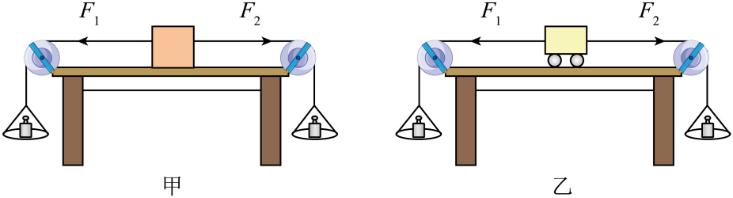

当物体处于静止状态或（     ）状态时，我们说该物体处于平衡状态。图甲中木块对桌面的压力和桌面对木块的支持力是一对 （     ）力；

如果让你在两个实验装置中选择，你认为装置 （     ）（选填“甲”或“乙”）更科学；

在装置乙中，将小车旋转一定角度，松手后，发现小车旋转后又恢复原状。这说明两个力必须作用在（     ），物体才能平衡；

小帅同学在实验时发现，若左边挂一个钩码，右边挂两个钩码时，木块仍然保持静止状态，经过讨论，同学们发现产生这一现象的原因是木块受到了摩擦力的作用，这时木块在水平方向受到的力（     ）（选填“平衡”或“不平衡”）

【答案】

     匀速直线运动    相互作用

，

乙

，

同一直线上

，

平衡

## 39. （难度：适中）

一本书静止在斜面上，此时它受到的重力和支持力（     ）（选填“是”或“不是”）一对平衡力；突然所受外力全部消失，书本会保持（     ）（选填“静止”或“匀速直线运动”）状态。

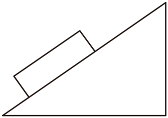

【答案】

     不是  

   静止

## 40. （难度：适中）

如图所示，物体A重30N，用50N的力F将物体A垂直压在墙上静止不动，则物体A所受的摩擦力是（     ）N；若力F减小到40N，物体A恰能匀速下滑，此时物体A受到的摩擦力大小是（     ）N；若此时力F继续减小，物体A受到的摩擦力将（     ）。

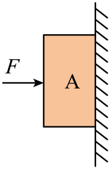

【答案】

     30     30     变小

## 41. （难度：适中）

如图所示，小镇同学用手握住重10N的水杯静止不动，此时手受到的摩擦大小为（     ）N，方向为（     ）（选填“竖直向下”或“竖直向上”）。若增大握力再次握住此水杯水杯受到的摩擦力将（     ）（选填“增大”“减小”或“不变”）。

【答案】

     10     竖直向下  

   不变

## 42. （难度：适中）

课间小明和同桌一起做游戏，游戏规则是：左脚和左侧身体紧贴墙面站立，然后右脚抬离地面，能使身体保持静止不动者获胜，如图所示为小明左侧身体紧贴墙面的示意图，你认为他抬起右脚后（     ）（选填“能”或“不能”）保持静止不动，原因是（     ）。

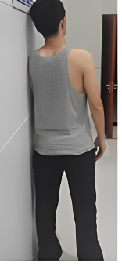

【答案】

不能       重力和支持力不在同一条直线上

## 43. （难度：适中）

如图所示，物体甲的质量为\( 0.5\text{kg}\)，乙的质量为\( 1.2\text{kg}\)。物体乙恰好水平向右做匀速直线运动，则物体乙受到的摩擦力f=（     ）N。若要使物体乙水平向左做匀速直线运动，则需要给乙施加一个水平向左F=（     ）\( \text{N}\)的力（不计绳重，绳与滑轮间的摩擦）。

【答案】

     5     10

【解析】[1]由题可知，物体乙恰好水平向右做匀速直线运动，物体乙在水平方向上受到绳子的拉力和摩擦力是一对平衡力，其大小相等，物体甲与乙用一根绳子连接在一起，所以甲受到的拉力与自身重力相等，同一根绳子上的力大小相等，因此物体乙受到的摩擦力为\( \mathrm{f}={\mathrm{F}}_{\mathrm{拉}}\text{=}{\mathrm{G}}_{\mathrm{甲}}\text{=}{\mathrm{m}}_{\mathrm{甲}}\mathrm{g}=\text{0.5kg}\times \text{10N/kg=5N}\)
[2]若要使物体乙水平向左做匀速直线运动，由于摩擦力大小与运动方向无关，故其所受到向左的拉力与向右的摩擦力和绳子的拉力之和相等，所以水平向左的拉力为\( \mathrm{F}={\mathrm{F}}_{\mathrm{拉}}+\mathrm{f}=\text{5N}+\text{5N}=\text{10N}\)

## 44. （难度：适中）

如图所示，质量为0.1kg的磁铁A紧贴在电梯壁上，随电梯一起竖直向上做匀速直线运动，则磁铁A受到的重力为（     ）N， 磁铁A受到的摩擦力为（     ）N、摩擦力的方向为竖直（     ）。（取g=10N/kg）

【答案】

     1     1     向上

【解析】[1]磁铁A质量为0.1kg，磁铁A受到的重力为\( \mathrm{G}=\mathrm{m}\mathrm{g}=0.1\mathrm{k}\mathrm{g}\times 10\mathrm{N}/\mathrm{k}\mathrm{g}=1\mathrm{N}\)
[2][3]磁铁A随电梯一起竖直向上做匀速直线运动，受力平衡，磁铁A受到的摩擦力等于重力为1N。方向与重力的方向相反，摩擦力的方向为竖直向上。

## 45. （难度：适中）

2024年4月3日，旅韩大熊猫“福宝”入住四川卧龙神树坪基地。下图是“福宝”练习爬树的情景。熊猫质量为\( 80\text{kg}\)，当“福宝”1500N的力抱着竖直的树干匀速向上爬时，“福宝”与树干之间的摩擦力方向 （     ），摩擦力大小为（     ）；“福宝”爬到较高处，静止观望，因害怕将树干抱的更紧，此时所受摩擦力大小将（     ）（变大/变小/不变）。（g＝10N/kg）

【答案】

     竖直向上     800N     不变

【解析】[1][2]当“福宝”用1500N的力抱着竖直的树干匀速向上爬时，福宝受到的摩擦力与重力为平衡力，两力的大小相等，方向相反；重力方向竖直向下，福宝所受摩擦力方向竖直向上，大小为f=G=mg=80kg×10N/kg=800N
[3]“福宝”爬到较高处，静止观望，因害怕将树干抱的更紧，此时重力和摩擦力是平衡力，大小相等，重力不变，则所受摩擦力大小不变。

## 46. （难度：适中）

如图所示为“福宝”练习爬树时的情景，当“福宝”抱着树干匀速向上爬时，“福宝”与树干之间的摩擦为 （     ）（选填“静”或“滚动”）摩擦，摩擦力方向 （     ）。

【答案】

     静    竖直向上

## 47. 单选题（难度：简单）

关于滑雪的物理知识，下列说法正确的是（   ）

- A. 滑雪板的重力和运动员对滑雪板的压力是一对平衡力
- B. 运动员能一直下滑是由于其受到的重力大于惯性
- C. 用杆撑地加速滑行，说明力可以改变物体的运动状态
- D. 若运动员在滑行过程中受到的所有外力突然消失，其滑行速度将越来越大

【答案】C

【解析】A．滑雪板的重力和运动员对滑雪板的压力方向相同，二者不是一对平衡力，故A错误；
B．惯性不是力，不能与重力比较大小，故B错误；
C．用杆撑地加速滑行，速度改变，说明力可以改变物体的运动状态，故C正确。
D．若运动员在滑行过程中受到的所有外力突然消失，由牛顿第一定律可知，运动员将做匀速直线运动，故D错误。
故选C。

## 48. 单选题（难度：适中）

中国女排运动员正在扣球时，以下说法中不正确的是（　　）

- A. 用力扣球时，排球的运动速度加快，说明力可以改变物体的运动状态
- B. 手对排球的作用力和排球对手的作用力是一对相互作用力
- C. 排球在空中飞行时，受到平衡力的作用
- D. 排球离开运动员后还能在空中飞行，是因为排球具有惯性

【答案】C

【解析】A．力的作用效果有两个：一是改变物体的形状，二是改变物体的运动状态。运动状态的改变包括物体运动速度大小的改变和运动方向的改变。 当运动员用力扣球时，排球的运动速度加快，即排球的运动状态发生了改变，这表明力可以改变物体的运动状态，故A正确，不符合题意；
B．相互作用力的特点是：大小相等、方向相反、作用在同一条直线上，且分别作用在两个不同的物体上。 手对排球施加作用力的同时，排球也会对手施加一个反作用力，这两个力满足相互作用力的特点，所以手对排球的作用力和排球对手的作用力是一对相互作用力，故B正确，不符合题意；
C．物体处于平衡状态（静止或匀速直线运动状态）时，受到的力是平衡力。 排球在空中飞行时，由于受到重力和空气阻力的作用，其运动速度和运动方向都在不断变化，即排球的运动状态在不断改变，所以排球不是处于平衡状态，也就没有受到平衡力的作用，故C错误，符合题意；
D．惯性是物体保持原来运动状态不变的性质。 排球在运动员扣球的作用下获得了一定的速度，当排球离开运动员的手后，由于排球具有惯性，它会保持原来的运动状态继续在空中飞行，故D正确，不符合题意。
故选C。

## 49. 单选题（难度：简单）

关于足球赛，下列说法正确的是（    ）

【答案】A

## 50. 多选题

如图甲所示，放在水平地面上的物体受到方向不变的水平拉力F的作用，物体\( 0\mathrm{～}3\text{s}\)静止，\( 3\mathrm{～}6\text{s}\)速度由0变为\( 1\text{m/s},6\mathrm{～}9\text{s}\)以\( \text{1m/s}\)的速度做匀速直线运动，拉力随时间变化关系如图乙所示。下列选项正确的是（　　）

- A. \( \text{0}\mathrm{～}\text{3s}\)受到的摩擦力大小为\( \text{2N}\)
- B. \( 3\mathrm{～}6\text{s}\)受到的摩擦力大小为\( \text{6N}\)
- C. \( 6\mathrm{～}9\text{s}\)受到的摩擦力大小为\( \text{4N}\)
- D. \( 6\mathrm{～}9\text{s}\)物体通过的路程\( \text{1m}\)

【答案】A/C

【解析】A．物体\( 0～3\mathrm{s}\)静止，处于平衡状态，它受到的拉力和摩擦力是一对平衡力，大小相等，由图可知，\( 0～3\mathrm{s}\)时，拉力大小为\( 2\mathrm{N}\)，所以摩擦力也为\( 2\mathrm{N}\)，故A正确；
B．物体\( 3～6\mathrm{s}\)速度由\( 0\)变为\( 1\text{m}/\text{s}\)，物体做加速运动，因滑动摩擦力的大小与接触面的粗糙程度和压力的大小有关，与物体运动的速度无关，故\( 3～6\mathrm{s}\)受到的摩擦力大小为\( 4\text{N}\)，故B错误；
C．物体\( 6～9\mathrm{s}\)以\( 1\text{m}/\text{s}\)的速度做匀速直线运动，处于平衡状态，它受到的拉力和摩擦力是一对平衡力，大小相等，所以摩擦力为\( 4\text{N}\)，故C正确；
D．根据\( s=vt\)可知，\( 6～9\mathrm{s}\)物体通过的路程为\( s=vt=1\text{m}/\text{s}\times 3\text{s=3m}\)，故D错误；
故选AC。

## 51. 多选题（难度：适中）

2025年全国室内田径大赛济南站，苏炳添男子60米决赛以6秒65夺冠，下列说法正确的是（　　）

- A. 鞋底的花纹可以增大摩擦力
- B. 静止在地面上的运动员受到了平衡力
- C. 跑步时，运动员相对于跑道是静止的
- D. 最后冲刺时很难停下来，是因为速度越大，惯性越大

【答案】A/B

【解析】A．鞋底的花纹是通过增大接触面的粗糙程度来增大摩擦力，故A正确；
B．静止在地面上的运动员，处于平衡状态，受到的重力和地面对运动员的支持力是一对平衡力，故B正确；
C．跑步时，运动员相对于跑道的位置在不断变化，是运动的，故C错误；
D．惯性的大小与物体的质量有关，与速度无关。最后冲刺时很难停下来，是因为运动员具有惯性，保持原来的运动状态，不是惯性变大，故D错误。
故选AB。

## 52. 单选题（难度：适中）

国产动画电影《哪吒之魔童闹海》于2025年春节上映，截至4月24日，该影片票房突破157亿元，位居全球电影票房榜第五位。其中有哪吒与父亲踢毽子的温馨场面，如图，下列说法正确的是（　　）

- A. 以地面为参照物，踢出去的毽子是静止的
- B. 毽子在空中飞行，毽子还受到哪吒踢的力
- C. 毽子能继续向上飞，是因为毽子具有惯性
- D. 毽子在最高点时，受到平衡力作用

【答案】C

【解析】A．以地面为参照物，踢出去的毽子相对于地面的位置发生了变化，是运动的，故A错误；
B．力是物体对物体的作用，毽子在空中飞行时不再受到哪吒踢的力，故B错误；
C．毽子能继续在空中飞，是因为毽子具有惯性，仍然要保持原来的运动状态，故C正确；
D．毽子在最高点时，只受重力的作用，即受到非平衡力作用，故D错误。
故选C。

## 53. 单选题（难度：简单）

如图，放手后纸片不能保持静止，这是为了探究二力平衡条件中两个力（　　）

- A. 是否作用在同一物体上
- B. 大小是否相等
- C. 是否作用在同一直线上
- D. 方向是否相反

【答案】C

【解析】由图可知，将卡片转动到某一位置，此时这两个力的大小相等、方向相反、作用在同一个物体上，但不在同一直线上，可见此操作是为了探究物体在平衡状态下所受的两个力是否作用在同一直线上，故C符合题意，ABD不符合题意。
故选C。

## 54. 单选题（难度：简单）

某同学利用如图所示装置探究二力平衡的条件，下列说法正确的是（　　）

- A. 小车应放在粗糙的水平桌面上
- B. 图中小车静止时，小车只受到一对平衡力的作用
- C. 将小车扭转一个角度后释放，是为了探究相互平衡的两个力是否方向相反
- D. 改变左右两盘中砝码的质量，是为了探究相互平衡的两个力是否大小相等

【答案】D

【解析】A．为减小摩擦力对实验的影响，小车应放在光滑的水平桌面上，故A错误；
B．图中小车静止时，处于平衡状态，在竖直方向上，小车受到重力和桌面的支持力，这两个力是一对平衡力；在水平方向上，小车受到左右两绳子对它的拉力，这两个力也是一对平衡力，所以小车受到两对平衡力的作用，故B错误；
C．将小车扭转一个角度后，两个拉力不在同一条直线上，释放后小车会转动，直到两个拉力在同一条直线上时小车才会静止，这个操作是为了探究相互平衡的两个力是否作用在同一条直线上，故C错误；
D．改变左右两盘中的砝码质量，左右两绳子对小车的拉力大小会发生变化。可探究平衡的两个力大小是否相等，故D正确。
故选D。

## 55. 单选题（难度：简单）

如图所示，在探究“二力平衡的条件”的实验中，小车放在水平桌面上，两端的轻质细绳绕过定滑轮挂有等量的同种钩码。\( {F}_{1}\)是小车受到的向左的拉力，\( {F}_{2}\)是小车受到的向右的拉力，\( {F}_{1}\)与\( {F}_{2}\)在同一水平直线上。下列说法正确的是（　　）

- A. 实验时小车也可以换成木块
- B. 增减钩码个数，可探究二力大小对小车平衡的影响
- C. 当\( {F}_{1}\)与\( {F}_{2}\)相等时，小车一定处于静止状态
- D. 将小车在水平方向扭转\( 90°\)后不能平衡，说明二个力平衡的条件之一是方向相反

【答案】B

【解析】A．实验时如果把小车换成木块，木块与桌面间的摩擦力较大，会对实验结果产生较大影响，而小车与桌面间是滚动摩擦，摩擦力小，更有利于探究二力平衡条件，所以不能换成木块，故A错误；
B．增减钩码个数，会改变拉力\( {F}_{1}\)和\( {F}_{2}\)的大小，这样就可以探究二力大小对小车平衡的影响，故B正确；
C．当\( {F}_{1}\)和\( {F}_{2}\)相等时，小车可能处于静止状态，也可能处于匀速直线运动状态，故C错误；
D．将小车在水平方向扭转\( 90°\)后不能平衡，说明二力平衡的条件之一是两个力在同一条直线上，故D错误；
故选B。

## 56. 单选题（难度：简单）

如图是探究二力平衡条件的实验装置，每个砝码的质量均为50g，下列关于该实验的叙述不正确的是（　　）

- A. 桌面光滑一些，更利于实验
- B. 调整托盘所放钩码个数，可改变小车受力大小
- C. 将小车扭转一定角度再释放，是研究不在同一直线上的两个力是否平衡
- D. 将小车换成弹簧测力计，两托盘内各放入1个砝码，静止时弹簧测力计示数为1牛

【答案】D

【解析】A．摩擦力与接触面粗糙程度有关，桌面光滑一些，可以使摩擦力更小，更利于实验，故A正确，不符合题意；
B．小车左右两边所受的拉力，就等于左右两边钩码的重力，调整托盘所放钩码个数，可改变小车受力大小，故B正确，不符合题意； 
C．将小车扭转一定角度再释放，观察小车能否在扭转后的位置平衡，是研究不在同一直线上的两个力是否平衡，故C正确，不符合题意； 
D．将小车换成弹簧测力计，两托盘内各放入1个砝码\( m=50\text{g=0.05kg}\)，1个钩码的重力\( G=mg=0.05\text{kg}\times 10\text{N}/\text{kg}=0.5\text{N}\)
测力计左右两边的拉力都是\( 0.5\text{N}\)，静止时弹簧测力计示数为\( 0.5\text{N}\)牛，故D错误，符合题意。
故选D。

## 57. 多选题

如图甲所示，水平地面上的一个物体受到水平推力F的作用，物体的速度v与时间t的关系如图乙所示。下列说法中正确的是（　　）

- A. 0~2s，推力小于摩擦力
- B. 2~4s，物体做变速运动
- C. 4~6s，推力等于摩擦力
- D. 0~6s，推力的大小始终不变

【答案】B/C

【解析】A．由图乙可知，0~2s，物体速度为0，没有推动，物体处于平衡状态，受到的推力与摩擦力是一对平衡力，平衡力大小相等，即推力等于摩擦力，故A错误；
B．由图乙可知，2~4s物体做加速直线运动，故B正确；
C．由图乙可知，在4~6s物体做匀速直线运动，处于平衡状态，物体受到的摩擦力与推力是一对平衡力，平衡力大小相等，即推力等于摩擦力，故C正确；
D．0~2s，物体静止，推力等于静摩擦力；物体在2~4s做加速运动，受到的摩擦力为滑动摩擦力，物体受到的推力大于滑动摩擦力；在4~6s物体做匀速直线运动，推力等于滑动摩擦力，且压力大小和接触面的粗糙程度不变，滑动摩擦力不变；所以，推力的大小是变化的，故D错误。
故选BC。

## 58. 多选题（难度：适中）

科技推动社会发展。如图为智能机器人在水平匀速向前搬运货物的情景，下列说法正确的是（　　）

- A. 货物对机器人的压力和货物受到的重力是一对平衡力
- B. 货物对机器人的压力和地面对机器人的支持力是一对相互作用力
- C. 机器人对货物的支持力和货物受到的重力是一对平衡力
- D. 机器人对货物的支持力和货物对机器人的压力是一对相互作用力

【答案】C/D

【解析】A．已知平衡力必须是同一个受力物体。货物对机器人的压力，受力物体是机器人。货物受到的重力，受力物体是货物。受力物体不同，所以不是平衡力。故A错误；
B．相互作用力必须是两个物体之间的相互作用，且大小相等、方向相反、作用在同一直线上。货物对机器人的压力，其反作用力是机器人对货物的支持力，不是地面对机器人的支持力。故B错误；
C．两个力都作用在货物上。由于货物静止或匀速运动，处于平衡状态，故力的大小相等。方向相反，在同一直线上。是一对平衡力。故C正确；
D．机器人对货物的支持力和货物对机器人的压力，作用到两个物体，大小相等、方向相反、作用在同一直线上，是作用力与反作用力关系。故D正确；
故选CD。

## 59. 单选题（难度：简单）

如图所示为“研究二力平衡条件”的实验装置，下列叙述正确的是（　　）

- A. 实验中应尽量选用粗糙的水平桌面
- B. 可用卡片代替小车，方便探究二力平衡是否需作用在同一物体上
- C. 将小车扭转一个角度，是为了探究两力是否相等
- D. 小车只受一对平衡力的作用

【答案】B

【解析】A．实验中应尽量选用光滑的水平桌面，这样可以减小摩擦力对实验的影响，使实验结果更准确，若选用粗糙的水平桌面，摩擦力会对实验产生较大干扰，故A错误；
B．用卡片代替小车，由于卡片的重力远小于钩码的拉力，卡片的重力可以忽略不计，并且可以将卡片剪成两半，方便探究二力平衡是否需作用在同一物体上，故B正确；
C．将小车扭转一个角度，是为了探究二力平衡时两个力是否在同一直线上，而不是探究两力是否相等，故C错误；
D．小车在水平方向上受到两个拉力，在竖直方向上受到重力和支持力，所以小车受到两对平衡力的作用，故D错误。
故选B。

## 60. 单选题（难度：简单）

利用如图所示的装置探究二力平衡的条件。下列说法正确的是（　　）

【答案】A

## 61. 单选题（难度：简单）

如图所示，一件神似五花肉的奇石摆件静立在水平桌面上，奇石受到两个力的作用：自身所受的重力\( {G}_{\mathrm{石}}\)、支架对它的支持力\( {F}_{\mathrm{支}}\)。支架受到三个力的作用；奇石对它的压力\( {F}_{\mathrm{压}}\)、自身所受的重力\( {G}_{\mathrm{支}}\)、水平桌面对它的支持力\( {F}_{\mathrm{桌}}\)。下列说法正确的是（    ）

- A. \( {G}_{\mathrm{石}}\)与\( {F}_{\mathrm{支}}\)是一对相互作用力
- B. \( {F}_{\mathrm{支}}\)与\( {F}_{\mathrm{压}}\)是一对平衡力
- C. \( {G}_{\mathrm{支}}\)与\( {F}_{\mathrm{桌}}\)是一对平衡力
- D. \( {F}_{\mathrm{支}}\)与\( {F}_{\mathrm{压}}\)是一对相互作用力

【答案】D

【解析】A．奇石所受的重力和支架对它的支持力，这两个力都作用在奇石这一个物体上，使奇石保持静止，是一对平衡力，不是相互作用力，故A错误；
B．支架对奇石的支持力的受力物体是奇石，奇石对支架的压力的受力物体是支架。平衡力必须作用在同一个物体上，所以这两个力不是一对平衡力，而是一对相互作用力，故B错误；
C．支架在竖直方向上受到三个力：向下的自身重力、向下的奇石对它的压力和向上的桌面对它的支持力。因为支架静止，所以受力平衡，满足\( {F}_{\mathrm{桌}}={G}_{\mathrm{支}}+{F}_{\mathrm{压}}\)
因此，\( {F}_{\mathrm{桌}}\)的大小不等于\( {G}_{\mathrm{支}}\)的大小，它们不是一对平衡力，故C错误；
D．支架对奇石的支持力和奇石对支架的压力，这两个力是支架和奇石之间的相互作用产生的，它们大小相等、方向相反、作用在同一直线上，分别作用在奇石和支架两个不同的物体上，是一对相互作用力，故D正确。
故选D。

## 62. 多选题（难度：简单）

滑板车深受小朋友们喜爱，已然成为热门的儿童运动项目。如图所示，小孩双脚稳稳地站立在滑板车上，正沿着水平地面滑行。下列说法正确的是（　　）。

- A. 滑行中，若滑板车所受的力全部消失，它将保持匀速直线运动状态
- B. 此时小孩对滑板车的压力和滑板车对小孩的支持力是相互作用力
- C. 停止蹬地后车不会立即停下来是因为车受到惯性力的作用
- D. 此时地面对滑板车的支持力和滑板车受到的重力是一对平衡力

【答案】A/B

【解析】A．一切物体在不受外力作用时，总保持静止状态或匀速直线运动状态。滑板车原本沿水平地面滑行，若所有外力消失，滑板车将以原来的速度保持匀速直线运动状态，故A正确；
B．小孩对滑板车的压力与滑板车对小孩的支持力，满足“大小相等、方向相反、作用在两个物体上、作用在同一直线上”，属于相互作用力，故B正确；
C．惯性是物体保持原有运动状态的性质，不是“力”，不能说“受到惯性力”，故C错误；
D．地面对滑板车的支持力，受力物体是滑板车，其大小等于小孩重力加滑板车重力；而滑板车受到的重力大小仅为滑板车自身的重力。两者大小不相等，不满足“平衡力”大小相等的条件，故D错误。
故选AB。

## 63. 单选题（难度：简单）

如图为研究二力平衡条件的实验装置，下列关于这个实验的叙述错误的是（　　）

- A. 为了减小摩擦，应选用尽量光滑的水平桌面
- B. 为使实验效果明显，应选用质量较大的小车
- C. 调整两边的托盘所放的钩码数量，可以改变力的大小
- D. 将小车扭转一个角度（如图乙），是为了探究物体在平衡状态下所受的两个力是否作用在同一直线上

【答案】B

【解析】A．实验中选用尽量光滑的水平桌面，可减小摩擦力对实验的干扰，使实验结论更准确，故A正确，不符合题意；
B．若选用质量较大的小车，其对桌面的压力大，摩擦力也大，会严重干扰实验，所以应选用质量较小的小车，故B错误，符合题意；
C．通过调整两边托盘所放钩码的数量，可改变左右两边拉力的大小，从而探究二力平衡时力的大小关系，故C正确，不符合题意；
D．将小车扭转一个角度（如图乙），此时两个力不在同一直线上，松手后观察小车是否会转动，以此探究物体在平衡状态下所受的两个力是否作用在同一直线上，故D正确，不符合题意。
故选B。

## 64. 多选题（难度：简单）

2025年第十五届全国运动会是历史上首次由多地区联合承办的全运会，也是香港和澳门回归祖国之后首次共同举办的全国综合性体育赛事。运动会蕴含着丰富的物理知识，如图所示，下列说法中正确的是（　　）

【答案】A

## 65. 单选题（难度：适中）

2025年世界乒乓球锦标赛男女混双决赛中，中国队以3∶0战胜对手，实现了三连冠。如图，是运动员比赛时的场景。下列说法正确的是 （　　）

- A. 静止在手中的乒乓球没有惯性
- B. 乒乓球在下落的过程中，相对于地面是运动的
- C. 乒乓球在空中运动的过程中，一直受到球拍的作用力
- D. 击球时，球拍对乒乓球的力和乒乓球对球拍的力是一对平衡力

【答案】B

【解析】A．惯性是物体的固有属性，一切物体在任何情况下都有惯性，静止在手中的乒乓球也有惯性，故A错误；
B．乒乓球在下落过程中，相对于地面的位置在不断改变，所以以地面为参照物，乒乓球是运动的，故B正确；
C．乒乓球在空中运动时，已经脱离球拍，球拍与球之间没有接触，不再受到球拍的作用力，故C错误；
D．击球时，球拍对乒乓球的力和乒乓球对球拍的力，这两个力大小相等、方向相反、作用在同一条直线上，但作用在两个不同的物体上，是一对相互作用力，而不是平衡力，故D错误。
故选B。

## 66. 单选题（难度：简单）

如图所示，为了探究相互平衡的两个力是否作用在同一物体上，下列做法正确的是（　　）

【答案】A

## 67. 单选题（难度：简单）

在学校的运动会上，同学们积极参与各项比赛，如图所示。下列说法正确的是（    ）

【答案】A

## 68. （难度：简单）

如图所示，在50N水平向右的力F作用下，重10N的物块静止在竖直墙面上，则物块受到的摩擦力大小为（　　）       A．50N  B．10N  C．60N  D．40N

## 69. 单选题（难度：简单）

利用如图所示的装置探究二力平衡的条件。下列说法错误的是（　　）

- A. 为减小摩擦，应选择尽量光滑的水平桌面
- B. 定滑轮的作用是改变拉力的方向
- C. 将小车扭转一定角度，是为了使小车受到的拉力不在同一条直线上
- D. 左右托盘中分别加入1N和\( 1.5\text{N}\)的钩码后，小车做匀速直线运动，小车水平方向所受合力为\( 0.5\text{N}\)

【答案】D

【解析】A．探究二力平衡的条件，研究小车两端受到两个拉力的关系，应减小桌面与小车间的摩擦力对实验的影响，将小车放在光滑的水平桌面上可减小小车与水平面间的摩擦力，故A正确，不符合题意；
B．实验中拉力的大小等于钩码的重力大小，实验中定滑轮的作用是改变拉力的方向，故B正确，不符合题意；
C．将小车扭转一定角度，能使小车受到的拉力不在同一条直线上，用于探究二力平衡时二力是否在同一直线上，故C正确，不符合题意；
D．小车沿桌面做匀速直线运动时，处于平衡状态，水平方向所受合力为0，故D错误，符合题意。
故选D。

## 70. 单选题（难度：适中）

一同学用水平力去推水平面上的桌子，未推动，则下列说法正确的是（　　）

- A. 因为推力小于桌子所受的摩擦阻力，所以未推动
- B. 因为推力小于桌子的重力，所以未推动
- C. 虽然桌子未推动，但推力与摩擦力大小相等
- D. 虽然桌子未推动，但推力与重力大小相等

【答案】C

【解析】AC．桌子未推动，说明桌子在水平方向受力平衡，推力和摩擦阻力是平衡力，大小相等，故A错误，C正确；
BD．推力是水平方向的力，重力是竖直方向的力，二者方向不同，无法比较大小，且桌子未推动与推力和重力的大小关系无关，故BD错误。
故选C。

## 71. 多选题（难度：适中）

嫦娥六号成功着陆在月球背面南极-艾特肯盆地预选着陆区，开启人类探测器首次在月球背面实施的样品采集任务。如图所示，探测器静止在水平月面上时，探测器所受的重力为G、对月面的压力为\( {F}_{\text{1}}\)、所受月面的支持力为\( {F}_{\text{2}}\)。下列说法正确的是（　　）

- A. \( {F}_{\text{1}}\)和\( {F}_{\text{2}}\)是一对相互作用力
- B. \( {F}_{\text{1}}\)和G是一对相互作用力
- C. \( {F}_{\text{1}}\)和\( {F}_{\text{2}}\)是一对平衡力
- D. \( {F}_{\text{2}}\)和G是一对平衡力

【答案】A/D

【解析】探测器所受的重力G的受力物体是探测器，方向竖直向下；探测器对月面的压力\( {F}_{\text{1}}\)的受力物体是月球，方向垂直水平月面向下；探测器所受月面的支持力\( {F}_{\text{2}}\)的受力物体是探测器，方向垂直水平月面向上。探测器静止，处于平衡状态，所以\( {F}_{\text{1}}\)和\( {F}_{\text{2}}\)是一对相互作用力，\( {F}_{\text{2}}\)和G是一对平衡力。故AD正确，BC错误。
故选AD。

## 72. 单选题（难度：适中）

在下列实例中，受平衡力作用的物体是（      ）

【答案】A

## 73. 单选题（难度：适中）

下面是同学们在学校进行运动时的场景，有关其原理的分析中，正确的是（　　）

【答案】A

## 74. 单选题（难度：适中）

关于力，下列说法正确的是（　　）

- A. 不接触的物体彼此间可能有力的作用
- B. 力的作用效果只与力的大小有关
- C. 物体受到的重力一定是它质量的9.8倍
- D. 物体做匀速圆周运动时受平衡力作用

【答案】A

【解析】A．不接触的物体彼此间可能有力的作用，比如树上的苹果受到地球的吸引力，故A正确；
B．力的作用效果与力的大小、力的方向、力的作用点都有关，故B错误；
C．同一个物体在地球的不同位置受力的重力是不同的，不一定总是它质量的9.8倍，故C错误；
D．物体做匀速圆周运动的物体，运动方向在不断的发生改变，受到的是非平衡力，故D错误。
故选A。

## 75. 判断题（难度：适中）

判断题：物体的速度为零时，一定处于平衡状态。(    )

- YES. 正确
- NO. 错误

【答案】NO

【解析】物体处于静止或匀速直线运动状态，我们就说物体处于平衡状态；物体速度为零时，物体不一定处于处于平衡状态，例如竖直上抛的物体上升到最高点时速度为零，但物体只受重力作用，物体受到的不是平衡力，物体不处于平衡状态，故说法错误。

## 76. 判断题（难度：适中）

判断题：用力推小车，小车没动，因为推力小于摩擦力。(      )

- YES. 正确
- NO. 错误

【答案】NO

【解析】用力推小车，小车没动，处于静止状态，因为推力和摩擦力为一对平衡力，即推力等于摩擦力，故题干说法错误。

## 77. 单选题（难度：适中）

如图所示，小物同学从蹦床向上运动过程中，以下说法中正确的是（    ）

- A. 小物同学离开蹦床后仍受向上的作用力
- B. 小物同学离开蹦床后运动状态一直改变
- C. 小物同学到达最高点时处于平衡状态
- D. 小物同学到达最高点时不具有惯性

【答案】B

【解析】A．小物同学离开蹦床后，不再与蹦床接触，蹦床的弹力消失，在不计空气阻力的情况下，此时她只受到竖直向下的重力作用，没有向上的作用力，故A错误；
B．小物同学离开蹦床后，无论是向上运动还是从最高点下落，都受到重力作用，这个力会改变她的运动状态。在上升过程中，速度不断减小；在下降过程中，速度不断增大。因此，她的运动状态一直在改变，故B正确；
C．平衡状态是指物体处于静止或匀速直线运动的状态，此时物体所受的合力为零。小物同学到达最高点时，瞬时速度为零，但仍然受到重力作用，所受合力不为零，因此不处于平衡状态，故C错误；
D．惯性是物体本身的一种属性，其大小只与物体的质量有关。任何有质量的物体在任何情况下都具有惯性。小物同学到达最高点时，虽然速度为零，但她的质量没有改变，所以仍然具有惯性，故D错误。
故选B。

## 78. （难度：简单）

有一个重1000N的物体挂在吊车的吊钩上，物体在起吊过程中受到的空气阻力为100N，并保持不变。问：

物体匀速上升时，吊车对物体的拉力是多少？

物体匀速下降时，吊车对物体的拉力又是多少？

【答案】

1100N             

，

900N

【解析】物体匀速上升时，受到向上的拉力、向下的重力和阻力，三个力平衡，故吊车对物体的拉力是\( F=G+{f}_{\mathrm{下}}=1000\mathrm{N}+100\mathrm{N}=1100\mathrm{N}\)

物体匀速下降时，受到向上的拉力、阻力和向下的重力，三个力平衡，，故吊车对物体的拉力是\( {F}^{\text{'}}=G-{f}_{\mathrm{上}}=1000\mathrm{N}-100\mathrm{N}=900\mathrm{N}\)

## 79. 单选题（难度：适中）

2024年巴黎奥运会期间，我国运动健儿用汗水和努力，让五星红旗一次次升起，这也是他们祝福祖国最好的礼物。运动会中蕴含着丰富的物理知识，如图所示下列说法错误的是（　　）

- A. 图甲中苏炳添冲过终点不能立刻停止，是受到惯性的作用
- B. 图乙中戴倩倩将标枪掷出后，标枪到达最高点时受到非平衡力的作用
- C. 图丙中马龙用球拍将乒乓球弹回，说明力能改变物体的运动状态
- D. 图丁中李发彬举着杠铃静止时，他受到的重力与地面对他的支持力不是一对平衡力

【答案】A

【解析】A．图甲中苏炳添冲过终点不能立刻停止，是因为苏炳添具有惯性，还要继续保持原来的运动状态，惯性不是力，不能说受到惯性作用，故A错误，符合题意；
B．图乙中戴倩倩将标枪掷出后，标枪到达最高点时只受重力作用，故受到非平衡力的作用，故B正确，不符合题意；
C．图丙中马龙用球拍将乒乓球弹回，方向改变，说明力能改变物体的运动状态，故C正确，不符合题意；
D．图丁中李发彬举着杠铃静止时，他受到的重力与地面对他的支持力大小不相等，所以不是一对平衡力，故D正确，不符合题意。
故选A。

## 80. 单选题（难度：适中）

如图所示是某同学参加男子4×100米接力赛的情景，下列说法正确的是（　　）

- A. 运动员加速向前，可以增大惯性
- B. 比赛过程中，匀速转弯时，运动员处于平衡状态
- C. 该同学受到的支持力和他对地面的压力是一对平衡力
- D. 运动员起跑时用力向后蹬地，说明力的作用是相互的

【答案】D

【解析】A．惯性是物体的属性，与物体的质量有关，与速度无关，运动员加速向前，质量不变，惯性不变，故A错误；
B．比赛过程中，匀速转弯时，运动方向发生改变，不处于平衡状态，故B错误；
C．该同学受到的支持力和他对地面的压力作用在不同的物体上，因此不是平衡力，故C错误；
D．运动员起跑时用力向后蹬地，给地施加向后的力，地面会给人向前的力，而使人向前运动，说明力的作用是相互的，故D正确。
故选D。

## 81. （难度：简单）

中国高铁技术世界领先，高铁总里程世界第一。如图为运行的某列“复兴号”高铁列车，它的总质量约为4.8×10⁵kg。列车在水平轨道上以100m/s的速度匀速直线行驶，所受阻力是重力的0.02倍（g取\( 10\text{N}/\text{kg}\)）。求列车匀速直线行驶时；

列车对地面的压力；

所受牵引力的大小；

【答案】

$ 4.8\times {10}^{6}\text{N}$       

，

$ 9.6\times {10}^{4}\text{N}$ 

【解析】列车的总质量约为4.8×10⁵kg，列车的重力\( G=mg=4.8\times {10}^{5}\text{kg}\times \text{10N/kg=}4.8\times {10}^{6}\text{N}\)
列车对地面的压力等于列车的重力，所以列车对地面的压力为\( F=G=4.8\times {10}^{6}\text{N}\)

列车所受阻力是重力的0.02倍，故阻力大小\( f=0.02\times 4.8\times {10}^{6}\text{N}=9.6\times {10}^{4}\text{N}\)
列车做匀速直线运动时，处于平衡状态，则牵引力和阻力是一对平衡力，故牵引力大小与阻力大小相等，即\( {F}_{\mathrm{牵}}=f=9.6\times {10}^{4}\text{N}\)

## 82. 单选题（难度：适中）

如图所示为2024珠海航展展示的国产“机器狼”，“机器狼”携带武器装备静止在水平地面上不动时，以下说法正确的是（　　）

【答案】A

## 83. （难度：简单）

如图所示，直升机在进行救援时，施救人员从飞机上通过救援绳下落，施救人员自身重力为\( 700\text{\hspace{0.17em}N}\)，匀速上升和匀速下降时人受到的空气阻力均为\( 60\text{\hspace{0.17em}N}\)。根据要求回答以下问题：

飞机吊着施救人员悬空静止时，绳对施救人员身体的拉力为多少？

飞机吊着施救人员沿竖直方向匀速上升时，绳对施救人员的拉力为多少？

飞机吊着施救人员沿竖直方向匀速下降时，绳对施救人员的拉力为多少？

【答案】

$ 700\text{\hspace{0.17em}N}$    

，

$ 760\text{\hspace{0.17em}N}$    

，

$ 640\text{\hspace{0.17em}N}$ 

【解析】施救人员悬空静止时，处于平衡状态，其受到竖直向下的重力G和竖直向上的绳子拉力F1是一对平衡力，大小相等。根据二力平衡条件可知\( {F}_{1}=G=700\mathrm{N}\)

施救人员沿竖直方向匀速上升时，处于平衡状态。对施救人员进行受力分析，其在竖直方向上受到三个力的作用，竖直向下的重力G、竖直向下的空气阻力f和竖直向上的绳子拉力F2。根据平衡条件可知，向上的力等于向下的力的合力，即\( {F}_{2}=G+f\)
代入数据得\( {F}_{2}=G+f=700\mathrm{N}+60\mathrm{N}=760\mathrm{N}\)

施救人员沿竖直方向匀速下降时，处于平衡状态。对施救人员进行受力分析，其在竖直方向上受到三个力的作用，竖直向下的重力G、竖直向上的空气阻力f和竖直向上的绳子拉力F3。根据平衡条件可知，向上的力的合力等于向下的力，即\( {F}_{3}+f=G\)
所以，绳对施救人员的拉力为\( {F}_{3}=G-f\)
代入数据得\( {F}_{3}=G-f=700\mathrm{N}-60\mathrm{N}=640\mathrm{N}\)

## 84. （难度：适中）

如图所示，静止在水平地面上的一物体，受到方向不变的水平推力F的作用后开始运动，F的大小与时间t关系和物体速度v与时间t的关系如图乙所示，第4秒末时，物体受到的摩擦力为 （      ）N；第6-9秒末，物体的运动状态为 （       ）。

【答案】

4       匀速直线运动

【解析】[1]分析乙图，物体速度v与时间t的关系图像，物体在6-9s做匀速直线运动，此时物体水平方向上受力平衡，即物体所受推力F的大小等于滑动摩擦力的大小；由F的大小与时间t关系图像，可知物体在6-9s时，\( F=4\mathrm{N}\)，故物体受到的摩擦力大小为4N。在4s末时压力和接触面粗糙程度不变，摩擦力不变，故第4秒末时，物体受到的摩擦力为4N。
[2]第6-9秒末，物体速度为2m/s，匀速直线运动

## 85. （难度：适中）

2024年12月26日，我国自主研发的六代机歼-36成功进行了首次试飞。它具有极致的隐身性能、强大的动力系统（速度可达3--6马赫）、先进的智能化作战能力、超远的作战半径等特点。能完成极小半径翻转等高难度机动动作，转向能力很强。在翻转过程中，飞机受到  （       ）（选填“平衡力”或“非平衡力”）的作用。若以飞机为参照物，飞行员是 （       ）的（选填“运动”或“静止”）。若飞机以4000km/h的速度飞行2400km，需要 （       ）min。

【答案】

非平衡力         静止        36

【解析】[1]由于翻转过程中，飞机的运动状态在发生变化，所以此时飞机受非平衡力作用。
[2]以飞机为参照物，飞行员与飞机的相对位置未变，故为静止。
[3]根据公式\( v=\frac{s}{t}\)，可以得到时间为\( t=\frac{s}{v}=\frac{2400\text{km}}{4000\text{km/h}}=0.6\text{h}=36\text{min}\)

## 86. （难度：适中）

某校科技节活动中，物理小组用以下装置探究二力平衡的条件。

阶段一：小组讨论发现，图甲装置中，即使左右钩码质量不同，木块仍静止不动，原因是木块所受（       ）力过大，干扰实验，因此最终选择图乙装置优化设计。

阶段二：用图乙装置验证力的方向条件。保持两盘钩码质量相等，将小车扭转一定角度后释放，观察到小车转动，说明平衡的两个力必须作用在（       ）上。

阶段三：用图丙装置探究两个力是否作用在同一个物体上，他将要对硬纸片进行的操作是（       ），并观察硬纸片是否仍能保持平衡。若纸片无法保持平衡，则说明二力平衡的条件之一是：两个力必须作用在同一物体上。

【答案】

摩擦

，

同一直线

，

将硬纸片剪开

【解析】由图甲可知，木块放置在桌面上，左右钩码质量不同时，木块静止不动，根据二力平衡知识可知，此时木块受到静摩擦力，摩擦力较大，导致干扰实验。

保持两盘钩码质量相等，将小车扭转一定角度后释放，此时小车受到的力不在一条直线上，观察到小车转动，则小车未处于平衡状态，由此可说明平衡的两个力必须作用在同一直线上。

用图丙装置探究两个力是否作用在同一个物体上，则需要使两个力分别作用在不同物体上，可以将硬纸片剪开，并观察硬纸片是否仍能保持平衡。

## 87. 单选题（难度：适中）

下图是体操世界杯多哈站男子体操比赛中的场景。下列说法正确的是（    ）

- A. 图-1中，自由体操运动员在空中旋转时惯性变大
- B. 图-2中，静止在吊环上的运动员受到平衡力的作用
- C. 图-3中，运动员从双杠上甩出后下落的过程中相对于地面是静止的
- D. 图-4中，单杠运动员的手上涂镁粉是为了减小摩擦

【答案】B

【解析】A．惯性的大小只与物体的质量有关，运动员在空中旋转时质量不变，惯性不变，故A错误；
B．静止在吊环上的运动员处于平衡状态，受到的重力和吊环的拉力是一对平衡力，故B正确；
C．运动员从双杠上甩出后下落的过程中，相对于地面的位置发生了变化，是运动的，故C错误；
D．单杠运动员手上涂镁粉，是通过增大接触面的粗糙程度来增大摩擦，防止打滑，故D错误。
故选B。

## 88. （难度：适中）

在“探究二力平衡条件”的实验中，小明设置的实验装置如图甲所示。

实验时，向左盘和右盘同时放入等重的砝码，这时木块保持静止，但小明在实验时发现，若向左盘和右盘同时放入不等重的砝码，木块仍然保持静止，则产生这一现象的原因是  （       ） ；

现保持\( {F}_{1}\)与\( {F}_{2}\)的大小相等，将木块换成小车，然后扭转一个角度，松手后，小车将发生转动，据此可以得出二力平衡时需要满足的一个条件是 （       ）；

在探究同一问题时，小红用小卡片设计了如图乙所示的实验装置，在图乙的基础上继续实验，为了验证只有作用在同一物体上的两个力才能平衡时，小明的操作应该是 （       ）并观察卡片能否静止。

利用如图丙所示的装置，（       ）（填“能”或“不能”）探究二力平衡的条件；

【答案】

木块与桌面间存在摩擦力

，

两个力必须在同一直线上

，

把小卡片剪成两半

，

能

## 89. （难度：适中）

如图所示，某同学站在升降电梯里，受到电梯的支持力F和重力G。当电梯从底层由静止开始向上加速时，F （       ）G；当电梯向上减速时，F（       ）G。上述两种情况（       ）（选填“是”或“不是”）平衡状态。（前两空均选填“>”“<”或“=”）

【答案】

&gt;        &lt;         不是

## 90. （难度：简单）

2022年3月5号，西昌卫星发射中心发射了长征2号运载火箭，上面有六颗02批卫星和一颗商业遥感卫星，火箭升空时，发动机喷出高速气体，从而获得向上推力，推力的施力物体是  （       ）（选填“发动机”或“高速气体”），如图所示，卫星到达预定轨道后，绕地球做圆周运动，此时卫星受  （       ）（选填“平衡力”或“非平衡力”）。

【答案】

高速气体        非平衡力

## 91. （难度：简单）

踢毽子起源于汉代，盛行于南北朝和隋唐，已有两千多年的历史。在下图所示的游戏中，毽子被踢出主要表明力可以改变物体的 （       ）。被踢出后，毽子上升到最高处时，毽子处于  （       ）（选填“平衡”或“非平衡”）状态。（不计空气阻力）

【答案】

运动状态        非平衡

## 92. （难度：适中）

如图所示，运动员将冰壶推出后，冰壶在水平冰面上向前滑行，此时冰壶受到向（       ）的摩擦力，冰壶受到的重力和冰面对冰壶的支持力是一对（       ）力。

【答案】

后        平衡

## 93. （难度：适中）

小红用竖直向上30N的力提一个质量为10kg的物体，物体静止在地面上。

     
求：(1)货物的重力G；

货物受到的支持力F支。

【答案】

(1)100N

(2)70N

【解析】物体静止在地面上，受到三个力的作用：竖直向下的重力G、竖直向上的拉力F拉以及竖直向上的支持力F支。由于物体静止，合外力为零，向上的力之和等于向下的力之和，则有\( {F}_{\mathrm{拉}}+{F}_{\mathrm{支}}=G\)，货物受到的支持力\( {F}_{\mathrm{支}}=G-{F}_{\mathrm{拉}}=100\mathrm{N}-30\mathrm{N}=70\mathrm{N}\)

## 94. （难度：适中）

如图所示，小球在竖直细绳的拉力作用下在光滑斜面上处于平衡状态。请画出小球的受力示意图。

【答案】

    

